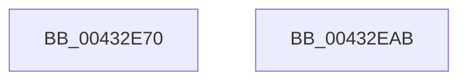

# MiInitializeLargePfnList

- RVA: `0x00432E70`–`0x00432EAC` (길이 `60` bytes)
- VA: `0x0000000140432E70`
- 실행 섹션: `.text`
- PDB 이름 있음: `예`; PDB Function 태그: `아니요`
- unwind 정보 RVA: `0x000DB714`
- 디코드: `18`개 명령, `60/60` bytes 표시
- 미해석 바이트: `0` (있으면 어셈블리에 `.byte`로 보존)

> 이 문서는 커널 이미지의 기계어와 PDB 기호를 분석해 생성했습니다. 4번과 5번은 함수 원형과 자료형을 바이너리 사용 방식에서 추정한 C 해석이며 원본 소스 복구 결과는 아닙니다.

## 1. Dependencies

- 직접 호출 지점: **0**; 고유 호출 대상: **0**
- 직접 호출자로 확인된 함수: **3**
- RIP 상대 이미지 참조: **0**

### Outgoing calls
- 직접 디코드된 call 명령이 없습니다.

### Direct callers
- [MmCreateShadowMapping](../../page/80/MmCreateShadowMapping_function_00807AB0.md) at `0x00807B22`
- [MiAllocateFastAwePages](../../page/80/MiAllocateFastAwePages_function_0080969C.md) at `0x00809764`
- [MiCreatePagingFileMap](../../page/98/MiCreatePagingFileMap_function_009852F8.md) at `0x0098537B`

### Static image references
- 디코드된 RIP-relative 메모리 참조가 없습니다.

## 2. Other-region calls and transfers

- 다른 실행 섹션으로 향하는 call: **0**
- 별도 외부 분기/꼬리 이동을 확인하지 못했습니다.

## 3. Assembly (complete function range)

```asm
00432E70  33 D2                           xor edx, edx
00432E72  48 8D 41 18                     lea rax, [rcx + 0x18]
00432E76  48 89 51 10                     mov qword ptr [rcx + 0x10], rdx
00432E7A  48 89 49 08                     mov qword ptr [rcx + 8], rcx
00432E7E  48 89 09                        mov qword ptr [rcx], rcx
00432E81  48 89 50 10                     mov qword ptr [rax + 0x10], rdx
00432E85  48 89 40 08                     mov qword ptr [rax + 8], rax
00432E89  48 89 00                        mov qword ptr [rax], rax
00432E8C  48 8D 41 30                     lea rax, [rcx + 0x30]
00432E90  48 89 50 10                     mov qword ptr [rax + 0x10], rdx
00432E94  48 89 40 08                     mov qword ptr [rax + 8], rax
00432E98  48 89 00                        mov qword ptr [rax], rax
00432E9B  48 8D 41 48                     lea rax, [rcx + 0x48]
00432E9F  48 89 50 10                     mov qword ptr [rax + 0x10], rdx
00432EA3  48 89 40 08                     mov qword ptr [rax + 8], rax
00432EA7  48 89 00                        mov qword ptr [rax], rax
00432EAA  C3                              ret
00432EAB  CC                              int3
```

## 4. C-style interpretation (structured pseudocode)

```c
__int64 __fastcall MiInitializeLargePfnList(__int64 a1, int a2)
{
    a2 = 0;
    *(unsigned __int64 *)(a1 + 16) = 0;
    *(unsigned __int64 *)(a1 + 8) = a1;
    *(unsigned __int64 *)(a1) = a1;
    *(unsigned __int64 *)(a1 + 24 + 16) = 0;
    *(unsigned __int64 *)(a1 + 24 + 8) = a1 + 24;
    *(unsigned __int64 *)(a1 + 24) = a1 + 24;
    *(unsigned __int64 *)(a1 + 48 + 16) = 0;
    *(unsigned __int64 *)(a1 + 48 + 8) = a1 + 48;
    *(unsigned __int64 *)(a1 + 48) = a1 + 48;
    *(unsigned __int64 *)(a1 + 72 + 16) = 0;
    *(unsigned __int64 *)(a1 + 72 + 8) = a1 + 72;
    *(unsigned __int64 *)(a1 + 72) = a1 + 72;
    return a1 + 72;
}
```

## 5. (Beta) C Style

```c
void *MiInitializeLargePfnList(void *Arg1, int32_t Arg2)
{
    uint8_t *arg1 = (uint8_t *)Arg1;

    Arg2 = 0;
    *(uint64_t *)(arg1 + 0x10) = 0;
    *(void **)(arg1 + 0x8) = Arg1;
    *(void **)(arg1) = Arg1;
    *(uint64_t *)(arg1 + 0x18 + 0x10) = 0;
    *(void **)(arg1 + 0x18 + 0x8) = Arg1 + 24;
    *(void **)(arg1 + 0x18) = Arg1 + 24;
    *(uint64_t *)(arg1 + 0x30 + 0x10) = 0;
    *(void **)(arg1 + 0x30 + 0x8) = Arg1 + 48;
    *(void **)(arg1 + 0x30) = Arg1 + 48;
    *(uint64_t *)(arg1 + 0x48 + 0x10) = 0;
    *(void **)(arg1 + 0x48 + 0x8) = Arg1 + 72;
    *(void **)(arg1 + 0x48) = Arg1 + 72;
    return Arg1 + 72;
}
```

### 관측된 메모리 오프셋

구조체 형식이 확인되지 않은 접근은 인자 기준의 오프셋으로만 기록했습니다.

| 기준 인자 | 오프셋 표현 | 폭 (bit) | 접근 |
|---|---:|---:|---|
| `Arg1` | `+ 0x0` | `64` | `W` |
| `Arg1` | `+ 0x8` | `64` | `W` |
| `Arg1` | `+ 0x10` | `64` | `W` |
| `Arg1` | `+ 0x18` | `64` | `R` |
| `Arg1` | `+ 0x30` | `64` | `R` |
| `Arg1` | `+ 0x48` | `64` | `R` |

## 6. Execution-region graph

[열기: 2D/3D 그래프와 함수 탐색 컨트롤 패널](../../../control-panel.html?section=text&rva=0x00432E70&view=graph)

- 2D 그래프는 위에서 아래로 흐르고, 3D 그래프는 빈 공간을 드래그해 회전합니다. Shift+드래그는 이동, 휠은 확대·축소, 함수 노드 선택은 대상 보고서 이동입니다.

### Static fallback


