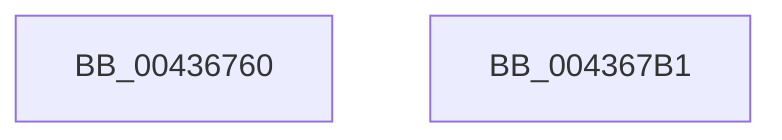

# MiInitializePoolPageChainPacket

- RVA: `0x00436760`–`0x004367B2` (길이 `82` bytes)
- VA: `0x0000000140436760`
- 실행 섹션: `.text`
- PDB 이름 있음: `예`; PDB Function 태그: `아니요`
- unwind 정보 RVA: `0x0006C9B8`
- 디코드: `19`개 명령, `82/82` bytes 표시
- 미해석 바이트: `0` (있으면 어셈블리에 `.byte`로 보존)

> 이 문서는 커널 이미지의 기계어와 PDB 기호를 분석해 생성했습니다. 4번과 5번은 함수 원형과 자료형을 바이너리 사용 방식에서 추정한 C 해석이며 원본 소스 복구 결과는 아닙니다.

## 1. Dependencies

- 직접 호출 지점: **1**; 고유 호출 대상: **1**
- 직접 호출자로 확인된 함수: **1**
- RIP 상대 이미지 참조: **2**

### Outgoing calls
- `0x004367A7` → [MiInitializePageChainPacket](MiInitializePageChainPacket_function_004367C0.md) (function, `0x004367C0`)

### Direct callers
- [MiGetPoolPages](../32/MiGetPoolPages_function_00327D3C.md) at `0x00327E73`

### Static image references
- `0x0043678F` → RVA `0x00E38480` (`.data`; read)
- `0x004367A0` → RVA `0x00E38D00` (`.data`; read)

## 2. Other-region calls and transfers

- 다른 실행 섹션으로 향하는 call: **0**
- 별도 외부 분기/꼬리 이동을 확인하지 못했습니다.

## 3. Assembly (complete function range)

```asm
00436760  48 8B C4                        mov rax, rsp
00436763  48 83 EC 78                     sub rsp, 0x78
00436767  4C 89 48 E8                     mov qword ptr [rax - 0x18], r9
0043676B  45 33 C9                        xor r9d, r9d
0043676E  4C 89 40 E0                     mov qword ptr [rax - 0x20], r8
00436772  48 83 60 D8 00                  and qword ptr [rax - 0x28], 0
00436777  C7 40 D0 09 00 00 00            mov dword ptr [rax - 0x30], 9
0043677E  48 83 60 C8 00                  and qword ptr [rax - 0x38], 0
00436783  45 8D 41 02                     lea r8d, [r9 + 2]
00436787  48 83 48 C0 FF                  or qword ptr [rax - 0x40], 0xffffffffffffffff
0043678C  89 50 B8                        mov dword ptr [rax - 0x48], edx
0043678F  48 8D 15 EA 1C A0 00            lea rdx, [rip + 0xa01cea]
00436796  C7 40 B0 01 00 00 00            mov dword ptr [rax - 0x50], 1
0043679D  89 48 A8                        mov dword ptr [rax - 0x58], ecx
004367A0  48 8D 0D 59 25 A0 00            lea rcx, [rip + 0xa02559]
004367A7  E8 14 00 00 00                  call 0x1404367c0
004367AC  48 83 C4 78                     add rsp, 0x78
004367B0  C3                              ret
004367B1  CC                              int3
```

## 4. C-style interpretation (structured pseudocode)

```c
__int64 __fastcall MiInitializePoolPageChainPacket(int a1, int a2, __int64 a3, __int64 a4)
{
    __int64 result;
    __int64 v_rsp;

    v_rsp = (v_rsp) - (120);
    *(unsigned __int64 *)(v_rsp - 24) = a4;
    a4 = 0;
    *(unsigned __int64 *)(v_rsp - 32) = a3;
    *(unsigned int *)(v_rsp - 48) = 9;
    *(unsigned int *)(v_rsp - 72) = a2;
    *(unsigned int *)(v_rsp - 80) = 1;
    *(unsigned int *)(v_rsp - 88) = a1;
    result = MiInitializePageChainPacket(v_rip + 10495321, v_rip + 10493162, a4 + 2, a4);
    v_rsp = (v_rsp) + (120);
    return result;
}
```

## 5. (Beta) C Style

```c
int64_t MiInitializePoolPageChainPacket(int32_t Arg1, int32_t Arg2, int64_t Arg3, int64_t Arg4)
{
    int64_t result;
    int64_t local_rsp;

    local_rsp = (local_rsp) - (120);
    *(uint64_t *)(local_rsp - 0x18) = Arg4;
    Arg4 = 0;
    *(uint64_t *)(local_rsp - 0x20) = Arg3;
    *(uint32_t *)(local_rsp - 0x30) = 9;
    *(uint32_t *)(local_rsp - 0x48) = Arg2;
    *(uint32_t *)(local_rsp - 0x50) = 1;
    *(uint32_t *)(local_rsp - 0x58) = Arg1;
    result = MiInitializePageChainPacket(v_rip + 10495321, v_rip + 10493162, Arg4 + 2, Arg4);
    local_rsp = (local_rsp) + (120);
    return result;
}
```

## 6. Execution-region graph

[열기: 2D/3D 그래프와 함수 탐색 컨트롤 패널](../../../control-panel.html?section=text&rva=0x00436760&view=graph)

- 2D 그래프는 위에서 아래로 흐르고, 3D 그래프는 빈 공간을 드래그해 회전합니다. Shift+드래그는 이동, 휠은 확대·축소, 함수 노드 선택은 대상 보고서 이동입니다.

### Static fallback


