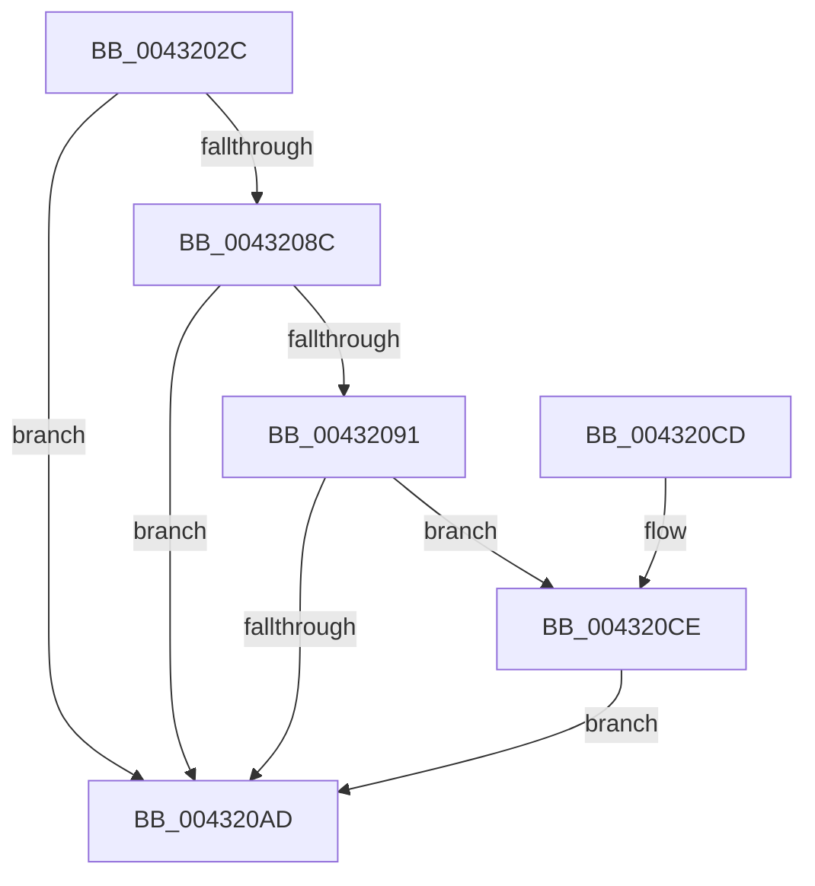

# MiInitializeSelfmap

- RVA: `0x0043202C`–`0x004320E1` (길이 `181` bytes)
- VA: `0x000000014043202C`
- 실행 섹션: `.text`
- PDB 이름 있음: `예`; PDB Function 태그: `아니요`
- unwind 정보 RVA: `0x00065624`
- 디코드: `43`개 명령, `181/181` bytes 표시
- 미해석 바이트: `0` (있으면 어셈블리에 `.byte`로 보존)

> 이 문서는 커널 이미지의 기계어와 PDB 기호를 분석해 생성했습니다. 4번과 5번은 함수 원형과 자료형을 바이너리 사용 방식에서 추정한 C 해석이며 원본 소스 복구 결과는 아닙니다.

## 1. Dependencies

- 직접 호출 지점: **4**; 고유 호출 대상: **4**
- 직접 호출자로 확인된 함수: **2**
- RIP 상대 이미지 참조: **1**

### Outgoing calls
- `0x00432049` → [MiMakeValidPte](../2C/MiMakeValidPte_function_002C5590.md) (function, `0x002C5590`)
- `0x0043205F` → [MiMapPageInHyperSpaceWorker](../33/MiMapPageInHyperSpaceWorker_function_00332B10.md) (function, `0x00332B10`)
- `0x004320BD` → [MiUnmapPageInHyperSpaceWorker](MiUnmapPageInHyperSpaceWorker_function_00432800.md) (function, `0x00432800`)
- `0x004320DA` → [MiCheckLinearProtectedPteAccessedBit](../29/MiCheckLinearProtectedPteAccessedBit_function_00292D80.md) (function, `0x00292D80`)

### Direct callers
- [MiAllocateProcessShadow](../../page/A5/MiAllocateProcessShadow_function_00A5F1A0.md) at `0x00A5F219`
- [MiAllocateTopLevelPage](../../page/A5/MiAllocateTopLevelPage_function_00A5F2EC.md) at `0x00A5F3EF`

### Static image references
- `0x0043207D` → RVA `0x00FC6A88` (`ALMOSTRO`; read)

## 2. Other-region calls and transfers

- 다른 실행 섹션으로 향하는 call: **0**
- 별도 외부 분기/꼬리 이동을 확인하지 못했습니다.

## 3. Assembly (complete function range)

```asm
0043202C  48 89 5C 24 08                  mov qword ptr [rsp + 8], rbx
00432031  57                              push rdi
00432032  48 83 EC 20                     sub rsp, 0x20
00432036  48 8B F9                        mov rdi, rcx
00432039  C6 44 24 38 00                  mov byte ptr [rsp + 0x38], 0
0043203E  48 8B D1                        mov rdx, rcx
00432041  41 B8 04 00 00 90               mov r8d, 0x90000004
00432047  33 C9                           xor ecx, ecx
00432049  E8 42 35 E9 FF                  call 0x1402c5590
0043204E  41 B8 00 00 00 80               mov r8d, 0x80000000
00432054  48 8D 54 24 38                  lea rdx, [rsp + 0x38]
00432059  48 8B CF                        mov rcx, rdi
0043205C  48 8B D8                        mov rbx, rax
0043205F  E8 AC 0A F0 FF                  call 0x140332b10
00432064  48 B9 68 DF BE 7D FB F6 FF FF   movabs rcx, 0xfffff6fb7dbedf68
0043206E  48 C1 E9 03                     shr rcx, 3
00432072  48 0F BA F3 08                  btr rbx, 8
00432077  81 E1 FF 01 00 00               and ecx, 0x1ff
0043207D  48 0F BA 25 02 4A B9 00 24      bt qword ptr [rip + 0xb94a02], 0x24
00432086  48 8D 3C C8                     lea rdi, [rax + rcx*8]
0043208A  73 21                           jae 0x1404320ad
0043208C  F6 C3 20                        test bl, 0x20
0043208F  75 1C                           jne 0x1404320ad
00432091  48 B8 00 00 00 00 80 F6 FF FF   movabs rax, 0xfffff68000000000
0043209B  48 B9 00 00 00 00 40 00 00 00   movabs rcx, 0x4000000000
004320A5  48 03 C1                        add rax, rcx
004320A8  48 3B F8                        cmp rdi, rax
004320AB  73 21                           jae 0x1404320ce
004320AD  8A 54 24 38                     mov dl, byte ptr [rsp + 0x38]
004320B1  41 B8 00 00 00 80               mov r8d, 0x80000000
004320B7  48 8B CF                        mov rcx, rdi
004320BA  48 89 1F                        mov qword ptr [rdi], rbx
004320BD  E8 3E 07 00 00                  call 0x140432800
004320C2  48 8B 5C 24 30                  mov rbx, qword ptr [rsp + 0x30]
004320C7  48 83 C4 20                     add rsp, 0x20
004320CB  5F                              pop rdi
004320CC  C3                              ret
004320CD  CC                              int3
004320CE  41 B8 80 00 00 00               mov r8d, 0x80
004320D4  48 8B D3                        mov rdx, rbx
004320D7  48 8B CF                        mov rcx, rdi
004320DA  E8 A1 0C E6 FF                  call 0x140292d80
004320DF  EB CC                           jmp 0x1404320ad
```

## 4. C-style interpretation (structured pseudocode)

```c
__int64 __fastcall MiInitializeSelfmap(__int64 a1)
{
    __int64 result;
    __int64 v_rsp;
    unsigned __int8 v_stack_p10;
    unsigned __int64 v_stack_p8;

    v_stack_p8 = v_rbx;
    v_rsp = (v_rsp) - (32);
    v_stack_p10 = 0;
    a1 = 0;
    result = MiMakeValidPte(a1, a1, (unsigned int)(0x90000004ULL), a4);
    result = MiMapPageInHyperSpaceWorker(0, v_stack_p10, (unsigned int)(0x80000000ULL), a4);
    a1 = (0) >> (3);
    a1 = (unsigned int)((a1) & (511));
    if (condition_is_above_or_equal) goto loc_004320AD;
    if ((((unsigned __int8)(result)) & (32)) != 0) goto loc_004320AD;
    result = (result) + (a1);
    if ((result + a1 * 8) >= result) goto loc_004320CE;
loc_004320AD:
    *(unsigned __int64 *)(result + a1 * 8) = result;
    result = MiUnmapPageInHyperSpaceWorker(result + a1 * 8, v_stack_p10, (unsigned int)(0x80000000ULL), a4);
    v_rsp = (v_rsp) + (32);
    return result;
loc_004320CE:
    result = MiCheckLinearProtectedPteAccessedBit(result + a1 * 8, v_stack_p8, 128, a4);
    goto loc_004320AD;
}
```

## 5. (Beta) C Style

```c
int64_t MiInitializeSelfmap(int64_t Arg1)
{
    int64_t result;
    int64_t local_rsp;
    uint8_t v_stack_p10;
    uint64_t v_stack_p8;

    v_stack_p8 = local_rbx;
    local_rsp = (local_rsp) - (32);
    v_stack_p10 = 0;
    Arg1 = 0;
    result = MiMakeValidPte(Arg1, Arg1, (uint32_t)(0x90000004ULL), a4);
    result = MiMapPageInHyperSpaceWorker(0, v_stack_p10, (uint32_t)(0x80000000ULL), a4);
    Arg1 = (0) >> (3);
    Arg1 = (uint32_t)((Arg1) & (511));
    if (condition_is_above_or_equal) goto loc_004320AD;
    if ((((uint8_t)(result)) & (32)) != 0) goto loc_004320AD;
    result = (result) + (Arg1);
    if ((result + Arg1 * 8) >= result) goto loc_004320CE;
loc_004320AD:
    *(uint64_t *)(result + Arg1 * 8) = result;
    result = MiUnmapPageInHyperSpaceWorker(result + Arg1 * 8, v_stack_p10, (uint32_t)(0x80000000ULL), a4);
    local_rsp = (local_rsp) + (32);
    return result;
loc_004320CE:
    result = MiCheckLinearProtectedPteAccessedBit(result + Arg1 * 8, v_stack_p8, 128, a4);
    goto loc_004320AD;
}
```

## 6. Execution-region graph

[열기: 2D/3D 그래프와 함수 탐색 컨트롤 패널](../../../control-panel.html?section=text&rva=0x0043202C&view=graph)

- 2D 그래프는 위에서 아래로 흐르고, 3D 그래프는 빈 공간을 드래그해 회전합니다. Shift+드래그는 이동, 휠은 확대·축소, 함수 노드 선택은 대상 보고서 이동입니다.

### Static fallback


