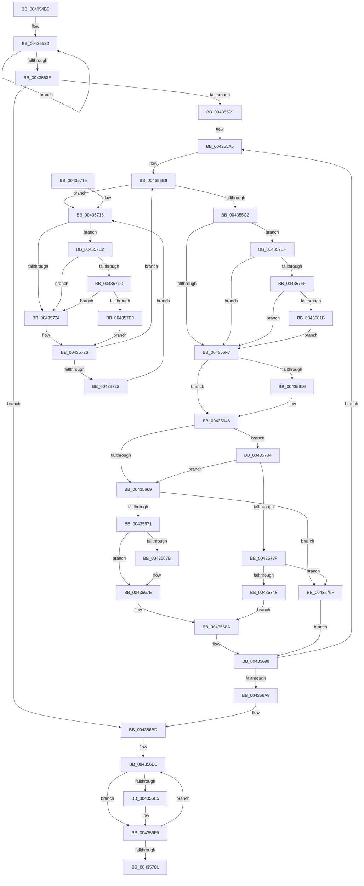

# MiInsertDemotedPages

- RVA: `0x004354B8`–`0x0043582C` (길이 `884` bytes)
- VA: `0x00000001404354B8`
- 실행 섹션: `.text`
- PDB 이름 있음: `예`; PDB Function 태그: `아니요`
- unwind 정보 RVA: `0x000A2C3C`
- 디코드: `218`개 명령, `884/884` bytes 표시
- 미해석 바이트: `0` (있으면 어셈블리에 `.byte`로 보존)

> 이 문서는 커널 이미지의 기계어와 PDB 기호를 분석해 생성했습니다. 4번과 5번은 함수 원형과 자료형을 바이너리 사용 방식에서 추정한 C 해석이며 원본 소스 복구 결과는 아닙니다.

## 1. Dependencies

- 직접 호출 지점: **7**; 고유 호출 대상: **7**
- 직접 호출자로 확인된 함수: **4**
- RIP 상대 이미지 참조: **3**

### Outgoing calls
- `0x004354E5` → [MiGetPfnPageSizeIndex](../31/MiGetPfnPageSizeIndex_function_0031C710.md) (function, `0x0031C710`)
- `0x00435653` → [MiUpdateDemotedSubPage](MiUpdateDemotedSubPage_function_00435840.md) (function, `0x00435840`)
- `0x00435685` → [MiInsertPageInFreeOrZeroedList](../33/MiInsertPageInFreeOrZeroedList_function_00334D20.md) (function, `0x00334D20`)
- `0x004357B5` → [MiInsertDemotedPages](MiInsertDemotedPages_function_004354B8.md) (function, `0x004354B8`)
- `0x004357D0` → [KiCheckVpBackingLongSpinWaitHypercall](../30/KiCheckVpBackingLongSpinWaitHypercall_function_0030F490.md) (function, `0x0030F490`)
- `0x004357E2` → [HvlNotifyLongSpinWait](../30/HvlNotifyLongSpinWait_function_0030F460.md) (function, `0x0030F460`)
- `0x004357F2` → [MiCanPfnOriginalPteBeLost](../37/MiCanPfnOriginalPteBeLost_function_00373D3C.md) (function, `0x00373D3C`)

### Direct callers
- [MiDemoteLocalLargePage](../28/MiDemoteLocalLargePage_function_0028A4F0.md) at `0x0028A80C`
- [MiDemoteLargeFreePage](MiDemoteLargeFreePage_function_00435118.md) at `0x0043526D`
- [MiInsertDemotedPages](MiInsertDemotedPages_function_004354B8.md) at `0x004357B5`
- [MiInsertPossiblyBadPage](../68/MiInsertPossiblyBadPage_function_00689DF0.md) at `0x00689F1E`

### Static image references
- `0x0043553E` → RVA `0x00011C60` (`.rdata`; read)
- `0x00435718` → RVA `0x00FC52AC` (`ALMOSTRO`; reference)
- `0x004357C2` → RVA `0x00FC6AB8` (`ALMOSTRO`; read)

## 2. Other-region calls and transfers

- 다른 실행 섹션으로 향하는 call: **0**
- 별도 외부 분기/꼬리 이동을 확인하지 못했습니다.

## 3. Assembly (complete function range)

```asm
004354B8  44 89 4C 24 20                  mov dword ptr [rsp + 0x20], r9d
004354BD  4C 89 44 24 18                  mov qword ptr [rsp + 0x18], r8
004354C2  48 89 4C 24 08                  mov qword ptr [rsp + 8], rcx
004354C7  53                              push rbx
004354C8  55                              push rbp
004354C9  56                              push rsi
004354CA  57                              push rdi
004354CB  41 54                           push r12
004354CD  41 55                           push r13
004354CF  41 56                           push r14
004354D1  41 57                           push r15
004354D3  48 83 EC 48                     sub rsp, 0x48
004354D7  48 8B D9                        mov rbx, rcx
004354DA  33 F6                           xor esi, esi
004354DC  48 8B CA                        mov rcx, rdx
004354DF  44 8B F6                        mov r14d, esi
004354E2  4C 8B FA                        mov r15, rdx
004354E5  E8 26 72 EE FF                  call 0x14031c710
004354EA  44 8B C8                        mov r9d, eax
004354ED  49 C7 C2 00 00 FF FF            mov r10, 0xffffffffffff0000
004354F4  49 8B 47 10                     mov rax, qword ptr [r15 + 0x10]
004354F8  25 E0 03 00 00                  and eax, 0x3e0
004354FD  44 89 4C 24 28                  mov dword ptr [rsp + 0x28], r9d
00435502  48 F7 D8                        neg rax
00435505  1B C0                           sbb eax, eax
00435507  F7 D8                           neg eax
00435509  FF C0                           inc eax
0043550B  41 83 F9 02                     cmp r9d, 2
0043550F  89 44 24 24                     mov dword ptr [rsp + 0x24], eax
00435513  4D 1B C0                        sbb r8, r8
00435516  41 83 E0 08                     and r8d, 8
0043551A  49 8B 84 18 58 3B 00 00         mov rax, qword ptr [r8 + rbx + 0x3b58]
00435522  48 8D 50 01                     lea rdx, [rax + 1]
00435526  48 8B C8                        mov rcx, rax
00435529  48 33 CA                        xor rcx, rdx
0043552C  49 23 CA                        and rcx, r10
0043552F  48 33 CA                        xor rcx, rdx
00435532  F0 49 0F B1 8C 18 58 3B 00 00   lock cmpxchg qword ptr [r8 + rbx + 0x3b58], rcx
0043553C  75 E4                           jne 0x140435522
0043553E  4C 8D 25 1B C7 BD FF            lea r12, [rip - 0x4238e5]
00435545  4B 8B 0C CC                     mov rcx, qword ptr [r12 + r9*8]
00435549  45 8D 41 01                     lea r8d, [r9 + 1]
0043554D  44 89 44 24 20                  mov dword ptr [rsp + 0x20], r8d
00435552  48 8D 3C 49                     lea rdi, [rcx + rcx*2]
00435556  48 C1 E7 04                     shl rdi, 4
0043555A  49 03 FF                        add rdi, r15
0043555D  48 B8 00 00 00 00 00 DE FF FF   movabs rax, 0xffffde0000000000
00435567  4F 8B 24 C4                     mov r12, qword ptr [r12 + r8*8]
0043556B  33 D2                           xor edx, edx
0043556D  48 8B EF                        mov rbp, rdi
00435570  48 2B E8                        sub rbp, rax
00435573  48 B8 AB AA AA AA AA AA AA AA   movabs rax, 0xaaaaaaaaaaaaaaab
0043557D  48 C1 FD 04                     sar rbp, 4
00435581  48 0F AF E8                     imul rbp, rax
00435585  48 8B C1                        mov rax, rcx
00435588  49 F7 F4                        div r12
0043558B  48 89 44 24 30                  mov qword ptr [rsp + 0x30], rax
00435590  48 85 C0                        test rax, rax
00435593  0F 84 24 01 00 00               je 0x1404356bd
00435599  4F 8D 2C 64                     lea r13, [r12 + r12*2]
0043559D  49 C1 E5 04                     shl r13, 4
004355A1  48 8D 5F 18                     lea rbx, [rdi + 0x18]
004355A5  48 89 7C 24 38                  mov qword ptr [rsp + 0x38], rdi
004355AA  49 2B EC                        sub rbp, r12
004355AD  49 2B FD                        sub rdi, r13
004355B0  49 2B DD                        sub rbx, r13
004355B3  45 33 DB                        xor r11d, r11d
004355B6  F0 48 0F BA 2B 3F               lock bts qword ptr [rbx], 0x3f
004355BC  0F 82 54 01 00 00               jb 0x140435716
004355C2  8B 43 08                        mov eax, dword ptr [rbx + 8]
004355C5  89 84 24 98 00 00 00            mov dword ptr [rsp + 0x98], eax
004355CC  C1 E8 18                        shr eax, 0x18
004355CF  24 F8                           and al, 0xf8
004355D1  88 84 24 9B 00 00 00            mov byte ptr [rsp + 0x9b], al
004355D8  8B 84 24 98 00 00 00            mov eax, dword ptr [rsp + 0x98]
004355DF  89 43 08                        mov dword ptr [rbx + 8], eax
004355E2  8B 43 08                        mov eax, dword ptr [rbx + 8]
004355E5  89 84 24 98 00 00 00            mov dword ptr [rsp + 0x98], eax
004355EC  C1 E8 10                        shr eax, 0x10
004355EF  A8 08                           test al, 8
004355F1  0F 85 F8 01 00 00               jne 0x1404357ef
004355F7  80 A4 24 9A 00 00 00 EF         and byte ptr [rsp + 0x9a], 0xef
004355FF  8B 84 24 98 00 00 00            mov eax, dword ptr [rsp + 0x98]
00435606  89 43 08                        mov dword ptr [rbx + 8], eax
00435609  49 8B 47 10                     mov rax, qword ptr [r15 + 0x10]
0043560D  48 89 43 F8                     mov qword ptr [rbx - 8], rax
00435611  49 3B FF                        cmp rdi, r15
00435614  74 30                           je 0x140435646
00435616  48 8B 03                        mov rax, qword ptr [rbx]
00435619  48 B9 00 00 00 00 00 00 00 C0   movabs rcx, 0xc000000000000000
00435623  48 23 C1                        and rax, rcx
00435626  48 89 03                        mov qword ptr [rbx], rax
00435629  8B 43 08                        mov eax, dword ptr [rbx + 8]
0043562C  89 84 24 98 00 00 00            mov dword ptr [rsp + 0x98], eax
00435633  66 44 89 9C 24 98 00 00 00      mov word ptr [rsp + 0x98], r11w
0043563C  8B 84 24 98 00 00 00            mov eax, dword ptr [rsp + 0x98]
00435643  89 43 08                        mov dword ptr [rbx + 8], eax
00435646  8B 74 24 20                     mov esi, dword ptr [rsp + 0x20]
0043564A  48 8B D7                        mov rdx, rdi
0043564D  44 8B C6                        mov r8d, esi
00435650  49 8B CF                        mov rcx, r15
00435653  E8 E8 01 00 00                  call 0x140435840
00435658  48 8B 8C 24 A0 00 00 00         mov rcx, qword ptr [rsp + 0xa0]
00435660  48 3B CF                        cmp rcx, rdi
00435663  0F 83 CB 00 00 00               jae 0x140435734
00435669  85 C0                           test eax, eax
0043566B  0F 85 FE 00 00 00               jne 0x14043576f
00435671  8B 43 08                        mov eax, dword ptr [rbx + 8]
00435674  C1 E8 18                        shr eax, 0x18
00435677  A8 40                           test al, 0x40
00435679  75 03                           jne 0x14043567e
0043567B  4D 03 F4                        add r14, r12
0043567E  8B 54 24 24                     mov edx, dword ptr [rsp + 0x24]
00435682  48 8B CD                        mov rcx, rbp
00435685  E8 96 F6 EF FF                  call 0x140334d20
0043568A  48 B8 FF FF FF FF FF FF FF 7F   movabs rax, 0x7fffffffffffffff
00435694  F0 48 21 03                     lock and qword ptr [rbx], rax
00435698  48 83 6C 24 30 01               sub qword ptr [rsp + 0x30], 1
0043569E  BE 00 00 00 00                  mov esi, 0
004356A3  0F 85 FC FE FF FF               jne 0x1404355a5
004356A9  44 8B 4C 24 28                  mov r9d, dword ptr [rsp + 0x28]
004356AE  49 C7 C2 00 00 FF FF            mov r10, 0xffffffffffff0000
004356B5  48 8B 9C 24 90 00 00 00         mov rbx, qword ptr [rsp + 0x90]
004356BD  41 83 F9 02                     cmp r9d, 2
004356C1  4D 1B C0                        sbb r8, r8
004356C4  41 83 E0 08                     and r8d, 8
004356C8  49 8B 84 18 58 3B 00 00         mov rax, qword ptr [r8 + rbx + 0x3b58]
004356D0  48 8D 50 FF                     lea rdx, [rax - 1]
004356D4  48 8B C8                        mov rcx, rax
004356D7  48 33 CA                        xor rcx, rdx
004356DA  49 23 CA                        and rcx, r10
004356DD  48 33 CA                        xor rcx, rdx
004356E0  66 85 C9                        test cx, cx
004356E3  75 10                           jne 0x1404356f5
004356E5  48 8D 91 00 00 01 00            lea rdx, [rcx + 0x10000]
004356EC  48 33 D1                        xor rdx, rcx
004356EF  49 23 D2                        and rdx, r10
004356F2  48 33 CA                        xor rcx, rdx
004356F5  F0 49 0F B1 8C 18 58 3B 00 00   lock cmpxchg qword ptr [r8 + rbx + 0x3b58], rcx
004356FF  75 CF                           jne 0x1404356d0
00435701  49 8B C6                        mov rax, r14
00435704  48 83 C4 48                     add rsp, 0x48
00435708  41 5F                           pop r15
0043570A  41 5E                           pop r14
0043570C  41 5D                           pop r13
0043570E  41 5C                           pop r12
00435710  5F                              pop rdi
00435711  5E                              pop rsi
00435712  5D                              pop rbp
00435713  5B                              pop rbx
00435714  C3                              ret
00435715  CC                              int3
00435716  FF C6                           inc esi
00435718  85 35 8E FB B8 00               test dword ptr [rip + 0xb8fb8e], esi
0043571E  0F 84 9E 00 00 00               je 0x1404357c2
00435724  F3 90                           pause
00435726  48 8B 03                        mov rax, qword ptr [rbx]
00435729  48 85 C0                        test rax, rax
0043572C  0F 89 84 FE FF FF               jns 0x1404355b6
00435732  EB E2                           jmp 0x140435716
00435734  48 3B 4C 24 38                  cmp rcx, qword ptr [rsp + 0x38]
00435739  0F 83 2A FF FF FF               jae 0x140435669
0043573F  39 B4 24 A8 00 00 00            cmp dword ptr [rsp + 0xa8], esi
00435746  75 27                           jne 0x14043576f
00435748  8B 43 08                        mov eax, dword ptr [rbx + 8]
0043574B  89 84 24 98 00 00 00            mov dword ptr [rsp + 0x98], eax
00435752  C1 E8 10                        shr eax, 0x10
00435755  24 FD                           and al, 0xfd
00435757  0C 05                           or al, 5
00435759  88 84 24 9A 00 00 00            mov byte ptr [rsp + 0x9a], al
00435760  8B 84 24 98 00 00 00            mov eax, dword ptr [rsp + 0x98]
00435767  89 43 08                        mov dword ptr [rbx + 8], eax
0043576A  E9 1B FF FF FF                  jmp 0x14043568a
0043576F  8B 43 08                        mov eax, dword ptr [rbx + 8]
00435772  89 84 24 98 00 00 00            mov dword ptr [rsp + 0x98], eax
00435779  C1 E8 10                        shr eax, 0x10
0043577C  24 FD                           and al, 0xfd
0043577E  0C 05                           or al, 5
00435780  88 84 24 9A 00 00 00            mov byte ptr [rsp + 0x9a], al
00435787  8B 84 24 98 00 00 00            mov eax, dword ptr [rsp + 0x98]
0043578E  89 43 08                        mov dword ptr [rbx + 8], eax
00435791  48 B8 FF FF FF FF FF FF FF 7F   movabs rax, 0x7fffffffffffffff
0043579B  F0 48 21 03                     lock and qword ptr [rbx], rax
0043579F  44 8B 8C 24 A8 00 00 00         mov r9d, dword ptr [rsp + 0xa8]
004357A7  4C 8B C1                        mov r8, rcx
004357AA  48 8B 8C 24 90 00 00 00         mov rcx, qword ptr [rsp + 0x90]
004357B2  48 8B D7                        mov rdx, rdi
004357B5  E8 FE FC FF FF                  call 0x1404354b8
004357BA  4C 03 F0                        add r14, rax
004357BD  E9 D6 FE FF FF                  jmp 0x140435698
004357C2  8B 05 F0 12 B9 00               mov eax, dword ptr [rip + 0xb912f0]
004357C8  A8 40                           test al, 0x40
004357CA  0F 84 54 FF FF FF               je 0x140435724
004357D0  E8 BB 9C ED FF                  call 0x14030f490
004357D5  45 33 DB                        xor r11d, r11d
004357D8  84 C0                           test al, al
004357DA  0F 84 44 FF FF FF               je 0x140435724
004357E0  8B CE                           mov ecx, esi
004357E2  E8 79 9C ED FF                  call 0x14030f460
004357E7  45 33 DB                        xor r11d, r11d
004357EA  E9 37 FF FF FF                  jmp 0x140435726
004357EF  48 8B CF                        mov rcx, rdi
004357F2  E8 45 E5 F3 FF                  call 0x140373d3c
004357F7  85 C0                           test eax, eax
004357F9  0F 84 F8 FD FF FF               je 0x1404355f7
004357FF  48 8B 43 F8                     mov rax, qword ptr [rbx - 8]
00435803  8A 4B 0A                        mov cl, byte ptr [rbx + 0xa]
00435806  C0 E9 04                        shr cl, 4
00435809  A8 04                           test al, 4
0043580B  F6 D1                           not cl
0043580D  0F 95 C0                        setne al
00435810  22 C8                           and cl, al
00435812  F6 C1 01                        test cl, 1
00435815  0F 84 DC FD FF FF               je 0x1404355f7
0043581B  48 8B 43 F8                     mov rax, qword ptr [rbx - 8]
0043581F  48 83 E0 FB                     and rax, 0xfffffffffffffffb
00435823  48 89 43 F8                     mov qword ptr [rbx - 8], rax
00435827  E9 CB FD FF FF                  jmp 0x1404355f7
```

## 4. C-style interpretation (structured pseudocode)

```c
__int64 __fastcall MiInsertDemotedPages(__int64 a1, __int64 a2, __int64 a3, int a4)
{
    __int64 result;
    __int64 v_r11;
    __int64 v_r13;
    __int64 v_r14;
    __int64 v_rbp;
    __int64 v_rbx;
    __int64 v_rdi;
    __int64 v_rsi;
    __int64 v_rsp;
    unsigned __int64 v_stack_m50;
    unsigned __int64 v_stack_m58;
    unsigned int v_stack_m60;
    unsigned int v_stack_m64;
    unsigned int v_stack_m68;
    unsigned int v_stack_p10;
    unsigned __int8 v_stack_p12;
    unsigned __int8 v_stack_p13;
    unsigned __int64 v_stack_p18;
    unsigned int v_stack_p20;
    unsigned __int64 v_stack_p38;
    unsigned __int64 v_stack_p8;
    unsigned __int64 v_stack_p90;
    unsigned int v_stack_p98;
    unsigned __int8 v_stack_p9A;
    unsigned int v_stack_pA8;

    v_stack_p20 = a4;
    v_stack_p18 = a3;
    v_stack_p8 = a1;
    v_rsp = (v_rsp) - (72);
    v_rsi = 0;
    result = MiGetPfnPageSizeIndex(a2, a2, a3, a4);
    result = (unsigned int)((*(unsigned __int64 *)(a2 + 16)) & (992));
    v_stack_m60 = (unsigned int)((unsigned int)((unsigned int)(result)));
    result = -(result);
    result = (unsigned int)(-(result));
    result = (unsigned int)((result) + 1);
    v_stack_m64 = (unsigned int)(result);
    a3 = (unsigned int)((a3) & (8));
loc_00435522:
    a1 = (*(unsigned __int64 *)(a3 + a1 * 1 + 15192)) ^ (*(unsigned __int64 *)(a3 + a1 * 1 + 15192) + 1);
    a1 = (a1) & (0xFFFFFFFFFFFF0000ULL);
    a1 = (a1) ^ (*(unsigned __int64 *)(a3 + a1 * 1 + 15192) + 1);
    if (condition_is_not_equal) goto loc_00435522;
    v_stack_m68 = (unsigned int)((unsigned int)((unsigned int)(result)) + 1);
    v_rdi = (*(unsigned __int64 *)(v_rip - 4339941 + (unsigned int)((unsigned int)(result)) * 8) + *(unsigned __int64 *)(v_rip - 4339941 + (unsigned int)((unsigned int)(result)) * 8) * 2) << (4);
    v_rdi = (v_rdi) + (a2);
    a2 = 0;
    v_rbp = (v_rdi) - (*(unsigned __int64 *)(a3 + a1 * 1 + 15192));
    v_rbp = (v_rbp) >> (4);
    v_rbp = (v_rbp) * (*(unsigned __int64 *)(a3 + a1 * 1 + 15192));
    v_stack_m58 = *(unsigned __int64 *)(v_rip - 4339941 + (unsigned int)((unsigned int)(result)) * 8);
    if (*(unsigned __int64 *)(v_rip - 4339941 + (unsigned int)((unsigned int)(result)) * 8) == 0) goto loc_004356BD;
    v_r13 = (*(unsigned __int64 *)(v_rip - 4339941 + (unsigned int)((unsigned int)(result)) + 1 * 8) + *(unsigned __int64 *)(v_rip - 4339941 + (unsigned int)((unsigned int)(result)) + 1 * 8) * 2) << (4);
loc_004355A5:
    v_stack_m50 = v_rdi;
    v_rbp = (v_rbp) - (*(unsigned __int64 *)(v_rip - 4339941 + (unsigned int)((unsigned int)(result)) + 1 * 8));
    v_rdi = (v_rdi) - (v_r13);
    v_rbx = (v_rdi + 24) - (v_r13);
    v_r11 = 0;
loc_004355B6:
    if (condition_is_below) goto loc_00435716;
    v_stack_p10 = (unsigned int)((unsigned int)(*(unsigned int *)(v_rbx + 8)));
    result = (unsigned int)(((unsigned int)(*(unsigned int *)(v_rbx + 8))) >> (24));
    result = (unsigned __int8)((result) & (248));
    v_stack_p13 = (unsigned __int8)(result);
    *(unsigned int *)(v_rbx + 8) = (unsigned int)((unsigned int)(v_stack_p10));
    v_stack_p10 = (unsigned int)((unsigned int)(*(unsigned int *)(v_rbx + 8)));
    result = (unsigned int)(((unsigned int)(*(unsigned int *)(v_rbx + 8))) >> (16));
    if ((((unsigned __int8)(result)) & (8)) != 0) goto loc_004357EF;
loc_004355F7:
    *(unsigned int *)(v_rbx + 8) = (unsigned int)((unsigned int)(v_stack_p10));
    *(unsigned __int64 *)(v_rbx - 8) = *(unsigned __int64 *)(a2 + 16);
    result = *(unsigned __int64 *)(a2 + 16);
    if (v_rdi != 0) {
        result = *(unsigned __int64 *)(v_rbx);
        result = (result) & (*(unsigned __int64 *)(v_rip - 4339941 + (unsigned int)((unsigned int)(result)) * 8));
        *(unsigned __int64 *)(v_rbx) = result;
        result = *(unsigned int *)(v_rbx + 8);
        v_stack_p10 = (unsigned int)(result);
        v_stack_p10 = 0;
        result = v_stack_p10;
        *(unsigned int *)(v_rbx + 8) = (unsigned int)(result);
    }
    result = MiUpdateDemotedSubPage(0, v_rdi, (unsigned int)((unsigned int)((unsigned int)(v_stack_m68))), (unsigned int)((unsigned int)(result)));
    if (v_stack_p18 >= v_rdi) goto loc_00435734;
loc_00435669:
    if ((unsigned int)(result) != 0) goto loc_0043576F;
    result = (unsigned int)(((unsigned int)(*(unsigned int *)(v_rbx + 8))) >> (24));
    v_r14 = 0;
    if ((((unsigned __int8)(result)) & (64)) == 0) {
        v_r14 = (0) + (*(unsigned __int64 *)(v_rip - 4339941 + (unsigned int)((unsigned int)(result)) + 1 * 8));
    }
    result = MiInsertPageInFreeOrZeroedList(v_rbp, (unsigned int)(v_stack_m64), (unsigned int)((unsigned int)((unsigned int)(v_stack_m68))), (unsigned int)((unsigned int)(result)));
loc_0043568A:
loc_00435698:
    if (condition_is_not_equal) goto loc_004355A5;
loc_004356BD:
    a3 = (unsigned int)(((unsigned int)((unsigned int)((unsigned int)(v_stack_m68)))) & (8));
loc_004356D0:
    a1 = (*(unsigned __int64 *)(a3 + v_stack_p8 * 1 + 15192)) ^ (*(unsigned __int64 *)(a3 + v_stack_p8 * 1 + 15192) - 1);
    a1 = (a1) & (0xFFFFFFFFFFFF0000ULL);
    a1 = (a1) ^ (*(unsigned __int64 *)(a3 + v_stack_p8 * 1 + 15192) - 1);
    if ((unsigned __int16)(a1) == 0) {
        a2 = a1 + 65536;
        a2 = (a2) ^ (a1);
        a2 = (a2) & (0xFFFFFFFFFFFF0000ULL);
        a1 = (a1) ^ (a2);
    }
    if (condition_is_not_equal) goto loc_004356D0;
    v_rsp = (v_rsp) + (72);
    return v_r14;
loc_00435716:
    v_rsi = (unsigned int)((0) + 1);
    if (((*(unsigned int *)(v_rip + 12123022)) & ((unsigned int)(v_rsi))) == 0) goto loc_004357C2;
loc_00435724:
loc_00435726:
    if (!sign_flag) goto loc_004355B6;
    goto loc_00435716;
loc_00435734:
    if (a1 >= v_stack_p38) goto loc_00435669;
    if (v_stack_pA8 != ((unsigned int)(v_rsi))) goto loc_0043576F;
    v_stack_p98 = (unsigned int)((unsigned int)(*(unsigned int *)(v_stack_p8 + 8)));
    result = (unsigned int)(((unsigned int)(*(unsigned int *)(v_stack_p8 + 8))) >> (16));
    result = (unsigned __int8)((result) & (253));
    result = (unsigned __int8)((result) | (5));
    v_stack_p9A = (unsigned __int8)(result);
    *(unsigned int *)(v_stack_p8 + 8) = (unsigned int)((unsigned int)(v_stack_p98));
    goto loc_0043568A;
loc_0043576F:
    v_stack_p98 = (unsigned int)((unsigned int)(*(unsigned int *)(v_stack_p8 + 8)));
    result = (unsigned int)(((unsigned int)(*(unsigned int *)(v_stack_p8 + 8))) >> (16));
    result = (unsigned __int8)((result) & (253));
    result = (unsigned __int8)((result) | (5));
    v_stack_p9A = (unsigned __int8)(result);
    *(unsigned int *)(v_stack_p8 + 8) = (unsigned int)((unsigned int)(v_stack_p98));
    result = MiInsertDemotedPages(v_stack_p90, v_rdi, a1, (unsigned int)(v_stack_pA8));
    v_r14 = (v_r14) + (result);
    goto loc_00435698;
loc_004357C2:
    if ((((unsigned __int8)((unsigned int)(*(unsigned int *)(v_rip + 12129008)))) & (64)) == 0) goto loc_00435724;
    result = KiCheckVpBackingLongSpinWaitHypercall(v_stack_p90, v_rdi, a1, (unsigned int)(v_stack_pA8));
    v_r11 = 0;
    if ((unsigned __int8)(result) == 0) goto loc_00435724;
    result = HvlNotifyLongSpinWait((unsigned int)((unsigned int)(v_rsi)), v_rdi, a1, (unsigned int)(v_stack_pA8));
    v_r11 = 0;
    goto loc_00435726;
loc_004357EF:
    result = MiCanPfnOriginalPteBeLost(v_rdi, v_rdi, a1, (unsigned int)(v_stack_pA8));
    if ((unsigned int)(result) == 0) goto loc_004355F7;
    a1 = (unsigned __int8)((*(unsigned __int8 *)(v_stack_p8 + 10)) >> (4));
    a1 = (unsigned __int8)(~(a1));
    result = ((((unsigned __int8)(*(unsigned __int64 *)(v_stack_p8 - 8))) & (4)) != 0) ? 1 : 0;
    a1 = (unsigned __int8)((a1) & ((unsigned __int8)(result)));
    if ((((unsigned __int8)(a1)) & (1)) == 0) goto loc_004355F7;
    result = (*(unsigned __int64 *)(v_stack_p8 - 8)) & (-5);
    *(unsigned __int64 *)(v_stack_p8 - 8) = result;
    goto loc_004355F7;
}
```

## 5. (Beta) C Style

```c
int64_t MiInsertDemotedPages(int64_t Arg1, void *Arg2, int64_t Arg3, int32_t Arg4)
{
    uint8_t *arg2 = (uint8_t *)Arg2;

    int64_t result;
    int64_t local_r11;
    int64_t local_r13;
    int64_t local_r14;
    int64_t local_rbp;
    int64_t local_rbx;
    int64_t local_rdi;
    int64_t local_rsi;
    int64_t local_rsp;
    uint64_t v_stack_m50;
    uint64_t v_stack_m58;
    uint32_t v_stack_m60;
    uint32_t v_stack_m64;
    uint32_t v_stack_m68;
    uint32_t v_stack_p10;
    uint8_t v_stack_p12;
    uint8_t v_stack_p13;
    uint64_t v_stack_p18;
    uint32_t v_stack_p20;
    uint64_t v_stack_p38;
    uint64_t v_stack_p8;
    uint64_t v_stack_p90;
    uint32_t v_stack_p98;
    uint8_t v_stack_p9A;
    uint32_t v_stack_pA8;

    v_stack_p20 = Arg4;
    v_stack_p18 = Arg3;
    v_stack_p8 = Arg1;
    local_rsp = (local_rsp) - (72);
    local_rsi = 0;
    result = MiGetPfnPageSizeIndex(Arg2, Arg2, Arg3, Arg4);
    result = (uint32_t)((*(uint64_t *)(arg2 + 0x10)) & (992));
    v_stack_m60 = (uint32_t)((uint32_t)((uint32_t)(result)));
    result = -(result);
    result = (uint32_t)(-(result));
    result = (uint32_t)((result) + 1);
    v_stack_m64 = (uint32_t)(result);
    Arg3 = (uint32_t)((Arg3) & (8));
loc_00435522:
    Arg1 = (*(uint64_t *)(Arg3 + Arg1 * 1 + 0x3B58)) ^ (*(uint64_t *)(Arg3 + Arg1 * 1 + 0x3B58) + 1);
    Arg1 = (Arg1) & (0xFFFFFFFFFFFF0000ULL);
    Arg1 = (Arg1) ^ (*(uint64_t *)(Arg3 + Arg1 * 1 + 0x3B58) + 1);
    if (condition_is_not_equal) goto loc_00435522;
    v_stack_m68 = (uint32_t)((uint32_t)((uint32_t)(result)) + 1);
    local_rdi = (*(uint64_t *)(v_rip - 0x4238E5 + (uint32_t)((uint32_t)(result)) * 8) + *(uint64_t *)(v_rip - 0x4238E5 + (uint32_t)((uint32_t)(result)) * 8) * 2) << (4);
    local_rdi = (local_rdi) + (Arg2);
    Arg2 = 0;
    local_rbp = (local_rdi) - (*(uint64_t *)(Arg3 + Arg1 * 1 + 0x3B58));
    local_rbp = (local_rbp) >> (4);
    local_rbp = (local_rbp) * (*(uint64_t *)(Arg3 + Arg1 * 1 + 0x3B58));
    v_stack_m58 = *(uint64_t *)(v_rip - 0x4238E5 + (uint32_t)((uint32_t)(result)) * 8);
    if (*(uint64_t *)(v_rip - 0x4238E5 + (uint32_t)((uint32_t)(result)) * 8) == 0) goto loc_004356BD;
    local_r13 = (*(uint64_t *)(v_rip - 0x4238E5 + (uint32_t)((uint32_t)(result)) + 0x1 * 8) + *(uint64_t *)(v_rip - 0x4238E5 + (uint32_t)((uint32_t)(result)) + 0x1 * 8) * 2) << (4);
loc_004355A5:
    v_stack_m50 = local_rdi;
    local_rbp = (local_rbp) - (*(uint64_t *)(v_rip - 0x4238E5 + (uint32_t)((uint32_t)(result)) + 0x1 * 8));
    local_rdi = (local_rdi) - (local_r13);
    local_rbx = (local_rdi + 24) - (local_r13);
    local_r11 = 0;
loc_004355B6:
    if (condition_is_below) goto loc_00435716;
    v_stack_p10 = (uint32_t)((uint32_t)(*(uint32_t *)(local_rbx + 0x8)));
    result = (uint32_t)(((uint32_t)(*(uint32_t *)(local_rbx + 0x8))) >> (24));
    result = (uint8_t)((result) & (248));
    v_stack_p13 = (uint8_t)(result);
    *(uint32_t *)(local_rbx + 0x8) = (uint32_t)((uint32_t)(v_stack_p10));
    v_stack_p10 = (uint32_t)((uint32_t)(*(uint32_t *)(local_rbx + 0x8)));
    result = (uint32_t)(((uint32_t)(*(uint32_t *)(local_rbx + 0x8))) >> (16));
    if ((((uint8_t)(result)) & (8)) != 0) goto loc_004357EF;
loc_004355F7:
    *(uint32_t *)(local_rbx + 0x8) = (uint32_t)((uint32_t)(v_stack_p10));
    *(uint64_t *)(local_rbx - 0x8) = *(uint64_t *)(arg2 + 0x10);
    result = *(uint64_t *)(arg2 + 0x10);
    if (local_rdi != 0) {
        result = *(uint64_t *)(local_rbx);
        result = (result) & (*(uint64_t *)(v_rip - 0x4238E5 + (uint32_t)((uint32_t)(result)) * 8));
        *(uint64_t *)(local_rbx) = result;
        result = *(uint32_t *)(local_rbx + 0x8);
        v_stack_p10 = (uint32_t)(result);
        v_stack_p10 = 0;
        result = v_stack_p10;
        *(uint32_t *)(local_rbx + 0x8) = (uint32_t)(result);
    }
    result = MiUpdateDemotedSubPage(0, local_rdi, (uint32_t)((uint32_t)((uint32_t)(v_stack_m68))), (uint32_t)((uint32_t)(result)));
    if (v_stack_p18 >= local_rdi) goto loc_00435734;
loc_00435669:
    if ((uint32_t)(result) != 0) goto loc_0043576F;
    result = (uint32_t)(((uint32_t)(*(uint32_t *)(local_rbx + 0x8))) >> (24));
    local_r14 = 0;
    if ((((uint8_t)(result)) & (64)) == 0) {
        local_r14 = (0) + (*(uint64_t *)(v_rip - 0x4238E5 + (uint32_t)((uint32_t)(result)) + 0x1 * 8));
    }
    result = MiInsertPageInFreeOrZeroedList(local_rbp, (uint32_t)(v_stack_m64), (uint32_t)((uint32_t)((uint32_t)(v_stack_m68))), (uint32_t)((uint32_t)(result)));
loc_0043568A:
loc_00435698:
    if (condition_is_not_equal) goto loc_004355A5;
loc_004356BD:
    Arg3 = (uint32_t)(((uint32_t)((uint32_t)((uint32_t)(v_stack_m68)))) & (8));
loc_004356D0:
    Arg1 = (*(uint64_t *)(Arg3 + v_stack_p8 * 1 + 0x3B58)) ^ (*(uint64_t *)(Arg3 + v_stack_p8 * 1 + 0x3B58) - 1);
    Arg1 = (Arg1) & (0xFFFFFFFFFFFF0000ULL);
    Arg1 = (Arg1) ^ (*(uint64_t *)(Arg3 + v_stack_p8 * 1 + 0x3B58) - 1);
    if ((uint16_t)(Arg1) == 0) {
        Arg2 = Arg1 + 65536;
        Arg2 = (Arg2) ^ (Arg1);
        Arg2 = (Arg2) & (0xFFFFFFFFFFFF0000ULL);
        Arg1 = (Arg1) ^ (Arg2);
    }
    if (condition_is_not_equal) goto loc_004356D0;
    local_rsp = (local_rsp) + (72);
    return local_r14;
loc_00435716:
    local_rsi = (uint32_t)((0) + 1);
    if (((*(uint32_t *)(v_rip + 0xB8FB8E)) & ((uint32_t)(local_rsi))) == 0) goto loc_004357C2;
loc_00435724:
loc_00435726:
    if (!sign_flag) goto loc_004355B6;
    goto loc_00435716;
loc_00435734:
    if (Arg1 >= v_stack_p38) goto loc_00435669;
    if (v_stack_pA8 != ((uint32_t)(local_rsi))) goto loc_0043576F;
    v_stack_p98 = (uint32_t)((uint32_t)(*(uint32_t *)(v_stack_p8 + 0x8)));
    result = (uint32_t)(((uint32_t)(*(uint32_t *)(v_stack_p8 + 0x8))) >> (16));
    result = (uint8_t)((result) & (253));
    result = (uint8_t)((result) | (5));
    v_stack_p9A = (uint8_t)(result);
    *(uint32_t *)(v_stack_p8 + 0x8) = (uint32_t)((uint32_t)(v_stack_p98));
    goto loc_0043568A;
loc_0043576F:
    v_stack_p98 = (uint32_t)((uint32_t)(*(uint32_t *)(v_stack_p8 + 0x8)));
    result = (uint32_t)(((uint32_t)(*(uint32_t *)(v_stack_p8 + 0x8))) >> (16));
    result = (uint8_t)((result) & (253));
    result = (uint8_t)((result) | (5));
    v_stack_p9A = (uint8_t)(result);
    *(uint32_t *)(v_stack_p8 + 0x8) = (uint32_t)((uint32_t)(v_stack_p98));
    result = MiInsertDemotedPages(v_stack_p90, local_rdi, Arg1, (uint32_t)(v_stack_pA8));
    local_r14 = (local_r14) + (result);
    goto loc_00435698;
loc_004357C2:
    if ((((uint8_t)((uint32_t)(*(uint32_t *)(v_rip + 0xB912F0)))) & (64)) == 0) goto loc_00435724;
    result = KiCheckVpBackingLongSpinWaitHypercall(v_stack_p90, local_rdi, Arg1, (uint32_t)(v_stack_pA8));
    local_r11 = 0;
    if ((uint8_t)(result) == 0) goto loc_00435724;
    result = HvlNotifyLongSpinWait((uint32_t)((uint32_t)(local_rsi)), local_rdi, Arg1, (uint32_t)(v_stack_pA8));
    local_r11 = 0;
    goto loc_00435726;
loc_004357EF:
    result = MiCanPfnOriginalPteBeLost(local_rdi, local_rdi, Arg1, (uint32_t)(v_stack_pA8));
    if ((uint32_t)(result) == 0) goto loc_004355F7;
    Arg1 = (uint8_t)((*(uint8_t *)(v_stack_p8 + 0xA)) >> (4));
    Arg1 = (uint8_t)(~(Arg1));
    result = ((((uint8_t)(*(uint64_t *)(v_stack_p8 - 0x8))) & (4)) != 0) ? 1 : 0;
    Arg1 = (uint8_t)((Arg1) & ((uint8_t)(result)));
    if ((((uint8_t)(Arg1)) & (1)) == 0) goto loc_004355F7;
    result = (*(uint64_t *)(v_stack_p8 - 0x8)) & (-5);
    *(uint64_t *)(v_stack_p8 - 0x8) = result;
    goto loc_004355F7;
}
```

### 관측된 메모리 오프셋

구조체 형식이 확인되지 않은 접근은 인자 기준의 오프셋으로만 기록했습니다.

| 기준 인자 | 오프셋 표현 | 폭 (bit) | 접근 |
|---|---:|---:|---|
| `Arg2` | `+ 0x10` | `64` | `R` |

## 6. Execution-region graph

[열기: 2D/3D 그래프와 함수 탐색 컨트롤 패널](../../../control-panel.html?section=text&rva=0x004354B8&view=graph)

- 2D 그래프는 위에서 아래로 흐르고, 3D 그래프는 빈 공간을 드래그해 회전합니다. Shift+드래그는 이동, 휠은 확대·축소, 함수 노드 선택은 대상 보고서 이동입니다.

### Static fallback


