# MiInsertHugeRangeInList

- RVA: `0x004371E8`–`0x004374B7` (길이 `719` bytes)
- VA: `0x00000001404371E8`
- 실행 섹션: `.text`
- PDB 이름 있음: `예`; PDB Function 태그: `아니요`
- unwind 정보 RVA: `0x000A3178`
- 디코드: `193`개 명령, `719/719` bytes 표시
- 미해석 바이트: `0` (있으면 어셈블리에 `.byte`로 보존)

> 이 문서는 커널 이미지의 기계어와 PDB 기호를 분석해 생성했습니다. 4번과 5번은 함수 원형과 자료형을 바이너리 사용 방식에서 추정한 C 해석이며 원본 소스 복구 결과는 아닙니다.

## 1. Dependencies

- 직접 호출 지점: **11**; 고유 호출 대상: **11**
- 직접 호출자로 확인된 함수: **9**
- RIP 상대 이미지 참조: **3**

### Outgoing calls
- `0x00437231` → [MiHugePfnPartition](MiHugePfnPartition_function_004371B4.md) (function, `0x004371B4`)
- `0x00437243` → [MiPageToNode](../33/MiPageToNode_function_00338CD0.md) (function, `0x00338CD0`)
- `0x0043724D` → [MiPageToChannel](../2B/MiPageToChannel_function_002B9B48.md) (function, `0x002B9B48`)
- `0x004372A6` → [MiMarkHugeRangeTransition](MiMarkHugeRangeTransition_function_004374C0.md) (function, `0x004374C0`)
- `0x004372FF` → [MiGetColorHeadHugeRangeBase](MiGetColorHeadHugeRangeBase_function_00437160.md) (function, `0x00437160`)
- `0x00437313` → [ExAcquireSpinLockExclusiveAtDpcLevel](../24/ExAcquireSpinLockExclusiveAtDpcLevel_function_00248E80.md) (function, `0x00248E80`)
- `0x00437324` → [MiLockColorHeadHugeAtDpc](../4F/MiLockColorHeadHugeAtDpc_function_004FAD3C.md) (function, `0x004FAD3C`)
- `0x0043735B` → [MiUpdateHugePageCounts](../67/MiUpdateHugePageCounts_function_00677530.md) (function, `0x00677530`)
- `0x004373ED` → [MiUpdateHugeRangeZeroFreeBitmap](../67/MiUpdateHugeRangeZeroFreeBitmap_function_0067759C.md) (function, `0x0067759C`)
- `0x00437488` → [MiWakePageZeroing](../2C/MiWakePageZeroing_function_002CBCC0.md) (function, `0x002CBCC0`)
- `0x00437499` → [ExReleaseSpinLockExclusiveFromDpcLevel](../24/ExReleaseSpinLockExclusiveFromDpcLevel_function_002497E0.md) (function, `0x002497E0`)

### Direct callers
- [MiHugeRangeFreeToZero](MiHugeRangeFreeToZero_function_00436A38.md) at `0x00436AEB`
- [MiAddPartitionHugeRange](../67/MiAddPartitionHugeRange_function_006750D8.md) at `0x006752E4`
- [MiDereferenceIoHugeRange](../67/MiDereferenceIoHugeRange_function_006753F8.md) at `0x00675493`
- [MiHugePurgeZeroList](../67/MiHugePurgeZeroList_function_00676124.md) at `0x00676271`
- [MiMarkHugePfnBad](../67/MiMarkHugePfnBad_function_00676744.md) at `0x00676A8A`
- [MiMarkHugePfnGood](../67/MiMarkHugePfnGood_function_00676BB0.md) at `0x00676D54`
- [MiMoveBadHugeRangeCrossPartition](../67/MiMoveBadHugeRangeCrossPartition_function_00676DD0.md) at `0x00676E99`
- [MiReleaseMemoryRuns](../67/MiReleaseMemoryRuns_function_00676EF0.md) at `0x00676FCA`
- [MiInsertHugeRangeInPartition](../69/MiInsertHugeRangeInPartition_function_00690F28.md) at `0x00690F68`

### Static image references
- `0x004371FD` → RVA `0x00E300C0` (`.data`; read)
- `0x0043726F` → RVA `0x00E2DCC0` (`.data`; read)
- `0x0043730C` → RVA `0x00E2FFD0` (`.data`; read)

## 2. Other-region calls and transfers

- 다른 실행 섹션으로 향하는 call: **0**
- 별도 외부 분기/꼬리 이동을 확인하지 못했습니다.

## 3. Assembly (complete function range)

```asm
004371E8  48 89 4C 24 08                  mov qword ptr [rsp + 8], rcx
004371ED  53                              push rbx
004371EE  55                              push rbp
004371EF  56                              push rsi
004371F0  57                              push rdi
004371F1  41 54                           push r12
004371F3  41 55                           push r13
004371F5  41 56                           push r14
004371F7  41 57                           push r15
004371F9  48 83 EC 38                     sub rsp, 0x38
004371FD  48 8B 05 BC 8E 9F 00            mov rax, qword ptr [rip + 0x9f8ebc]
00437204  48 8B F2                        mov rsi, rdx
00437207  81 E2 FF FF 3F 00               and edx, 0x3fffff
0043720D  41 8B E8                        mov ebp, r8d
00437210  48 89 54 24 20                  mov qword ptr [rsp + 0x20], rdx
00437215  48 8D 04 D0                     lea rax, [rax + rdx*8]
00437219  48 8B 38                        mov rdi, qword ptr [rax]
0043721C  48 89 84 24 88 00 00 00         mov qword ptr [rsp + 0x88], rax
00437224  48 85 C9                        test rcx, rcx
00437227  74 05                           je 0x14043722e
00437229  4C 8B E9                        mov r13, rcx
0043722C  EB 0B                           jmp 0x140437239
0043722E  48 8B C8                        mov rcx, rax
00437231  E8 7E FF FF FF                  call 0x1404371b4
00437236  4C 8B E8                        mov r13, rax
00437239  4C 8B F2                        mov r14, rdx
0043723C  49 C1 E6 12                     shl r14, 0x12
00437240  49 8B CE                        mov rcx, r14
00437243  E8 88 1A F0 FF                  call 0x140338cd0
00437248  49 8B CE                        mov rcx, r14
0043724B  8B D8                           mov ebx, eax
0043724D  E8 F6 28 E8 FF                  call 0x1402b9b48
00437252  0F B6 C8                        movzx ecx, al
00437255  33 D2                           xor edx, edx
00437257  88 84 24 90 00 00 00            mov byte ptr [rsp + 0x90], al
0043725E  83 E1 01                        and ecx, 1
00437261  49 8B C6                        mov rax, r14
00437264  44 8B FB                        mov r15d, ebx
00437267  41 83 E7 3F                     and r15d, 0x3f
0043726B  48 C1 E8 12                     shr rax, 0x12
0043726F  F7 35 4B 6A 9F 00               div dword ptr [rip + 0x9f6a4b]
00437275  41 0F BA EF 09                  bts r15d, 9
0043727A  45 03 FF                        add r15d, r15d
0043727D  0F B6 C2                        movzx eax, dl
00437280  44 0B F9                        or r15d, ecx
00437283  4C 69 C3 80 DF 00 00            imul r8, rbx, 0xdf80
0043728A  41 C1 E7 08                     shl r15d, 8
0043728E  4D 03 45 10                     add r8, qword ptr [r13 + 0x10]
00437292  44 0B F8                        or r15d, eax
00437295  4C 89 84 24 98 00 00 00         mov qword ptr [rsp + 0x98], r8
0043729D  40 F6 C5 10                     test bpl, 0x10
004372A1  75 10                           jne 0x1404372b3
004372A3  49 8B CE                        mov rcx, r14
004372A6  E8 15 02 00 00                  call 0x1404374c0
004372AB  85 C0                           test eax, eax
004372AD  0F 85 F2 01 00 00               jne 0x1404374a5
004372B3  B8 04 00 00 00                  mov eax, 4
004372B8  40 F6 C7 08                     test dil, 8
004372BC  74 05                           je 0x1404372c3
004372BE  83 E5 FC                        and ebp, 0xfffffffc
004372C1  0B E8                           or ebp, eax
004372C3  40 F6 C5 01                     test bpl, 1
004372C7  74 05                           je 0x1404372ce
004372C9  45 33 F6                        xor r14d, r14d
004372CC  EB 11                           jmp 0x1404372df
004372CE  41 BE 05 00 00 00               mov r14d, 5
004372D4  40 84 E8                        test al, bpl
004372D7  75 06                           jne 0x1404372df
004372D9  41 BE 01 00 00 00               mov r14d, 1
004372DF  44 8B E0                        mov r12d, eax
004372E2  41 8B DE                        mov ebx, r14d
004372E5  83 E3 01                        and ebx, 1
004372E8  44 23 E5                        and r12d, ebp
004372EB  48 8B AC 24 98 00 00 00         mov rbp, qword ptr [rsp + 0x98]
004372F3  45 8B C6                        mov r8d, r14d
004372F6  C1 E3 14                        shl ebx, 0x14
004372F9  48 8B CD                        mov rcx, rbp
004372FC  41 0B DF                        or ebx, r15d
004372FF  E8 5C FE FF FF                  call 0x140437160
00437304  4C 8B F8                        mov r15, rax
00437307  45 85 E4                        test r12d, r12d
0043730A  74 0E                           je 0x14043731a
0043730C  48 8D 0D BD 8C 9F 00            lea rcx, [rip + 0x9f8cbd]
00437313  E8 68 1B E1 FF                  call 0x140248e80
00437318  EB 0F                           jmp 0x140437329
0043731A  0F B6 CB                        movzx ecx, bl
0043731D  4C 8D 3C C8                     lea r15, [rax + rcx*8]
00437321  49 8B CF                        mov rcx, r15
00437324  E8 13 3A 0C 00                  call 0x1404fad3c
00437329  48 83 BC 24 80 00 00 00 00      cmp qword ptr [rsp + 0x80], 0
00437332  74 2C                           je 0x140437360
00437334  41 0F B7 4D 00                  movzx ecx, word ptr [r13]
00437339  B8 01 00 00 00                  mov eax, 1
0043733E  48 C1 E1 04                     shl rcx, 4
00437342  44 8B C8                        mov r9d, eax
00437345  48 33 F9                        xor rdi, rcx
00437348  44 8B C0                        mov r8d, eax
0043734B  48 81 E7 0F 80 FF FF            and rdi, 0xffffffffffff800f
00437352  48 8B D6                        mov rdx, rsi
00437355  48 33 F9                        xor rdi, rcx
00437358  49 8B CD                        mov rcx, r13
0043735B  E8 D0 01 24 00                  call 0x140677530
00437360  45 85 F6                        test r14d, r14d
00437363  75 0A                           jne 0x14043736f
00437365  48 83 E7 F9                     and rdi, 0xfffffffffffffff9
00437369  48 83 CF 01                     or rdi, 1
0043736D  EB 18                           jmp 0x140437387
0043736F  41 83 FE 01                     cmp r14d, 1
00437373  75 0A                           jne 0x14043737f
00437375  48 83 E7 FA                     and rdi, 0xfffffffffffffffa
00437379  48 83 CF 02                     or rdi, 2
0043737D  EB 08                           jmp 0x140437387
0043737F  48 83 E7 FC                     and rdi, 0xfffffffffffffffc
00437383  48 83 CF 04                     or rdi, 4
00437387  49 8B 0F                        mov rcx, qword ptr [r15]
0043738A  48 8B D7                        mov rdx, rdi
0043738D  4C 8B D1                        mov r10, rcx
00437390  41 B8 FF 7F 00 00               mov r8d, 0x7fff
00437396  49 C1 EA 0F                     shr r10, 0xf
0043739A  49 23 D0                        and rdx, r8
0043739D  41 81 E2 FF FF 3F 00            and r10d, 0x3fffff
004373A4  75 4E                           jne 0x1404373f4
004373A6  48 8B 94 24 88 00 00 00         mov rdx, qword ptr [rsp + 0x88]
004373AE  48 8B C7                        mov rax, rdi
004373B1  4C 8B 5C 24 20                  mov r11, qword ptr [rsp + 0x20]
004373B6  49 23 C0                        and rax, r8
004373B9  49 C1 E3 16                     shl r11, 0x16
004373BD  40 80 E7 07                     and dil, 7
004373C1  4C 0B 5C 24 20                  or r11, qword ptr [rsp + 0x20]
004373C6  49 C1 E3 0F                     shl r11, 0xf
004373CA  48 89 02                        mov qword ptr [rdx], rax
004373CD  48 B8 FF 7F 00 00 00 00 00 F8   movabs rax, 0xf800000000007fff
004373D7  48 23 C8                        and rcx, rax
004373DA  4C 0B D9                        or r11, rcx
004373DD  40 80 FF 04                     cmp dil, 4
004373E1  74 6C                           je 0x14043744f
004373E3  45 8D 4A 01                     lea r9d, [r10 + 1]
004373E7  44 8B C3                        mov r8d, ebx
004373EA  48 8B CD                        mov rcx, rbp
004373ED  E8 AA 01 24 00                  call 0x14067759c
004373F2  EB 5B                           jmp 0x14043744f
004373F4  4C 8B C6                        mov r8, rsi
004373F7  49 8B C2                        mov rax, r10
004373FA  48 C1 E0 0F                     shl rax, 0xf
004373FE  48 0B C2                        or rax, rdx
00437401  49 C1 E0 25                     shl r8, 0x25
00437405  48 8B 94 24 88 00 00 00         mov rdx, qword ptr [rsp + 0x88]
0043740D  48 C1 E6 0F                     shl rsi, 0xf
00437411  4C 8B DE                        mov r11, rsi
00437414  4C 33 D9                        xor r11, rcx
00437417  48 89 02                        mov qword ptr [rdx], rax
0043741A  49 8B D0                        mov rdx, r8
0043741D  4C 8B 0D 9C 8C 9F 00            mov r9, qword ptr [rip + 0x9f8c9c]
00437424  4B 8B 04 D1                     mov rax, qword ptr [r9 + r10*8]
00437428  48 33 D0                        xor rdx, rax
0043742B  48 B8 FF FF FF FF 1F 00 00 F8   movabs rax, 0xf800001fffffffff
00437435  48 23 D0                        and rdx, rax
00437438  48 B8 FF 7F 00 00 E0 FF FF FF   movabs rax, 0xffffffe000007fff
00437442  49 33 D0                        xor rdx, r8
00437445  4C 23 D8                        and r11, rax
00437448  4C 33 DE                        xor r11, rsi
0043744B  4B 89 14 D1                     mov qword ptr [r9 + r10*8], rdx
0043744F  4D 89 1F                        mov qword ptr [r15], r11
00437452  41 83 FE 05                     cmp r14d, 5
00437456  74 35                           je 0x14043748d
00437458  0F B6 84 24 90 00 00 00         movzx eax, byte ptr [rsp + 0x90]
00437460  41 8B CE                        mov ecx, r14d
00437463  4C 8D 04 48                     lea r8, [rax + rcx*2]
00437467  F0 4A FF 84 C5 98 3A 00 00      lock inc qword ptr [rbp + r8*8 + 0x3a98]
00437470  F0 49 FF 85 18 41 00 00         lock inc qword ptr [r13 + 0x4118]
00437478  41 83 FE 01                     cmp r14d, 1
0043747C  75 0F                           jne 0x14043748d
0043747E  45 8D 46 02                     lea r8d, [r14 + 2]
00437482  48 8B D5                        mov rdx, rbp
00437485  49 8B CD                        mov rcx, r13
00437488  E8 33 48 E9 FF                  call 0x1402cbcc0
0043748D  45 85 E4                        test r12d, r12d
00437490  74 0E                           je 0x1404374a0
00437492  48 8D 0D 37 8B 9F 00            lea rcx, [rip + 0x9f8b37]
00437499  E8 42 23 E1 FF                  call 0x1402497e0
0043749E  EB 05                           jmp 0x1404374a5
004374A0  F0 49 83 27 F7                  lock and qword ptr [r15], 0xfffffffffffffff7
004374A5  48 83 C4 38                     add rsp, 0x38
004374A9  41 5F                           pop r15
004374AB  41 5E                           pop r14
004374AD  41 5D                           pop r13
004374AF  41 5C                           pop r12
004374B1  5F                              pop rdi
004374B2  5E                              pop rsi
004374B3  5D                              pop rbp
004374B4  5B                              pop rbx
004374B5  C3                              ret
004374B6  CC                              int3
```

## 4. C-style interpretation (structured pseudocode)

```c
__int64 __fastcall MiInsertHugeRangeInList(__int64 a1, __int64 a2, int a3)
{
    __int64 result;
    __int64 v_r10;
    __int64 v_r11;
    __int64 v_r12;
    __int64 v_r14;
    __int64 v_r15;
    __int64 v_rbp;
    __int64 v_rbx;
    __int64 v_rdi;
    __int64 v_rsi;
    __int64 v_rsp;
    unsigned __int64 v_stack_m58;
    unsigned __int64 v_stack_p10;
    unsigned __int8 v_stack_p18;
    unsigned __int64 v_stack_p20;
    unsigned __int64 v_stack_p8;

    v_stack_p8 = a1;
    v_rsp = (v_rsp) - (56);
    a2 = (unsigned int)((a2) & (0x3FFFFFULL));
    v_stack_m58 = a2;
    v_stack_p10 = *(unsigned __int64 *)(v_rip + 10456764) + a2 * 8;
    if (a1 == 0) goto loc_0043722E;
    goto loc_00437239;
loc_0043722E:
    result = MiHugePfnPartition(*(unsigned __int64 *)(v_rip + 10456764) + a2 * 8, a2, a3, a4);
loc_00437239:
    v_r14 = (a2) << (18);
    result = MiPageToNode(v_r14, a2, a3, a4);
    result = MiPageToChannel(v_r14, a2, a3, a4);
    a2 = 0;
    v_stack_p18 = (unsigned __int8)(result);
    a1 = (unsigned int)(((unsigned __int8)(result)) & (1));
    v_r15 = (unsigned int)(((unsigned int)((unsigned int)((unsigned int)((unsigned int)(result))))) & (63));
    result = (v_r14) >> (18);
    v_r15 = (unsigned int)((v_r15) + ((unsigned int)(v_r15)));
    v_r15 = (unsigned int)((v_r15) | ((unsigned int)(a1)));
    a3 = (a3) * ((unsigned int)((unsigned int)(result)));
    v_r15 = (unsigned int)((v_r15) << (8));
    a3 = (a3) + (*(unsigned __int64 *)(result + 16));
    v_r15 = (unsigned int)((v_r15) | (0));
    v_stack_p20 = a3;
    if ((((unsigned __int8)((unsigned int)(a3))) & (16)) != 0) goto loc_004372B3;
    result = MiMarkHugeRangeTransition(v_r14, a2, a3, a4);
    if ((unsigned int)(result) != 0) goto loc_004374A5;
loc_004372B3:
    v_rbp = (unsigned int)(a3);
    if ((((unsigned __int8)(*(unsigned __int64 *)(*(unsigned __int64 *)(v_rip + 10456764) + a2 * 8))) & (8)) != 0) {
        v_rbp = (unsigned int)(((unsigned int)(a3)) & (0xFFFFFFFCULL));
        v_rbp = (unsigned int)((v_rbp) | (4));
    }
    if ((((unsigned __int8)(v_rbp)) & (1)) == 0) goto loc_004372CE;
    v_r14 = 0;
    goto loc_004372DF;
loc_004372CE:
    v_r14 = 5;
    if (((4) & ((unsigned __int8)(v_rbp))) == 0) {
        v_r14 = 1;
    }
    v_rbx = (unsigned int)(((unsigned int)((unsigned int)(v_r14))) & (1));
    v_r12 = (unsigned int)((4) & ((unsigned int)(v_rbp)));
    v_rbx = (unsigned int)((v_rbx) << (20));
    v_rbx = (unsigned int)((v_rbx) | ((unsigned int)(v_r15)));
    result = MiGetColorHeadHugeRangeBase(v_stack_p20, a2, (unsigned int)((unsigned int)(v_r14)), a4);
    if ((unsigned int)(v_r12) == 0) goto loc_0043731A;
    result = ExAcquireSpinLockExclusiveAtDpcLevel(v_rip + 10456253, a2, (unsigned int)((unsigned int)(v_r14)), a4);
    goto loc_00437329;
loc_0043731A:
    result = MiLockColorHeadHugeAtDpc(result + (unsigned __int8)(v_rbx) * 8, a2, (unsigned int)((unsigned int)(v_r14)), a4);
loc_00437329:
    v_rdi = *(unsigned __int64 *)(*(unsigned __int64 *)(v_rip + 10456764) + a2 * 8);
    if (v_stack_p8 != 0) {
        a1 = *(unsigned __int16 *)(result);
        result = 1;
        a1 = (a1) << (4);
        a4 = (unsigned int)(result);
        v_rdi = (*(unsigned __int64 *)(*(unsigned __int64 *)(v_rip + 10456764) + a2 * 8)) ^ (a1);
        a3 = (unsigned int)(result);
        v_rdi = (v_rdi) & (0xFFFFFFFFFFFF800FULL);
        a2 = 0;
        v_rdi = (v_rdi) ^ (a1);
        a1 = result;
        result = MiUpdateHugePageCounts(a1, a2, a3, a4);
    }
    if ((unsigned int)(v_r14) != 0) goto loc_0043736F;
    v_rdi = (v_rdi) & (-7);
    v_rdi = (v_rdi) | (1);
    goto loc_00437387;
loc_0043736F:
    if (((unsigned int)(v_r14)) != 1) goto loc_0043737F;
    v_rdi = (v_rdi) & (-6);
    v_rdi = (v_rdi) | (2);
    goto loc_00437387;
loc_0043737F:
    v_rdi = (v_rdi) & (-4);
    v_rdi = (v_rdi) | (4);
loc_00437387:
    v_r10 = (*(unsigned __int64 *)(result + (unsigned __int8)(v_rbx) * 8)) >> (15);
    a2 = (v_rdi) & ((unsigned int)(0x7FFFULL));
    v_r10 = (unsigned int)((v_r10) & (0x3FFFFFULL));
    if (condition_is_not_equal) goto loc_004373F4;
    result = (v_rdi) & ((unsigned int)(0x7FFFULL));
    v_r11 = (v_stack_m58) << (22);
    v_rdi = (unsigned __int8)((v_rdi) & (7));
    v_r11 = (v_r11) | (v_stack_m58);
    v_r11 = (v_r11) << (15);
    *(unsigned __int64 *)(v_stack_p10) = result;
    a1 = (*(unsigned __int64 *)(result + (unsigned __int8)(v_rbx) * 8)) & (result);
    v_r11 = (v_r11) | (a1);
    if (((unsigned __int8)(v_rdi)) == 4) goto loc_0043744F;
    result = MiUpdateHugeRangeZeroFreeBitmap(v_stack_p20, v_stack_p10, (unsigned int)((unsigned int)(v_rbx)), v_r10 + 1);
    goto loc_0043744F;
loc_004373F4:
    result = (v_r10) << (15);
    result = (result) | (v_stack_p10);
    a3 = (a2) << (37);
    v_rsi = (a2) << (15);
    v_r11 = (v_rsi) ^ (v_stack_p20);
    *(unsigned __int64 *)(v_stack_p10) = result;
    a2 = (a3) ^ (*(unsigned __int64 *)(*(unsigned __int64 *)(v_rip + 10456220) + v_r10 * 8));
    a2 = (a2) & (*(unsigned __int64 *)(*(unsigned __int64 *)(v_rip + 10456220) + v_r10 * 8));
    a2 = (a2) ^ (a3);
    v_r11 = (v_r11) & (*(unsigned __int64 *)(*(unsigned __int64 *)(v_rip + 10456220) + v_r10 * 8));
    v_r11 = (v_r11) ^ (v_rsi);
    *(unsigned __int64 *)(*(unsigned __int64 *)(v_rip + 10456220) + v_r10 * 8) = a2;
loc_0043744F:
    *(unsigned __int64 *)(result + (unsigned __int8)(v_rbx) * 8) = v_r11;
    if (((unsigned int)(v_r14)) == 5) goto loc_0043748D;
    result = v_stack_p18;
    if (((unsigned int)(v_r14)) == 1) {
        a3 = v_r14 + 2;
        a2 = v_stack_p20;
        a1 = result;
        result = MiWakePageZeroing(a1, a2, a3, *(unsigned __int64 *)(v_rip + 10456220));
    }
    if ((unsigned int)(v_r12) == 0) goto loc_004374A0;
    result = ExReleaseSpinLockExclusiveFromDpcLevel(v_rip + 10455863, a2, a3, *(unsigned __int64 *)(v_rip + 10456220));
    goto loc_004374A5;
loc_004374A0:
loc_004374A5:
    v_rsp = (v_rsp) + (56);
    return result;
}
```

## 5. (Beta) C Style

```c
int64_t MiInsertHugeRangeInList(int64_t Arg1, int64_t Arg2, int32_t Arg3)
{
    int64_t result;
    int64_t local_r10;
    int64_t local_r11;
    int64_t local_r12;
    int64_t local_r14;
    int64_t local_r15;
    int64_t local_rbp;
    int64_t local_rbx;
    int64_t local_rdi;
    int64_t local_rsi;
    int64_t local_rsp;
    uint64_t v_stack_m58;
    uint64_t v_stack_p10;
    uint8_t v_stack_p18;
    uint64_t v_stack_p20;
    uint64_t v_stack_p8;

    v_stack_p8 = Arg1;
    local_rsp = (local_rsp) - (56);
    Arg2 = (uint32_t)((Arg2) & (0x3FFFFFULL));
    v_stack_m58 = Arg2;
    v_stack_p10 = *(uint64_t *)(v_rip + 0x9F8EBC) + Arg2 * 8;
    if (Arg1 == 0) goto loc_0043722E;
    goto loc_00437239;
loc_0043722E:
    result = MiHugePfnPartition(*(uint64_t *)(v_rip + 0x9F8EBC) + Arg2 * 8, Arg2, Arg3, a4);
loc_00437239:
    local_r14 = (Arg2) << (18);
    result = MiPageToNode(local_r14, Arg2, Arg3, a4);
    result = MiPageToChannel(local_r14, Arg2, Arg3, a4);
    Arg2 = 0;
    v_stack_p18 = (uint8_t)(result);
    Arg1 = (uint32_t)(((uint8_t)(result)) & (1));
    local_r15 = (uint32_t)(((uint32_t)((uint32_t)((uint32_t)((uint32_t)(result))))) & (63));
    result = (local_r14) >> (18);
    local_r15 = (uint32_t)((local_r15) + ((uint32_t)(local_r15)));
    local_r15 = (uint32_t)((local_r15) | ((uint32_t)(Arg1)));
    Arg3 = (Arg3) * ((uint32_t)((uint32_t)(result)));
    local_r15 = (uint32_t)((local_r15) << (8));
    Arg3 = (Arg3) + (*(uint64_t *)(result + 0x10));
    local_r15 = (uint32_t)((local_r15) | (0));
    v_stack_p20 = Arg3;
    if ((((uint8_t)((uint32_t)(Arg3))) & (16)) != 0) goto loc_004372B3;
    result = MiMarkHugeRangeTransition(local_r14, Arg2, Arg3, a4);
    if ((uint32_t)(result) != 0) goto loc_004374A5;
loc_004372B3:
    local_rbp = (uint32_t)(Arg3);
    if ((((uint8_t)(*(uint64_t *)(*(uint64_t *)(v_rip + 0x9F8EBC) + Arg2 * 8))) & (8)) != 0) {
        local_rbp = (uint32_t)(((uint32_t)(Arg3)) & (0xFFFFFFFCULL));
        local_rbp = (uint32_t)((local_rbp) | (4));
    }
    if ((((uint8_t)(local_rbp)) & (1)) == 0) goto loc_004372CE;
    local_r14 = 0;
    goto loc_004372DF;
loc_004372CE:
    local_r14 = 5;
    if (((4) & ((uint8_t)(local_rbp))) == 0) {
        local_r14 = 1;
    }
    local_rbx = (uint32_t)(((uint32_t)((uint32_t)(local_r14))) & (1));
    local_r12 = (uint32_t)((4) & ((uint32_t)(local_rbp)));
    local_rbx = (uint32_t)((local_rbx) << (20));
    local_rbx = (uint32_t)((local_rbx) | ((uint32_t)(local_r15)));
    result = MiGetColorHeadHugeRangeBase(v_stack_p20, Arg2, (uint32_t)((uint32_t)(local_r14)), a4);
    if ((uint32_t)(local_r12) == 0) goto loc_0043731A;
    result = ExAcquireSpinLockExclusiveAtDpcLevel(v_rip + 10456253, Arg2, (uint32_t)((uint32_t)(local_r14)), a4);
    goto loc_00437329;
loc_0043731A:
    result = MiLockColorHeadHugeAtDpc(result + (uint8_t)(local_rbx) * 8, Arg2, (uint32_t)((uint32_t)(local_r14)), a4);
loc_00437329:
    local_rdi = *(uint64_t *)(*(uint64_t *)(v_rip + 0x9F8EBC) + Arg2 * 8);
    if (v_stack_p8 != 0) {
        Arg1 = *(uint16_t *)(result);
        result = 1;
        Arg1 = (Arg1) << (4);
        a4 = (uint32_t)(result);
        local_rdi = (*(uint64_t *)(*(uint64_t *)(v_rip + 0x9F8EBC) + Arg2 * 8)) ^ (Arg1);
        Arg3 = (uint32_t)(result);
        local_rdi = (local_rdi) & (0xFFFFFFFFFFFF800FULL);
        Arg2 = 0;
        local_rdi = (local_rdi) ^ (Arg1);
        Arg1 = result;
        result = MiUpdateHugePageCounts(Arg1, Arg2, Arg3, a4);
    }
    if ((uint32_t)(local_r14) != 0) goto loc_0043736F;
    local_rdi = (local_rdi) & (-7);
    local_rdi = (local_rdi) | (1);
    goto loc_00437387;
loc_0043736F:
    if (((uint32_t)(local_r14)) != 1) goto loc_0043737F;
    local_rdi = (local_rdi) & (-6);
    local_rdi = (local_rdi) | (2);
    goto loc_00437387;
loc_0043737F:
    local_rdi = (local_rdi) & (-4);
    local_rdi = (local_rdi) | (4);
loc_00437387:
    local_r10 = (*(uint64_t *)(result + (uint8_t)(local_rbx) * 8)) >> (15);
    Arg2 = (local_rdi) & ((uint32_t)(0x7FFFULL));
    local_r10 = (uint32_t)((local_r10) & (0x3FFFFFULL));
    if (condition_is_not_equal) goto loc_004373F4;
    result = (local_rdi) & ((uint32_t)(0x7FFFULL));
    local_r11 = (v_stack_m58) << (22);
    local_rdi = (uint8_t)((local_rdi) & (7));
    local_r11 = (local_r11) | (v_stack_m58);
    local_r11 = (local_r11) << (15);
    *(uint64_t *)(v_stack_p10) = result;
    Arg1 = (*(uint64_t *)(result + (uint8_t)(local_rbx) * 8)) & (result);
    local_r11 = (local_r11) | (Arg1);
    if (((uint8_t)(local_rdi)) == 4) goto loc_0043744F;
    result = MiUpdateHugeRangeZeroFreeBitmap(v_stack_p20, v_stack_p10, (uint32_t)((uint32_t)(local_rbx)), local_r10 + 1);
    goto loc_0043744F;
loc_004373F4:
    result = (local_r10) << (15);
    result = (result) | (v_stack_p10);
    Arg3 = (Arg2) << (37);
    local_rsi = (Arg2) << (15);
    local_r11 = (local_rsi) ^ (v_stack_p20);
    *(uint64_t *)(v_stack_p10) = result;
    Arg2 = (Arg3) ^ (*(uint64_t *)(*(uint64_t *)(v_rip + 0x9F8C9C) + local_r10 * 8));
    Arg2 = (Arg2) & (*(uint64_t *)(*(uint64_t *)(v_rip + 0x9F8C9C) + local_r10 * 8));
    Arg2 = (Arg2) ^ (Arg3);
    local_r11 = (local_r11) & (*(uint64_t *)(*(uint64_t *)(v_rip + 0x9F8C9C) + local_r10 * 8));
    local_r11 = (local_r11) ^ (local_rsi);
    *(uint64_t *)(*(uint64_t *)(v_rip + 0x9F8C9C) + local_r10 * 8) = Arg2;
loc_0043744F:
    *(uint64_t *)(result + (uint8_t)(local_rbx) * 8) = local_r11;
    if (((uint32_t)(local_r14)) == 5) goto loc_0043748D;
    result = v_stack_p18;
    if (((uint32_t)(local_r14)) == 1) {
        Arg3 = local_r14 + 2;
        Arg2 = v_stack_p20;
        Arg1 = result;
        result = MiWakePageZeroing(Arg1, Arg2, Arg3, *(uint64_t *)(v_rip + 0x9F8C9C));
    }
    if ((uint32_t)(local_r12) == 0) goto loc_004374A0;
    result = ExReleaseSpinLockExclusiveFromDpcLevel(v_rip + 10455863, Arg2, Arg3, *(uint64_t *)(v_rip + 0x9F8C9C));
    goto loc_004374A5;
loc_004374A0:
loc_004374A5:
    local_rsp = (local_rsp) + (56);
    return result;
}
```

## 6. Execution-region graph

[열기: 2D/3D 그래프와 함수 탐색 컨트롤 패널](../../../control-panel.html?section=text&rva=0x004371E8&view=graph)

- 2D 그래프는 위에서 아래로 흐르고, 3D 그래프는 빈 공간을 드래그해 회전합니다. Shift+드래그는 이동, 휠은 확대·축소, 함수 노드 선택은 대상 보고서 이동입니다.

### Static fallback

```mermaid
flowchart TD
  bb_004371E8[BB_004371E8]
  bb_00437229[BB_00437229]
  bb_0043722E[BB_0043722E]
  bb_00437239[BB_00437239]
  bb_004372A3[BB_004372A3]
  bb_004372B3[BB_004372B3]
  bb_004372BE[BB_004372BE]
  bb_004372C3[BB_004372C3]
  bb_004372C9[BB_004372C9]
  bb_004372CE[BB_004372CE]
  bb_004372D9[BB_004372D9]
  bb_004372DF[BB_004372DF]
  bb_0043730C[BB_0043730C]
  bb_0043731A[BB_0043731A]
  bb_00437329[BB_00437329]
  bb_00437334[BB_00437334]
  bb_00437360[BB_00437360]
  bb_00437365[BB_00437365]
  bb_0043736F[BB_0043736F]
  bb_00437375[BB_00437375]
  bb_0043737F[BB_0043737F]
  bb_00437387[BB_00437387]
  bb_004373A6[BB_004373A6]
  bb_004373E3[BB_004373E3]
  bb_004373F4[BB_004373F4]
  bb_0043744F[BB_0043744F]
  bb_00437458[BB_00437458]
  bb_0043747E[BB_0043747E]
  bb_0043748D[BB_0043748D]
  bb_00437492[BB_00437492]
  bb_004374A0[BB_004374A0]
  bb_004374A5[BB_004374A5]
  bb_004374B6[BB_004374B6]
  bb_004371E8 -->|branch| bb_0043722E
  bb_004371E8 -->|fallthrough| bb_00437229
  bb_00437229 -->|branch| bb_00437239
  bb_0043722E -->|flow| bb_00437239
  bb_00437239 -->|branch| bb_004372B3
  bb_00437239 -->|fallthrough| bb_004372A3
  bb_004372A3 -->|branch| bb_004374A5
  bb_004372A3 -->|fallthrough| bb_004372B3
  bb_004372B3 -->|branch| bb_004372C3
  bb_004372B3 -->|fallthrough| bb_004372BE
  bb_004372BE -->|flow| bb_004372C3
  bb_004372C3 -->|branch| bb_004372CE
  bb_004372C3 -->|fallthrough| bb_004372C9
  bb_004372C9 -->|branch| bb_004372DF
  bb_004372CE -->|branch| bb_004372DF
  bb_004372CE -->|fallthrough| bb_004372D9
  bb_004372D9 -->|flow| bb_004372DF
  bb_004372DF -->|branch| bb_0043731A
  bb_004372DF -->|fallthrough| bb_0043730C
  bb_0043730C -->|branch| bb_00437329
  bb_0043731A -->|flow| bb_00437329
  bb_00437329 -->|branch| bb_00437360
  bb_00437329 -->|fallthrough| bb_00437334
  bb_00437334 -->|flow| bb_00437360
  bb_00437360 -->|branch| bb_0043736F
  bb_00437360 -->|fallthrough| bb_00437365
  bb_00437365 -->|branch| bb_00437387
  bb_0043736F -->|branch| bb_0043737F
  bb_0043736F -->|fallthrough| bb_00437375
  bb_00437375 -->|branch| bb_00437387
  bb_0043737F -->|flow| bb_00437387
  bb_00437387 -->|branch| bb_004373F4
  bb_00437387 -->|fallthrough| bb_004373A6
  bb_004373A6 -->|branch| bb_0043744F
  bb_004373A6 -->|fallthrough| bb_004373E3
  bb_004373E3 -->|branch| bb_0043744F
  bb_004373F4 -->|flow| bb_0043744F
  bb_0043744F -->|branch| bb_0043748D
  bb_0043744F -->|fallthrough| bb_00437458
  bb_00437458 -->|branch| bb_0043748D
  bb_00437458 -->|fallthrough| bb_0043747E
  bb_0043747E -->|flow| bb_0043748D
  bb_0043748D -->|branch| bb_004374A0
  bb_0043748D -->|fallthrough| bb_00437492
  bb_00437492 -->|branch| bb_004374A5
  bb_004374A0 -->|flow| bb_004374A5
```


