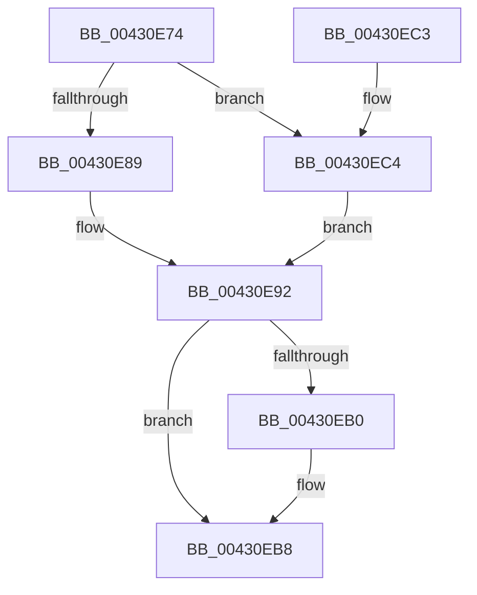

# MiInsertVadEvent

- RVA: `0x00430E74`–`0x00430EC8` (길이 `84` bytes)
- VA: `0x0000000140430E74`
- 실행 섹션: `.text`
- PDB 이름 있음: `예`; PDB Function 태그: `아니요`
- unwind 정보 RVA: `0x00065BB8`
- 디코드: `28`개 명령, `84/84` bytes 표시
- 미해석 바이트: `0` (있으면 어셈블리에 `.byte`로 보존)

> 이 문서는 커널 이미지의 기계어와 PDB 기호를 분석해 생성했습니다. 4번과 5번은 함수 원형과 자료형을 바이너리 사용 방식에서 추정한 C 해석이며 원본 소스 복구 결과는 아닙니다.

## 1. Dependencies

- 직접 호출 지점: **2**; 고유 호출 대상: **2**
- 직접 호출자로 확인된 함수: **11**
- RIP 상대 이미지 참조: **0**

### Outgoing calls
- `0x00430E8B` → [MiLockVadCore](../29/MiLockVadCore_function_00297170.md) (function, `0x00297170`)
- `0x00430EB3` → [MiUnlockVadCore](MiUnlockVadCore_function_004311C0.md) (function, `0x004311C0`)

### Direct callers
- [MiWaitForVadDeletion](../31/MiWaitForVadDeletion_function_00316F1C.md) at `0x00316F82`
- [MiApplyImageHotPatchRequest](../../page/80/MiApplyImageHotPatchRequest_function_008025AC.md) at `0x008027D0`
- [sub_0088535F](../../page/88/Unknown_function_0088535F.md) at `0x0088557F`
- [MiCreatePlaceholderStorage](../../page/8C/MiCreatePlaceholderStorage_function_008CF330.md) at `0x008CF3AB`
- [MiAddSecureEntry](../../page/98/MiAddSecureEntry_function_00980250.md) at `0x0098033D`
- [MiCreateVadEventBitmap](../../page/98/MiCreateVadEventBitmap_function_009803FC.md) at `0x009804B7`
- [MiSecureVad](../../page/9F/MiSecureVad_function_009F5788.md) at `0x009F58AB`
- [MiCreateRotateView](../../page/A7/MiCreateRotateView_function_00A7F498.md) at `0x00A7F508`
- [MiCreateLargePageVad](../../page/A9/MiCreateLargePageVad_function_00A99B50.md) at `0x00A99CCB`
- [MiCreateUserPhysicalView](../../page/AD/MiCreateUserPhysicalView_function_00ADA4B4.md) at `0x00ADA75C`
- [sub_00B2A146](../../page/B2/Unknown_function_00B2A146.md) at `0x00B2A331`

### Static image references
- 디코드된 RIP-relative 메모리 참조가 없습니다.

## 2. Other-region calls and transfers

- 다른 실행 섹션으로 향하는 call: **0**
- 별도 외부 분기/꼬리 이동을 확인하지 못했습니다.

## 3. Assembly (complete function range)

```asm
00430E74  48 89 5C 24 08                  mov qword ptr [rsp + 8], rbx
00430E79  57                              push rdi
00430E7A  48 83 EC 20                     sub rsp, 0x20
00430E7E  48 8B FA                        mov rdi, rdx
00430E81  48 8B D9                        mov rbx, rcx
00430E84  45 85 C0                        test r8d, r8d
00430E87  74 3B                           je 0x140430ec4
00430E89  33 D2                           xor edx, edx
00430E8B  E8 E0 62 E6 FF                  call 0x140297170
00430E90  8A D0                           mov dl, al
00430E92  48 8B 43 38                     mov rax, qword ptr [rbx + 0x38]
00430E96  48 83 E0 F0                     and rax, 0xfffffffffffffff0
00430E9A  48 89 07                        mov qword ptr [rdi], rax
00430E9D  48 8B 43 38                     mov rax, qword ptr [rbx + 0x38]
00430EA1  83 E0 0F                        and eax, 0xf
00430EA4  48 0B C7                        or rax, rdi
00430EA7  48 89 43 38                     mov qword ptr [rbx + 0x38], rax
00430EAB  80 FA 11                        cmp dl, 0x11
00430EAE  74 08                           je 0x140430eb8
00430EB0  48 8B CB                        mov rcx, rbx
00430EB3  E8 08 03 00 00                  call 0x1404311c0
00430EB8  48 8B 5C 24 30                  mov rbx, qword ptr [rsp + 0x30]
00430EBD  48 83 C4 20                     add rsp, 0x20
00430EC1  5F                              pop rdi
00430EC2  C3                              ret
00430EC3  CC                              int3
00430EC4  B2 11                           mov dl, 0x11
00430EC6  EB CA                           jmp 0x140430e92
```

## 4. C-style interpretation (structured pseudocode)

```c
__int64 __fastcall MiInsertVadEvent(__int64 a1, __int64 a2, int a3)
{
    __int64 result;
    __int64 v_rsp;
    unsigned __int64 v_stack_p8;

    v_stack_p8 = v_rbx;
    v_rsp = (v_rsp) - (32);
    if (a3 == 0) goto loc_00430EC4;
    a2 = 0;
    result = MiLockVadCore(a1, a2, a3, a4);
loc_00430E92:
    result = (*(unsigned __int64 *)(a1 + 56)) & (-16);
    *(unsigned __int64 *)(a2) = result;
    result = (unsigned int)((*(unsigned __int64 *)(a1 + 56)) & (15));
    result = (result) | (0);
    *(unsigned __int64 *)(a1 + 56) = result;
    if (((unsigned __int8)((unsigned __int8)(result))) != 17) {
        a1 = a1;
        result = MiUnlockVadCore(a1, (unsigned __int8)(result), a3, a4);
    }
    v_rsp = (v_rsp) + (32);
    return result;
loc_00430EC4:
    goto loc_00430E92;
}
```

## 5. (Beta) C Style

```c
int64_t MiInsertVadEvent(void *Arg1, void *Arg2, int32_t Arg3)
{
    uint8_t *arg1 = (uint8_t *)Arg1;
    uint8_t *arg2 = (uint8_t *)Arg2;

    int64_t result;
    int64_t local_rsp;
    uint64_t v_stack_p8;

    v_stack_p8 = local_rbx;
    local_rsp = (local_rsp) - (32);
    if (Arg3 == 0) goto loc_00430EC4;
    Arg2 = 0;
    result = MiLockVadCore(Arg1, Arg2, Arg3, a4);
loc_00430E92:
    result = (*(uint64_t *)(arg1 + 0x38)) & (-16);
    *(uint64_t *)(arg2) = result;
    result = (uint32_t)((*(uint64_t *)(arg1 + 0x38)) & (15));
    result = (result) | (0);
    *(uint64_t *)(arg1 + 0x38) = result;
    if (((uint8_t)((uint8_t)(result))) != 17) {
        Arg1 = Arg1;
        result = MiUnlockVadCore(Arg1, (uint8_t)(result), Arg3, a4);
    }
    local_rsp = (local_rsp) + (32);
    return result;
loc_00430EC4:
    goto loc_00430E92;
}
```

### 관측된 메모리 오프셋

구조체 형식이 확인되지 않은 접근은 인자 기준의 오프셋으로만 기록했습니다.

| 기준 인자 | 오프셋 표현 | 폭 (bit) | 접근 |
|---|---:|---:|---|
| `Arg1` | `+ 0x38` | `64` | `R` |
| `Arg1` | `+ 0x38` | `64` | `W` |
| `Arg2` | `+ 0x0` | `64` | `W` |

## 6. Execution-region graph

[열기: 2D/3D 그래프와 함수 탐색 컨트롤 패널](../../../control-panel.html?section=text&rva=0x00430E74&view=graph)

- 2D 그래프는 위에서 아래로 흐르고, 3D 그래프는 빈 공간을 드래그해 회전합니다. Shift+드래그는 이동, 휠은 확대·축소, 함수 노드 선택은 대상 보고서 이동입니다.

### Static fallback


