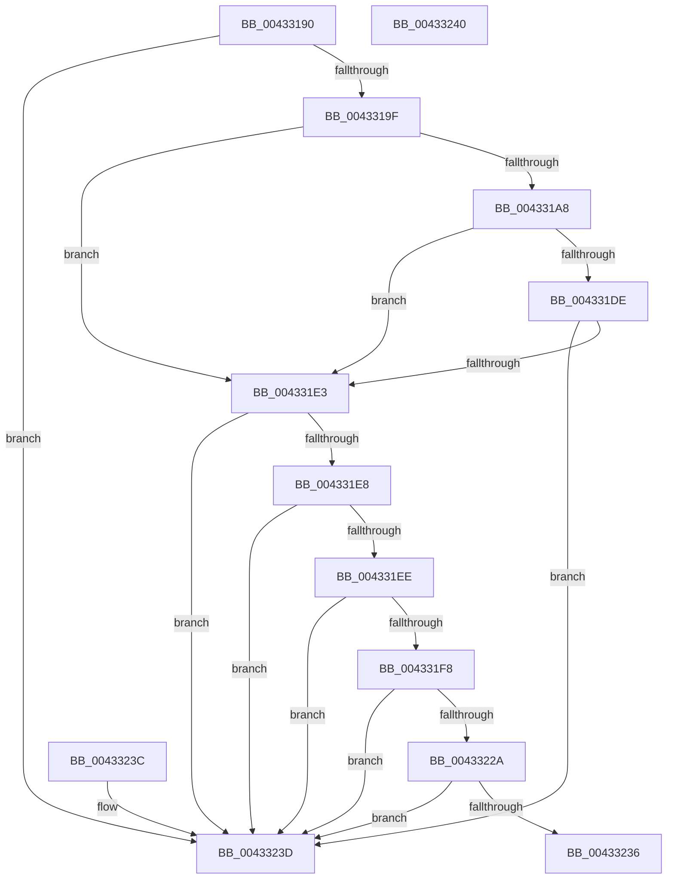

# MiIsPageEligibleForProtectedStandby

- RVA: `0x00433190`–`0x00433241` (길이 `177` bytes)
- VA: `0x0000000140433190`
- 실행 섹션: `.text`
- PDB 이름 있음: `예`; PDB Function 태그: `아니요`
- unwind 정보 RVA: `0x000DB714`
- 디코드: `48`개 명령, `177/177` bytes 표시
- 미해석 바이트: `0` (있으면 어셈블리에 `.byte`로 보존)

> 이 문서는 커널 이미지의 기계어와 PDB 기호를 분석해 생성했습니다. 4번과 5번은 함수 원형과 자료형을 바이너리 사용 방식에서 추정한 C 해석이며 원본 소스 복구 결과는 아닙니다.

## 1. Dependencies

- 직접 호출 지점: **0**; 고유 호출 대상: **0**
- 직접 호출자로 확인된 함수: **1**
- RIP 상대 이미지 참조: **3**

### Outgoing calls
- 직접 디코드된 call 명령이 없습니다.

### Direct callers
- [MiCanBatchHardFaultPages](../24/MiCanBatchHardFaultPages_function_0024AE00.md) at `0x0024AEFF`

### Static image references
- `0x0043319F` → RVA `0x00E3CBE6` (`.data`; read)
- `0x004331CA` → RVA `0x00E3D240` (`.data`; read)
- `0x004331FC` → RVA `0x00E30088` (`.data`; read)

## 2. Other-region calls and transfers

- 다른 실행 섹션으로 향하는 call: **0**
- 별도 외부 분기/꼬리 이동을 확인하지 못했습니다.

## 3. Assembly (complete function range)

```asm
00433190  48 0F BA 62 28 35               bt qword ptr [rdx + 0x28], 0x35
00433196  4C 8B C9                        mov r9, rcx
00433199  0F 82 9E 00 00 00               jb 0x14043323d
0043319F  80 3D 40 9A A0 00 00            cmp byte ptr [rip + 0xa09a40], 0
004331A6  74 3B                           je 0x1404331e3
004331A8  48 B8 00 00 00 00 00 DE FF FF   movabs rax, 0xffffde0000000000
004331B2  4C 8B C2                        mov r8, rdx
004331B5  4C 2B C0                        sub r8, rax
004331B8  48 B8 AB AA AA AA AA AA AA AA   movabs rax, 0xaaaaaaaaaaaaaaab
004331C2  49 C1 F8 04                     sar r8, 4
004331C6  4C 0F AF C0                     imul r8, rax
004331CA  48 8B 05 6F A0 A0 00            mov rax, qword ptr [rip + 0xa0a06f]
004331D1  49 C1 E8 09                     shr r8, 9
004331D5  42 0F B6 0C 40                  movzx ecx, byte ptr [rax + r8*2]
004331DA  85 C9                           test ecx, ecx
004331DC  74 05                           je 0x1404331e3
004331DE  83 F9 0A                        cmp ecx, 0xa
004331E1  75 5A                           jne 0x14043323d
004331E3  4D 85 C9                        test r9, r9
004331E6  74 55                           je 0x14043323d
004331E8  F6 42 23 10                     test byte ptr [rdx + 0x23], 0x10
004331EC  75 4F                           jne 0x14043323d
004331EE  8B 42 20                        mov eax, dword ptr [rdx + 0x20]
004331F1  C1 E8 18                        shr eax, 0x18
004331F4  A8 40                           test al, 0x40
004331F6  75 45                           jne 0x14043323d
004331F8  48 8B 42 28                     mov rax, qword ptr [rdx + 0x28]
004331FC  48 8B 0D 85 CE 9F 00            mov rcx, qword ptr [rip + 0x9fce85]
00433203  48 C1 E8 2B                     shr rax, 0x2b
00433207  25 FF 03 00 00                  and eax, 0x3ff
0043320C  4C 8B 04 C1                     mov r8, qword ptr [rcx + rax*8]
00433210  49 8B 41 28                     mov rax, qword ptr [r9 + 0x28]
00433214  48 8B 0D 6D CE 9F 00            mov rcx, qword ptr [rip + 0x9fce6d]
0043321B  48 C1 E8 2B                     shr rax, 0x2b
0043321F  25 FF 03 00 00                  and eax, 0x3ff
00433224  4C 39 04 C1                     cmp qword ptr [rcx + rax*8], r8
00433228  75 13                           jne 0x14043323d
0043322A  8B 42 20                        mov eax, dword ptr [rdx + 0x20]
0043322D  C1 E8 18                        shr eax, 0x18
00433230  24 07                           and al, 7
00433232  3C 05                           cmp al, 5
00433234  73 07                           jae 0x14043323d
00433236  B8 01 00 00 00                  mov eax, 1
0043323B  C3                              ret
0043323C  CC                              int3
0043323D  33 C0                           xor eax, eax
0043323F  C3                              ret
00433240  CC                              int3
```

## 4. C-style interpretation (structured pseudocode)

```c
__int64 __fastcall MiIsPageEligibleForProtectedStandby(__int64 a1, __int64 a2)
{
    __int64 result;

    if (condition_is_below) goto loc_0043323D;
    if ((*(unsigned __int8 *)(v_rip + 10525248)) == 0) goto loc_004331E3;
    a3 = (a2) - (result);
    a3 = (a3) >> (4);
    a3 = (a3) * (result);
    a3 = (a3) >> (9);
    if ((unsigned int)(*(unsigned __int8 *)(*(unsigned __int64 *)(v_rip + 10526831) + a3 * 2)) == 0) goto loc_004331E3;
    if (((unsigned int)(*(unsigned __int8 *)(*(unsigned __int64 *)(v_rip + 10526831) + a3 * 2))) != 10) goto loc_0043323D;
loc_004331E3:
    if (a1 == 0) goto loc_0043323D;
    if (((*(unsigned __int8 *)(a2 + 35)) & (16)) != 0) goto loc_0043323D;
    result = (unsigned int)(((unsigned int)(*(unsigned int *)(a2 + 32))) >> (24));
    if ((((unsigned __int8)(result)) & (64)) != 0) goto loc_0043323D;
    result = (*(unsigned __int64 *)(a2 + 40)) >> (43);
    result = (unsigned int)((result) & (0x3FFULL));
    result = (*(unsigned __int64 *)(a1 + 40)) >> (43);
    result = (unsigned int)((result) & (0x3FFULL));
    if ((*(unsigned __int64 *)(*(unsigned __int64 *)(v_rip + 10473069) + result * 8)) != (*(unsigned __int64 *)(*(unsigned __int64 *)(v_rip + 10473093) + result * 8))) goto loc_0043323D;
    result = (unsigned int)(((unsigned int)(*(unsigned int *)(a2 + 32))) >> (24));
    result = (unsigned __int8)((result) & (7));
    if (((unsigned __int8)(result)) >= 5) goto loc_0043323D;
    return 1;
loc_0043323D:
    result = 0;
    return result;
}
```

## 5. (Beta) C Style

```c
int64_t MiIsPageEligibleForProtectedStandby(int64_t Arg1, void *Arg2)
{
    uint8_t *arg2 = (uint8_t *)Arg2;

    int64_t result;

    if (condition_is_below) goto loc_0043323D;
    if ((*(uint8_t *)(v_rip + 0xA09A40)) == 0) goto loc_004331E3;
    a3 = (Arg2) - (result);
    a3 = (a3) >> (4);
    a3 = (a3) * (result);
    a3 = (a3) >> (9);
    if ((uint32_t)(*(uint8_t *)(*(uint64_t *)(v_rip + 0xA0A06F) + a3 * 2)) == 0) goto loc_004331E3;
    if (((uint32_t)(*(uint8_t *)(*(uint64_t *)(v_rip + 0xA0A06F) + a3 * 2))) != 10) goto loc_0043323D;
loc_004331E3:
    if (Arg1 == 0) goto loc_0043323D;
    if (((*(uint8_t *)(arg2 + 0x23)) & (16)) != 0) goto loc_0043323D;
    result = (uint32_t)(((uint32_t)(*(uint32_t *)(arg2 + 0x20))) >> (24));
    if ((((uint8_t)(result)) & (64)) != 0) goto loc_0043323D;
    result = (*(uint64_t *)(arg2 + 0x28)) >> (43);
    result = (uint32_t)((result) & (0x3FFULL));
    result = (*(uint64_t *)(Arg1 + 0x28)) >> (43);
    result = (uint32_t)((result) & (0x3FFULL));
    if ((*(uint64_t *)(*(uint64_t *)(v_rip + 0x9FCE6D) + result * 8)) != (*(uint64_t *)(*(uint64_t *)(v_rip + 0x9FCE85) + result * 8))) goto loc_0043323D;
    result = (uint32_t)(((uint32_t)(*(uint32_t *)(arg2 + 0x20))) >> (24));
    result = (uint8_t)((result) & (7));
    if (((uint8_t)(result)) >= 5) goto loc_0043323D;
    return 1;
loc_0043323D:
    result = 0;
    return result;
}
```

### 관측된 메모리 오프셋

구조체 형식이 확인되지 않은 접근은 인자 기준의 오프셋으로만 기록했습니다.

| 기준 인자 | 오프셋 표현 | 폭 (bit) | 접근 |
|---|---:|---:|---|
| `Arg2` | `+ 0x20` | `32` | `R` |
| `Arg2` | `+ 0x23` | `8` | `R` |
| `Arg2` | `+ 0x28` | `64` | `R` |

## 6. Execution-region graph

[열기: 2D/3D 그래프와 함수 탐색 컨트롤 패널](../../../control-panel.html?section=text&rva=0x00433190&view=graph)

- 2D 그래프는 위에서 아래로 흐르고, 3D 그래프는 빈 공간을 드래그해 회전합니다. Shift+드래그는 이동, 휠은 확대·축소, 함수 노드 선택은 대상 보고서 이동입니다.

### Static fallback


