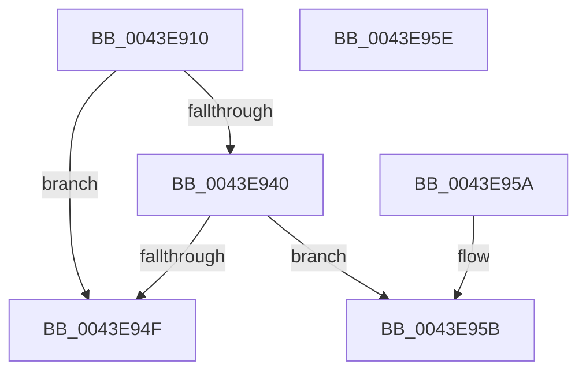

# MiIsPfnSystemCharged

- RVA: `0x0043E910`–`0x0043E95F` (길이 `79` bytes)
- VA: `0x000000014043E910`
- 실행 섹션: `.text`
- PDB 이름 있음: `예`; PDB Function 태그: `아니요`
- unwind 정보 RVA: `0x000DB714`
- 디코드: `22`개 명령, `79/79` bytes 표시
- 미해석 바이트: `0` (있으면 어셈블리에 `.byte`로 보존)

> 이 문서는 커널 이미지의 기계어와 PDB 기호를 분석해 생성했습니다. 4번과 5번은 함수 원형과 자료형을 바이너리 사용 방식에서 추정한 C 해석이며 원본 소스 복구 결과는 아닙니다.

## 1. Dependencies

- 직접 호출 지점: **0**; 고유 호출 대상: **0**
- 직접 호출자로 확인된 함수: **3**
- RIP 상대 이미지 참조: **0**

### Outgoing calls
- 직접 디코드된 call 명령이 없습니다.

### Direct callers
- [MiDecommitHandleTransitionPte](../24/MiDecommitHandleTransitionPte_function_0024037C.md) at `0x002406F3`
- [MiReturnPagedPoolLockCharge](../24/MiReturnPagedPoolLockCharge_function_00240780.md) at `0x002407DD`
- [MiDecommitPrivatePageTail](../36/MiDecommitPrivatePageTail_function_0036F564.md) at `0x0036F78F`

### Static image references
- 디코드된 RIP-relative 메모리 참조가 없습니다.

## 2. Other-region calls and transfers

- 다른 실행 섹션으로 향하는 call: **0**
- 별도 외부 분기/꼬리 이동을 확인하지 못했습니다.

## 3. Assembly (complete function range)

```asm
0043E910  48 8B 51 08                     mov rdx, qword ptr [rcx + 8]
0043E914  49 B9 00 00 00 00 80 F6 FF FF   movabs r9, 0xfffff68000000000
0043E91E  49 8B C1                        mov rax, r9
0043E921  49 B8 78 FF FF FF 3F 00 00 00   movabs r8, 0x3fffffff78
0043E92B  49 03 C0                        add rax, r8
0043E92E  49 B8 00 00 00 00 00 00 00 80   movabs r8, 0x8000000000000000
0043E938  49 0B D0                        or rdx, r8
0043E93B  48 3B D0                        cmp rdx, rax
0043E93E  77 0F                           ja 0x14043e94f
0043E940  48 8B 51 08                     mov rdx, qword ptr [rcx + 8]
0043E944  49 0B D0                        or rdx, r8
0043E947  49 8B C1                        mov rax, r9
0043E94A  48 3B D0                        cmp rdx, rax
0043E94D  73 0C                           jae 0x14043e95b
0043E94F  0F B6 41 23                     movzx eax, byte ptr [rcx + 0x23]
0043E953  C1 E8 05                        shr eax, 5
0043E956  83 E0 01                        and eax, 1
0043E959  C3                              ret
0043E95A  CC                              int3
0043E95B  33 C0                           xor eax, eax
0043E95D  C3                              ret
0043E95E  CC                              int3
```

## 4. C-style interpretation (structured pseudocode)

```c
__int64 __fastcall MiIsPfnSystemCharged(__int64 a1)
{
    __int64 result;

    result = (a4) + (a3);
    a2 = (*(unsigned __int64 *)(a1 + 8)) | (a3);
    if (a2 > result) goto loc_0043E94F;
    a2 = (*(unsigned __int64 *)(a1 + 8)) | (a3);
    if (a2 >= a4) goto loc_0043E95B;
loc_0043E94F:
    result = (unsigned int)((*(unsigned __int8 *)(a1 + 35)) >> (5));
    result = (unsigned int)((result) & (1));
    return result;
loc_0043E95B:
    result = 0;
    return result;
}
```

## 5. (Beta) C Style

```c
int64_t MiIsPfnSystemCharged(void *Arg1)
{
    uint8_t *arg1 = (uint8_t *)Arg1;

    int64_t result;

    result = (a4) + (a3);
    a2 = (*(uint64_t *)(arg1 + 0x8)) | (a3);
    if (a2 > result) goto loc_0043E94F;
    a2 = (*(uint64_t *)(arg1 + 0x8)) | (a3);
    if (a2 >= a4) goto loc_0043E95B;
loc_0043E94F:
    result = (uint32_t)((*(uint8_t *)(arg1 + 0x23)) >> (5));
    result = (uint32_t)((result) & (1));
    return result;
loc_0043E95B:
    result = 0;
    return result;
}
```

### 관측된 메모리 오프셋

구조체 형식이 확인되지 않은 접근은 인자 기준의 오프셋으로만 기록했습니다.

| 기준 인자 | 오프셋 표현 | 폭 (bit) | 접근 |
|---|---:|---:|---|
| `Arg1` | `+ 0x8` | `64` | `R` |
| `Arg1` | `+ 0x23` | `8` | `R` |

## 6. Execution-region graph

[열기: 2D/3D 그래프와 함수 탐색 컨트롤 패널](../../../control-panel.html?section=text&rva=0x0043E910&view=graph)

- 2D 그래프는 위에서 아래로 흐르고, 3D 그래프는 빈 공간을 드래그해 회전합니다. Shift+드래그는 이동, 휠은 확대·축소, 함수 노드 선택은 대상 보고서 이동입니다.

### Static fallback


