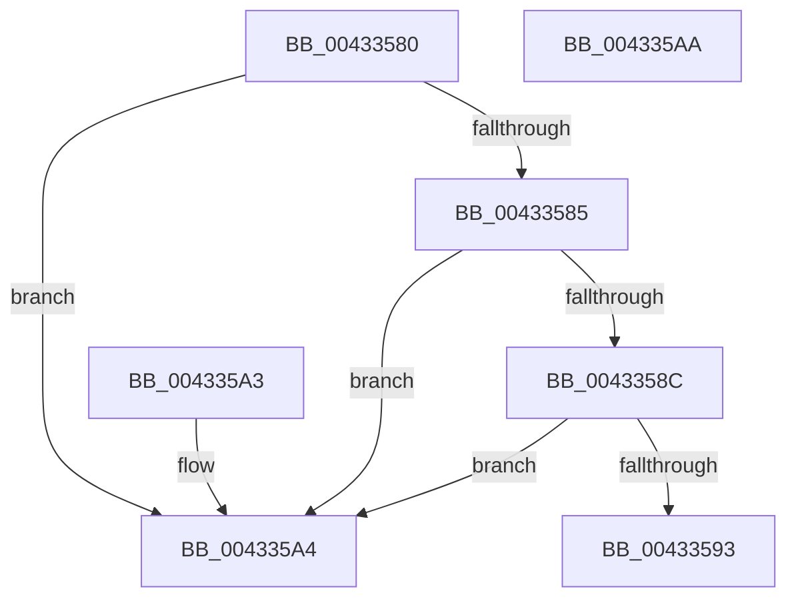

# MiIsPoolPteInUse

- RVA: `0x00433580`–`0x004335AB` (길이 `43` bytes)
- VA: `0x0000000140433580`
- 실행 섹션: `.text`
- PDB 이름 있음: `예`; PDB Function 태그: `아니요`
- unwind 정보 RVA: `0x000DB714`
- 디코드: `14`개 명령, `43/43` bytes 표시
- 미해석 바이트: `0` (있으면 어셈블리에 `.byte`로 보존)

> 이 문서는 커널 이미지의 기계어와 PDB 기호를 분석해 생성했습니다. 4번과 5번은 함수 원형과 자료형을 바이너리 사용 방식에서 추정한 C 해석이며 원본 소스 복구 결과는 아닙니다.

## 1. Dependencies

- 직접 호출 지점: **0**; 고유 호출 대상: **0**
- 직접 호출자로 확인된 함수: **1**
- RIP 상대 이미지 참조: **0**

### Outgoing calls
- 직접 디코드된 call 명령이 없습니다.

### Direct callers
- [MiLinkPoolCommitChain](../31/MiLinkPoolCommitChain_function_00313D20.md) at `0x00314048`

### Static image references
- 디코드된 RIP-relative 메모리 참조가 없습니다.

## 2. Other-region calls and transfers

- 다른 실행 섹션으로 향하는 call: **0**
- 별도 외부 분기/꼬리 이동을 확인하지 못했습니다.

## 3. Assembly (complete function range)

```asm
00433580  F6 C1 01                        test cl, 1
00433583  75 1F                           jne 0x1404335a4
00433585  48 0F BA E1 0A                  bt rcx, 0xa
0043358A  72 18                           jb 0x1404335a4
0043358C  48 0F BA E1 0B                  bt rcx, 0xb
00433591  72 11                           jb 0x1404335a4
00433593  48 F7 C1 E0 03 00 00            test rcx, 0x3e0
0043359A  B8 00 00 00 00                  mov eax, 0
0043359F  0F 95 C0                        setne al
004335A2  C3                              ret
004335A3  CC                              int3
004335A4  B8 01 00 00 00                  mov eax, 1
004335A9  C3                              ret
004335AA  CC                              int3
```

## 4. C-style interpretation (structured pseudocode)

```c
__int64 __fastcall MiIsPoolPteInUse(__int64 a1)
{
    __int64 result;

    if ((((unsigned __int8)(a1)) & (1)) != 0) goto loc_004335A4;
    if (condition_is_below) goto loc_004335A4;
    if (condition_is_below) goto loc_004335A4;
    result = (((a1) & (992)) != 0) ? 1 : 0;
    return result;
loc_004335A4:
    return 1;
}
```

## 5. (Beta) C Style

```c
int64_t MiIsPoolPteInUse(int64_t Arg1)
{
    int64_t result;

    if ((((uint8_t)(Arg1)) & (1)) != 0) goto loc_004335A4;
    if (condition_is_below) goto loc_004335A4;
    if (condition_is_below) goto loc_004335A4;
    result = (((Arg1) & (992)) != 0) ? 1 : 0;
    return result;
loc_004335A4:
    return 1;
}
```

## 6. Execution-region graph

[열기: 2D/3D 그래프와 함수 탐색 컨트롤 패널](../../../control-panel.html?section=text&rva=0x00433580&view=graph)

- 2D 그래프는 위에서 아래로 흐르고, 3D 그래프는 빈 공간을 드래그해 회전합니다. Shift+드래그는 이동, 휠은 확대·축소, 함수 노드 선택은 대상 보고서 이동입니다.

### Static fallback


