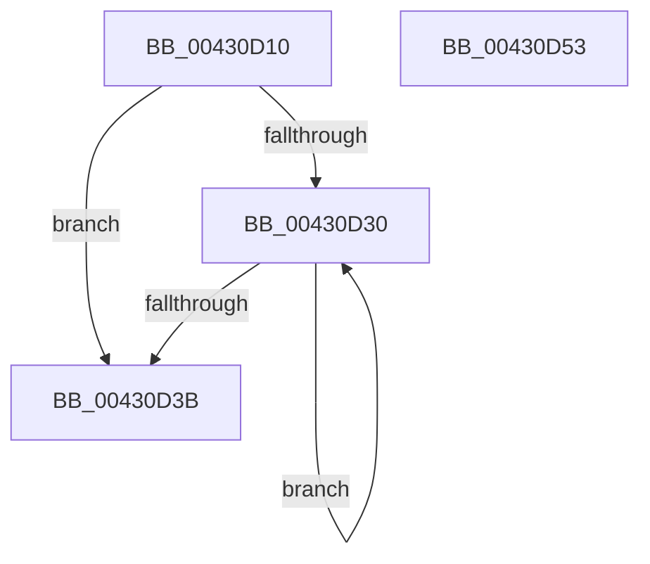

# MiLocateOldestSecure

- RVA: `0x00430D10`–`0x00430D54` (길이 `68` bytes)
- VA: `0x0000000140430D10`
- 실행 섹션: `.text`
- PDB 이름 있음: `예`; PDB Function 태그: `아니요`
- unwind 정보 RVA: `0x0005CAAC`
- 디코드: `23`개 명령, `68/68` bytes 표시
- 미해석 바이트: `0` (있으면 어셈블리에 `.byte`로 보존)

> 이 문서는 커널 이미지의 기계어와 PDB 기호를 분석해 생성했습니다. 4번과 5번은 함수 원형과 자료형을 바이너리 사용 방식에서 추정한 C 해석이며 원본 소스 복구 결과는 아닙니다.

## 1. Dependencies

- 직접 호출 지점: **2**; 고유 호출 대상: **2**
- 직접 호출자로 확인된 함수: **1**
- RIP 상대 이미지 참조: **0**

### Outgoing calls
- `0x00430D21` → [MiLockVadCore](../29/MiLockVadCore_function_00297170.md) (function, `0x00297170`)
- `0x00430D40` → [MiUnlockVadCore](MiUnlockVadCore_function_004311C0.md) (function, `0x004311C0`)

### Direct callers
- [MiUnmapLockedPagesInUserSpace](../../page/A7/MiUnmapLockedPagesInUserSpace_function_00A78E54.md) at `0x00A78F1B`

### Static image references
- 디코드된 RIP-relative 메모리 참조가 없습니다.

## 2. Other-region calls and transfers

- 다른 실행 섹션으로 향하는 call: **0**
- 별도 외부 분기/꼬리 이동을 확인하지 못했습니다.

## 3. Assembly (complete function range)

```asm
00430D10  48 89 5C 24 08                  mov qword ptr [rsp + 8], rbx
00430D15  57                              push rdi
00430D16  48 83 EC 20                     sub rsp, 0x20
00430D1A  33 D2                           xor edx, edx
00430D1C  48 8B F9                        mov rdi, rcx
00430D1F  33 DB                           xor ebx, ebx
00430D21  E8 4A 64 E6 FF                  call 0x140297170
00430D26  48 8B 57 38                     mov rdx, qword ptr [rdi + 0x38]
00430D2A  48 83 E2 F0                     and rdx, 0xfffffffffffffff0
00430D2E  74 0B                           je 0x140430d3b
00430D30  48 8B DA                        mov rbx, rdx
00430D33  48 8B 12                        mov rdx, qword ptr [rdx]
00430D36  48 85 D2                        test rdx, rdx
00430D39  75 F5                           jne 0x140430d30
00430D3B  8A D0                           mov dl, al
00430D3D  48 8B CF                        mov rcx, rdi
00430D40  E8 7B 04 00 00                  call 0x1404311c0
00430D45  48 8B C3                        mov rax, rbx
00430D48  48 8B 5C 24 30                  mov rbx, qword ptr [rsp + 0x30]
00430D4D  48 83 C4 20                     add rsp, 0x20
00430D51  5F                              pop rdi
00430D52  C3                              ret
00430D53  CC                              int3
```

## 4. C-style interpretation (structured pseudocode)

```c
__int64 __fastcall MiLocateOldestSecure(__int64 a1, int a2)
{
    __int64 result;
    __int64 v_rbx;
    __int64 v_rsp;
    unsigned __int64 v_stack_p8;

    v_stack_p8 = v_rbx;
    v_rsp = (v_rsp) - (32);
    a2 = 0;
    v_rbx = 0;
    result = MiLockVadCore(a1, a2, a3, a4);
    a2 = (*(unsigned __int64 *)(a1 + 56)) & (-16);
    if (condition_is_equal) goto loc_00430D3B;
loc_00430D30:
    if (*(unsigned __int64 *)(a2) != 0) goto loc_00430D30;
loc_00430D3B:
    result = MiUnlockVadCore(a1, (unsigned __int8)(result), a3, a4);
    v_rsp = (v_rsp) + (32);
    return a2;
}
```

## 5. (Beta) C Style

```c
int64_t MiLocateOldestSecure(void *Arg1, int32_t Arg2)
{
    uint8_t *arg1 = (uint8_t *)Arg1;

    int64_t result;
    int64_t local_rbx;
    int64_t local_rsp;
    uint64_t v_stack_p8;

    v_stack_p8 = local_rbx;
    local_rsp = (local_rsp) - (32);
    Arg2 = 0;
    local_rbx = 0;
    result = MiLockVadCore(Arg1, Arg2, a3, a4);
    Arg2 = (*(uint64_t *)(arg1 + 0x38)) & (-16);
    if (condition_is_equal) goto loc_00430D3B;
loc_00430D30:
    if (*(uint64_t *)(Arg2) != 0) goto loc_00430D30;
loc_00430D3B:
    result = MiUnlockVadCore(Arg1, (uint8_t)(result), a3, a4);
    local_rsp = (local_rsp) + (32);
    return Arg2;
}
```

### 관측된 메모리 오프셋

구조체 형식이 확인되지 않은 접근은 인자 기준의 오프셋으로만 기록했습니다.

| 기준 인자 | 오프셋 표현 | 폭 (bit) | 접근 |
|---|---:|---:|---|
| `Arg1` | `+ 0x38` | `64` | `R` |

## 6. Execution-region graph

[열기: 2D/3D 그래프와 함수 탐색 컨트롤 패널](../../../control-panel.html?section=text&rva=0x00430D10&view=graph)

- 2D 그래프는 위에서 아래로 흐르고, 3D 그래프는 빈 공간을 드래그해 회전합니다. Shift+드래그는 이동, 휠은 확대·축소, 함수 노드 선택은 대상 보고서 이동입니다.

### Static fallback


