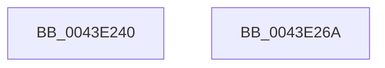

# MiMakeColor

- RVA: `0x0043E240`–`0x0043E26B` (길이 `43` bytes)
- VA: `0x000000014043E240`
- 실행 섹션: `.text`
- PDB 이름 있음: `예`; PDB Function 태그: `아니요`
- unwind 정보 RVA: `0x000DB714`
- 디코드: `16`개 명령, `43/43` bytes 표시
- 미해석 바이트: `0` (있으면 어셈블리에 `.byte`로 보존)

> 이 문서는 커널 이미지의 기계어와 PDB 기호를 분석해 생성했습니다. 4번과 5번은 함수 원형과 자료형을 바이너리 사용 방식에서 추정한 C 해석이며 원본 소스 복구 결과는 아닙니다.

## 1. Dependencies

- 직접 호출 지점: **0**; 고유 호출 대상: **0**
- 직접 호출자로 확인된 함수: **2**
- RIP 상대 이미지 참조: **0**

### Outgoing calls
- 직접 디코드된 call 명령이 없습니다.

### Direct callers
- [MiInitializePartitionFreeZeroLists](../../page/7F/MiInitializePartitionFreeZeroLists_function_007FDA7C.md) at `0x007FDBE3`
- [MmRelocatePfnList](../../page/90/MmRelocatePfnList_function_00901E70.md) at `0x00902037`

### Static image references
- 디코드된 RIP-relative 메모리 참조가 없습니다.

## 2. Other-region calls and transfers

- 다른 실행 섹션으로 향하는 call: **0**
- 별도 외부 분기/꼬리 이동을 확인하지 못했습니다.

## 3. Assembly (complete function range)

```asm
0043E240  8B 44 24 28                     mov eax, dword ptr [rsp + 0x28]
0043E244  83 E1 3F                        and ecx, 0x3f
0043E247  83 E0 03                        and eax, 3
0043E24A  41 83 E1 03                     and r9d, 3
0043E24E  C1 E0 02                        shl eax, 2
0043E251  83 E2 01                        and edx, 1
0043E254  41 0B C1                        or eax, r9d
0043E257  C1 E0 07                        shl eax, 7
0043E25A  0B C1                           or eax, ecx
0043E25C  41 0F B6 C8                     movzx ecx, r8b
0043E260  03 C0                           add eax, eax
0043E262  0B C2                           or eax, edx
0043E264  C1 E0 08                        shl eax, 8
0043E267  0B C1                           or eax, ecx
0043E269  C3                              ret
0043E26A  CC                              int3
```

## 4. C-style interpretation (structured pseudocode)

```c
__int64 __fastcall MiMakeColor(int a1, int a2, unsigned __int8 a3, int a4, unsigned int a5)
{
    __int64 result;

    a1 = (unsigned int)((a1) & (63));
    result = (unsigned int)(((unsigned int)(a5)) & (3));
    a4 = (unsigned int)((a4) & (3));
    result = (unsigned int)((result) << (2));
    a2 = (unsigned int)((a2) & (1));
    result = (unsigned int)((result) | (a4));
    result = (unsigned int)((result) << (7));
    result = (unsigned int)((result) | (a1));
    result = (unsigned int)((result) + ((unsigned int)(result)));
    result = (unsigned int)((result) | (a2));
    result = (unsigned int)((result) << (8));
    result = (unsigned int)((result) | (a3));
    return result;
}
```

## 5. (Beta) C Style

```c
int64_t MiMakeColor(int32_t Arg1, int32_t Arg2, uint8_t Arg3, int32_t Arg4, uint32_t Arg5)
{
    int64_t result;

    Arg1 = (uint32_t)((Arg1) & (63));
    result = (uint32_t)(((uint32_t)(Arg5)) & (3));
    Arg4 = (uint32_t)((Arg4) & (3));
    result = (uint32_t)((result) << (2));
    Arg2 = (uint32_t)((Arg2) & (1));
    result = (uint32_t)((result) | (Arg4));
    result = (uint32_t)((result) << (7));
    result = (uint32_t)((result) | (Arg1));
    result = (uint32_t)((result) + ((uint32_t)(result)));
    result = (uint32_t)((result) | (Arg2));
    result = (uint32_t)((result) << (8));
    result = (uint32_t)((result) | (Arg3));
    return result;
}
```

## 6. Execution-region graph

[열기: 2D/3D 그래프와 함수 탐색 컨트롤 패널](../../../control-panel.html?section=text&rva=0x0043E240&view=graph)

- 2D 그래프는 위에서 아래로 흐르고, 3D 그래프는 빈 공간을 드래그해 회전합니다. Shift+드래그는 이동, 휠은 확대·축소, 함수 노드 선택은 대상 보고서 이동입니다.

### Static fallback


