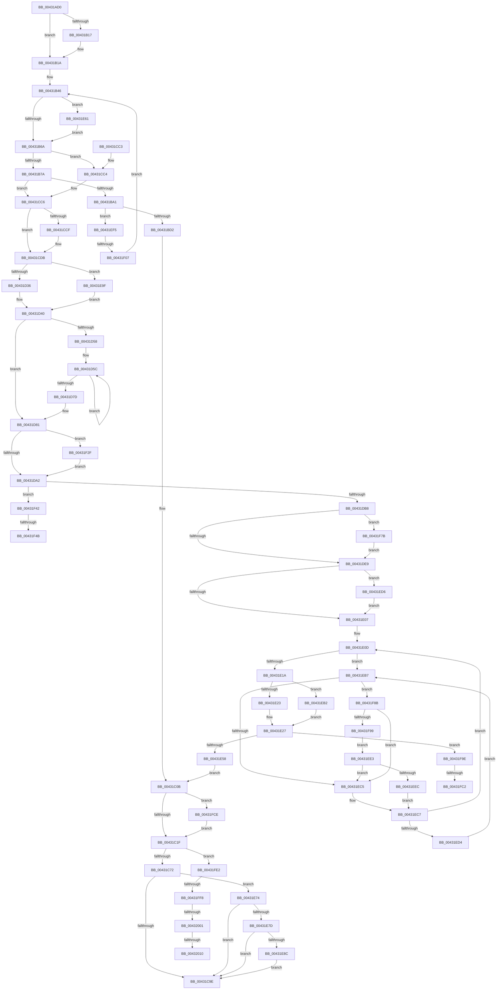

# MiMakeOutswappedPageResident

- RVA: `0x00431AD0`–`0x00432024` (길이 `1,364` bytes)
- VA: `0x0000000140431AD0`
- 실행 섹션: `.text`
- PDB 이름 있음: `예`; PDB Function 태그: `예`
- unwind 정보 RVA: `0x000A2218`
- 디코드: `332`개 명령, `1,364/1,364` bytes 표시
- 미해석 바이트: `0` (있으면 어셈블리에 `.byte`로 보존)

> 이 문서는 커널 이미지의 기계어와 PDB 기호를 분석해 생성했습니다. 4번과 5번은 함수 원형과 자료형을 바이너리 사용 방식에서 추정한 C 해석이며 원본 소스 복구 결과는 아닙니다.

## 1. Dependencies

- 직접 호출 지점: **29**; 고유 호출 대상: **23**
- 직접 호출자로 확인된 함수: **1**
- RIP 상대 이미지 참조: **7**

### Outgoing calls
- `0x00431B8B` → [MiLockTransitionLeafPageEx](../40/MiLockTransitionLeafPageEx_function_00405884.md) (function, `0x00405884`)
- `0x00431BF7` → [MiCaptureDirtyBitToPfn](../37/MiCaptureDirtyBitToPfn_function_00370DD0.md) (function, `0x00370DD0`)
- `0x00431C11` → [MiUnlockPage](../31/MiUnlockPage_function_0031A3E0.md) (function, `0x0031A3E0`)
- `0x00431C44` → [MiMakeValidPte](../2C/MiMakeValidPte_function_002C5590.md) (function, `0x002C5590`)
- `0x00431C83` → [MiMapPageInHyperSpaceWorker](../33/MiMapPageInHyperSpaceWorker_function_00332B10.md) (function, `0x00332B10`)
- `0x00431CAA` → [MiUnmapPageInHyperSpaceWorker](MiUnmapPageInHyperSpaceWorker_function_00432800.md) (function, `0x00432800`)
- `0x00431CD6` → [KiLowerIrqlProcessIrqlFlags](../4F/KiLowerIrqlProcessIrqlFlags_function_004F5698.md) (function, `0x004F5698`)
- `0x00431CF1` → [MiInitializePageColorBase](../32/MiInitializePageColorBase_function_00320410.md) (function, `0x00320410`)
- `0x00431D4A` → [MiGetPage](../28/MiGetPage_function_002884C0.md) (function, `0x002884C0`)
- `0x00431D61` → [MiWaitForFreePage](../2A/MiWaitForFreePage_function_002A3324.md) (function, `0x002A3324`)
- `0x00431D6F` → [MiGetPage](../28/MiGetPage_function_002884C0.md) (function, `0x002884C0`)
- `0x00431DD7` → [MiInitializePfnForOtherProcess](../38/MiInitializePfnForOtherProcess_function_00382A20.md) (function, `0x00382A20`)
- `0x00431E2C` → [MiMakeDemandZeroPte](../33/MiMakeDemandZeroPte_function_00337A00.md) (function, `0x00337A00`)
- `0x00431E3D` → [MiSetPfnModified](../36/MiSetPfnModified_function_00362960.md) (function, `0x00362960`)
- `0x00431E66` → [KiRaiseIrqlProcessIrqlFlags](../4F/KiRaiseIrqlProcessIrqlFlags_function_004F56FC.md) (function, `0x004F56FC`)
- `0x00431E95` → [MiCheckLinearProtectedPteAccessedBit](../29/MiCheckLinearProtectedPteAccessedBit_function_00292D80.md) (function, `0x00292D80`)
- `0x00431ED9` → [KiRaiseIrqlProcessIrqlFlags](../4F/KiRaiseIrqlProcessIrqlFlags_function_004F56FC.md) (function, `0x004F56FC`)
- `0x00431EE3` → [KiCheckVpBackingLongSpinWaitHypercall](../30/KiCheckVpBackingLongSpinWaitHypercall_function_0030F490.md) (function, `0x0030F490`)
- `0x00431EEE` → [HvlNotifyLongSpinWait](../30/HvlNotifyLongSpinWait_function_0030F460.md) (function, `0x0030F460`)
- `0x00431EFA` → [MiUnlinkPageFromListEx](../28/MiUnlinkPageFromListEx_function_00287590.md) (function, `0x00287590`)
- `0x00431F0C` → [MiDiscardTransitionPteEx](../37/MiDiscardTransitionPteEx_function_00375954.md) (function, `0x00375954`)
- `0x00431F17` → [MiUnlockPage](../31/MiUnlockPage_function_0031A3E0.md) (function, `0x0031A3E0`)
- `0x00431F35` → [MiMakeTransitionPte](../36/MiMakeTransitionPte_function_00363F70.md) (function, `0x00363F70`)
- `0x00431F5B` → [MiMapPageInHyperSpaceWorker](../33/MiMapPageInHyperSpaceWorker_function_00332B10.md) (function, `0x00332B10`)
- `0x00431F70` → [MiUnmapPageInHyperSpaceWorker](MiUnmapPageInHyperSpaceWorker_function_00432800.md) (function, `0x00432800`)
- `0x00431F81` → [MiReadPagefilePage](../66/MiReadPagefilePage_function_0066F78C.md) (function, `0x0066F78C`)
- `0x00431FA6` → [MiInitializeUsedPtesCount](../44/MiInitializeUsedPtesCount_function_00443AB0.md) (function, `0x00443AB0`)
- `0x00431FD8` → [MiReleasePageFileInfo](../28/MiReleasePageFileInfo_function_00283FD0.md) (function, `0x00283FD0`)
- `0x00432019` → [MiCheckLinearProtectedPteAccessedBit](../29/MiCheckLinearProtectedPteAccessedBit_function_00292D80.md) (function, `0x00292D80`)

### Direct callers
- [sub_006F28BE](../6F/Unknown_function_006F28BE.md) at `0x006F28CF`

### Static image references
- `0x00431B28` → RVA `0x00E30088` (`.data`; read)
- `0x00431B5D` → RVA `0x00FC6D20` (`ALMOSTRO`; read)
- `0x00431C88` → RVA `0x00FC6A88` (`ALMOSTRO`; read)
- `0x00431D08` → RVA `0x00E2DCC0` (`.data`; read)
- `0x00431EB9` → RVA `0x00FC52AC` (`ALMOSTRO`; reference)
- `0x00431F8B` → RVA `0x00FC6AB8` (`ALMOSTRO`; read)
- `0x00431FB5` → RVA `0x00E38878` (`.data`; read)

## 2. Other-region calls and transfers

- 다른 실행 섹션으로 향하는 call: **0**
- call이 아닌 외부 분기/꼬리 이동: **9**
  - `0x00431F01` → [sub_006EE8FE](../6E/Unknown_function_006EE8FE.md) (`tail-transfer`)
  - `0x00431F45` → [sub_006EE8FE + 0x4C](../6E/Unknown_function_006EE8FE.md) (`tail-transfer`)
  - `0x00431F76` → [sub_006EE8FE + 0x4C](../6E/Unknown_function_006EE8FE.md) (`tail-transfer`)
  - `0x00431FBC` → [sub_006EE8FE + 0x5B](../6E/Unknown_function_006EE8FE.md) (`tail-transfer`)
  - `0x00431FC9` → [sub_006EE8FE + 0x5B](../6E/Unknown_function_006EE8FE.md) (`tail-transfer`)
  - `0x00431FF2` → [sub_006EE8FE + 0x64](../6E/Unknown_function_006EE8FE.md) (`tail-transfer`)
  - `0x00431FFB` → [sub_006EE8FE + 0x64](../6E/Unknown_function_006EE8FE.md) (`tail-transfer`)
  - `0x0043200A` → [sub_006EE8FE + 0x64](../6E/Unknown_function_006EE8FE.md) (`tail-transfer`)
  - `0x0043201F` → [sub_006EE8FE + 0x64](../6E/Unknown_function_006EE8FE.md) (`tail-transfer`)

## 3. Assembly (complete function range)

```asm
00431AD0  4C 89 44 24 18                  mov qword ptr [rsp + 0x18], r8
00431AD5  48 89 4C 24 08                  mov qword ptr [rsp + 8], rcx
00431ADA  55                              push rbp
00431ADB  53                              push rbx
00431ADC  56                              push rsi
00431ADD  57                              push rdi
00431ADE  41 54                           push r12
00431AE0  41 55                           push r13
00431AE2  41 56                           push r14
00431AE4  41 57                           push r15
00431AE6  48 8B EC                        mov rbp, rsp
00431AE9  48 83 EC 58                     sub rsp, 0x58
00431AED  0F 57 C0                        xorps xmm0, xmm0
00431AF0  C6 45 60 00                     mov byte ptr [rbp + 0x60], 0
00431AF4  4C 8B EA                        mov r13, rdx
00431AF7  48 BB 68 DF BE 7D FB F6 FF FF   movabs rbx, 0xfffff6fb7dbedf68
00431B01  0F 11 45 E0                     movups xmmword ptr [rbp - 0x20], xmm0
00431B05  48 8B D1                        mov rdx, rcx
00431B08  48 8B C3                        mov rax, rbx
00431B0B  44 8D A1 28 03 00 00            lea r12d, [rcx + 0x328]
00431B12  4C 3B E8                        cmp r13, rax
00431B15  74 03                           je 0x140431b1a
00431B17  45 8B E5                        mov r12d, r13d
00431B1A  0F B7 B9 04 01 00 00            movzx edi, word ptr [rcx + 0x104]
00431B21  0F B7 89 AE 04 00 00            movzx ecx, word ptr [rcx + 0x4ae]
00431B28  48 8B 05 59 E5 9F 00            mov rax, qword ptr [rip + 0x9fe559]
00431B2F  41 C1 EC 03                     shr r12d, 3
00431B33  41 81 E4 FF 01 00 00            and r12d, 0x1ff
00431B3A  44 89 65 C8                     mov dword ptr [rbp - 0x38], r12d
00431B3E  4C 8B 3C C8                     mov r15, qword ptr [rax + rcx*8]
00431B42  4C 89 7D D0                     mov qword ptr [rbp - 0x30], r15
00431B46  49 BF 00 00 00 00 00 DE FF FF   movabs r15, 0xffffde0000000000
00431B50  B8 02 00 00 00                  mov eax, 2
00431B55  44 0F 20 C6                     mov rsi, cr8
00431B59  44 0F 22 C0                     mov cr8, rax
00431B5D  83 3D BC 51 B9 00 00            cmp dword ptr [rip + 0xb951bc], 0
00431B64  0F 85 F7 02 00 00               jne 0x140431e61
00431B6A  40 88 75 50                     mov byte ptr [rbp + 0x50], sil
00431B6E  48 8B C3                        mov rax, rbx
00431B71  4C 3B E8                        cmp r13, rax
00431B74  0F 85 4A 01 00 00               jne 0x140431cc4
00431B7A  48 8D 9A 28 03 00 00            lea rbx, [rdx + 0x328]
00431B81  45 33 C0                        xor r8d, r8d
00431B84  48 8B CB                        mov rcx, rbx
00431B87  48 8D 55 60                     lea rdx, [rbp + 0x60]
00431B8B  E8 F4 3C FD FF                  call 0x140405884
00431B90  48 8B 1B                        mov rbx, qword ptr [rbx]
00431B93  4C 8B F0                        mov r14, rax
00431B96  48 0F BA E3 0B                  bt rbx, 0xb
00431B9B  0F 83 25 01 00 00               jae 0x140431cc6
00431BA1  40 88 75 60                     mov byte ptr [rbp + 0x60], sil
00431BA5  49 8B C7                        mov rax, r15
00431BA8  4D 8B FE                        mov r15, r14
00431BAB  4C 2B F8                        sub r15, rax
00431BAE  48 B8 AB AA AA AA AA AA AA AA   movabs rax, 0xaaaaaaaaaaaaaaab
00431BB8  49 C1 FF 04                     sar r15, 4
00431BBC  4C 0F AF F8                     imul r15, rax
00431BC0  41 8A 46 22                     mov al, byte ptr [r14 + 0x22]
00431BC4  24 07                           and al, 7
00431BC6  4C 89 7D 58                     mov qword ptr [rbp + 0x58], r15
00431BCA  3C 06                           cmp al, 6
00431BCC  0F 85 23 03 00 00               jne 0x140431ef5
00431BD2  49 8B 46 18                     mov rax, qword ptr [r14 + 0x18]
00431BD6  48 8D 48 01                     lea rcx, [rax + 1]
00431BDA  48 8B D1                        mov rdx, rcx
00431BDD  48 33 D0                        xor rdx, rax
00431BE0  48 B8 00 00 00 00 00 00 00 C0   movabs rax, 0xc000000000000000
00431BEA  48 23 D0                        and rdx, rax
00431BED  48 33 D1                        xor rdx, rcx
00431BF0  49 89 56 18                     mov qword ptr [r14 + 0x18], rdx
00431BF4  49 8B CE                        mov rcx, r14
00431BF7  E8 D4 F1 F3 FF                  call 0x140370dd0
00431BFC  48 8B 7D 48                     mov rdi, qword ptr [rbp + 0x48]
00431C00  48 8B D8                        mov rbx, rax
00431C03  48 8B 45 58                     mov rax, qword ptr [rbp + 0x58]
00431C07  48 89 45 58                     mov qword ptr [rbp + 0x58], rax
00431C0B  40 8A D6                        mov dl, sil
00431C0E  49 8B CE                        mov rcx, r14
00431C11  E8 CA 87 EE FF                  call 0x14031a3e0
00431C16  48 85 DB                        test rbx, rbx
00431C19  0F 85 AF 03 00 00               jne 0x140431fce
00431C1F  48 BE 68 DF BE 7D FB F6 FF FF   movabs rsi, 0xfffff6fb7dbedf68
00431C29  48 8B C6                        mov rax, rsi
00431C2C  4C 3B E8                        cmp r13, rax
00431C2F  B9 04 00 00 80                  mov ecx, 0x80000004
00431C34  41 B8 04 00 00 98               mov r8d, 0x98000004
00431C3A  49 8B D7                        mov rdx, r15
00431C3D  44 0F 44 C1                     cmove r8d, ecx
00431C41  49 8B CD                        mov rcx, r13
00431C44  E8 47 39 E9 FF                  call 0x1402c5590
00431C49  48 8B D8                        mov rbx, rax
00431C4C  48 8B C6                        mov rax, rsi
00431C4F  48 BE 00 00 00 00 80 F6 FF FF   movabs rsi, 0xfffff68000000000
00431C59  49 BE 00 00 00 00 40 00 00 00   movabs r14, 0x4000000000
00431C63  41 BF 80 00 00 00               mov r15d, 0x80
00431C69  4C 3B E8                        cmp r13, rax
00431C6C  0F 84 70 03 00 00               je 0x140431fe2
00431C72  48 8B 4D 58                     mov rcx, qword ptr [rbp + 0x58]
00431C76  48 8D 55 50                     lea rdx, [rbp + 0x50]
00431C7A  41 BD 00 00 00 80               mov r13d, 0x80000000
00431C80  45 8B C5                        mov r8d, r13d
00431C83  E8 88 0E F0 FF                  call 0x140332b10
00431C88  48 0F BA 25 F7 4D B9 00 24      bt qword ptr [rip + 0xb94df7], 0x24
00431C91  41 8B CC                        mov ecx, r12d
00431C94  48 8D 3C C8                     lea rdi, [rax + rcx*8]
00431C98  0F 82 D6 01 00 00               jb 0x140431e74
00431C9E  8A 55 50                        mov dl, byte ptr [rbp + 0x50]
00431CA1  45 8B C5                        mov r8d, r13d
00431CA4  48 8B CF                        mov rcx, rdi
00431CA7  48 89 1F                        mov qword ptr [rdi], rbx
00431CAA  E8 51 0B 00 00                  call 0x140432800
00431CAF  48 8B C3                        mov rax, rbx
00431CB2  48 83 C4 58                     add rsp, 0x58
00431CB6  41 5F                           pop r15
00431CB8  41 5E                           pop r14
00431CBA  41 5D                           pop r13
00431CBC  41 5C                           pop r12
00431CBE  5F                              pop rdi
00431CBF  5E                              pop rsi
00431CC0  5B                              pop rbx
00431CC1  5D                              pop rbp
00431CC2  C3                              ret
00431CC3  CC                              int3
00431CC4  33 DB                           xor ebx, ebx
00431CC6  83 3D 53 50 B9 00 00            cmp dword ptr [rip + 0xb95053], 0
00431CCD  74 0C                           je 0x140431cdb
00431CCF  44 0F 20 C1                     mov rcx, cr8
00431CD3  40 8A D6                        mov dl, sil
00431CD6  E8 BD 39 0C 00                  call 0x1404f5698
00431CDB  40 0F B6 C6                     movzx eax, sil
00431CDF  44 0F 22 C0                     mov cr8, rax
00431CE3  4C 8D 4D E0                     lea r9, [rbp - 0x20]
00431CE7  44 8B C7                        mov r8d, edi
00431CEA  BA 03 00 00 00                  mov edx, 3
00431CEF  33 C9                           xor ecx, ecx
00431CF1  E8 1A E7 EE FF                  call 0x140320410
00431CF6  4C 8B 4D E0                     mov r9, qword ptr [rbp - 0x20]
00431CFA  B8 01 00 00 00                  mov eax, 1
00431CFF  F0 41 0F C1 01                  lock xadd dword ptr [r9], eax
00431D04  4C 8B 45 E8                     mov r8, qword ptr [rbp - 0x18]
00431D08  4C 8D 0D B1 BF 9F 00            lea r9, [rip + 0x9fbfb1]
00431D0F  33 D2                           xor edx, edx
00431D11  49 8B C8                        mov rcx, r8
00431D14  48 C1 E9 10                     shr rcx, 0x10
00431D18  33 FF                           xor edi, edi
00431D1A  83 E1 03                        and ecx, 3
00431D1D  33 F6                           xor esi, esi
00431D1F  41 F7 34 89                     div dword ptr [r9 + rcx*4]
00431D23  41 33 D0                        xor edx, r8d
00431D26  44 0F B6 F2                     movzx r14d, dl
00431D2A  45 33 F0                        xor r14d, r8d
00431D2D  48 85 DB                        test rbx, rbx
00431D30  0F 85 69 01 00 00               jne 0x140431e9f
00431D36  8D 7E 30                        lea edi, [rsi + 0x30]
00431D39  C7 45 D8 04 00 00 00            mov dword ptr [rbp - 0x28], 4
00431D40  48 8B 4D D0                     mov rcx, qword ptr [rbp - 0x30]
00431D44  44 8B C7                        mov r8d, edi
00431D47  41 8B D6                        mov edx, r14d
00431D4A  E8 71 67 E5 FF                  call 0x1402884c0
00431D4F  4C 8B F8                        mov r15, rax
00431D52  48 83 F8 FF                     cmp rax, -1
00431D56  75 29                           jne 0x140431d81
00431D58  4C 8B 65 D0                     mov r12, qword ptr [rbp - 0x30]
00431D5C  33 D2                           xor edx, edx
00431D5E  49 8B CC                        mov rcx, r12
00431D61  E8 BE 15 E7 FF                  call 0x1402a3324
00431D66  44 8B C7                        mov r8d, edi
00431D69  41 8B D6                        mov edx, r14d
00431D6C  49 8B CC                        mov rcx, r12
00431D6F  E8 4C 67 E5 FF                  call 0x1402884c0
00431D74  4C 8B F8                        mov r15, rax
00431D77  48 83 F8 FF                     cmp rax, -1
00431D7B  74 DF                           je 0x140431d5c
00431D7D  44 8B 65 C8                     mov r12d, dword ptr [rbp - 0x38]
00431D81  4F 8D 34 7F                     lea r14, [r15 + r15*2]
00431D85  48 B8 00 00 00 00 00 DE FF FF   movabs rax, 0xffffde0000000000
00431D8F  49 C1 E6 04                     shl r14, 4
00431D93  48 8B C0                        mov rax, rax
00431D96  4C 03 F0                        add r14, rax
00431D99  48 85 DB                        test rbx, rbx
00431D9C  0F 85 8D 01 00 00               jne 0x140431f2f
00431DA2  48 B8 68 DF BE 7D FB F6 FF FF   movabs rax, 0xfffff6fb7dbedf68
00431DAC  48 8B C0                        mov rax, rax
00431DAF  4C 3B E8                        cmp r13, rax
00431DB2  0F 85 8A 01 00 00               jne 0x140431f42
00431DB8  48 8B 7D 48                     mov rdi, qword ptr [rbp + 0x48]
00431DBC  41 B9 00 0A 00 00               mov r9d, 0xa00
00431DC2  4C 89 7D 58                     mov qword ptr [rbp + 0x58], r15
00431DC6  48 89 B7 28 03 00 00            mov qword ptr [rdi + 0x328], rsi
00431DCD  4C 8B 45 58                     mov r8, qword ptr [rbp + 0x58]
00431DD1  49 8B D5                        mov rdx, r13
00431DD4  49 8B CF                        mov rcx, r15
00431DD7  E8 44 0C F5 FF                  call 0x140382a20
00431DDC  49 89 5E 10                     mov qword ptr [r14 + 0x10], rbx
00431DE0  48 85 DB                        test rbx, rbx
00431DE3  0F 85 92 01 00 00               jne 0x140431f7b
00431DE9  44 0F 20 C6                     mov rsi, cr8
00431DED  48 89 75 48                     mov qword ptr [rbp + 0x48], rsi
00431DF1  BA 02 00 00 00                  mov edx, 2
00431DF6  44 0F 22 C2                     mov cr8, rdx
00431DFA  83 3D 1F 4F B9 00 00            cmp dword ptr [rip + 0xb94f1f], 0
00431E01  0F 85 CF 00 00 00               jne 0x140431ed6
00431E07  40 88 75 60                     mov byte ptr [rbp + 0x60], sil
00431E0B  33 F6                           xor esi, esi
00431E0D  F0 49 0F BA 6E 18 3F            lock bts qword ptr [r14 + 0x18], 0x3f
00431E14  0F 82 9D 00 00 00               jb 0x140431eb7
00431E1A  48 85 DB                        test rbx, rbx
00431E1D  0F 84 8F 00 00 00               je 0x140431eb2
00431E23  49 8B 5E 10                     mov rbx, qword ptr [r14 + 0x10]
00431E27  B9 04 00 00 00                  mov ecx, 4
00431E2C  E8 CF 5B F0 FF                  call 0x140337a00
00431E31  49 8B CE                        mov rcx, r14
00431E34  49 89 46 10                     mov qword ptr [r14 + 0x10], rax
00431E38  BA 01 00 00 00                  mov edx, 1
00431E3D  E8 1E 0B F3 FF                  call 0x140362960
00431E42  48 B9 68 DF BE 7D FB F6 FF FF   movabs rcx, 0xfffff6fb7dbedf68
00431E4C  48 8B C1                        mov rax, rcx
00431E4F  4C 3B E8                        cmp r13, rax
00431E52  0F 85 46 01 00 00               jne 0x140431f9e
00431E58  40 8A 75 48                     mov sil, byte ptr [rbp + 0x48]
00431E5C  E9 AA FD FF FF                  jmp 0x140431c0b
00431E61  8A D0                           mov dl, al
00431E63  40 8A CE                        mov cl, sil
00431E66  E8 91 38 0C 00                  call 0x1404f56fc
00431E6B  48 8B 55 48                     mov rdx, qword ptr [rbp + 0x48]
00431E6F  E9 F6 FC FF FF                  jmp 0x140431b6a
00431E74  F6 C3 20                        test bl, 0x20
00431E77  0F 85 21 FE FF FF               jne 0x140431c9e
00431E7D  48 8B C6                        mov rax, rsi
00431E80  49 03 C6                        add rax, r14
00431E83  48 3B F8                        cmp rdi, rax
00431E86  0F 82 12 FE FF FF               jb 0x140431c9e
00431E8C  45 8B C7                        mov r8d, r15d
00431E8F  48 8B D3                        mov rdx, rbx
00431E92  48 8B CF                        mov rcx, rdi
00431E95  E8 E6 0E E6 FF                  call 0x140292d80
00431E9A  E9 FF FD FF FF                  jmp 0x140431c9e
00431E9F  48 8B C3                        mov rax, rbx
00431EA2  48 C1 E8 05                     shr rax, 5
00431EA6  83 E0 1F                        and eax, 0x1f
00431EA9  48 89 45 D8                     mov qword ptr [rbp - 0x28], rax
00431EAD  E9 8E FE FF FF                  jmp 0x140431d40
00431EB2  E9 70 FF FF FF                  jmp 0x140431e27
00431EB7  FF C6                           inc esi
00431EB9  85 35 ED 33 B9 00               test dword ptr [rip + 0xb933ed], esi
00431EBF  0F 84 C6 00 00 00               je 0x140431f8b
00431EC5  F3 90                           pause
00431EC7  49 8B 46 18                     mov rax, qword ptr [r14 + 0x18]
00431ECB  48 85 C0                        test rax, rax
00431ECE  0F 89 39 FF FF FF               jns 0x140431e0d
00431ED4  EB E1                           jmp 0x140431eb7
00431ED6  40 8A CE                        mov cl, sil
00431ED9  E8 1E 38 0C 00                  call 0x1404f56fc
00431EDE  E9 24 FF FF FF                  jmp 0x140431e07
00431EE3  E8 A8 D5 ED FF                  call 0x14030f490
00431EE8  84 C0                           test al, al
00431EEA  74 D9                           je 0x140431ec5
00431EEC  8B CE                           mov ecx, esi
00431EEE  E8 6D D5 ED FF                  call 0x14030f460
00431EF3  EB D2                           jmp 0x140431ec7
00431EF5  33 D2                           xor edx, edx
00431EF7  49 8B CE                        mov rcx, r14
00431EFA  E8 91 56 E5 FF                  call 0x140287590
00431EFF  A8 03                           test al, 3
00431F01  0F 84 F7 C9 2B 00               je 0x1406ee8fe
00431F07  33 D2                           xor edx, edx
00431F09  49 8B CE                        mov rcx, r14
00431F0C  E8 43 3A F4 FF                  call 0x140375954
00431F11  40 8A D6                        mov dl, sil
00431F14  49 8B CE                        mov rcx, r14
00431F17  E8 C4 84 EE FF                  call 0x14031a3e0
00431F1C  48 8B 55 48                     mov rdx, qword ptr [rbp + 0x48]
00431F20  48 BB 68 DF BE 7D FB F6 FF FF   movabs rbx, 0xfffff6fb7dbedf68
00431F2A  E9 17 FC FF FF                  jmp 0x140431b46
00431F2F  8B 55 D8                        mov edx, dword ptr [rbp - 0x28]
00431F32  49 8B CF                        mov rcx, r15
00431F35  E8 36 20 F3 FF                  call 0x140363f70
00431F3A  48 8B F0                        mov rsi, rax
00431F3D  E9 60 FE FF FF                  jmp 0x140431da2
00431F42  48 85 DB                        test rbx, rbx
00431F45  0F 84 FF C9 2B 00               je 0x1406ee94a
00431F4B  48 8B 4D 58                     mov rcx, qword ptr [rbp + 0x58]
00431F4F  48 8D 55 50                     lea rdx, [rbp + 0x50]
00431F53  BF 00 00 00 80                  mov edi, 0x80000000
00431F58  44 8B C7                        mov r8d, edi
00431F5B  E8 B0 0B F0 FF                  call 0x140332b10
00431F60  8A 55 50                        mov dl, byte ptr [rbp + 0x50]
00431F63  44 8B C7                        mov r8d, edi
00431F66  41 8B CC                        mov ecx, r12d
00431F69  48 8D 0C C8                     lea rcx, [rax + rcx*8]
00431F6D  48 89 31                        mov qword ptr [rcx], rsi
00431F70  E8 8B 08 00 00                  call 0x140432800
00431F75  90                              nop
00431F76  E9 CF C9 2B 00                  jmp 0x1406ee94a
00431F7B  49 8B D5                        mov rdx, r13
00431F7E  49 8B CF                        mov rcx, r15
00431F81  E8 06 D8 23 00                  call 0x14066f78c
00431F86  E9 5E FE FF FF                  jmp 0x140431de9
00431F8B  8B 05 27 4B B9 00               mov eax, dword ptr [rip + 0xb94b27]
00431F91  A8 40                           test al, 0x40
00431F93  0F 84 2C FF FF FF               je 0x140431ec5
00431F99  E9 45 FF FF FF                  jmp 0x140431ee3
00431F9E  BA 01 00 00 00                  mov edx, 1
00431FA3  49 8B CE                        mov rcx, r14
00431FA6  E8 05 1B 01 00                  call 0x140443ab0
00431FAB  8B 87 B8 04 00 00               mov eax, dword ptr [rdi + 0x4b8]
00431FB1  24 0F                           and al, 0xf
00431FB3  3C 01                           cmp al, 1
00431FB5  48 8D 05 BC 68 A0 00            lea rax, [rip + 0xa068bc]
00431FBC  0F 84 97 C9 2B 00               je 0x1406ee959
00431FC2  48 8D 87 F8 04 00 00            lea rax, [rdi + 0x4f8]
00431FC9  E9 8B C9 2B 00                  jmp 0x1406ee959
00431FCE  48 8B 4D D0                     mov rcx, qword ptr [rbp - 0x30]
00431FD2  45 33 C0                        xor r8d, r8d
00431FD5  48 8B D3                        mov rdx, rbx
00431FD8  E8 F3 1F E5 FF                  call 0x140283fd0
00431FDD  E9 3D FC FF FF                  jmp 0x140431c1f
00431FE2  48 81 C7 28 03 00 00            add rdi, 0x328
00431FE9  48 0F BA 25 96 4A B9 00 24      bt qword ptr [rip + 0xb94a96], 0x24
00431FF2  0F 83 6A C9 2B 00               jae 0x1406ee962
00431FF8  F6 C3 20                        test bl, 0x20
00431FFB  0F 85 61 C9 2B 00               jne 0x1406ee962
00432001  48 8B C6                        mov rax, rsi
00432004  49 03 C6                        add rax, r14
00432007  48 3B F8                        cmp rdi, rax
0043200A  0F 82 52 C9 2B 00               jb 0x1406ee962
00432010  45 8B C7                        mov r8d, r15d
00432013  48 8B D3                        mov rdx, rbx
00432016  48 8B CF                        mov rcx, rdi
00432019  E8 62 0D E6 FF                  call 0x140292d80
0043201E  90                              nop
0043201F  E9 3E C9 2B 00                  jmp 0x1406ee962
```

## 4. C-style interpretation (structured pseudocode)

```c
__int64 __fastcall MiMakeOutswappedPageResident(__int64 a1, __int64 a2, __int64 a3)
{
    __int64 result;
    __int64 v_r12;
    __int64 v_r14;
    __int64 v_r15;
    __int64 v_rbx;
    __int64 v_rdi;
    __int64 v_rsi;
    __int64 v_rsp;
    unsigned __int64 v_stack_m58;
    unsigned __int64 v_stack_m60;
    unsigned int v_stack_m68;
    unsigned __int64 v_stack_m70;
    unsigned int v_stack_m78;
    unsigned __int8 v_stack_p10;
    unsigned __int64 v_stack_p18;
    unsigned __int8 v_stack_p20;
    unsigned __int64 v_stack_p8;

    v_stack_p18 = a3;
    v_stack_p8 = a1;
    v_rsp = (v_rsp) - (88);
    v_stack_p20 = 0;
    v_stack_m60 = v_xmm0;
    v_r12 = a1 + 808;
    if (a2 != v_rbx) {
        v_r12 = (unsigned int)(a2);
    }
    v_r12 = (unsigned int)((v_r12) >> (3));
    v_r12 = (unsigned int)((v_r12) & (511));
    v_stack_m78 = (unsigned int)(v_r12);
    v_stack_m70 = *(unsigned __int64 *)(*(unsigned __int64 *)(v_rip + 10478937) + *(unsigned __int16 *)(a1 + 1198) * 8);
loc_00431B46:
    if ((*(unsigned int *)(v_rip + 12145084)) != 0) goto loc_00431E61;
loc_00431B6A:
    v_stack_p10 = (unsigned __int8)(v_cr8);
    if (a2 != v_rbx) goto loc_00431CC4;
    a3 = 0;
    result = MiLockTransitionLeafPageEx(a1 + 808, v_stack_p20, a3, a4);
    if (condition_is_above_or_equal) goto loc_00431CC6;
    v_stack_p20 = (unsigned __int8)(v_cr8);
    v_r15 = (result) - (*(unsigned __int64 *)(*(unsigned __int64 *)(v_rip + 10478937) + *(unsigned __int16 *)(a1 + 1198) * 8));
    v_r15 = (v_r15) >> (4);
    v_r15 = (v_r15) * (*(unsigned __int64 *)(*(unsigned __int64 *)(v_rip + 10478937) + *(unsigned __int16 *)(a1 + 1198) * 8));
    result = (unsigned __int8)((*(unsigned __int8 *)(result + 34)) & (7));
    v_stack_p18 = v_r15;
    if (((unsigned __int8)(result)) != 6) goto loc_00431EF5;
    a2 = (*(unsigned __int64 *)(result + 24) + 1) ^ (*(unsigned __int64 *)(result + 24));
    a2 = (a2) & (*(unsigned __int64 *)(result + 24));
    a2 = (a2) ^ (*(unsigned __int64 *)(result + 24) + 1);
    *(unsigned __int64 *)(result + 24) = a2;
    result = MiCaptureDirtyBitToPfn(result, a2, a3, a4);
    v_stack_p18 = v_stack_p18;
loc_00431C0B:
    result = MiUnlockPage(result, (unsigned __int8)(v_cr8), a3, a4);
    if (result != 0) goto loc_00431FCE;
loc_00431C1F:
    a3 = (unsigned int)(0x98000004ULL);
    if (a2 == v_cr8) { a3 = (unsigned int)((unsigned int)(0x80000004ULL)); }
    result = MiMakeValidPte(a2, v_r15, a3, a4);
    if (a2 == v_cr8) goto loc_00431FE2;
    result = MiMapPageInHyperSpaceWorker(v_stack_p18, v_stack_p10, (unsigned int)((unsigned int)((unsigned int)(0x80000000ULL))), a4);
    if (a2 < v_cr8) goto loc_00431E74;
loc_00431C9E:
    *(unsigned __int64 *)(result + (unsigned int)((unsigned int)(v_r12)) * 8) = result;
    result = MiUnmapPageInHyperSpaceWorker(result + (unsigned int)((unsigned int)(v_r12)) * 8, v_stack_p10, (unsigned int)((unsigned int)((unsigned int)(0x80000000ULL))), a4);
    v_rsp = (v_rsp) + (88);
    return result;
loc_00431CC4:
    v_rbx = 0;
loc_00431CC6:
    if ((*(unsigned int *)(v_rip + 12144723)) != 0) {
        a1 = 2;
        a2 = (unsigned __int8)(v_cr8);
        result = KiLowerIrqlProcessIrqlFlags(a1, a2, (unsigned int)((unsigned int)((unsigned int)(0x80000000ULL))), a4);
    }
    a1 = 0;
    result = MiInitializePageColorBase(a1, 3, (unsigned int)((unsigned int)(result + (unsigned int)((unsigned int)(v_r12)) * 8)), v_stack_m60);
    a2 = 0;
    a1 = (v_stack_m58) >> (16);
    v_rdi = 0;
    a1 = (unsigned int)((a1) & (3));
    v_rsi = 0;
    a2 = (unsigned int)((a2) ^ ((unsigned int)(v_stack_m58)));
    v_r14 = (unsigned int)(((unsigned __int8)(a2)) ^ ((unsigned int)(v_stack_m58)));
    if (0 != 0) goto loc_00431E9F;
    v_stack_m68 = 4;
loc_00431D40:
    result = MiGetPage(v_stack_m70, (unsigned int)((unsigned int)(v_r14)), (unsigned int)((unsigned int)(v_rsi + 48)), v_rip + 10469297);
    if (result != -1) goto loc_00431D81;
loc_00431D5C:
    a2 = 0;
    result = MiWaitForFreePage(v_stack_m70, a2, (unsigned int)((unsigned int)(v_rsi + 48)), v_rip + 10469297);
    result = MiGetPage(v_stack_m70, (unsigned int)((unsigned int)(v_r14)), (unsigned int)((unsigned int)(v_rsi + 48)), v_rip + 10469297);
    if (result == -1) goto loc_00431D5C;
loc_00431D81:
    v_r14 = (result + result * 2) << (4);
    v_r14 = (v_r14) + (result);
    if (0 != 0) goto loc_00431F2F;
loc_00431DA2:
    if (((unsigned int)(0x80000000ULL)) != result) goto loc_00431F42;
    v_stack_p18 = result;
    *(unsigned __int64 *)(v_stack_p8 + 808) = 0;
    result = MiInitializePfnForOtherProcess(result, (unsigned int)(0x80000000ULL), v_stack_p18, (unsigned int)(0xA00ULL));
    *(unsigned __int64 *)(v_r14 + 16) = 0;
    if (0 != 0) goto loc_00431F7B;
loc_00431DE9:
    v_stack_p8 = (unsigned __int8)(v_cr8);
    if ((*(unsigned int *)(v_rip + 12144415)) != 0) goto loc_00431ED6;
loc_00431E07:
    v_stack_p20 = (unsigned __int8)((unsigned __int8)(v_cr8));
    v_rsi = 0;
loc_00431E0D:
    if (condition_is_below) goto loc_00431EB7;
    if (0 == 0) goto loc_00431EB2;
loc_00431E27:
    result = MiMakeDemandZeroPte(4, 2, v_stack_p18, (unsigned int)(0xA00ULL));
    *(unsigned __int64 *)(v_r14 + 16) = result;
    result = MiSetPfnModified(v_r14, 1, v_stack_p18, (unsigned int)(0xA00ULL));
    if (((unsigned int)(0x80000000ULL)) != v_r14) goto loc_00431F9E;
    goto loc_00431C0B;
loc_00431E61:
    result = KiRaiseIrqlProcessIrqlFlags((unsigned __int8)(v_stack_p8), (unsigned __int8)(v_r14), v_stack_p18, (unsigned int)(0xA00ULL));
    goto loc_00431B6A;
loc_00431E74:
    if ((((unsigned __int8)(*(unsigned __int64 *)(v_r14 + 16))) & (32)) != 0) goto loc_00431C9E;
    result = (v_stack_p8) + (v_r14);
    if (v_stack_p8 < result) goto loc_00431C9E;
    result = MiCheckLinearProtectedPteAccessedBit(v_stack_p8, *(unsigned __int64 *)(v_r14 + 16), (unsigned int)((unsigned int)(result)), (unsigned int)(0xA00ULL));
    goto loc_00431C9E;
loc_00431E9F:
    result = (*(unsigned __int64 *)(v_r14 + 16)) >> (5);
    result = (unsigned int)((result) & (31));
    v_stack_m68 = result;
    goto loc_00431D40;
loc_00431EB2:
    goto loc_00431E27;
loc_00431EB7:
    v_rsi = (unsigned int)((v_stack_p8) + 1);
    if (((*(unsigned int *)(v_rip + 12137453)) & ((unsigned int)(v_rsi))) == 0) goto loc_00431F8B;
loc_00431EC5:
loc_00431EC7:
    if (!sign_flag) goto loc_00431E0D;
    goto loc_00431EB7;
loc_00431ED6:
    result = KiRaiseIrqlProcessIrqlFlags((unsigned __int8)(v_rsi), *(unsigned __int64 *)(v_r14 + 16), (unsigned int)((unsigned int)(result)), (unsigned int)(0xA00ULL));
    goto loc_00431E07;
loc_00431EE3:
    result = KiCheckVpBackingLongSpinWaitHypercall((unsigned __int8)(v_rsi), *(unsigned __int64 *)(v_r14 + 16), (unsigned int)((unsigned int)(result)), (unsigned int)(0xA00ULL));
    if ((unsigned __int8)(result) == 0) goto loc_00431EC5;
    result = HvlNotifyLongSpinWait((unsigned int)((unsigned int)(v_rsi)), *(unsigned __int64 *)(v_r14 + 16), (unsigned int)((unsigned int)(result)), (unsigned int)(0xA00ULL));
    goto loc_00431EC7;
loc_00431EF5:
    a2 = 0;
    result = MiUnlinkPageFromListEx(v_r14, a2, (unsigned int)((unsigned int)(result)), (unsigned int)(0xA00ULL));
    a2 = 0;
    result = MiDiscardTransitionPteEx(v_r14, a2, (unsigned int)((unsigned int)(result)), (unsigned int)(0xA00ULL));
    result = MiUnlockPage(v_r14, (unsigned __int8)(v_rsi), (unsigned int)((unsigned int)(result)), (unsigned int)(0xA00ULL));
    goto loc_00431B46;
loc_00431F2F:
    result = MiMakeTransitionPte(result, (unsigned int)(v_stack_m68), (unsigned int)((unsigned int)(result)), (unsigned int)(0xA00ULL));
    goto loc_00431DA2;
loc_00431F42:
    result = MiMapPageInHyperSpaceWorker(v_stack_p18, v_stack_p10, (unsigned int)((unsigned int)((unsigned int)(0x80000000ULL))), (unsigned int)(0xA00ULL));
    *(unsigned __int64 *)(result + (unsigned int)((unsigned int)((unsigned int)(v_stack_m78))) * 8) = result;
    result = MiUnmapPageInHyperSpaceWorker(result + (unsigned int)((unsigned int)((unsigned int)(v_stack_m78))) * 8, v_stack_p10, (unsigned int)((unsigned int)((unsigned int)(0x80000000ULL))), (unsigned int)(0xA00ULL));
loc_00431F7B:
    result = MiReadPagefilePage(result, (unsigned int)(0x80000000ULL), (unsigned int)((unsigned int)((unsigned int)(0x80000000ULL))), (unsigned int)(0xA00ULL));
    goto loc_00431DE9;
loc_00431F8B:
    if ((((unsigned __int8)((unsigned int)(*(unsigned int *)(v_rip + 12143399)))) & (64)) == 0) goto loc_00431EC5;
    goto loc_00431EE3;
loc_00431F9E:
    result = MiInitializeUsedPtesCount(v_r14, 1, (unsigned int)((unsigned int)((unsigned int)(0x80000000ULL))), (unsigned int)(0xA00ULL));
    result = (unsigned __int8)(((unsigned int)(*(unsigned int *)((unsigned int)(0x80000000ULL) + 1208))) & (15));
loc_00431FCE:
    a3 = 0;
    result = MiReleasePageFileInfo(v_stack_m70, *(unsigned __int64 *)(v_r14 + 16), a3, (unsigned int)(0xA00ULL));
    goto loc_00431C1F;
loc_00431FE2:
    v_rdi = ((unsigned int)(0x80000000ULL)) + (808);
    result = (result) + (v_r14);
    result = MiCheckLinearProtectedPteAccessedBit(v_rdi, *(unsigned __int64 *)(v_r14 + 16), (unsigned int)((unsigned int)(result)), (unsigned int)(0xA00ULL));
}
```

## 5. (Beta) C Style

```c
int64_t MiMakeOutswappedPageResident(void *Arg1, int64_t Arg2, int64_t Arg3)
{
    uint8_t *arg1 = (uint8_t *)Arg1;

    int64_t result;
    int64_t local_r12;
    int64_t local_r14;
    int64_t local_r15;
    int64_t local_rbx;
    int64_t local_rdi;
    int64_t local_rsi;
    int64_t local_rsp;
    uint64_t v_stack_m58;
    uint64_t v_stack_m60;
    uint32_t v_stack_m68;
    uint64_t v_stack_m70;
    uint32_t v_stack_m78;
    uint8_t v_stack_p10;
    uint64_t v_stack_p18;
    uint8_t v_stack_p20;
    uint64_t v_stack_p8;

    v_stack_p18 = Arg3;
    v_stack_p8 = Arg1;
    local_rsp = (local_rsp) - (88);
    v_stack_p20 = 0;
    v_stack_m60 = v_xmm0;
    local_r12 = Arg1 + 808;
    if (Arg2 != local_rbx) {
        local_r12 = (uint32_t)(Arg2);
    }
    local_r12 = (uint32_t)((local_r12) >> (3));
    local_r12 = (uint32_t)((local_r12) & (511));
    v_stack_m78 = (uint32_t)(local_r12);
    v_stack_m70 = *(uint64_t *)(*(uint64_t *)(v_rip + 0x9FE559) + *(uint16_t *)(arg1 + 0x4AE) * 8);
loc_00431B46:
    if ((*(uint32_t *)(v_rip + 0xB951BC)) != 0) goto loc_00431E61;
loc_00431B6A:
    v_stack_p10 = (uint8_t)(v_cr8);
    if (Arg2 != local_rbx) goto loc_00431CC4;
    Arg3 = 0;
    result = MiLockTransitionLeafPageEx(Arg1 + 808, v_stack_p20, Arg3, a4);
    if (condition_is_above_or_equal) goto loc_00431CC6;
    v_stack_p20 = (uint8_t)(v_cr8);
    local_r15 = (result) - (*(uint64_t *)(*(uint64_t *)(v_rip + 0x9FE559) + *(uint16_t *)(arg1 + 0x4AE) * 8));
    local_r15 = (local_r15) >> (4);
    local_r15 = (local_r15) * (*(uint64_t *)(*(uint64_t *)(v_rip + 0x9FE559) + *(uint16_t *)(arg1 + 0x4AE) * 8));
    result = (uint8_t)((*(uint8_t *)(result + 0x22)) & (7));
    v_stack_p18 = local_r15;
    if (((uint8_t)(result)) != 6) goto loc_00431EF5;
    Arg2 = (*(uint64_t *)(result + 0x18) + 1) ^ (*(uint64_t *)(result + 0x18));
    Arg2 = (Arg2) & (*(uint64_t *)(result + 0x18));
    Arg2 = (Arg2) ^ (*(uint64_t *)(result + 0x18) + 1);
    *(uint64_t *)(result + 0x18) = Arg2;
    result = MiCaptureDirtyBitToPfn(result, Arg2, Arg3, a4);
    v_stack_p18 = v_stack_p18;
loc_00431C0B:
    result = MiUnlockPage(result, (uint8_t)(v_cr8), Arg3, a4);
    if (result != 0) goto loc_00431FCE;
loc_00431C1F:
    Arg3 = (uint32_t)(0x98000004ULL);
    if (Arg2 == v_cr8) { Arg3 = (uint32_t)((uint32_t)(0x80000004ULL)); }
    result = MiMakeValidPte(Arg2, local_r15, Arg3, a4);
    if (Arg2 == v_cr8) goto loc_00431FE2;
    result = MiMapPageInHyperSpaceWorker(v_stack_p18, v_stack_p10, (uint32_t)((uint32_t)((uint32_t)(0x80000000ULL))), a4);
    if (Arg2 < v_cr8) goto loc_00431E74;
loc_00431C9E:
    *(uint64_t *)(result + (uint32_t)((uint32_t)(local_r12)) * 8) = result;
    result = MiUnmapPageInHyperSpaceWorker(result + (uint32_t)((uint32_t)(local_r12)) * 8, v_stack_p10, (uint32_t)((uint32_t)((uint32_t)(0x80000000ULL))), a4);
    local_rsp = (local_rsp) + (88);
    return result;
loc_00431CC4:
    local_rbx = 0;
loc_00431CC6:
    if ((*(uint32_t *)(v_rip + 0xB95053)) != 0) {
        Arg1 = 2;
        Arg2 = (uint8_t)(v_cr8);
        result = KiLowerIrqlProcessIrqlFlags(Arg1, Arg2, (uint32_t)((uint32_t)((uint32_t)(0x80000000ULL))), a4);
    }
    Arg1 = 0;
    result = MiInitializePageColorBase(Arg1, 3, (uint32_t)((uint32_t)(result + (uint32_t)((uint32_t)(local_r12)) * 8)), v_stack_m60);
    Arg2 = 0;
    Arg1 = (v_stack_m58) >> (16);
    local_rdi = 0;
    Arg1 = (uint32_t)((Arg1) & (3));
    local_rsi = 0;
    Arg2 = (uint32_t)((Arg2) ^ ((uint32_t)(v_stack_m58)));
    local_r14 = (uint32_t)(((uint8_t)(Arg2)) ^ ((uint32_t)(v_stack_m58)));
    if (0 != 0) goto loc_00431E9F;
    v_stack_m68 = 4;
loc_00431D40:
    result = MiGetPage(v_stack_m70, (uint32_t)((uint32_t)(local_r14)), (uint32_t)((uint32_t)(local_rsi + 48)), v_rip + 10469297);
    if (result != -1) goto loc_00431D81;
loc_00431D5C:
    Arg2 = 0;
    result = MiWaitForFreePage(v_stack_m70, Arg2, (uint32_t)((uint32_t)(local_rsi + 48)), v_rip + 10469297);
    result = MiGetPage(v_stack_m70, (uint32_t)((uint32_t)(local_r14)), (uint32_t)((uint32_t)(local_rsi + 48)), v_rip + 10469297);
    if (result == -1) goto loc_00431D5C;
loc_00431D81:
    local_r14 = (result + result * 2) << (4);
    local_r14 = (local_r14) + (result);
    if (0 != 0) goto loc_00431F2F;
loc_00431DA2:
    if (((uint32_t)(0x80000000ULL)) != result) goto loc_00431F42;
    v_stack_p18 = result;
    *(uint64_t *)(v_stack_p8 + 0x328) = 0;
    result = MiInitializePfnForOtherProcess(result, (uint32_t)(0x80000000ULL), v_stack_p18, (uint32_t)(0xA00ULL));
    *(uint64_t *)(local_r14 + 0x10) = 0;
    if (0 != 0) goto loc_00431F7B;
loc_00431DE9:
    v_stack_p8 = (uint8_t)(v_cr8);
    if ((*(uint32_t *)(v_rip + 0xB94F1F)) != 0) goto loc_00431ED6;
loc_00431E07:
    v_stack_p20 = (uint8_t)((uint8_t)(v_cr8));
    local_rsi = 0;
loc_00431E0D:
    if (condition_is_below) goto loc_00431EB7;
    if (0 == 0) goto loc_00431EB2;
loc_00431E27:
    result = MiMakeDemandZeroPte(4, 2, v_stack_p18, (uint32_t)(0xA00ULL));
    *(uint64_t *)(local_r14 + 0x10) = result;
    result = MiSetPfnModified(local_r14, 1, v_stack_p18, (uint32_t)(0xA00ULL));
    if (((uint32_t)(0x80000000ULL)) != local_r14) goto loc_00431F9E;
    goto loc_00431C0B;
loc_00431E61:
    result = KiRaiseIrqlProcessIrqlFlags((uint8_t)(v_stack_p8), (uint8_t)(local_r14), v_stack_p18, (uint32_t)(0xA00ULL));
    goto loc_00431B6A;
loc_00431E74:
    if ((((uint8_t)(*(uint64_t *)(local_r14 + 0x10))) & (32)) != 0) goto loc_00431C9E;
    result = (v_stack_p8) + (local_r14);
    if (v_stack_p8 < result) goto loc_00431C9E;
    result = MiCheckLinearProtectedPteAccessedBit(v_stack_p8, *(uint64_t *)(local_r14 + 0x10), (uint32_t)((uint32_t)(result)), (uint32_t)(0xA00ULL));
    goto loc_00431C9E;
loc_00431E9F:
    result = (*(uint64_t *)(local_r14 + 0x10)) >> (5);
    result = (uint32_t)((result) & (31));
    v_stack_m68 = result;
    goto loc_00431D40;
loc_00431EB2:
    goto loc_00431E27;
loc_00431EB7:
    local_rsi = (uint32_t)((v_stack_p8) + 1);
    if (((*(uint32_t *)(v_rip + 0xB933ED)) & ((uint32_t)(local_rsi))) == 0) goto loc_00431F8B;
loc_00431EC5:
loc_00431EC7:
    if (!sign_flag) goto loc_00431E0D;
    goto loc_00431EB7;
loc_00431ED6:
    result = KiRaiseIrqlProcessIrqlFlags((uint8_t)(local_rsi), *(uint64_t *)(local_r14 + 0x10), (uint32_t)((uint32_t)(result)), (uint32_t)(0xA00ULL));
    goto loc_00431E07;
loc_00431EE3:
    result = KiCheckVpBackingLongSpinWaitHypercall((uint8_t)(local_rsi), *(uint64_t *)(local_r14 + 0x10), (uint32_t)((uint32_t)(result)), (uint32_t)(0xA00ULL));
    if ((uint8_t)(result) == 0) goto loc_00431EC5;
    result = HvlNotifyLongSpinWait((uint32_t)((uint32_t)(local_rsi)), *(uint64_t *)(local_r14 + 0x10), (uint32_t)((uint32_t)(result)), (uint32_t)(0xA00ULL));
    goto loc_00431EC7;
loc_00431EF5:
    Arg2 = 0;
    result = MiUnlinkPageFromListEx(local_r14, Arg2, (uint32_t)((uint32_t)(result)), (uint32_t)(0xA00ULL));
    Arg2 = 0;
    result = MiDiscardTransitionPteEx(local_r14, Arg2, (uint32_t)((uint32_t)(result)), (uint32_t)(0xA00ULL));
    result = MiUnlockPage(local_r14, (uint8_t)(local_rsi), (uint32_t)((uint32_t)(result)), (uint32_t)(0xA00ULL));
    goto loc_00431B46;
loc_00431F2F:
    result = MiMakeTransitionPte(result, (uint32_t)(v_stack_m68), (uint32_t)((uint32_t)(result)), (uint32_t)(0xA00ULL));
    goto loc_00431DA2;
loc_00431F42:
    result = MiMapPageInHyperSpaceWorker(v_stack_p18, v_stack_p10, (uint32_t)((uint32_t)((uint32_t)(0x80000000ULL))), (uint32_t)(0xA00ULL));
    *(uint64_t *)(result + (uint32_t)((uint32_t)((uint32_t)(v_stack_m78))) * 8) = result;
    result = MiUnmapPageInHyperSpaceWorker(result + (uint32_t)((uint32_t)((uint32_t)(v_stack_m78))) * 8, v_stack_p10, (uint32_t)((uint32_t)((uint32_t)(0x80000000ULL))), (uint32_t)(0xA00ULL));
loc_00431F7B:
    result = MiReadPagefilePage(result, (uint32_t)(0x80000000ULL), (uint32_t)((uint32_t)((uint32_t)(0x80000000ULL))), (uint32_t)(0xA00ULL));
    goto loc_00431DE9;
loc_00431F8B:
    if ((((uint8_t)((uint32_t)(*(uint32_t *)(v_rip + 0xB94B27)))) & (64)) == 0) goto loc_00431EC5;
    goto loc_00431EE3;
loc_00431F9E:
    result = MiInitializeUsedPtesCount(local_r14, 1, (uint32_t)((uint32_t)((uint32_t)(0x80000000ULL))), (uint32_t)(0xA00ULL));
    result = (uint8_t)(((uint32_t)(*(uint32_t *)((uint32_t)(0x80000000ULL) + 0x4B8))) & (15));
loc_00431FCE:
    Arg3 = 0;
    result = MiReleasePageFileInfo(v_stack_m70, *(uint64_t *)(local_r14 + 0x10), Arg3, (uint32_t)(0xA00ULL));
    goto loc_00431C1F;
loc_00431FE2:
    local_rdi = ((uint32_t)(0x80000000ULL)) + (808);
    result = (result) + (local_r14);
    result = MiCheckLinearProtectedPteAccessedBit(local_rdi, *(uint64_t *)(local_r14 + 0x10), (uint32_t)((uint32_t)(result)), (uint32_t)(0xA00ULL));
}
```

### 관측된 메모리 오프셋

구조체 형식이 확인되지 않은 접근은 인자 기준의 오프셋으로만 기록했습니다.

| 기준 인자 | 오프셋 표현 | 폭 (bit) | 접근 |
|---|---:|---:|---|
| `Arg1` | `+ 0x104` | `16` | `R` |
| `Arg1` | `+ 0x328` | `32` | `R` |
| `Arg1` | `+ 0x4AE` | `16` | `R` |

## 6. Execution-region graph

[열기: 2D/3D 그래프와 함수 탐색 컨트롤 패널](../../../control-panel.html?section=text&rva=0x00431AD0&view=graph)

- 2D 그래프는 위에서 아래로 흐르고, 3D 그래프는 빈 공간을 드래그해 회전합니다. Shift+드래그는 이동, 휠은 확대·축소, 함수 노드 선택은 대상 보고서 이동입니다.

### Static fallback


