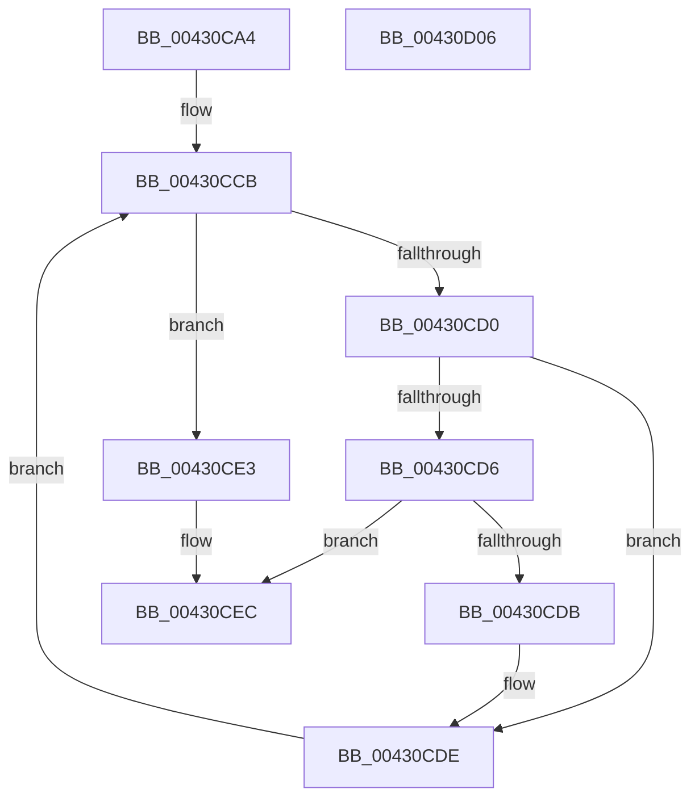

# MiMakeSecureExclusive

- RVA: `0x00430CA4`–`0x00430D07` (길이 `99` bytes)
- VA: `0x0000000140430CA4`
- 실행 섹션: `.text`
- PDB 이름 있음: `예`; PDB Function 태그: `아니요`
- unwind 정보 RVA: `0x00060BC4`
- 디코드: `32`개 명령, `99/99` bytes 표시
- 미해석 바이트: `0` (있으면 어셈블리에 `.byte`로 보존)

> 이 문서는 커널 이미지의 기계어와 PDB 기호를 분석해 생성했습니다. 4번과 5번은 함수 원형과 자료형을 바이너리 사용 방식에서 추정한 C 해석이며 원본 소스 복구 결과는 아닙니다.

## 1. Dependencies

- 직접 호출 지점: **2**; 고유 호출 대상: **2**
- 직접 호출자로 확인된 함수: **1**
- RIP 상대 이미지 참조: **0**

### Outgoing calls
- `0x00430CBC` → [MiLockVadCore](../29/MiLockVadCore_function_00297170.md) (function, `0x00297170`)
- `0x00430CEF` → [MiUnlockVadCore](MiUnlockVadCore_function_004311C0.md) (function, `0x004311C0`)

### Direct callers
- [MmStoreAllocateVirtualMemory](../../page/A6/MmStoreAllocateVirtualMemory_function_00A68238.md) at `0x00A6832D`

### Static image references
- 디코드된 RIP-relative 메모리 참조가 없습니다.

## 2. Other-region calls and transfers

- 다른 실행 섹션으로 향하는 call: **0**
- 별도 외부 분기/꼬리 이동을 확인하지 못했습니다.

## 3. Assembly (complete function range)

```asm
00430CA4  48 89 5C 24 08                  mov qword ptr [rsp + 8], rbx
00430CA9  48 89 74 24 10                  mov qword ptr [rsp + 0x10], rsi
00430CAE  57                              push rdi
00430CAF  48 83 EC 20                     sub rsp, 0x20
00430CB3  33 DB                           xor ebx, ebx
00430CB5  33 D2                           xor edx, edx
00430CB7  8B FB                           mov edi, ebx
00430CB9  48 8B F1                        mov rsi, rcx
00430CBC  E8 AF 64 E6 FF                  call 0x140297170
00430CC1  8A D0                           mov dl, al
00430CC3  48 8B 46 38                     mov rax, qword ptr [rsi + 0x38]
00430CC7  48 83 E0 F0                     and rax, 0xfffffffffffffff0
00430CCB  48 85 C0                        test rax, rax
00430CCE  74 13                           je 0x140430ce3
00430CD0  83 78 50 02                     cmp dword ptr [rax + 0x50], 2
00430CD4  75 08                           jne 0x140430cde
00430CD6  48 85 FF                        test rdi, rdi
00430CD9  75 11                           jne 0x140430cec
00430CDB  48 8B F8                        mov rdi, rax
00430CDE  48 8B 00                        mov rax, qword ptr [rax]
00430CE1  EB E8                           jmp 0x140430ccb
00430CE3  83 4F 08 20                     or dword ptr [rdi + 8], 0x20
00430CE7  BB 01 00 00 00                  mov ebx, 1
00430CEC  48 8B CE                        mov rcx, rsi
00430CEF  E8 CC 04 00 00                  call 0x1404311c0
00430CF4  48 8B 74 24 38                  mov rsi, qword ptr [rsp + 0x38]
00430CF9  8B C3                           mov eax, ebx
00430CFB  48 8B 5C 24 30                  mov rbx, qword ptr [rsp + 0x30]
00430D00  48 83 C4 20                     add rsp, 0x20
00430D04  5F                              pop rdi
00430D05  C3                              ret
00430D06  CC                              int3
```

## 4. C-style interpretation (structured pseudocode)

```c
__int64 __fastcall MiMakeSecureExclusive(__int64 a1, int a2)
{
    __int64 result;
    __int64 v_rbx;
    __int64 v_rsp;
    unsigned __int64 v_stack_p10;
    unsigned __int64 v_stack_p8;

    v_stack_p8 = v_rbx;
    v_stack_p10 = v_rsi;
    v_rsp = (v_rsp) - (32);
    v_rbx = 0;
    a2 = 0;
    result = MiLockVadCore(a1, a2, a3, a4);
    result = (*(unsigned __int64 *)(a1 + 56)) & (-16);
loc_00430CCB:
    if (result == 0) goto loc_00430CE3;
    if ((*(unsigned int *)(result + 80)) != 2) goto loc_00430CDE;
    if (0 != 0) goto loc_00430CEC;
loc_00430CDE:
    goto loc_00430CCB;
loc_00430CE3:
loc_00430CEC:
    result = MiUnlockVadCore(a1, (unsigned __int8)(result), a3, a4);
    v_rsp = (v_rsp) + (32);
    return 1;
}
```

## 5. (Beta) C Style

```c
int64_t MiMakeSecureExclusive(void *Arg1, int32_t Arg2)
{
    uint8_t *arg1 = (uint8_t *)Arg1;

    int64_t result;
    int64_t local_rbx;
    int64_t local_rsp;
    uint64_t v_stack_p10;
    uint64_t v_stack_p8;

    v_stack_p8 = local_rbx;
    v_stack_p10 = local_rsi;
    local_rsp = (local_rsp) - (32);
    local_rbx = 0;
    Arg2 = 0;
    result = MiLockVadCore(Arg1, Arg2, a3, a4);
    result = (*(uint64_t *)(arg1 + 0x38)) & (-16);
loc_00430CCB:
    if (result == 0) goto loc_00430CE3;
    if ((*(uint32_t *)(result + 0x50)) != 2) goto loc_00430CDE;
    if (0 != 0) goto loc_00430CEC;
loc_00430CDE:
    goto loc_00430CCB;
loc_00430CE3:
loc_00430CEC:
    result = MiUnlockVadCore(Arg1, (uint8_t)(result), a3, a4);
    local_rsp = (local_rsp) + (32);
    return 1;
}
```

### 관측된 메모리 오프셋

구조체 형식이 확인되지 않은 접근은 인자 기준의 오프셋으로만 기록했습니다.

| 기준 인자 | 오프셋 표현 | 폭 (bit) | 접근 |
|---|---:|---:|---|
| `Arg1` | `+ 0x38` | `64` | `R` |

## 6. Execution-region graph

[열기: 2D/3D 그래프와 함수 탐색 컨트롤 패널](../../../control-panel.html?section=text&rva=0x00430CA4&view=graph)

- 2D 그래프는 위에서 아래로 흐르고, 3D 그래프는 빈 공간을 드래그해 회전합니다. Shift+드래그는 이동, 휠은 확대·축소, 함수 노드 선택은 대상 보고서 이동입니다.

### Static fallback


