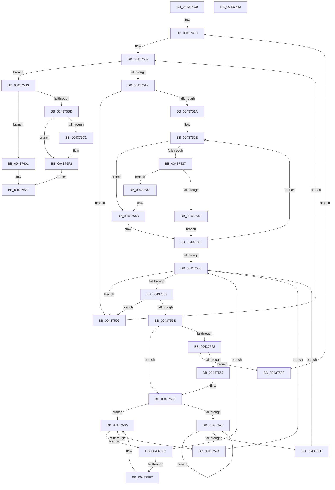

# MiMarkHugeRangeTransition

- RVA: `0x004374C0`–`0x00437644` (길이 `388` bytes)
- VA: `0x00000001404374C0`
- 실행 섹션: `.text`
- PDB 이름 있음: `예`; PDB Function 태그: `아니요`
- unwind 정보 RVA: `0x0006F874`
- 디코드: `109`개 명령, `388/388` bytes 표시
- 미해석 바이트: `0` (있으면 어셈블리에 `.byte`로 보존)

> 이 문서는 커널 이미지의 기계어와 PDB 기호를 분석해 생성했습니다. 4번과 5번은 함수 원형과 자료형을 바이너리 사용 방식에서 추정한 C 해석이며 원본 소스 복구 결과는 아닙니다.

## 1. Dependencies

- 직접 호출 지점: **4**; 고유 호출 대상: **3**
- 직접 호출자로 확인된 함수: **1**
- RIP 상대 이미지 참조: **3**

### Outgoing calls
- `0x004374F3` → [MiLockIoPfnTree](../2A/MiLockIoPfnTree_function_002AC8A4.md) (function, `0x002AC8A4`)
- `0x004375A7` → [MiUnlockIoPfnTree](../2A/MiUnlockIoPfnTree_function_002AC7F8.md) (function, `0x002AC7F8`)
- `0x004375FA` → [MiUnlockIoPfnTree](../2A/MiUnlockIoPfnTree_function_002AC7F8.md) (function, `0x002AC7F8`)
- `0x00437622` → [MiReleaseSpinLockShared](../34/MiReleaseSpinLockShared_function_00348BF0.md) (function, `0x00348BF0`)

### Direct callers
- [MiInsertHugeRangeInList](MiInsertHugeRangeInList_function_004371E8.md) at `0x004372A6`

### Static image references
- `0x004374FB` → RVA `0x00E37280` (`.data`; read)
- `0x00437502` → RVA `0x00E37300` (`.data`; read)
- `0x004375C1` → RVA `0x00E300C0` (`.data`; read)

## 2. Other-region calls and transfers

- 다른 실행 섹션으로 향하는 call: **0**
- 별도 외부 분기/꼬리 이동을 확인하지 못했습니다.

## 3. Assembly (complete function range)

```asm
004374C0  4C 8B DC                        mov r11, rsp
004374C3  49 89 5B 08                     mov qword ptr [r11 + 8], rbx
004374C7  49 89 6B 10                     mov qword ptr [r11 + 0x10], rbp
004374CB  49 89 73 18                     mov qword ptr [r11 + 0x18], rsi
004374CF  57                              push rdi
004374D0  48 83 EC 50                     sub rsp, 0x50
004374D4  0F 57 C0                        xorps xmm0, xmm0
004374D7  33 C0                           xor eax, eax
004374D9  0F 11 44 24 20                  movups xmmword ptr [rsp + 0x20], xmm0
004374DE  48 8B E9                        mov rbp, rcx
004374E1  0F 11 44 24 30                  movups xmmword ptr [rsp + 0x30], xmm0
004374E6  49 89 43 E8                     mov qword ptr [r11 - 0x18], rax
004374EA  33 DB                           xor ebx, ebx
004374EC  8D 48 01                        lea ecx, [rax + 1]
004374EF  8B F3                           mov esi, ebx
004374F1  8B FB                           mov edi, ebx
004374F3  E8 AC 53 E7 FF                  call 0x1402ac8a4
004374F8  44 8A D0                        mov r10b, al
004374FB  4C 8D 05 7E FD 9F 00            lea r8, [rip + 0x9ffd7e]
00437502  48 8D 05 F7 FD 9F 00            lea rax, [rip + 0x9ffdf7]
00437509  4C 3B C0                        cmp r8, rax
0043750C  0F 8D A7 00 00 00               jge 0x1404375b9
00437512  49 8B 10                        mov rdx, qword ptr [r8]
00437515  48 85 D2                        test rdx, rdx
00437518  74 7C                           je 0x140437596
0043751A  4C 8D 8D FF FF 03 00            lea r9, [rbp + 0x3ffff]
00437521  48 89 6C 24 38                  mov qword ptr [rsp + 0x38], rbp
00437526  4C 89 4C 24 40                  mov qword ptr [rsp + 0x40], r9
0043752B  48 8B CB                        mov rcx, rbx
0043752E  48 8B 42 18                     mov rax, qword ptr [rdx + 0x18]
00437532  4C 3B C8                        cmp r9, rax
00437535  72 14                           jb 0x14043754b
00437537  48 05 00 02 00 00               add rax, 0x200
0043753D  48 3B E8                        cmp rbp, rax
00437540  72 06                           jb 0x140437548
00437542  48 8B 52 08                     mov rdx, qword ptr [rdx + 8]
00437546  EB 06                           jmp 0x14043754e
00437548  48 8B CA                        mov rcx, rdx
0043754B  48 8B 12                        mov rdx, qword ptr [rdx]
0043754E  48 85 D2                        test rdx, rdx
00437551  75 DB                           jne 0x14043752e
00437553  48 85 C9                        test rcx, rcx
00437556  74 3E                           je 0x140437596
00437558  4C 3B 49 18                     cmp r9, qword ptr [rcx + 0x18]
0043755C  72 38                           jb 0x140437596
0043755E  39 59 20                        cmp dword ptr [rcx + 0x20], ebx
00437561  74 06                           je 0x140437569
00437563  85 F6                           test esi, esi
00437565  74 38                           je 0x14043759f
00437567  FF C7                           inc edi
00437569  48 8B 41 08                     mov rax, qword ptr [rcx + 8]
0043756D  48 8B D1                        mov rdx, rcx
00437570  48 85 C0                        test rax, rax
00437573  74 15                           je 0x14043758a
00437575  48 8B C8                        mov rcx, rax
00437578  48 8B 00                        mov rax, qword ptr [rax]
0043757B  48 85 C0                        test rax, rax
0043757E  75 F5                           jne 0x140437575
00437580  EB D1                           jmp 0x140437553
00437582  48 39 11                        cmp qword ptr [rcx], rdx
00437585  74 CC                           je 0x140437553
00437587  48 8B D1                        mov rdx, rcx
0043758A  48 8B 49 10                     mov rcx, qword ptr [rcx + 0x10]
0043758E  48 83 E1 FC                     and rcx, 0xfffffffffffffffc
00437592  75 EE                           jne 0x140437582
00437594  EB BD                           jmp 0x140437553
00437596  49 83 C0 40                     add r8, 0x40
0043759A  E9 63 FF FF FF                  jmp 0x140437502
0043759F  BA 01 00 00 00                  mov edx, 1
004375A4  41 8A CA                        mov cl, r10b
004375A7  E8 4C 52 E7 FF                  call 0x1402ac7f8
004375AC  BE 01 00 00 00                  mov esi, 1
004375B1  8D 4E 01                        lea ecx, [rsi + 1]
004375B4  E9 3A FF FF FF                  jmp 0x1404374f3
004375B9  85 F6                           test esi, esi
004375BB  74 44                           je 0x140437601
004375BD  85 FF                           test edi, edi
004375BF  74 31                           je 0x1404375f2
004375C1  4C 8B 05 F8 8A 9F 00            mov r8, qword ptr [rip + 0x9f8af8]
004375C8  8B CF                           mov ecx, edi
004375CA  48 C1 ED 12                     shr rbp, 0x12
004375CE  81 E1 FF 01 00 00               and ecx, 0x1ff
004375D4  81 E5 FF FF 3F 00               and ebp, 0x3fffff
004375DA  48 C1 E1 0F                     shl rcx, 0xf
004375DE  48 83 C9 05                     or rcx, 5
004375E2  49 8B 04 E8                     mov rax, qword ptr [r8 + rbp*8]
004375E6  25 F8 7F 00 00                  and eax, 0x7ff8
004375EB  48 0B C8                        or rcx, rax
004375EE  49 89 0C E8                     mov qword ptr [r8 + rbp*8], rcx
004375F2  BA 02 00 00 00                  mov edx, 2
004375F7  41 8A CA                        mov cl, r10b
004375FA  E8 F9 51 E7 FF                  call 0x1402ac7f8
004375FF  EB 26                           jmp 0x140437627
00437601  65 48 8B 0C 25 20 00 00 00      mov rcx, qword ptr gs:[0x20]
0043760A  48 8B 91 38 88 00 00            mov rdx, qword ptr [rcx + 0x8838]
00437611  48 8B 8A 48 01 00 00            mov rcx, qword ptr [rdx + 0x148]
00437618  41 8A D2                        mov dl, r10b
0043761B  48 81 C1 80 02 00 00            add rcx, 0x280
00437622  E8 C9 15 F1 FF                  call 0x140348bf0
00437627  48 8B 6C 24 68                  mov rbp, qword ptr [rsp + 0x68]
0043762C  85 FF                           test edi, edi
0043762E  48 8B 74 24 70                  mov rsi, qword ptr [rsp + 0x70]
00437633  0F 95 C3                        setne bl
00437636  8B C3                           mov eax, ebx
00437638  48 8B 5C 24 60                  mov rbx, qword ptr [rsp + 0x60]
0043763D  48 83 C4 50                     add rsp, 0x50
00437641  5F                              pop rdi
00437642  C3                              ret
00437643  CC                              int3
```

## 4. C-style interpretation (structured pseudocode)

```c
__int64 __fastcall MiMarkHugeRangeTransition(__int64 a1)
{
    __int64 result;
    __int64 v_rbp;
    __int64 v_rbx;
    __int64 v_rdi;
    __int64 v_rsp;
    unsigned __int64 v_stack_m18;
    unsigned __int64 v_stack_m20;
    unsigned __int64 v_stack_m28;
    unsigned __int64 v_stack_m38;
    unsigned __int64 v_stack_p10;
    unsigned __int64 v_stack_p18;
    unsigned __int64 v_stack_p8;

    *(unsigned __int64 *)(v_rsp + 8) = v_rbx;
    *(unsigned __int64 *)(v_rsp + 16) = v_rbp;
    *(unsigned __int64 *)(v_rsp + 24) = v_rsi;
    v_rsp = (v_rsp) - (80);
    result = 0;
    v_stack_m38 = v_xmm0;
    v_stack_m28 = v_xmm0;
    *(unsigned __int64 *)(v_rsp - 24) = 0;
    v_rbx = 0;
loc_004374F3:
    result = MiLockIoPfnTree(result + 1, a2, a3, a4);
loc_00437502:
    if ((v_rip + 10485118) >= (v_rip + 10485239)) goto loc_004375B9;
    if (*(unsigned __int64 *)(v_rip + 10485118) == 0) goto loc_00437596;
    v_stack_m20 = a1;
    v_stack_m18 = a1 + 262143;
loc_0043752E:
    if ((a1 + 262143) < (*(unsigned __int64 *)(*(unsigned __int64 *)(v_rip + 10485118) + 24))) goto loc_0043754B;
    result = (*(unsigned __int64 *)(*(unsigned __int64 *)(v_rip + 10485118) + 24)) + (512);
    if (a1 < result) goto loc_00437548;
    goto loc_0043754E;
loc_00437548:
loc_0043754B:
loc_0043754E:
    if (*(unsigned __int64 *)(*(unsigned __int64 *)(*(unsigned __int64 *)(v_rip + 10485118) + 8)) != 0) goto loc_0043752E;
loc_00437553:
    if (*(unsigned __int64 *)(*(unsigned __int64 *)(v_rip + 10485118) + 8) == 0) goto loc_00437596;
    if ((a1 + 262143) < (*(unsigned __int64 *)(*(unsigned __int64 *)(*(unsigned __int64 *)(v_rip + 10485118) + 8) + 24))) goto loc_00437596;
    if ((*(unsigned int *)(*(unsigned __int64 *)(*(unsigned __int64 *)(v_rip + 10485118) + 8) + 32)) == 0) goto loc_00437569;
    if (0 == 0) goto loc_0043759F;
    v_rdi = (unsigned int)((0) + 1);
loc_00437569:
    if (*(unsigned __int64 *)(*(unsigned __int64 *)(*(unsigned __int64 *)(v_rip + 10485118) + 8) + 8) == 0) goto loc_0043758A;
loc_00437575:
    if (*(unsigned __int64 *)(*(unsigned __int64 *)(*(unsigned __int64 *)(*(unsigned __int64 *)(v_rip + 10485118) + 8) + 8)) != 0) goto loc_00437575;
    goto loc_00437553;
loc_00437582:
    if ((*(unsigned __int64 *)(*(unsigned __int64 *)(*(unsigned __int64 *)(*(unsigned __int64 *)(v_rip + 10485118) + 8) + 8))) == (*(unsigned __int64 *)(*(unsigned __int64 *)(v_rip + 10485118) + 8))) goto loc_00437553;
loc_0043758A:
    a1 = (*(unsigned __int64 *)(*(unsigned __int64 *)(*(unsigned __int64 *)(*(unsigned __int64 *)(v_rip + 10485118) + 8) + 8) + 16)) & (-4);
    if (condition_is_not_equal) goto loc_00437582;
    goto loc_00437553;
loc_00437596:
    a3 = (v_rip + 10485118) + (64);
    goto loc_00437502;
loc_0043759F:
    result = MiUnlockIoPfnTree((unsigned __int8)((unsigned __int8)(result)), 1, a3, a1 + 262143);
    goto loc_004374F3;
loc_004375B9:
    if (1 == 0) goto loc_00437601;
    v_rbp = a1;
    if ((unsigned int)(v_rdi) != 0) {
        a3 = *(unsigned __int64 *)(v_rip + 10455800);
        a1 = (unsigned int)(v_rdi);
        v_rbp = (a1) >> (18);
        a1 = (unsigned int)((a1) & (511));
        v_rbp = (unsigned int)((v_rbp) & (0x3FFFFFULL));
        a1 = (a1) << (15);
        a1 = (a1) | (5);
        result = *(unsigned __int64 *)(a3 + v_rbp * 8);
        result = (unsigned int)((result) & (0x7FF8ULL));
        a1 = (a1) | (result);
        *(unsigned __int64 *)(a3 + v_rbp * 8) = a1;
    }
    result = MiUnlockIoPfnTree((unsigned __int8)((unsigned __int8)(result)), 2, a3, a1 + 262143);
    goto loc_00437627;
loc_00437601:
    a1 = (*(unsigned __int64 *)(*(unsigned __int64 *)(*(unsigned __int64 *)(gs_base + (0 + 32)) + 34872) + 328)) + (640);
    result = MiReleaseSpinLockShared(a1, (unsigned __int8)((unsigned __int8)(result)), a3, a1 + 262143);
loc_00437627:
    v_rbx = ((unsigned int)(v_rdi) != 0) ? 1 : 0;
    v_rsp = (v_rsp) + (80);
    return (unsigned int)((unsigned int)(v_rbx));
}
```

## 5. (Beta) C Style

```c
int64_t MiMarkHugeRangeTransition(int64_t Arg1)
{
    int64_t result;
    int64_t local_rbp;
    int64_t local_rbx;
    int64_t local_rdi;
    int64_t local_rsp;
    uint64_t v_stack_m18;
    uint64_t v_stack_m20;
    uint64_t v_stack_m28;
    uint64_t v_stack_m38;
    uint64_t v_stack_p10;
    uint64_t v_stack_p18;
    uint64_t v_stack_p8;

    *(uint64_t *)(local_rsp + 0x8) = local_rbx;
    *(uint64_t *)(local_rsp + 0x10) = local_rbp;
    *(uint64_t *)(local_rsp + 0x18) = local_rsi;
    local_rsp = (local_rsp) - (80);
    result = 0;
    v_stack_m38 = v_xmm0;
    v_stack_m28 = v_xmm0;
    *(uint64_t *)(local_rsp - 0x18) = 0;
    local_rbx = 0;
loc_004374F3:
    result = MiLockIoPfnTree(result + 1, a2, a3, a4);
loc_00437502:
    if ((v_rip + 10485118) >= (v_rip + 10485239)) goto loc_004375B9;
    if (*(uint64_t *)(v_rip + 0x9FFD7E) == 0) goto loc_00437596;
    v_stack_m20 = Arg1;
    v_stack_m18 = Arg1 + 262143;
loc_0043752E:
    if ((Arg1 + 262143) < (*(uint64_t *)(*(uint64_t *)(v_rip + 0x9FFD7E) + 0x18))) goto loc_0043754B;
    result = (*(uint64_t *)(*(uint64_t *)(v_rip + 0x9FFD7E) + 0x18)) + (512);
    if (Arg1 < result) goto loc_00437548;
    goto loc_0043754E;
loc_00437548:
loc_0043754B:
loc_0043754E:
    if (*(uint64_t *)(*(uint64_t *)(*(uint64_t *)(v_rip + 0x9FFD7E) + 0x8)) != 0) goto loc_0043752E;
loc_00437553:
    if (*(uint64_t *)(*(uint64_t *)(v_rip + 0x9FFD7E) + 0x8) == 0) goto loc_00437596;
    if ((Arg1 + 262143) < (*(uint64_t *)(*(uint64_t *)(*(uint64_t *)(v_rip + 0x9FFD7E) + 0x8) + 0x18))) goto loc_00437596;
    if ((*(uint32_t *)(*(uint64_t *)(*(uint64_t *)(v_rip + 0x9FFD7E) + 0x8) + 0x20)) == 0) goto loc_00437569;
    if (0 == 0) goto loc_0043759F;
    local_rdi = (uint32_t)((0) + 1);
loc_00437569:
    if (*(uint64_t *)(*(uint64_t *)(*(uint64_t *)(v_rip + 0x9FFD7E) + 0x8) + 0x8) == 0) goto loc_0043758A;
loc_00437575:
    if (*(uint64_t *)(*(uint64_t *)(*(uint64_t *)(*(uint64_t *)(v_rip + 0x9FFD7E) + 0x8) + 0x8)) != 0) goto loc_00437575;
    goto loc_00437553;
loc_00437582:
    if ((*(uint64_t *)(*(uint64_t *)(*(uint64_t *)(*(uint64_t *)(v_rip + 0x9FFD7E) + 0x8) + 0x8))) == (*(uint64_t *)(*(uint64_t *)(v_rip + 0x9FFD7E) + 0x8))) goto loc_00437553;
loc_0043758A:
    Arg1 = (*(uint64_t *)(*(uint64_t *)(*(uint64_t *)(*(uint64_t *)(v_rip + 0x9FFD7E) + 0x8) + 0x8) + 0x10)) & (-4);
    if (condition_is_not_equal) goto loc_00437582;
    goto loc_00437553;
loc_00437596:
    a3 = (v_rip + 10485118) + (64);
    goto loc_00437502;
loc_0043759F:
    result = MiUnlockIoPfnTree((uint8_t)((uint8_t)(result)), 1, a3, Arg1 + 262143);
    goto loc_004374F3;
loc_004375B9:
    if (1 == 0) goto loc_00437601;
    local_rbp = Arg1;
    if ((uint32_t)(local_rdi) != 0) {
        a3 = *(uint64_t *)(v_rip + 0x9F8AF8);
        Arg1 = (uint32_t)(local_rdi);
        local_rbp = (Arg1) >> (18);
        Arg1 = (uint32_t)((Arg1) & (511));
        local_rbp = (uint32_t)((local_rbp) & (0x3FFFFFULL));
        Arg1 = (Arg1) << (15);
        Arg1 = (Arg1) | (5);
        result = *(uint64_t *)(a3 + local_rbp * 8);
        result = (uint32_t)((result) & (0x7FF8ULL));
        Arg1 = (Arg1) | (result);
        *(uint64_t *)(a3 + local_rbp * 8) = Arg1;
    }
    result = MiUnlockIoPfnTree((uint8_t)((uint8_t)(result)), 2, a3, Arg1 + 262143);
    goto loc_00437627;
loc_00437601:
    Arg1 = (*(uint64_t *)(*(uint64_t *)(*(uint64_t *)(gs_base + (0 + 0x20)) + 0x8838) + 0x148)) + (640);
    result = MiReleaseSpinLockShared(Arg1, (uint8_t)((uint8_t)(result)), a3, Arg1 + 262143);
loc_00437627:
    local_rbx = ((uint32_t)(local_rdi) != 0) ? 1 : 0;
    local_rsp = (local_rsp) + (80);
    return (uint32_t)((uint32_t)(local_rbx));
}
```

## 6. Execution-region graph

[열기: 2D/3D 그래프와 함수 탐색 컨트롤 패널](../../../control-panel.html?section=text&rva=0x004374C0&view=graph)

- 2D 그래프는 위에서 아래로 흐르고, 3D 그래프는 빈 공간을 드래그해 회전합니다. Shift+드래그는 이동, 휠은 확대·축소, 함수 노드 선택은 대상 보고서 이동입니다.

### Static fallback


