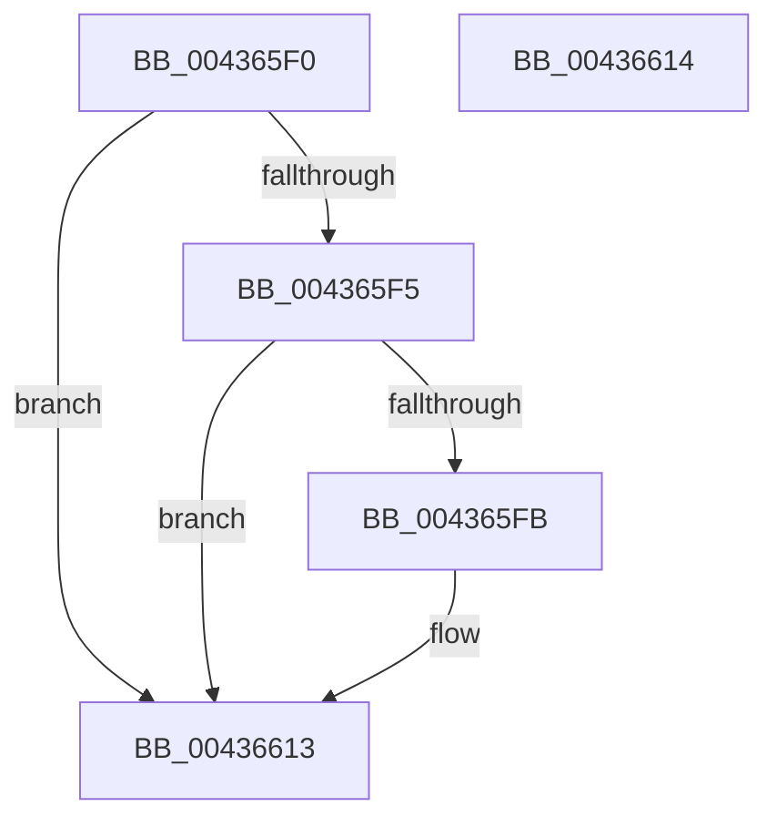

# MiMarkResumptionPoint

- RVA: `0x004365F0`–`0x00436615` (길이 `37` bytes)
- VA: `0x00000001404365F0`
- 실행 섹션: `.text`
- PDB 이름 있음: `예`; PDB Function 태그: `아니요`
- unwind 정보 RVA: `0x000DB714`
- 디코드: `14`개 명령, `37/37` bytes 표시
- 미해석 바이트: `0` (있으면 어셈블리에 `.byte`로 보존)

> 이 문서는 커널 이미지의 기계어와 PDB 기호를 분석해 생성했습니다. 4번과 5번은 함수 원형과 자료형을 바이너리 사용 방식에서 추정한 C 해석이며 원본 소스 복구 결과는 아닙니다.

## 1. Dependencies

- 직접 호출 지점: **0**; 고유 호출 대상: **0**
- 직접 호출자로 확인된 함수: **1**
- RIP 상대 이미지 참조: **0**

### Outgoing calls
- 직접 디코드된 call 명령이 없습니다.

### Direct callers
- [MiWalkPageTablesRecursively](../27/MiWalkPageTablesRecursively_function_002796C0.md) at `0x0027B7C1`

### Static image references
- 디코드된 RIP-relative 메모리 참조가 없습니다.

## 2. Other-region calls and transfers

- 다른 실행 섹션으로 향하는 call: **0**
- 별도 외부 분기/꼬리 이동을 확인하지 못했습니다.

## 3. Assembly (complete function range)

```asm
004365F0  45 85 C0                        test r8d, r8d
004365F3  74 1E                           je 0x140436613
004365F5  41 83 F9 03                     cmp r9d, 3
004365F9  74 18                           je 0x140436613
004365FB  8B 41 04                        mov eax, dword ptr [rcx + 4]
004365FE  48 89 51 48                     mov qword ptr [rcx + 0x48], rdx
00436602  41 0F B6 D0                     movzx edx, r8b
00436606  C1 E2 02                        shl edx, 2
00436609  33 D0                           xor edx, eax
0043660B  83 E2 1C                        and edx, 0x1c
0043660E  33 D0                           xor edx, eax
00436610  89 51 04                        mov dword ptr [rcx + 4], edx
00436613  C3                              ret
00436614  CC                              int3
```

## 4. C-style interpretation (structured pseudocode)

```c
__int64 __fastcall MiMarkResumptionPoint(__int64 a1, __int64 a2, int a3, int a4)
{
    __int64 result;

    if (a3 == 0) goto loc_00436613;
    if (a4 != 3) {
        result = *(unsigned int *)(a1 + 4);
        *(unsigned __int64 *)(a1 + 72) = a2;
        a2 = (unsigned __int8)(a3);
        a2 = (unsigned int)((a2) << (2));
        a2 = (unsigned int)((a2) ^ ((unsigned int)(result)));
        a2 = (unsigned int)((a2) & (28));
        a2 = (unsigned int)((a2) ^ ((unsigned int)(result)));
        *(unsigned int *)(a1 + 4) = (unsigned int)(a2);
    }
    return result;
}
```

## 5. (Beta) C Style

```c
int64_t MiMarkResumptionPoint(void *Arg1, int64_t Arg2, int32_t Arg3, int32_t Arg4)
{
    uint8_t *arg1 = (uint8_t *)Arg1;

    int64_t result;

    if (Arg3 == 0) goto loc_00436613;
    if (Arg4 != 3) {
        result = *(uint32_t *)(arg1 + 0x4);
        *(uint64_t *)(arg1 + 0x48) = Arg2;
        Arg2 = (uint8_t)(Arg3);
        Arg2 = (uint32_t)((Arg2) << (2));
        Arg2 = (uint32_t)((Arg2) ^ ((uint32_t)(result)));
        Arg2 = (uint32_t)((Arg2) & (28));
        Arg2 = (uint32_t)((Arg2) ^ ((uint32_t)(result)));
        *(uint32_t *)(arg1 + 0x4) = (uint32_t)(Arg2);
    }
    return result;
}
```

### 관측된 메모리 오프셋

구조체 형식이 확인되지 않은 접근은 인자 기준의 오프셋으로만 기록했습니다.

| 기준 인자 | 오프셋 표현 | 폭 (bit) | 접근 |
|---|---:|---:|---|
| `Arg1` | `+ 0x4` | `32` | `R` |
| `Arg1` | `+ 0x4` | `32` | `W` |
| `Arg1` | `+ 0x48` | `64` | `W` |

## 6. Execution-region graph

[열기: 2D/3D 그래프와 함수 탐색 컨트롤 패널](../../../control-panel.html?section=text&rva=0x004365F0&view=graph)

- 2D 그래프는 위에서 아래로 흐르고, 3D 그래프는 빈 공간을 드래그해 회전합니다. Shift+드래그는 이동, 휠은 확대·축소, 함수 노드 선택은 대상 보고서 이동입니다.

### Static fallback


