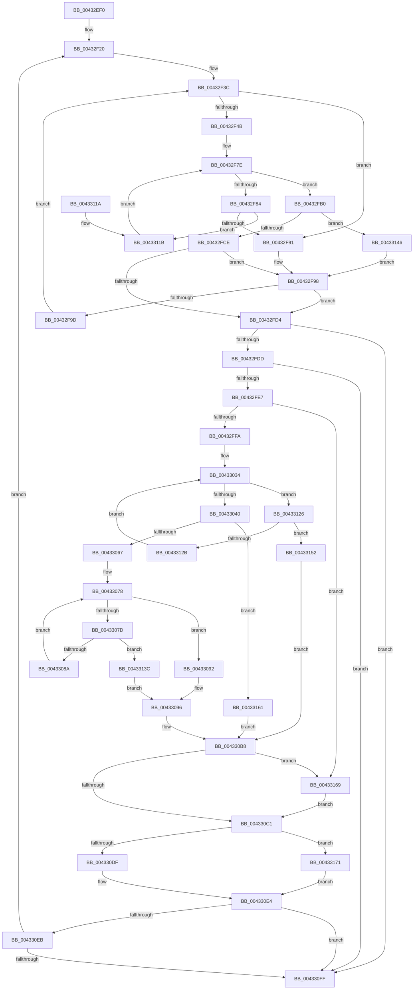

# MiMirrorPerformBlackWrites

- RVA: `0x00432EF0`–`0x0043317B` (길이 `651` bytes)
- VA: `0x0000000140432EF0`
- 실행 섹션: `.text`
- PDB 이름 있음: `예`; PDB Function 태그: `아니요`
- unwind 정보 RVA: `0x000A2438`
- 디코드: `173`개 명령, `651/651` bytes 표시
- 미해석 바이트: `0` (있으면 어셈블리에 `.byte`로 보존)

> 이 문서는 커널 이미지의 기계어와 PDB 기호를 분석해 생성했습니다. 4번과 5번은 함수 원형과 자료형을 바이너리 사용 방식에서 추정한 C 해석이며 원본 소스 복구 결과는 아닙니다.

## 1. Dependencies

- 직접 호출 지점: **2**; 고유 호출 대상: **2**
- 직접 호출자로 확인된 함수: **1**
- RIP 상대 이미지 참조: **3**

### Outgoing calls
- `0x004330DF` → [PopMirrorPhysicalMemory](../../pagelk/B7/PopMirrorPhysicalMemory_function_00B77D10.md) (function, `0x00B77D10`)
- `0x00433171` → [guard_dispatch_icall](../6B/guard_dispatch_icall_function_006BAAD0.md) (function, `0x006BAAD0`)

### Direct callers
- [MiMirrorBlackPhase](../67/MiMirrorBlackPhase_function_00678B4C.md) at `0x00678BFA`

### Static image references
- `0x00432F0A` → RVA `0x00B77D10` (`PopMirrorPhysicalMemory`; read)
- `0x00432F20` → RVA `0x00E301A0` (`.data`; read)
- `0x00432F2A` → RVA `0x00E301A8` (`.data`; read)

## 2. Other-region calls and transfers

- 다른 실행 섹션으로 향하는 call: **1**
  - `0x004330DF` → [PopMirrorPhysicalMemory](../../pagelk/B7/PopMirrorPhysicalMemory_function_00B77D10.md) (`.text` → `PAGELK`)
- 별도 외부 분기/꼬리 이동을 확인하지 못했습니다.

## 3. Assembly (complete function range)

```asm
00432EF0  48 89 5C 24 08                  mov qword ptr [rsp + 8], rbx
00432EF5  48 89 74 24 18                  mov qword ptr [rsp + 0x18], rsi
00432EFA  57                              push rdi
00432EFB  41 54                           push r12
00432EFD  41 55                           push r13
00432EFF  41 56                           push r14
00432F01  41 57                           push r15
00432F03  48 83 EC 20                     sub rsp, 0x20
00432F07  45 33 E4                        xor r12d, r12d
00432F0A  4C 8D 2D FF 4D 74 00            lea r13, [rip + 0x744dff]
00432F11  45 8B F4                        mov r14d, r12d
00432F14  41 8B D4                        mov edx, r12d
00432F17  4C 8B F9                        mov r15, rcx
00432F1A  66 0F 1F 44 00 00               nop word ptr [rax + rax]
00432F20  4C 8B 0D 79 D2 9F 00            mov r9, qword ptr [rip + 0x9fd279]
00432F27  4D 8B C4                        mov r8, r12
00432F2A  48 8B 1D 77 D2 9F 00            mov rbx, qword ptr [rip + 0x9fd277]
00432F31  49 3B D1                        cmp rdx, r9
00432F34  4C 0F 42 C2                     cmovb r8, rdx
00432F38  4D 8D 51 FF                     lea r10, [r9 - 1]
00432F3C  49 8B C2                        mov rax, r10
00432F3F  49 2B C0                        sub rax, r8
00432F42  48 FF C0                        inc rax
00432F45  48 83 F8 01                     cmp rax, 1
00432F49  72 46                           jb 0x140432f91
00432F4B  49 8B C2                        mov rax, r10
00432F4E  41 0F B6 C8                     movzx ecx, r8b
00432F52  48 C1 E8 06                     shr rax, 6
00432F56  80 E1 3F                        and cl, 0x3f
00432F59  41 BB 01 00 00 00               mov r11d, 1
00432F5F  49 D3 E3                        shl r11, cl
00432F62  49 FF CB                        dec r11
00432F65  48 8D 34 C3                     lea rsi, [rbx + rax*8]
00432F69  49 8B C0                        mov rax, r8
00432F6C  48 C1 E8 06                     shr rax, 6
00432F70  48 8D 3C C3                     lea rdi, [rbx + rax*8]
00432F74  48 8B 04 C3                     mov rax, qword ptr [rbx + rax*8]
00432F78  48 F7 D0                        not rax
00432F7B  4C 0B D8                        or r11, rax
00432F7E  49 83 FB FF                     cmp r11, -1
00432F82  75 2C                           jne 0x140432fb0
00432F84  48 83 C7 08                     add rdi, 8
00432F88  48 3B FE                        cmp rdi, rsi
00432F8B  0F 86 8A 01 00 00               jbe 0x14043311b
00432F91  48 C7 C7 FF FF FF FF            mov rdi, 0xffffffffffffffff
00432F98  4D 85 C0                        test r8, r8
00432F9B  74 37                           je 0x140432fd4
00432F9D  4C 8D 52 01                     lea r10, [rdx + 1]
00432FA1  4D 8B C4                        mov r8, r12
00432FA4  4D 3B D1                        cmp r10, r9
00432FA7  4D 0F 47 D1                     cmova r10, r9
00432FAB  49 FF CA                        dec r10
00432FAE  EB 8C                           jmp 0x140432f3c
00432FB0  48 2B FB                        sub rdi, rbx
00432FB3  49 F7 D3                        not r11
00432FB6  48 C1 FF 03                     sar rdi, 3
00432FBA  49 0F BC C3                     bsf rax, r11
00432FBE  48 C1 E7 06                     shl rdi, 6
00432FC2  48 03 F8                        add rdi, rax
00432FC5  49 3B FA                        cmp rdi, r10
00432FC8  0F 87 78 01 00 00               ja 0x140433146
00432FCE  48 83 FF FF                     cmp rdi, -1
00432FD2  74 C4                           je 0x140432f98
00432FD4  48 3B FA                        cmp rdi, rdx
00432FD7  0F 82 22 01 00 00               jb 0x1404330ff
00432FDD  48 83 FF FF                     cmp rdi, -1
00432FE1  0F 84 18 01 00 00               je 0x1404330ff
00432FE7  48 8B 05 B2 D1 9F 00            mov rax, qword ptr [rip + 0x9fd1b2]
00432FEE  49 8B DC                        mov rbx, r12
00432FF1  48 3B C7                        cmp rax, rdi
00432FF4  0F 86 6F 01 00 00               jbe 0x140433169
00432FFA  4C 8B 0D A7 D1 9F 00            mov r9, qword ptr [rip + 0x9fd1a7]
00433001  48 FF C8                        dec rax
00433004  48 C1 E8 06                     shr rax, 6
00433008  40 0F B6 CF                     movzx ecx, dil
0043300C  80 E1 3F                        and cl, 0x3f
0043300F  4D 8D 14 C1                     lea r10, [r9 + rax*8]
00433013  48 8B C7                        mov rax, rdi
00433016  48 C1 E8 06                     shr rax, 6
0043301A  49 8B 14 C1                     mov rdx, qword ptr [r9 + rax*8]
0043301E  4D 8D 04 C1                     lea r8, [r9 + rax*8]
00433022  B8 01 00 00 00                  mov eax, 1
00433027  48 D3 E0                        shl rax, cl
0043302A  48 FF C8                        dec rax
0043302D  48 0B D0                        or rdx, rax
00433030  49 8D 40 08                     lea rax, [r8 + 8]
00433034  48 F7 D2                        not rdx
00433037  48 85 D2                        test rdx, rdx
0043303A  0F 84 E6 00 00 00               je 0x140433126
00433040  48 0F BC CA                     bsf rcx, rdx
00433044  49 8B F0                        mov rsi, r8
00433047  49 2B F1                        sub rsi, r9
0043304A  8B C1                           mov eax, ecx
0043304C  48 C1 FE 03                     sar rsi, 3
00433050  48 C1 E6 06                     shl rsi, 6
00433054  48 03 F0                        add rsi, rax
00433057  48 8B 05 42 D1 9F 00            mov rax, qword ptr [rip + 0x9fd142]
0043305E  48 3B F0                        cmp rsi, rax
00433061  0F 87 FA 00 00 00               ja 0x140433161
00433067  B8 01 00 00 00                  mov eax, 1
0043306C  48 D3 E0                        shl rax, cl
0043306F  48 FF C8                        dec rax
00433072  48 0B C2                        or rax, rdx
00433075  48 F7 D0                        not rax
00433078  48 85 C0                        test rax, rax
0043307B  75 15                           jne 0x140433092
0043307D  49 8D 40 08                     lea rax, [r8 + 8]
00433081  49 3B C2                        cmp rax, r10
00433084  0F 87 B2 00 00 00               ja 0x14043313c
0043308A  4C 8B C0                        mov r8, rax
0043308D  48 8B 00                        mov rax, qword ptr [rax]
00433090  EB E6                           jmp 0x140433078
00433092  48 0F BC C0                     bsf rax, rax
00433096  49 8B D8                        mov rbx, r8
00433099  49 2B D9                        sub rbx, r9
0043309C  48 C1 FB 03                     sar rbx, 3
004330A0  48 C1 E3 06                     shl rbx, 6
004330A4  48 03 D8                        add rbx, rax
004330A7  48 8B 05 F2 D0 9F 00            mov rax, qword ptr [rip + 0x9fd0f2]
004330AE  48 3B D8                        cmp rbx, rax
004330B1  48 0F 47 D8                     cmova rbx, rax
004330B5  48 2B DE                        sub rbx, rsi
004330B8  48 85 DB                        test rbx, rbx
004330BB  0F 84 A8 00 00 00               je 0x140433169
004330C1  49 8B 47 10                     mov rax, qword ptr [r15 + 0x10]
004330C5  48 2B F7                        sub rsi, rdi
004330C8  48 8B D6                        mov rdx, rsi
004330CB  48 8B CF                        mov rcx, rdi
004330CE  48 C1 E2 0C                     shl rdx, 0xc
004330D2  48 C1 E1 0C                     shl rcx, 0xc
004330D6  49 3B C5                        cmp rax, r13
004330D9  0F 85 92 00 00 00               jne 0x140433171
004330DF  E8 2C 4C 74 00                  call 0x140b77d10
004330E4  44 8B F0                        mov r14d, eax
004330E7  85 C0                           test eax, eax
004330E9  78 14                           js 0x1404330ff
004330EB  48 8D 14 3B                     lea rdx, [rbx + rdi]
004330EF  48 03 D6                        add rdx, rsi
004330F2  48 3B 15 A7 D0 9F 00            cmp rdx, qword ptr [rip + 0x9fd0a7]
004330F9  0F 82 21 FE FF FF               jb 0x140432f20
004330FF  48 8B 5C 24 50                  mov rbx, qword ptr [rsp + 0x50]
00433104  41 8B C6                        mov eax, r14d
00433107  48 8B 74 24 60                  mov rsi, qword ptr [rsp + 0x60]
0043310C  48 83 C4 20                     add rsp, 0x20
00433110  41 5F                           pop r15
00433112  41 5E                           pop r14
00433114  41 5D                           pop r13
00433116  41 5C                           pop r12
00433118  5F                              pop rdi
00433119  C3                              ret
0043311A  CC                              int3
0043311B  4C 8B 1F                        mov r11, qword ptr [rdi]
0043311E  49 F7 D3                        not r11
00433121  E9 58 FE FF FF                  jmp 0x140432f7e
00433126  49 3B C2                        cmp rax, r10
00433129  77 27                           ja 0x140433152
0043312B  49 8B 50 08                     mov rdx, qword ptr [r8 + 8]
0043312F  49 83 C0 08                     add r8, 8
00433133  48 83 C0 08                     add rax, 8
00433137  E9 F8 FE FF FF                  jmp 0x140433034
0043313C  B8 40 00 00 00                  mov eax, 0x40
00433141  E9 50 FF FF FF                  jmp 0x140433096
00433146  48 C7 C7 FF FF FF FF            mov rdi, 0xffffffffffffffff
0043314D  E9 46 FE FF FF                  jmp 0x140432f98
00433152  48 8B 05 47 D0 9F 00            mov rax, qword ptr [rip + 0x9fd047]
00433159  48 8B F0                        mov rsi, rax
0043315C  E9 57 FF FF FF                  jmp 0x1404330b8
00433161  48 8B F0                        mov rsi, rax
00433164  E9 4F FF FF FF                  jmp 0x1404330b8
00433169  48 8B F0                        mov rsi, rax
0043316C  E9 50 FF FF FF                  jmp 0x1404330c1
00433171  E8 5A 79 28 00                  call 0x1406baad0
00433176  E9 69 FF FF FF                  jmp 0x1404330e4
```

## 4. C-style interpretation (structured pseudocode)

```c
__int64 __fastcall MiMirrorPerformBlackWrites(__int64 a1)
{
    __int64 result;
    __int64 v_r10;
    __int64 v_r11;
    __int64 v_r12;
    __int64 v_rbx;
    __int64 v_rdi;
    __int64 v_rsi;
    __int64 v_rsp;
    unsigned __int64 v_stack_p18;
    unsigned __int64 v_stack_p8;

    v_stack_p8 = v_rbx;
    v_stack_p18 = v_rsi;
    v_rsp = (v_rsp) - (32);
    v_r12 = 0;
loc_00432F20:
    a3 = 0;
    if (0 < (*(unsigned __int64 *)(v_rip + 10474105))) { a3 = 0; }
loc_00432F3C:
    result = (*(unsigned __int64 *)(v_rip + 10474105) - 1) - (a3);
    result = (result) + 1;
    if (result < 1) goto loc_00432F91;
    result = (*(unsigned __int64 *)(v_rip + 10474105) - 1) >> (6);
    a1 = (unsigned __int8)(((unsigned __int8)(a3)) & (63));
    v_r11 = (1) << ((unsigned __int8)(a1));
    v_r11 = (v_r11) - 1;
    result = (a3) >> (6);
    result = ~(*(unsigned __int64 *)(*(unsigned __int64 *)(v_rip + 10474103) + result * 8));
    v_r11 = (v_r11) | (result);
loc_00432F7E:
    if (v_r11 != -1) goto loc_00432FB0;
    v_rdi = (*(unsigned __int64 *)(v_rip + 10474103) + result * 8) + (8);
    if (v_rdi <= (*(unsigned __int64 *)(v_rip + 10474103) + result * 8)) goto loc_0043311B;
loc_00432F91:
loc_00432F98:
    if (a3 == 0) goto loc_00432FD4;
    v_r10 = 0 + 1;
    if ((0 + 1) > (*(unsigned __int64 *)(v_rip + 10474105))) { v_r10 = *(unsigned __int64 *)(v_rip + 10474105); }
    v_r10 = (v_r10) - 1;
    goto loc_00432F3C;
loc_00432FB0:
    v_rdi = (-1) - (*(unsigned __int64 *)(v_rip + 10474103));
    v_r11 = ~(v_r11);
    v_rdi = (v_rdi) >> (3);
    v_rdi = (v_rdi) << (6);
    v_rdi = (v_rdi) + (result);
    if (v_rdi > v_r10) goto loc_00433146;
    if (v_rdi == -1) goto loc_00432F98;
loc_00432FD4:
    if (v_rdi < 0) goto loc_004330FF;
    if (v_rdi == -1) goto loc_004330FF;
    if ((*(unsigned __int64 *)(v_rip + 10473906)) <= v_rdi) goto loc_00433169;
    result = (*(unsigned __int64 *)(v_rip + 10473906)) - 1;
    result = (result) >> (6);
    a1 = (unsigned __int8)(((unsigned __int8)(v_rdi)) & (63));
    result = (v_rdi) >> (6);
    result = (1) << ((unsigned __int8)(a1));
    result = (result) - 1;
    a2 = (*(unsigned __int64 *)(*(unsigned __int64 *)(v_rip + 10473895) + result * 8)) | (result);
loc_00433034:
    a2 = ~(a2);
    if (a2 == 0) goto loc_00433126;
    v_rsi = (*(unsigned __int64 *)(v_rip + 10473895) + result * 8) - (*(unsigned __int64 *)(v_rip + 10473895));
    v_rsi = (v_rsi) >> (3);
    v_rsi = (v_rsi) << (6);
    v_rsi = (v_rsi) + ((unsigned int)((unsigned int)(a1)));
    if (v_rsi > (*(unsigned __int64 *)(v_rip + 10473794))) goto loc_00433161;
    result = (1) << ((unsigned __int8)(a1));
    result = (result) - 1;
    result = (result) | (a2);
    result = ~(result);
loc_00433078:
    if (result != 0) goto loc_00433092;
    if ((*(unsigned __int64 *)(v_rip + 10473895) + result * 8 + 8) > (*(unsigned __int64 *)(v_rip + 10473895) + result * 8)) goto loc_0043313C;
    goto loc_00433078;
loc_00433092:
loc_00433096:
    v_rbx = (*(unsigned __int64 *)(v_rip + 10473895) + result * 8 + 8) - (*(unsigned __int64 *)(v_rip + 10473895));
    v_rbx = (v_rbx) >> (3);
    v_rbx = (v_rbx) << (6);
    v_rbx = (v_rbx) + (*(unsigned __int64 *)(*(unsigned __int64 *)(v_rip + 10473895) + result * 8 + 8));
    if (v_rbx > (*(unsigned __int64 *)(v_rip + 10473714))) { v_rbx = *(unsigned __int64 *)(v_rip + 10473714); }
    v_rbx = (v_rbx) - (v_rsi);
loc_004330B8:
    if (v_rbx == 0) goto loc_00433169;
loc_004330C1:
    v_rsi = (v_rsi) - (v_rdi);
    a2 = (v_rsi) << (12);
    a1 = (v_rdi) << (12);
    if ((*(unsigned __int64 *)(a1 + 16)) != (v_rip + 7622143)) goto loc_00433171;
    result = PopMirrorPhysicalMemory(a1, a2, *(unsigned __int64 *)(v_rip + 10473895) + result * 8 + 8, *(unsigned __int64 *)(v_rip + 10473895));
loc_004330E4:
    if (sign_flag) goto loc_004330FF;
    a2 = (v_rbx + v_rdi * 1) + (v_rsi);
    if (a2 < (*(unsigned __int64 *)(v_rip + 10473639))) goto loc_00432F20;
loc_004330FF:
    v_rsp = (v_rsp) + (32);
    return (unsigned int)((unsigned int)((unsigned int)((unsigned int)(result))));
loc_0043311B:
    v_r11 = ~(*(unsigned __int64 *)(v_rdi));
    goto loc_00432F7E;
loc_00433126:
    if (((unsigned int)((unsigned int)((unsigned int)((unsigned int)(result))))) > (*(unsigned __int64 *)(v_rip + 10473895) + result * 8)) goto loc_00433152;
    a3 = (*(unsigned __int64 *)(v_rip + 10473895) + result * 8 + 8) + (8);
    result = ((unsigned int)((unsigned int)((unsigned int)((unsigned int)(result))))) + (8);
    goto loc_00433034;
loc_0043313C:
    goto loc_00433096;
loc_00433146:
    goto loc_00432F98;
loc_00433152:
    goto loc_004330B8;
loc_00433161:
    goto loc_004330B8;
loc_00433169:
    goto loc_004330C1;
loc_00433171:
    result = guard_dispatch_icall(a1, *(unsigned __int64 *)(*(unsigned __int64 *)(v_rip + 10473895) + result * 8 + 8 + 8), a3, *(unsigned __int64 *)(v_rip + 10473895));
    goto loc_004330E4;
}
```

## 5. (Beta) C Style

```c
int64_t MiMirrorPerformBlackWrites(void *Arg1)
{
    uint8_t *arg1 = (uint8_t *)Arg1;

    int64_t result;
    int64_t local_r10;
    int64_t local_r11;
    int64_t local_r12;
    int64_t local_rbx;
    int64_t local_rdi;
    int64_t local_rsi;
    int64_t local_rsp;
    uint64_t v_stack_p18;
    uint64_t v_stack_p8;

    v_stack_p8 = local_rbx;
    v_stack_p18 = local_rsi;
    local_rsp = (local_rsp) - (32);
    local_r12 = 0;
loc_00432F20:
    a3 = 0;
    if (0 < (*(uint64_t *)(v_rip + 0x9FD279))) { a3 = 0; }
loc_00432F3C:
    result = (*(uint64_t *)(v_rip + 0x9FD279) - 1) - (a3);
    result = (result) + 1;
    if (result < 1) goto loc_00432F91;
    result = (*(uint64_t *)(v_rip + 0x9FD279) - 1) >> (6);
    Arg1 = (uint8_t)(((uint8_t)(a3)) & (63));
    local_r11 = (1) << ((uint8_t)(Arg1));
    local_r11 = (local_r11) - 1;
    result = (a3) >> (6);
    result = ~(*(uint64_t *)(*(uint64_t *)(v_rip + 0x9FD277) + result * 8));
    local_r11 = (local_r11) | (result);
loc_00432F7E:
    if (local_r11 != -1) goto loc_00432FB0;
    local_rdi = (*(uint64_t *)(v_rip + 0x9FD277) + result * 8) + (8);
    if (local_rdi <= (*(uint64_t *)(v_rip + 0x9FD277) + result * 8)) goto loc_0043311B;
loc_00432F91:
loc_00432F98:
    if (a3 == 0) goto loc_00432FD4;
    local_r10 = 0 + 1;
    if ((0 + 1) > (*(uint64_t *)(v_rip + 0x9FD279))) { local_r10 = *(uint64_t *)(v_rip + 0x9FD279); }
    local_r10 = (local_r10) - 1;
    goto loc_00432F3C;
loc_00432FB0:
    local_rdi = (-1) - (*(uint64_t *)(v_rip + 0x9FD277));
    local_r11 = ~(local_r11);
    local_rdi = (local_rdi) >> (3);
    local_rdi = (local_rdi) << (6);
    local_rdi = (local_rdi) + (result);
    if (local_rdi > local_r10) goto loc_00433146;
    if (local_rdi == -1) goto loc_00432F98;
loc_00432FD4:
    if (local_rdi < 0) goto loc_004330FF;
    if (local_rdi == -1) goto loc_004330FF;
    if ((*(uint64_t *)(v_rip + 0x9FD1B2)) <= local_rdi) goto loc_00433169;
    result = (*(uint64_t *)(v_rip + 0x9FD1B2)) - 1;
    result = (result) >> (6);
    Arg1 = (uint8_t)(((uint8_t)(local_rdi)) & (63));
    result = (local_rdi) >> (6);
    result = (1) << ((uint8_t)(Arg1));
    result = (result) - 1;
    a2 = (*(uint64_t *)(*(uint64_t *)(v_rip + 0x9FD1A7) + result * 8)) | (result);
loc_00433034:
    a2 = ~(a2);
    if (a2 == 0) goto loc_00433126;
    local_rsi = (*(uint64_t *)(v_rip + 0x9FD1A7) + result * 8) - (*(uint64_t *)(v_rip + 0x9FD1A7));
    local_rsi = (local_rsi) >> (3);
    local_rsi = (local_rsi) << (6);
    local_rsi = (local_rsi) + ((uint32_t)((uint32_t)(Arg1)));
    if (local_rsi > (*(uint64_t *)(v_rip + 0x9FD142))) goto loc_00433161;
    result = (1) << ((uint8_t)(Arg1));
    result = (result) - 1;
    result = (result) | (a2);
    result = ~(result);
loc_00433078:
    if (result != 0) goto loc_00433092;
    if ((*(uint64_t *)(v_rip + 0x9FD1A7) + result * 8 + 8) > (*(uint64_t *)(v_rip + 0x9FD1A7) + result * 8)) goto loc_0043313C;
    goto loc_00433078;
loc_00433092:
loc_00433096:
    local_rbx = (*(uint64_t *)(v_rip + 0x9FD1A7) + result * 8 + 8) - (*(uint64_t *)(v_rip + 0x9FD1A7));
    local_rbx = (local_rbx) >> (3);
    local_rbx = (local_rbx) << (6);
    local_rbx = (local_rbx) + (*(uint64_t *)(*(uint64_t *)(v_rip + 0x9FD1A7) + result * 8 + 0x8));
    if (local_rbx > (*(uint64_t *)(v_rip + 0x9FD0F2))) { local_rbx = *(uint64_t *)(v_rip + 0x9FD0F2); }
    local_rbx = (local_rbx) - (local_rsi);
loc_004330B8:
    if (local_rbx == 0) goto loc_00433169;
loc_004330C1:
    local_rsi = (local_rsi) - (local_rdi);
    a2 = (local_rsi) << (12);
    Arg1 = (local_rdi) << (12);
    if ((*(uint64_t *)(arg1 + 0x10)) != (v_rip + 7622143)) goto loc_00433171;
    result = PopMirrorPhysicalMemory(Arg1, a2, *(uint64_t *)(v_rip + 0x9FD1A7) + result * 8 + 8, *(uint64_t *)(v_rip + 0x9FD1A7));
loc_004330E4:
    if (sign_flag) goto loc_004330FF;
    a2 = (local_rbx + local_rdi * 1) + (local_rsi);
    if (a2 < (*(uint64_t *)(v_rip + 0x9FD0A7))) goto loc_00432F20;
loc_004330FF:
    local_rsp = (local_rsp) + (32);
    return (uint32_t)((uint32_t)((uint32_t)((uint32_t)(result))));
loc_0043311B:
    local_r11 = ~(*(uint64_t *)(local_rdi));
    goto loc_00432F7E;
loc_00433126:
    if (((uint32_t)((uint32_t)((uint32_t)((uint32_t)(result))))) > (*(uint64_t *)(v_rip + 0x9FD1A7) + result * 8)) goto loc_00433152;
    a3 = (*(uint64_t *)(v_rip + 0x9FD1A7) + result * 8 + 8) + (8);
    result = ((uint32_t)((uint32_t)((uint32_t)((uint32_t)(result))))) + (8);
    goto loc_00433034;
loc_0043313C:
    goto loc_00433096;
loc_00433146:
    goto loc_00432F98;
loc_00433152:
    goto loc_004330B8;
loc_00433161:
    goto loc_004330B8;
loc_00433169:
    goto loc_004330C1;
loc_00433171:
    result = guard_dispatch_icall(Arg1, *(uint64_t *)(*(uint64_t *)(v_rip + 0x9FD1A7) + result * 8 + 0x8 + 0x8), a3, *(uint64_t *)(v_rip + 0x9FD1A7));
    goto loc_004330E4;
}
```

### 관측된 메모리 오프셋

구조체 형식이 확인되지 않은 접근은 인자 기준의 오프셋으로만 기록했습니다.

| 기준 인자 | 오프셋 표현 | 폭 (bit) | 접근 |
|---|---:|---:|---|
| `Arg1` | `+ 0x10` | `64` | `R` |

## 6. Execution-region graph

[열기: 2D/3D 그래프와 함수 탐색 컨트롤 패널](../../../control-panel.html?section=text&rva=0x00432EF0&view=graph)

- 2D 그래프는 위에서 아래로 흐르고, 3D 그래프는 빈 공간을 드래그해 회전합니다. Shift+드래그는 이동, 휠은 확대·축소, 함수 노드 선택은 대상 보고서 이동입니다.

### Static fallback


