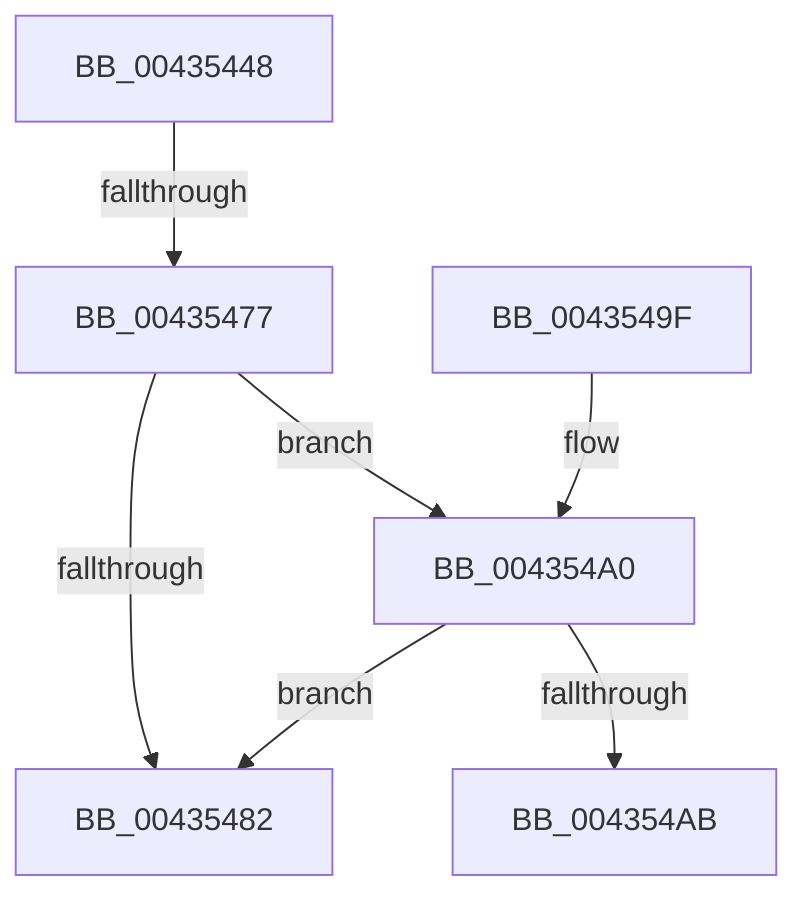

# MiObtainedPageIsGood

- RVA: `0x00435448`–`0x004354B0` (길이 `104` bytes)
- VA: `0x0000000140435448`
- 실행 섹션: `.text`
- PDB 이름 있음: `예`; PDB Function 태그: `예`
- unwind 정보 RVA: `0x000A2C10`
- 디코드: `29`개 명령, `104/104` bytes 표시
- 미해석 바이트: `0` (있으면 어셈블리에 `.byte`로 보존)

> 이 문서는 커널 이미지의 기계어와 PDB 기호를 분석해 생성했습니다. 4번과 5번은 함수 원형과 자료형을 바이너리 사용 방식에서 추정한 C 해석이며 원본 소스 복구 결과는 아닙니다.

## 1. Dependencies

- 직접 호출 지점: **0**; 고유 호출 대상: **0**
- 직접 호출자로 확인된 함수: **3**
- RIP 상대 이미지 참조: **0**

### Outgoing calls
- 직접 디코드된 call 명령이 없습니다.

### Direct callers
- [MiGetPage](../28/MiGetPage_function_002884C0.md) at `0x0028944F`
- [MiGetPage](../28/MiGetPage_function_002884C0.md) at `0x00289468`
- [MiDemoteLargeFreePage](MiDemoteLargeFreePage_function_00435118.md) at `0x004352B9`
- [MiGetFreeOrZeroPageAnyColor](MiGetFreeOrZeroPageAnyColor_function_004352D8.md) at `0x004353F7`

### Static image references
- 디코드된 RIP-relative 메모리 참조가 없습니다.

## 2. Other-region calls and transfers

- 다른 실행 섹션으로 향하는 call: **0**
- call이 아닌 외부 분기/꼬리 이동: **2**
  - `0x00435471` → [sub_006EED9E](../6E/Unknown_function_006EED9E.md) (`tail-transfer`)
  - `0x004354AB` → [sub_006EED9E](../6E/Unknown_function_006EED9E.md) (`tail-transfer`)

## 3. Assembly (complete function range)

```asm
00435448  48 8B C4                        mov rax, rsp
0043544B  48 89 58 08                     mov qword ptr [rax + 8], rbx
0043544F  48 89 68 10                     mov qword ptr [rax + 0x10], rbp
00435453  48 89 70 18                     mov qword ptr [rax + 0x18], rsi
00435457  48 89 78 20                     mov qword ptr [rax + 0x20], rdi
0043545B  41 56                           push r14
0043545D  48 83 EC 20                     sub rsp, 0x20
00435461  8B 41 20                        mov eax, dword ptr [rcx + 0x20]
00435464  48 8B D9                        mov rbx, rcx
00435467  C1 E8 18                        shr eax, 0x18
0043546A  BE 01 00 00 00                  mov esi, 1
0043546F  A8 40                           test al, 0x40
00435471  0F 85 27 99 2B 00               jne 0x1406eed9e
00435477  48 8B 41 28                     mov rax, qword ptr [rcx + 0x28]
0043547B  48 0F BA E0 28                  bt rax, 0x28
00435480  72 1E                           jb 0x1404354a0
00435482  48 8B 5C 24 30                  mov rbx, qword ptr [rsp + 0x30]
00435487  8B C6                           mov eax, esi
00435489  48 8B 74 24 40                  mov rsi, qword ptr [rsp + 0x40]
0043548E  48 8B 6C 24 38                  mov rbp, qword ptr [rsp + 0x38]
00435493  48 8B 7C 24 48                  mov rdi, qword ptr [rsp + 0x48]
00435498  48 83 C4 20                     add rsp, 0x20
0043549C  41 5E                           pop r14
0043549E  C3                              ret
0043549F  CC                              int3
004354A0  48 8B 41 28                     mov rax, qword ptr [rcx + 0x28]
004354A4  48 0F BA E0 29                  bt rax, 0x29
004354A9  73 D7                           jae 0x140435482
004354AB  E9 EE 98 2B 00                  jmp 0x1406eed9e
```

## 4. C-style interpretation (structured pseudocode)

```c
__int64 __fastcall MiObtainedPageIsGood(__int64 a1)
{
    __int64 result;
    __int64 v_rsp;
    unsigned __int64 v_stack_p10;
    unsigned __int64 v_stack_p18;
    unsigned __int64 v_stack_p20;
    unsigned __int64 v_stack_p8;

    *(unsigned __int64 *)(v_rsp + 8) = v_rbx;
    *(unsigned __int64 *)(v_rsp + 16) = v_rbp;
    *(unsigned __int64 *)(v_rsp + 24) = v_rsi;
    *(unsigned __int64 *)(v_rsp + 32) = v_rdi;
    v_rsp = (v_rsp) - (32);
    result = (unsigned int)(((unsigned int)(*(unsigned int *)(a1 + 32))) >> (24));
    if (condition_is_below) goto loc_004354A0;
loc_00435482:
    v_rsp = (v_rsp) + (32);
    return 1;
loc_004354A0:
    if (condition_is_above_or_equal) goto loc_00435482;
}
```

## 5. (Beta) C Style

```c
int64_t MiObtainedPageIsGood(void *Arg1)
{
    uint8_t *arg1 = (uint8_t *)Arg1;

    int64_t result;
    int64_t local_rsp;
    uint64_t v_stack_p10;
    uint64_t v_stack_p18;
    uint64_t v_stack_p20;
    uint64_t v_stack_p8;

    *(uint64_t *)(local_rsp + 0x8) = local_rbx;
    *(uint64_t *)(local_rsp + 0x10) = local_rbp;
    *(uint64_t *)(local_rsp + 0x18) = local_rsi;
    *(uint64_t *)(local_rsp + 0x20) = local_rdi;
    local_rsp = (local_rsp) - (32);
    result = (uint32_t)(((uint32_t)(*(uint32_t *)(arg1 + 0x20))) >> (24));
    if (condition_is_below) goto loc_004354A0;
loc_00435482:
    local_rsp = (local_rsp) + (32);
    return 1;
loc_004354A0:
    if (condition_is_above_or_equal) goto loc_00435482;
}
```

### 관측된 메모리 오프셋

구조체 형식이 확인되지 않은 접근은 인자 기준의 오프셋으로만 기록했습니다.

| 기준 인자 | 오프셋 표현 | 폭 (bit) | 접근 |
|---|---:|---:|---|
| `Arg1` | `+ 0x20` | `32` | `R` |
| `Arg1` | `+ 0x28` | `64` | `R` |

## 6. Execution-region graph

[열기: 2D/3D 그래프와 함수 탐색 컨트롤 패널](../../../control-panel.html?section=text&rva=0x00435448&view=graph)

- 2D 그래프는 위에서 아래로 흐르고, 3D 그래프는 빈 공간을 드래그해 회전합니다. Shift+드래그는 이동, 휠은 확대·축소, 함수 노드 선택은 대상 보고서 이동입니다.

### Static fallback


