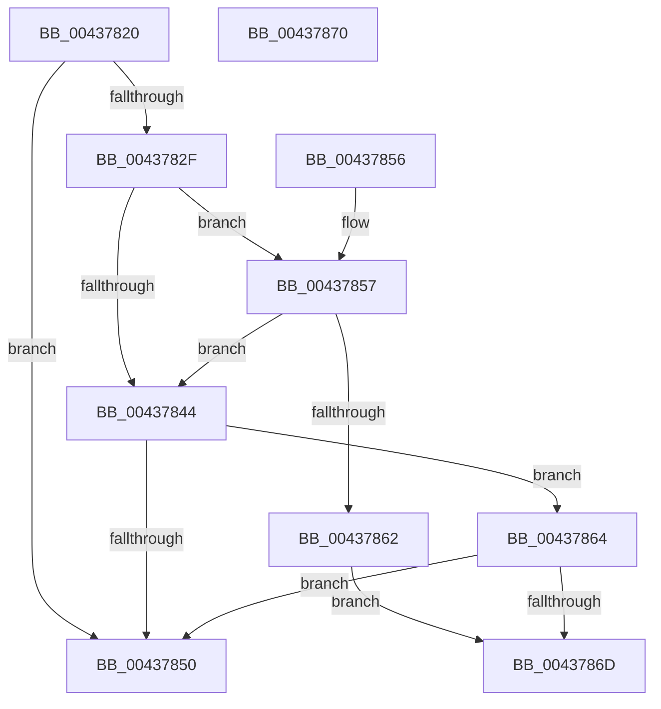

# MiOkToSetPteDirtyForNotValidFault

- RVA: `0x00437820`–`0x00437871` (길이 `81` bytes)
- VA: `0x0000000140437820`
- 실행 섹션: `.text`
- PDB 이름 있음: `예`; PDB Function 태그: `아니요`
- unwind 정보 RVA: `0x000DB714`
- 디코드: `23`개 명령, `81/81` bytes 표시
- 미해석 바이트: `0` (있으면 어셈블리에 `.byte`로 보존)

> 이 문서는 커널 이미지의 기계어와 PDB 기호를 분석해 생성했습니다. 4번과 5번은 함수 원형과 자료형을 바이너리 사용 방식에서 추정한 C 해석이며 원본 소스 복구 결과는 아닙니다.

## 1. Dependencies

- 직접 호출 지점: **0**; 고유 호출 대상: **0**
- 직접 호출자로 확인된 함수: **2**
- RIP 상대 이미지 참조: **0**

### Outgoing calls
- 직접 디코드된 call 명령이 없습니다.

### Direct callers
- [sub_0023D89B](../23/Unknown_function_0023D89B.md) at `0x0023D8AA`
- [MiIssueHardFault](../38/MiIssueHardFault_function_00380074.md) at `0x00380590`

### Static image references
- 디코드된 RIP-relative 메모리 참조가 없습니다.

## 2. Other-region calls and transfers

- 다른 실행 섹션으로 향하는 call: **0**
- 별도 외부 분기/꼬리 이동을 확인하지 못했습니다.

## 3. Assembly (complete function range)

```asm
00437820  48 B8 FF FF FE FF FF 7F 00 00   movabs rax, 0x7ffffffeffff
0043782A  48 3B D0                        cmp rdx, rax
0043782D  77 21                           ja 0x140437850
0043782F  65 48 8B 04 25 88 01 00 00      mov rax, qword ptr gs:[0x188]
00437838  48 8B 80 B8 00 00 00            mov rax, qword ptr [rax + 0xb8]
0043783F  48 85 C9                        test rcx, rcx
00437842  79 13                           jns 0x140437857
00437844  48 8B 80 78 07 00 00            mov rax, qword ptr [rax + 0x778]
0043784B  48 85 C0                        test rax, rax
0043784E  75 14                           jne 0x140437864
00437850  B8 01 00 00 00                  mov eax, 1
00437855  C3                              ret
00437856  CC                              int3
00437857  8B 88 F4 01 00 00               mov ecx, dword ptr [rax + 0x1f4]
0043785D  F6 C1 10                        test cl, 0x10
00437860  74 E2                           je 0x140437844
00437862  EB 09                           jmp 0x14043786d
00437864  48 83 C0 18                     add rax, 0x18
00437868  48 39 00                        cmp qword ptr [rax], rax
0043786B  74 E3                           je 0x140437850
0043786D  33 C0                           xor eax, eax
0043786F  C3                              ret
00437870  CC                              int3
```

## 4. C-style interpretation (structured pseudocode)

```c
__int64 __fastcall MiOkToSetPteDirtyForNotValidFault(__int64 a1, __int64 a2)
{
    __int64 result;

    if (a2 > result) goto loc_00437850;
    if (!sign_flag) goto loc_00437857;
loc_00437844:
    if (*(unsigned __int64 *)(*(unsigned __int64 *)(*(unsigned __int64 *)(gs_base + (0 + 392)) + 184) + 1912) != 0) goto loc_00437864;
loc_00437850:
    return 1;
loc_00437857:
    if ((((unsigned __int8)((unsigned int)(*(unsigned int *)(1 + 500)))) & (16)) == 0) goto loc_00437844;
    goto loc_0043786D;
loc_00437864:
    result = (1) + (24);
    if ((*(unsigned __int64 *)(result)) == result) goto loc_00437850;
loc_0043786D:
    result = 0;
    return result;
}
```

## 5. (Beta) C Style

```c
int64_t MiOkToSetPteDirtyForNotValidFault(int64_t Arg1, int64_t Arg2)
{
    int64_t result;

    if (Arg2 > result) goto loc_00437850;
    if (!sign_flag) goto loc_00437857;
loc_00437844:
    if (*(uint64_t *)(*(uint64_t *)(*(uint64_t *)(gs_base + (0 + 0x188)) + 0xB8) + 0x778) != 0) goto loc_00437864;
loc_00437850:
    return 1;
loc_00437857:
    if ((((uint8_t)((uint32_t)(*(uint32_t *)(1 + 0x1F4)))) & (16)) == 0) goto loc_00437844;
    goto loc_0043786D;
loc_00437864:
    result = (1) + (24);
    if ((*(uint64_t *)(result)) == result) goto loc_00437850;
loc_0043786D:
    result = 0;
    return result;
}
```

## 6. Execution-region graph

[열기: 2D/3D 그래프와 함수 탐색 컨트롤 패널](../../../control-panel.html?section=text&rva=0x00437820&view=graph)

- 2D 그래프는 위에서 아래로 흐르고, 3D 그래프는 빈 공간을 드래그해 회전합니다. Shift+드래그는 이동, 휠은 확대·축소, 함수 노드 선택은 대상 보고서 이동입니다.

### Static fallback


