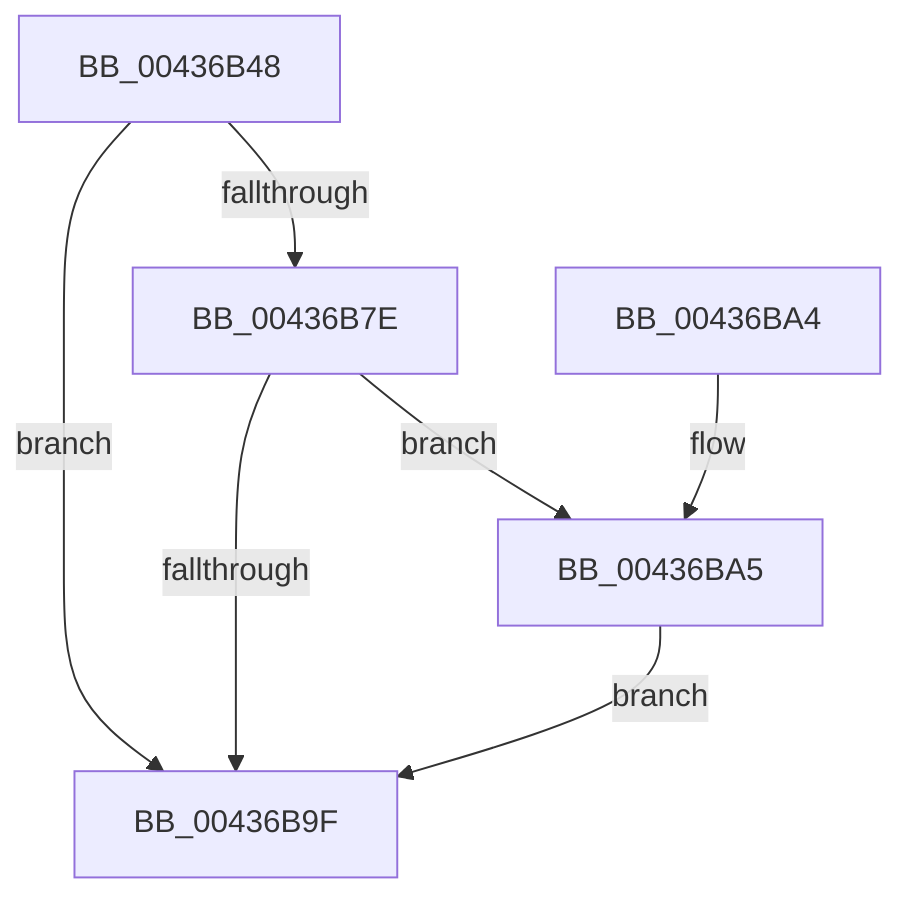

# MiPageListCollision

- RVA: `0x00436B48`–`0x00436BB2` (길이 `106` bytes)
- VA: `0x0000000140436B48`
- 실행 섹션: `.text`
- PDB 이름 있음: `예`; PDB Function 태그: `아니요`
- unwind 정보 RVA: `0x00082A88`
- 디코드: `26`개 명령, `106/106` bytes 표시
- 미해석 바이트: `0` (있으면 어셈블리에 `.byte`로 보존)

> 이 문서는 커널 이미지의 기계어와 PDB 기호를 분석해 생성했습니다. 4번과 5번은 함수 원형과 자료형을 바이너리 사용 방식에서 추정한 C 해석이며 원본 소스 복구 결과는 아닙니다.

## 1. Dependencies

- 직접 호출 지점: **2**; 고유 호출 대상: **2**
- 직접 호출자로 확인된 함수: **3**
- RIP 상대 이미지 참조: **1**

### Outgoing calls
- `0x00436B5B` → [MiStopPageAccessor](MiStopPageAccessor_function_00436BB8.md) (function, `0x00436BB8`)
- `0x00436BAB` → [MiZeroPageWorkMapping](MiZeroPageWorkMapping_function_00436CE0.md) (function, `0x00436CE0`)

### Direct callers
- [MiUnlinkFreeOrZeroedPage](../33/MiUnlinkFreeOrZeroedPage_function_00336C40.md) at `0x003376C2`
- [MiReplenishPageSlist](../3B/MiReplenishPageSlist_function_003BADE0.md) at `0x003BB449`
- [MiUnlinkHugeRange](MiUnlinkHugeRange_function_00436EF0.md) at `0x00436F60`
- [MiUnlinkHugeRange](MiUnlinkHugeRange_function_00436EF0.md) at `0x00436F7F`

### Static image references
- `0x00436B84` → RVA `0x000145A8` (`.rdata`; read)

## 2. Other-region calls and transfers

- 다른 실행 섹션으로 향하는 call: **0**
- 별도 외부 분기/꼬리 이동을 확인하지 못했습니다.

## 3. Assembly (complete function range)

```asm
00436B48  48 83 EC 28                     sub rsp, 0x28
00436B4C  83 64 24 38 00                  and dword ptr [rsp + 0x38], 0
00436B51  4C 8D 44 24 38                  lea r8, [rsp + 0x38]
00436B56  BA 01 00 00 00                  mov edx, 1
00436B5B  E8 58 00 00 00                  call 0x140436bb8
00436B60  8B 54 24 38                     mov edx, dword ptr [rsp + 0x38]
00436B64  48 8B 4C D0 18                  mov rcx, qword ptr [rax + rdx*8 + 0x18]
00436B69  48 83 C9 01                     or rcx, 1
00436B6D  48 89 4C D0 18                  mov qword ptr [rax + rdx*8 + 0x18], rcx
00436B72  4C 8B 88 20 01 00 00            mov r9, qword ptr [rax + 0x120]
00436B79  4D 85 C9                        test r9, r9
00436B7C  74 21                           je 0x140436b9f
00436B7E  8B 88 40 01 00 00               mov ecx, dword ptr [rax + 0x140]
00436B84  4C 8D 15 1D DA BD FF            lea r10, [rip - 0x4225e3]
00436B8B  8B 44 24 38                     mov eax, dword ptr [rsp + 0x38]
00436B8F  49 0F AF 04 CA                  imul rax, qword ptr [r10 + rcx*8]
00436B94  49 8D 14 C1                     lea rdx, [r9 + rax*8]
00436B98  48 8B 02                        mov rax, qword ptr [rdx]
00436B9B  A8 01                           test al, 1
00436B9D  75 06                           jne 0x140436ba5
00436B9F  48 83 C4 28                     add rsp, 0x28
00436BA3  C3                              ret
00436BA4  CC                              int3
00436BA5  41 B8 01 00 00 00               mov r8d, 1
00436BAB  E8 30 01 00 00                  call 0x140436ce0
00436BB0  EB ED                           jmp 0x140436b9f
```

## 4. C-style interpretation (structured pseudocode)

```c
__int64 __fastcall MiPageListCollision(void)
{
    __int64 result;
    __int64 v_rsp;
    unsigned int v_stack_p10;

    v_rsp = (v_rsp) - (40);
    result = MiStopPageAccessor(a1, 1, v_stack_p10, a4);
    a1 = (*(unsigned __int64 *)(result + (unsigned int)(v_stack_p10) * 8 + 24)) | (1);
    *(unsigned __int64 *)(result + (unsigned int)(v_stack_p10) * 8 + 24) = a1;
    if (*(unsigned __int64 *)(result + 288) == 0) goto loc_00436B9F;
    result = ((unsigned int)(v_stack_p10)) * (*(unsigned __int64 *)(v_rip - 4335075 + (unsigned int)(*(unsigned int *)(result + 320)) * 8));
    if ((((unsigned __int8)(*(unsigned __int64 *)(*(unsigned __int64 *)(result + 288) + result * 8))) & (1)) != 0) goto loc_00436BA5;
loc_00436B9F:
    v_rsp = (v_rsp) + (40);
    return *(unsigned __int64 *)(*(unsigned __int64 *)(result + 288) + result * 8);
loc_00436BA5:
    result = MiZeroPageWorkMapping((unsigned int)(*(unsigned int *)(result + 320)), *(unsigned __int64 *)(result + 288) + result * 8, 1, *(unsigned __int64 *)(result + 288));
    goto loc_00436B9F;
}
```

## 5. (Beta) C Style

```c
void MiPageListCollision(void)
{
    int64_t result;
    int64_t local_rsp;
    uint32_t v_stack_p10;

    local_rsp = (local_rsp) - (40);
    result = MiStopPageAccessor(a1, 1, v_stack_p10, a4);
    a1 = (*(uint64_t *)(result + (uint32_t)(v_stack_p10) * 8 + 0x18)) | (1);
    *(uint64_t *)(result + (uint32_t)(v_stack_p10) * 8 + 0x18) = a1;
    if (*(uint64_t *)(result + 0x120) == 0) goto loc_00436B9F;
    result = ((uint32_t)(v_stack_p10)) * (*(uint64_t *)(v_rip - 0x4225E3 + (uint32_t)(*(uint32_t *)(result + 0x140)) * 8));
    if ((((uint8_t)(*(uint64_t *)(*(uint64_t *)(result + 0x120) + result * 8))) & (1)) != 0) goto loc_00436BA5;
loc_00436B9F:
    local_rsp = (local_rsp) + (40);
    return *(uint64_t *)(*(uint64_t *)(result + 0x120) + result * 8);
loc_00436BA5:
    result = MiZeroPageWorkMapping((uint32_t)(*(uint32_t *)(result + 0x140)), *(uint64_t *)(result + 0x120) + result * 8, 1, *(uint64_t *)(result + 0x120));
    goto loc_00436B9F;
}
```

## 6. Execution-region graph

[열기: 2D/3D 그래프와 함수 탐색 컨트롤 패널](../../../control-panel.html?section=text&rva=0x00436B48&view=graph)

- 2D 그래프는 위에서 아래로 흐르고, 3D 그래프는 빈 공간을 드래그해 회전합니다. Shift+드래그는 이동, 휠은 확대·축소, 함수 노드 선택은 대상 보고서 이동입니다.

### Static fallback


