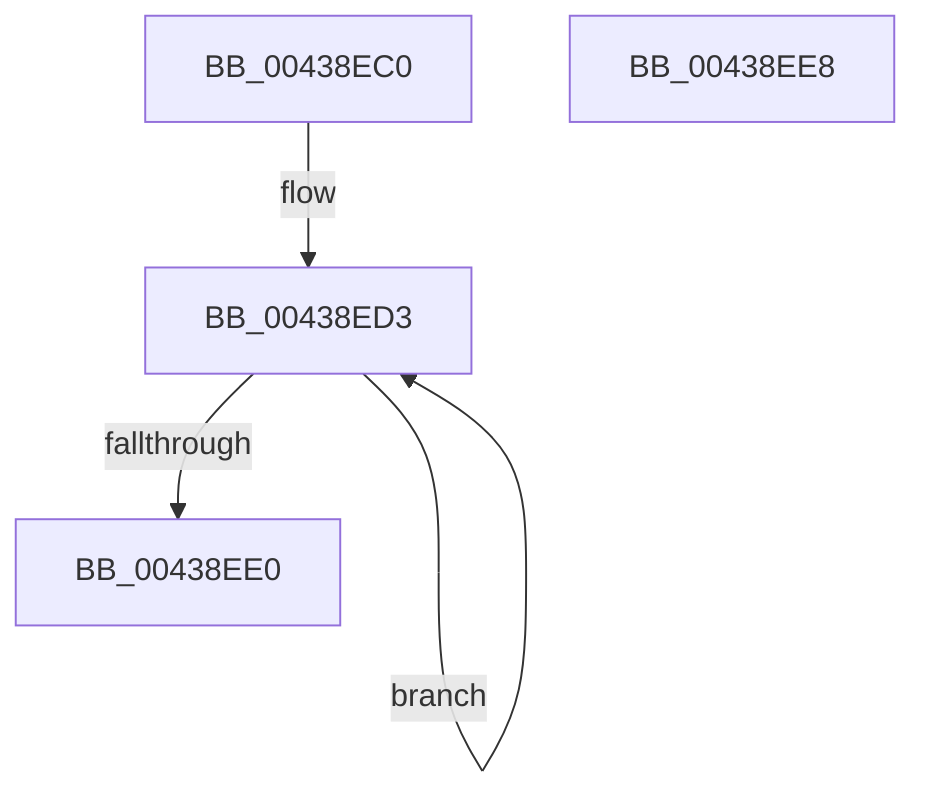

# MiPreparePageAccessor

- RVA: `0x00438EC0`–`0x00438EE9` (길이 `41` bytes)
- VA: `0x0000000140438EC0`
- 실행 섹션: `.text`
- PDB 이름 있음: `예`; PDB Function 태그: `아니요`
- unwind 정보 RVA: `0x000DB714`
- 디코드: `11`개 명령, `41/41` bytes 표시
- 미해석 바이트: `0` (있으면 어셈블리에 `.byte`로 보존)

> 이 문서는 커널 이미지의 기계어와 PDB 기호를 분석해 생성했습니다. 4번과 5번은 함수 원형과 자료형을 바이너리 사용 방식에서 추정한 C 해석이며 원본 소스 복구 결과는 아닙니다.

## 1. Dependencies

- 직접 호출 지점: **0**; 고유 호출 대상: **0**
- 직접 호출자로 확인된 함수: **2**
- RIP 상대 이미지 참조: **0**

### Outgoing calls
- 직접 디코드된 call 명령이 없습니다.

### Direct callers
- [MiGetBackgroundHugePageToZero](../31/MiGetBackgroundHugePageToZero_function_0031DD8C.md) at `0x0031DDCD`
- [MiScrubLargePage](../69/MiScrubLargePage_function_006942E8.md) at `0x006943A6`

### Static image references
- 디코드된 RIP-relative 메모리 참조가 없습니다.

## 2. Other-region calls and transfers

- 다른 실행 섹션으로 향하는 call: **0**
- 별도 외부 분기/꼬리 이동을 확인하지 못했습니다.

## 3. Assembly (complete function range)

```asm
00438EC0  45 33 C0                        xor r8d, r8d
00438EC3  48 8D 41 18                     lea rax, [rcx + 0x18]
00438EC7  4C 89 81 20 01 00 00            mov qword ptr [rcx + 0x120], r8
00438ECE  BA 20 00 00 00                  mov edx, 0x20
00438ED3  4C 89 00                        mov qword ptr [rax], r8
00438ED6  48 8D 40 08                     lea rax, [rax + 8]
00438EDA  48 83 EA 01                     sub rdx, 1
00438EDE  75 F3                           jne 0x140438ed3
00438EE0  44 89 81 18 01 00 00            mov dword ptr [rcx + 0x118], r8d
00438EE7  C3                              ret
00438EE8  CC                              int3
```

## 4. C-style interpretation (structured pseudocode)

```c
__int64 __fastcall MiPreparePageAccessor(__int64 a1, __int64 a2, int a3)
{
    a3 = 0;
    *(unsigned __int64 *)(a1 + 288) = 0;
loc_00438ED3:
    *(unsigned __int64 *)(a1 + 24) = 0;
    a2 = (32) - (1);
    if (condition_is_not_equal) goto loc_00438ED3;
    *(unsigned int *)(a1 + 280) = 0;
    return a1 + 24 + 8;
}
```

## 5. (Beta) C Style

```c
int64_t MiPreparePageAccessor(void *Arg1, int64_t Arg2, int32_t Arg3)
{
    uint8_t *arg1 = (uint8_t *)Arg1;

    Arg3 = 0;
    *(uint64_t *)(arg1 + 0x120) = 0;
loc_00438ED3:
    *(uint64_t *)(arg1 + 0x18) = 0;
    Arg2 = (32) - (1);
    if (condition_is_not_equal) goto loc_00438ED3;
    *(uint32_t *)(arg1 + 0x118) = 0;
    return Arg1 + 24 + 8;
}
```

### 관측된 메모리 오프셋

구조체 형식이 확인되지 않은 접근은 인자 기준의 오프셋으로만 기록했습니다.

| 기준 인자 | 오프셋 표현 | 폭 (bit) | 접근 |
|---|---:|---:|---|
| `Arg1` | `+ 0x0` | `64` | `W` |
| `Arg1` | `+ 0x8` | `64` | `R` |
| `Arg1` | `+ 0x18` | `64` | `R` |
| `Arg1` | `+ 0x118` | `32` | `W` |
| `Arg1` | `+ 0x120` | `64` | `W` |

## 6. Execution-region graph

[열기: 2D/3D 그래프와 함수 탐색 컨트롤 패널](../../../control-panel.html?section=text&rva=0x00438EC0&view=graph)

- 2D 그래프는 위에서 아래로 흐르고, 3D 그래프는 빈 공간을 드래그해 회전합니다. Shift+드래그는 이동, 휠은 확대·축소, 함수 노드 선택은 대상 보고서 이동입니다.

### Static fallback


