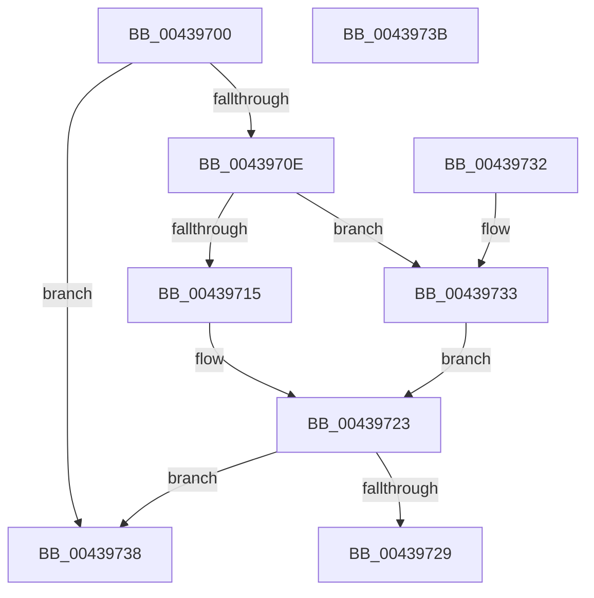

# MiQueryStateMatches

- RVA: `0x00439700`–`0x0043973C` (길이 `60` bytes)
- VA: `0x0000000140439700`
- 실행 섹션: `.text`
- PDB 이름 있음: `예`; PDB Function 태그: `아니요`
- unwind 정보 RVA: `0x000DB714`
- 디코드: `21`개 명령, `60/60` bytes 표시
- 미해석 바이트: `0` (있으면 어셈블리에 `.byte`로 보존)

> 이 문서는 커널 이미지의 기계어와 PDB 기호를 분석해 생성했습니다. 4번과 5번은 함수 원형과 자료형을 바이너리 사용 방식에서 추정한 C 해석이며 원본 소스 복구 결과는 아닙니다.

## 1. Dependencies

- 직접 호출 지점: **0**; 고유 호출 대상: **0**
- 직접 호출자로 확인된 함수: **1**
- RIP 상대 이미지 참조: **1**

### Outgoing calls
- 직접 디코드된 call 명령이 없습니다.

### Direct callers
- [MiQueryAddressState](../32/MiQueryAddressState_function_0032C380.md) at `0x0032D433`

### Static image references
- `0x00439718` → RVA `0x00014630` (`.rdata`; read)

## 2. Other-region calls and transfers

- 다른 실행 섹션으로 향하는 call: **0**
- 별도 외부 분기/꼬리 이동을 확인하지 못했습니다.

## 3. Assembly (complete function range)

```asm
00439700  4C 8B D1                        mov r10, rcx
00439703  44 0F B7 5C 24 28               movzx r11d, word ptr [rsp + 0x28]
00439709  3B 51 20                        cmp edx, dword ptr [rcx + 0x20]
0043970C  75 2A                           jne 0x140439738
0043970E  33 C0                           xor eax, eax
00439710  45 85 C0                        test r8d, r8d
00439713  74 1E                           je 0x140439733
00439715  41 8B C8                        mov ecx, r8d
00439718  48 8D 15 11 AF BD FF            lea rdx, [rip - 0x4250ef]
0043971F  44 0B 0C 8A                     or r9d, dword ptr [rdx + rcx*4]
00439723  45 3B 4A 24                     cmp r9d, dword ptr [r10 + 0x24]
00439727  75 0F                           jne 0x140439738
00439729  66 45 3B 5A 14                  cmp r11w, word ptr [r10 + 0x14]
0043972E  0F 94 C0                        sete al
00439731  C3                              ret
00439732  CC                              int3
00439733  44 8B C8                        mov r9d, eax
00439736  EB EB                           jmp 0x140439723
00439738  33 C0                           xor eax, eax
0043973A  C3                              ret
0043973B  CC                              int3
```

## 4. C-style interpretation (structured pseudocode)

```c
__int64 __fastcall MiQueryStateMatches(__int64 a1, int a2, int a3, int a4, unsigned __int16 a5)
{
    __int64 result;

    if (a2 != (*(unsigned int *)(a1 + 32))) goto loc_00439738;
    result = 0;
    if (a3 == 0) goto loc_00439733;
    a4 = (unsigned int)((a4) | (*(unsigned int *)(v_rip - 4346095 + (unsigned int)(a3) * 4)));
loc_00439723:
    if (a4 != (*(unsigned int *)(a1 + 36))) goto loc_00439738;
    result = (a5 == (*(unsigned __int16 *)(a1 + 20))) ? 1 : 0;
    return result;
loc_00439733:
    goto loc_00439723;
loc_00439738:
    result = 0;
    return result;
}
```

## 5. (Beta) C Style

```c
int64_t MiQueryStateMatches(void *Arg1, int32_t Arg2, int32_t Arg3, int32_t Arg4, uint16_t Arg5)
{
    uint8_t *arg1 = (uint8_t *)Arg1;

    int64_t result;

    if (Arg2 != (*(uint32_t *)(arg1 + 0x20))) goto loc_00439738;
    result = 0;
    if (Arg3 == 0) goto loc_00439733;
    Arg4 = (uint32_t)((Arg4) | (*(uint32_t *)(v_rip - 0x4250EF + (uint32_t)(Arg3) * 4)));
loc_00439723:
    if (Arg4 != (*(uint32_t *)(arg1 + 0x24))) goto loc_00439738;
    result = (Arg5 == (*(uint16_t *)(arg1 + 0x14))) ? 1 : 0;
    return result;
loc_00439733:
    goto loc_00439723;
loc_00439738:
    result = 0;
    return result;
}
```

### 관측된 메모리 오프셋

구조체 형식이 확인되지 않은 접근은 인자 기준의 오프셋으로만 기록했습니다.

| 기준 인자 | 오프셋 표현 | 폭 (bit) | 접근 |
|---|---:|---:|---|
| `Arg1` | `+ 0x14` | `16` | `R` |
| `Arg1` | `+ 0x20` | `32` | `R` |
| `Arg1` | `+ 0x24` | `32` | `R` |

## 6. Execution-region graph

[열기: 2D/3D 그래프와 함수 탐색 컨트롤 패널](../../../control-panel.html?section=text&rva=0x00439700&view=graph)

- 2D 그래프는 위에서 아래로 흐르고, 3D 그래프는 빈 공간을 드래그해 회전합니다. Shift+드래그는 이동, 휠은 확대·축소, 함수 노드 선택은 대상 보고서 이동입니다.

### Static fallback


