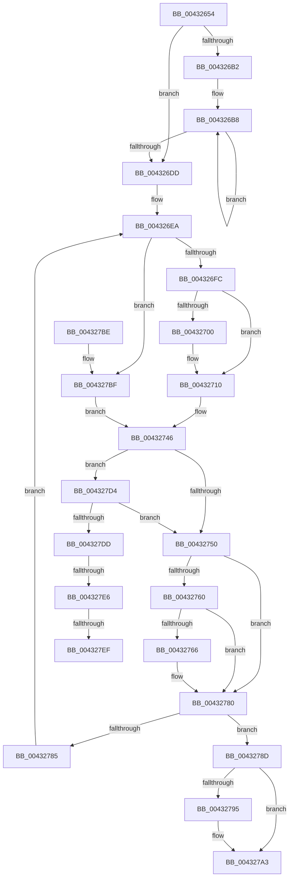

# MiReadWriteAnyLevelShadowPte

- RVA: `0x00432654`–`0x004327F9` (길이 `421` bytes)
- VA: `0x0000000140432654`
- 실행 섹션: `.text`
- PDB 이름 있음: `예`; PDB Function 태그: `예`
- unwind 정보 RVA: `0x000A22F0`
- 디코드: `114`개 명령, `421/421` bytes 표시
- 미해석 바이트: `0` (있으면 어셈블리에 `.byte`로 보존)

> 이 문서는 커널 이미지의 기계어와 PDB 기호를 분석해 생성했습니다. 4번과 5번은 함수 원형과 자료형을 바이너리 사용 방식에서 추정한 C 해석이며 원본 소스 복구 결과는 아닙니다.

## 1. Dependencies

- 직접 호출 지점: **5**; 고유 호출 대상: **4**
- 직접 호출자로 확인된 함수: **4**
- RIP 상대 이미지 참조: **0**

### Outgoing calls
- `0x0043270B` → [MiUnmapPageInHyperSpaceWorker](MiUnmapPageInHyperSpaceWorker_function_00432800.md) (function, `0x00432800`)
- `0x0043272E` → [MiMapPageInHyperSpaceWorker](../33/MiMapPageInHyperSpaceWorker_function_00332B10.md) (function, `0x00332B10`)
- `0x00432753` → [MI_READ_PTE_LOCK_FREE](../28/MI_READ_PTE_LOCK_FREE_function_002828A0.md) (function, `0x002828A0`)
- `0x0043277A` → [KeBugCheckEx](../4F/KeBugCheckEx_function_004FD660.md) (function, `0x004FD660`)
- `0x0043279E` → [MiUnmapPageInHyperSpaceWorker](MiUnmapPageInHyperSpaceWorker_function_00432800.md) (function, `0x00432800`)

### Direct callers
- [MiCheckKernelShadow](MiCheckKernelShadow_function_00432540.md) at `0x004325B9`
- [MiInitializeShadowPageTable](../../page/80/MiInitializeShadowPageTable_function_0080778C.md) at `0x008078BF`
- [MiInitializeShadowPageTable](../../page/80/MiInitializeShadowPageTable_function_0080778C.md) at `0x00807956`
- [MiMakeShadowPageTableRange](../../page/80/MiMakeShadowPageTableRange_function_00807998.md) at `0x008079F7`
- [MmDeleteShadowMapping](../../page/80/MmDeleteShadowMapping_function_00807D00.md) at `0x00807E2F`

### Static image references
- 디코드된 RIP-relative 메모리 참조가 없습니다.

## 2. Other-region calls and transfers

- 다른 실행 섹션으로 향하는 call: **0**
- call이 아닌 외부 분기/꼬리 이동: **3**
  - `0x004327E0` → [sub_006EE9B6 + 0x65](../6E/Unknown_function_006EE9B6.md) (`tail-transfer`)
  - `0x004327E9` → [sub_006EE9B6](../6E/Unknown_function_006EE9B6.md) (`tail-transfer`)
  - `0x004327F4` → [sub_006EE9B6](../6E/Unknown_function_006EE9B6.md) (`tail-transfer`)

## 3. Assembly (complete function range)

```asm
00432654  48 89 5C 24 08                  mov qword ptr [rsp + 8], rbx
00432659  44 89 44 24 18                  mov dword ptr [rsp + 0x18], r8d
0043265E  55                              push rbp
0043265F  56                              push rsi
00432660  57                              push rdi
00432661  41 54                           push r12
00432663  41 55                           push r13
00432665  41 56                           push r14
00432667  41 57                           push r15
00432669  48 8B EC                        mov rbp, rsp
0043266C  48 83 EC 60                     sub rsp, 0x60
00432670  65 48 8B 04 25 88 01 00 00      mov rax, qword ptr gs:[0x188]
00432679  49 8B D9                        mov rbx, r9
0043267C  48 83 65 F8 00                  and qword ptr [rbp - 8], 0
00432681  0F 57 C0                        xorps xmm0, xmm0
00432684  48 83 65 E0 00                  and qword ptr [rbp - 0x20], 0
00432689  4C 63 C2                        movsxd r8, edx
0043268C  4C 8B 88 B8 00 00 00            mov r9, qword ptr [rax + 0xb8]
00432693  4D 8B E8                        mov r13, r8
00432696  F3 0F 7F 45 E8                  movdqu xmmword ptr [rbp - 0x18], xmm0
0043269B  4D 8B A1 08 05 00 00            mov r12, qword ptr [r9 + 0x508]
004326A2  49 B9 00 00 00 00 80 F6 FF FF   movabs r9, 0xfffff68000000000
004326AC  49 83 F8 04                     cmp r8, 4
004326B0  7D 2B                           jge 0x1404326dd
004326B2  41 2B D0                        sub edx, r8d
004326B5  83 C2 04                        add edx, 4
004326B8  4A 89 4C C5 E0                  mov qword ptr [rbp + r8*8 - 0x20], rcx
004326BD  48 B8 F8 FF FF FF 7F 00 00 00   movabs rax, 0x7ffffffff8
004326C7  48 C1 E9 09                     shr rcx, 9
004326CB  48 23 C8                        and rcx, rax
004326CE  49 8B C1                        mov rax, r9
004326D1  48 03 C8                        add rcx, rax
004326D4  49 FF C0                        inc r8
004326D7  49 83 F8 04                     cmp r8, 4
004326DB  7C DB                           jl 0x1404326b8
004326DD  B0 11                           mov al, 0x11
004326DF  4C 63 F2                        movsxd r14, edx
004326E2  88 45 48                        mov byte ptr [rbp + 0x48], al
004326E5  49 8B F4                        mov rsi, r12
004326E8  33 FF                           xor edi, edi
004326EA  4E 8B 7C F5 D8                  mov r15, qword ptr [rbp + r14*8 - 0x28]
004326EF  49 FF CE                        dec r14
004326F2  49 83 FE 03                     cmp r14, 3
004326F6  0F 84 C3 00 00 00               je 0x1404327bf
004326FC  3C 11                           cmp al, 0x11
004326FE  74 10                           je 0x140432710
00432700  41 B8 00 00 00 80               mov r8d, 0x80000000
00432706  8A D0                           mov dl, al
00432708  49 8B CC                        mov rcx, r12
0043270B  E8 F0 00 00 00                  call 0x140432800
00432710  48 B8 FF FF FF FF FF 00 00 00   movabs rax, 0xffffffffff
0043271A  48 8D 55 48                     lea rdx, [rbp + 0x48]
0043271E  48 8B CF                        mov rcx, rdi
00432721  41 B8 00 00 00 80               mov r8d, 0x80000000
00432727  48 C1 E9 0C                     shr rcx, 0xc
0043272B  48 23 C8                        and rcx, rax
0043272E  E8 DD 03 F0 FF                  call 0x140332b10
00432733  4C 8B E0                        mov r12, rax
00432736  49 8B C7                        mov rax, r15
00432739  48 C1 E8 03                     shr rax, 3
0043273D  25 FF 01 00 00                  and eax, 0x1ff
00432742  49 8D 34 C4                     lea rsi, [r12 + rax*8]
00432746  83 7D 50 00                     cmp dword ptr [rbp + 0x50], 0
0043274A  0F 85 84 00 00 00               jne 0x1404327d4
00432750  48 8B CE                        mov rcx, rsi
00432753  E8 48 01 E5 FF                  call 0x1402828a0
00432758  48 8B F8                        mov rdi, rax
0043275B  4D 85 F6                        test r14, r14
0043275E  74 20                           je 0x140432780
00432760  24 81                           and al, 0x81
00432762  3C 81                           cmp al, 0x81
00432764  75 1A                           jne 0x140432780
00432766  45 33 C9                        xor r9d, r9d
00432769  48 89 7C 24 20                  mov qword ptr [rsp + 0x20], rdi
0043276E  4D 8B C7                        mov r8, r15
00432771  BA 06 13 00 00                  mov edx, 0x1306
00432776  41 8D 49 1A                     lea ecx, [r9 + 0x1a]
0043277A  E8 E1 AE 0C 00                  call 0x1404fd660
0043277F  CC                              int3
00432780  4D 3B F5                        cmp r14, r13
00432783  74 08                           je 0x14043278d
00432785  8A 45 48                        mov al, byte ptr [rbp + 0x48]
00432788  E9 5D FF FF FF                  jmp 0x1404326ea
0043278D  8A 55 48                        mov dl, byte ptr [rbp + 0x48]
00432790  80 FA 11                        cmp dl, 0x11
00432793  74 0E                           je 0x1404327a3
00432795  41 B8 00 00 00 80               mov r8d, 0x80000000
0043279B  49 8B CC                        mov rcx, r12
0043279E  E8 5D 00 00 00                  call 0x140432800
004327A3  48 8B 9C 24 A0 00 00 00         mov rbx, qword ptr [rsp + 0xa0]
004327AB  48 8B C7                        mov rax, rdi
004327AE  48 83 C4 60                     add rsp, 0x60
004327B2  41 5F                           pop r15
004327B4  41 5E                           pop r14
004327B6  41 5D                           pop r13
004327B8  41 5C                           pop r12
004327BA  5F                              pop rdi
004327BB  5E                              pop rsi
004327BC  5D                              pop rbp
004327BD  C3                              ret
004327BE  CC                              int3
004327BF  49 8B C7                        mov rax, r15
004327C2  48 C1 E8 03                     shr rax, 3
004327C6  25 FF 01 00 00                  and eax, 0x1ff
004327CB  48 8D 34 C6                     lea rsi, [rsi + rax*8]
004327CF  E9 72 FF FF FF                  jmp 0x140432746
004327D4  4D 3B F5                        cmp r14, r13
004327D7  0F 85 73 FF FF FF               jne 0x140432750
004327DD  F6 C3 01                        test bl, 1
004327E0  0F 84 35 C2 2B 00               je 0x1406eea1b
004327E6  4D 85 F6                        test r14, r14
004327E9  0F 85 C7 C1 2B 00               jne 0x1406ee9b6
004327EF  48 0F BA EB 08                  bts rbx, 8
004327F4  E9 BD C1 2B 00                  jmp 0x1406ee9b6
```

## 4. C-style interpretation (structured pseudocode)

```c
__int64 __fastcall MiReadWriteAnyLevelShadowPte(__int64 a1, int a2, int a3, __int64 a4)
{
    __int64 result;
    __int64 v_r14;
    __int64 v_rdi;
    __int64 v_rsp;
    unsigned __int64 v_stack_m40;
    unsigned __int64 v_stack_m50;
    unsigned __int64 v_stack_m58;
    unsigned __int64 v_stack_m78;
    unsigned __int8 v_stack_p10;
    unsigned int v_stack_p18;
    unsigned __int64 v_stack_p8;

    v_stack_p8 = v_rbx;
    v_stack_p18 = a3;
    v_rsp = (v_rsp) - (96);
    v_stack_m50 = v_xmm0;
    if (((int)(a2)) >= 4) goto loc_004326DD;
    a2 = (unsigned int)((a2) - ((unsigned int)((int)(a2))));
    a2 = (unsigned int)((a2) + (4));
loc_004326B8:
    *(unsigned __int64 *)(v_rsp + (int)(a2) * 8 - 32) = a1;
    a1 = (a1) >> (9);
    a1 = (a1) & (*(unsigned __int64 *)(gs_base + (0 + 392)));
    a1 = (a1) + (*(unsigned __int64 *)(*(unsigned __int64 *)(gs_base + (0 + 392)) + 184));
    a3 = ((int)(a2)) + 1;
    if (a3 < 4) goto loc_004326B8;
loc_004326DD:
    v_stack_p10 = 17;
    v_rdi = 0;
loc_004326EA:
    v_r14 = ((int)(a2)) - 1;
    if (v_r14 == 3) goto loc_004327BF;
    result = 17;
    if (17 != 17) {
        a3 = 0x80000000ULL;
        a2 = 17;
        a1 = *(unsigned __int64 *)(*(unsigned __int64 *)(*(unsigned __int64 *)(gs_base + (0 + 392)) + 184) + 1288);
        result = MiUnmapPageInHyperSpaceWorker(a1, a2, a3, *(unsigned __int64 *)(*(unsigned __int64 *)(gs_base + (0 + 392)) + 184));
    }
    a1 = (0) >> (12);
    a1 = (a1) & (result);
    result = MiMapPageInHyperSpaceWorker(a1, v_stack_p10, (unsigned int)(0x80000000ULL), *(unsigned __int64 *)(*(unsigned __int64 *)(gs_base + (0 + 392)) + 184));
    result = (*(unsigned __int64 *)(v_rsp + (int)(a2) * 8 - 40)) >> (3);
    result = (unsigned int)((result) & (511));
loc_00432746:
    if (v_stack_p18 != 0) goto loc_004327D4;
loc_00432750:
    result = MI_READ_PTE_LOCK_FREE(result + result * 8, v_stack_p10, (unsigned int)(0x80000000ULL), *(unsigned __int64 *)(*(unsigned __int64 *)(gs_base + (0 + 392)) + 184));
    if (v_r14 == 0) goto loc_00432780;
    result = (unsigned __int8)((result) & (129));
    if (((unsigned __int8)(result)) == 129) {
        a4 = 0;
        v_stack_m78 = result;
        a3 = *(unsigned __int64 *)(v_rsp + (int)(a2) * 8 - 40);
        a2 = 0x1306ULL;
        a1 = a4 + 26;
        result = KeBugCheckEx(a1, a2, a3, a4);
    }
    if (v_r14 == ((int)(a2))) goto loc_0043278D;
    goto loc_004326EA;
loc_0043278D:
    result = v_stack_p10;
    if (((unsigned __int8)(v_stack_p10)) != 17) {
        a3 = 0x80000000ULL;
        a1 = result;
        result = MiUnmapPageInHyperSpaceWorker(a1, v_stack_p10, a3, a4);
    }
    v_rsp = (v_rsp) + (96);
    return result;
loc_004327BF:
    result = (*(unsigned __int64 *)(v_rsp + (int)(a2) * 8 - 40)) >> (3);
    result = (unsigned int)((result) & (511));
    goto loc_00432746;
loc_004327D4:
    if (v_r14 != ((int)(a2))) goto loc_00432750;
}
```

## 5. (Beta) C Style

```c
int64_t MiReadWriteAnyLevelShadowPte(int64_t Arg1, int32_t Arg2, int32_t Arg3, int64_t Arg4)
{
    int64_t result;
    int64_t local_r14;
    int64_t local_rdi;
    int64_t local_rsp;
    uint64_t v_stack_m40;
    uint64_t v_stack_m50;
    uint64_t v_stack_m58;
    uint64_t v_stack_m78;
    uint8_t v_stack_p10;
    uint32_t v_stack_p18;
    uint64_t v_stack_p8;

    v_stack_p8 = local_rbx;
    v_stack_p18 = Arg3;
    local_rsp = (local_rsp) - (96);
    v_stack_m50 = v_xmm0;
    if (((int32_t)(Arg2)) >= 4) goto loc_004326DD;
    Arg2 = (uint32_t)((Arg2) - ((uint32_t)((int32_t)(Arg2))));
    Arg2 = (uint32_t)((Arg2) + (4));
loc_004326B8:
    *(uint64_t *)(local_rsp + (int32_t)(Arg2) * 8 - 0x20) = Arg1;
    Arg1 = (Arg1) >> (9);
    Arg1 = (Arg1) & (*(uint64_t *)(gs_base + (0 + 0x188)));
    Arg1 = (Arg1) + (*(uint64_t *)(*(uint64_t *)(gs_base + (0 + 0x188)) + 0xB8));
    Arg3 = ((int32_t)(Arg2)) + 1;
    if (Arg3 < 4) goto loc_004326B8;
loc_004326DD:
    v_stack_p10 = 17;
    local_rdi = 0;
loc_004326EA:
    local_r14 = ((int32_t)(Arg2)) - 1;
    if (local_r14 == 3) goto loc_004327BF;
    result = 17;
    if (17 != 17) {
        Arg3 = 0x80000000ULL;
        Arg2 = 17;
        Arg1 = *(uint64_t *)(*(uint64_t *)(*(uint64_t *)(gs_base + (0 + 0x188)) + 0xB8) + 0x508);
        result = MiUnmapPageInHyperSpaceWorker(Arg1, Arg2, Arg3, *(uint64_t *)(*(uint64_t *)(gs_base + (0 + 0x188)) + 0xB8));
    }
    Arg1 = (0) >> (12);
    Arg1 = (Arg1) & (result);
    result = MiMapPageInHyperSpaceWorker(Arg1, v_stack_p10, (uint32_t)(0x80000000ULL), *(uint64_t *)(*(uint64_t *)(gs_base + (0 + 0x188)) + 0xB8));
    result = (*(uint64_t *)(local_rsp + (int32_t)(Arg2) * 8 - 0x28)) >> (3);
    result = (uint32_t)((result) & (511));
loc_00432746:
    if (v_stack_p18 != 0) goto loc_004327D4;
loc_00432750:
    result = MI_READ_PTE_LOCK_FREE(result + result * 8, v_stack_p10, (uint32_t)(0x80000000ULL), *(uint64_t *)(*(uint64_t *)(gs_base + (0 + 0x188)) + 0xB8));
    if (local_r14 == 0) goto loc_00432780;
    result = (uint8_t)((result) & (129));
    if (((uint8_t)(result)) == 129) {
        Arg4 = 0;
        v_stack_m78 = result;
        Arg3 = *(uint64_t *)(local_rsp + (int32_t)(Arg2) * 8 - 0x28);
        Arg2 = 0x1306ULL;
        Arg1 = Arg4 + 26;
        result = KeBugCheckEx(Arg1, Arg2, Arg3, Arg4);
    }
    if (local_r14 == ((int32_t)(Arg2))) goto loc_0043278D;
    goto loc_004326EA;
loc_0043278D:
    result = v_stack_p10;
    if (((uint8_t)(v_stack_p10)) != 17) {
        Arg3 = 0x80000000ULL;
        Arg1 = result;
        result = MiUnmapPageInHyperSpaceWorker(Arg1, v_stack_p10, Arg3, Arg4);
    }
    local_rsp = (local_rsp) + (96);
    return result;
loc_004327BF:
    result = (*(uint64_t *)(local_rsp + (int32_t)(Arg2) * 8 - 0x28)) >> (3);
    result = (uint32_t)((result) & (511));
    goto loc_00432746;
loc_004327D4:
    if (local_r14 != ((int32_t)(Arg2))) goto loc_00432750;
}
```

## 6. Execution-region graph

[열기: 2D/3D 그래프와 함수 탐색 컨트롤 패널](../../../control-panel.html?section=text&rva=0x00432654&view=graph)

- 2D 그래프는 위에서 아래로 흐르고, 3D 그래프는 빈 공간을 드래그해 회전합니다. Shift+드래그는 이동, 휠은 확대·축소, 함수 노드 선택은 대상 보고서 이동입니다.

### Static fallback


