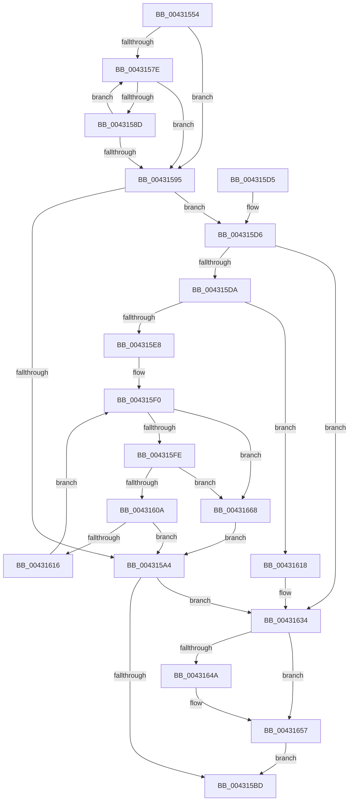

# MiReferenceControlAreaFile

- RVA: `0x00431554`–`0x00431673` (길이 `287` bytes)
- VA: `0x0000000140431554`
- 실행 섹션: `.text`
- PDB 이름 있음: `예`; PDB Function 태그: `아니요`
- unwind 정보 RVA: `0x000A21E8`
- 디코드: `81`개 명령, `287/287` bytes 표시
- 미해석 바이트: `0` (있으면 어셈블리에 `.byte`로 보존)

> 이 문서는 커널 이미지의 기계어와 PDB 기호를 분석해 생성했습니다. 4번과 5번은 함수 원형과 자료형을 바이너리 사용 방식에서 추정한 C 해석이며 원본 소스 복구 결과는 아닙니다.

## 1. Dependencies

- 직접 호출 지점: **5**; 고유 호출 대상: **5**
- 직접 호출자로 확인된 함수: **26**
- RIP 상대 이미지 참조: **0**

### Outgoing calls
- `0x004315B3` → [ObpTraceObjectReferenceIfActive](../21/ObpTraceObjectReferenceIfActive_function_00210780.md) (function, `0x00210780`)
- `0x0043162E` → [KeBugCheckEx](../4F/KeBugCheckEx_function_004FD660.md) (function, `0x004FD660`)
- `0x00431638` → [ExAcquireSpinLockShared](../24/ExAcquireSpinLockShared_function_0024DCE0.md) (function, `0x0024DCE0`)
- `0x00431652` → [ObfReferenceObjectWithTag](../21/ObfReferenceObjectWithTag_function_00210710.md) (function, `0x00210710`)
- `0x0043165E` → [MiReleaseSpinLockShared](../34/MiReleaseSpinLockShared_function_00348BF0.md) (function, `0x00348BF0`)

### Direct callers
- [NtAreMappedFilesTheSame](../../page/87/NtAreMappedFilesTheSame_function_0087EC70.md) at `0x0087EDF3`
- [MiUnmapVad](../../page/88/MiUnmapVad_function_00889280.md) at `0x008892EF`
- [MiUnmapViewOfSection](../../page/88/MiUnmapViewOfSection_function_0088A4C4.md) at `0x0088A722`
- [MiCreateSectionCommon](../../page/8A/MiCreateSectionCommon_function_008A9AA4.md) at `0x008A9DA2`
- [MiAllowImageMap](../../page/8C/MiAllowImageMap_function_008C8B10.md) at `0x008C8C45`
- [MmIsFileMapped](../../page/91/MmIsFileMapped_function_0091D8D4.md) at `0x0091D9D9`
- [MmSectionToSectionObjectPointers](../../page/91/MmSectionToSectionObjectPointers_function_0091DF04.md) at `0x0091DF20`
- [MiParseImageLoadConfig](../../page/94/MiParseImageLoadConfig_function_00940D18.md) at `0x00940F44`
- [MiLogRelocationFaults](../../page/94/MiLogRelocationFaults_function_009418EC.md) at `0x00941909`
- [MiParseComAndCetHeaders](../../page/94/MiParseComAndCetHeaders_function_00941974.md) at `0x00941A13`
- [MiMapImageInSystemSpace](../../page/94/MiMapImageInSystemSpace_function_00941DD8.md) at `0x00941E61`
- [MmEnumerateAddressSpaceAndReferenceImages](../../page/97/MmEnumerateAddressSpaceAndReferenceImages_function_0097DD50.md) at `0x0097DF39`
- [MiFillMapFileInfo](../../page/97/MiFillMapFileInfo_function_0097E15C.md) at `0x0097E27C`
- [MiMapViewOfImageSection](../../page/97/MiMapViewOfImageSection_function_0097E92C.md) at `0x0097F173`
- [MmExtendSection](../../page/98/MmExtendSection_function_00982C38.md) at `0x00982DD6`
- [MmFlushVirtualMemory](../../page/9D/MmFlushVirtualMemory_function_009D6F5C.md) at `0x009D7130`
- [MmQueryVirtualMemory](../../page/9D/MmQueryVirtualMemory_function_009D9280.md) at `0x009D9BA3`
- [MmGetFileNameForAddress](../../page/A2/MmGetFileNameForAddress_function_00A2B878.md) at `0x00A2B8CA`
- [MmGetFileNameForSection](../../page/A9/MmGetFileNameForSection_function_00A9AEBC.md) at `0x00A9AF17`
- [MiConstructLoaderEntry](../../page/AA/MiConstructLoaderEntry_function_00AAA264.md) at `0x00AAA71D`
- [MiMapImageForEnclaveUse](../../page/AB/MiMapImageForEnclaveUse_function_00AB213C.md) at `0x00AB2210`
- [MmCreateSpecialImageSection](../../page/AB/MmCreateSpecialImageSection_function_00AB7360.md) at `0x00AB7461`
- [MiAllocateFileExtents](../../page/AB/MiAllocateFileExtents_function_00ABDF54.md) at `0x00ABE04D`
- [MiLoadUserSymbols](../../page/AC/MiLoadUserSymbols_function_00AC91D0.md) at `0x00AC91FC`
- [MiCallImageNotify](../../page/AD/MiCallImageNotify_function_00ADB9CC.md) at `0x00ADBA53`
- [sub_00B1B1BE](../../page/B1/Unknown_function_00B1B1BE.md) at `0x00B1B1C1`

### Static image references
- 디코드된 RIP-relative 메모리 참조가 없습니다.

## 2. Other-region calls and transfers

- 다른 실행 섹션으로 향하는 call: **0**
- 별도 외부 분기/꼬리 이동을 확인하지 못했습니다.

## 3. Assembly (complete function range)

```asm
00431554  48 89 5C 24 08                  mov qword ptr [rsp + 8], rbx
00431559  48 89 6C 24 10                  mov qword ptr [rsp + 0x10], rbp
0043155E  48 89 74 24 18                  mov qword ptr [rsp + 0x18], rsi
00431563  57                              push rdi
00431564  48 83 EC 30                     sub rsp, 0x30
00431568  48 8B F9                        mov rdi, rcx
0043156B  0F 0D 49 40                     prefetchw byte ptr [rcx + 0x40]
0043156F  48 8B 51 40                     mov rdx, qword ptr [rcx + 0x40]
00431573  41 B8 0F 00 00 00               mov r8d, 0xf
00431579  41 84 D0                        test r8b, dl
0043157C  74 17                           je 0x140431595
0043157E  48 8D 4A FF                     lea rcx, [rdx - 1]
00431582  48 8B C2                        mov rax, rdx
00431585  F0 48 0F B1 4F 40               lock cmpxchg qword ptr [rdi + 0x40], rcx
0043158B  74 08                           je 0x140431595
0043158D  48 8B D0                        mov rdx, rax
00431590  41 84 C0                        test r8b, al
00431593  75 E9                           jne 0x14043157e
00431595  48 8B DA                        mov rbx, rdx
00431598  41 23 D0                        and edx, r8d
0043159B  48 83 E3 F0                     and rbx, 0xfffffffffffffff0
0043159F  83 FA 01                        cmp edx, 1
004315A2  76 32                           jbe 0x1404315d6
004315A4  48 8D 4B D0                     lea rcx, [rbx - 0x30]
004315A8  BA 01 00 00 00                  mov edx, 1
004315AD  41 B8 4D 6D 53 63               mov r8d, 0x63536d4d
004315B3  E8 C8 F1 DD FF                  call 0x140210780
004315B8  48 85 DB                        test rbx, rbx
004315BB  74 77                           je 0x140431634
004315BD  48 8B 6C 24 48                  mov rbp, qword ptr [rsp + 0x48]
004315C2  48 8B C3                        mov rax, rbx
004315C5  48 8B 5C 24 40                  mov rbx, qword ptr [rsp + 0x40]
004315CA  48 8B 74 24 50                  mov rsi, qword ptr [rsp + 0x50]
004315CF  48 83 C4 30                     add rsp, 0x30
004315D3  5F                              pop rdi
004315D4  C3                              ret
004315D5  CC                              int3
004315D6  85 D2                           test edx, edx
004315D8  74 5A                           je 0x140431634
004315DA  49 8B C0                        mov rax, r8
004315DD  F0 48 0F C1 43 D0               lock xadd qword ptr [rbx - 0x30], rax
004315E3  48 85 C0                        test rax, rax
004315E6  7E 30                           jle 0x140431618
004315E8  0F 0D 4F 40                     prefetchw byte ptr [rdi + 0x40]
004315EC  48 8B 47 40                     mov rax, qword ptr [rdi + 0x40]
004315F0  48 8B C8                        mov rcx, rax
004315F3  49 23 C8                        and rcx, r8
004315F6  49 03 C8                        add rcx, r8
004315F9  49 3B C8                        cmp rcx, r8
004315FC  77 6A                           ja 0x140431668
004315FE  48 8B C8                        mov rcx, rax
00431601  48 83 E1 F0                     and rcx, 0xfffffffffffffff0
00431605  48 3B D9                        cmp rbx, rcx
00431608  75 5E                           jne 0x140431668
0043160A  48 8D 48 0F                     lea rcx, [rax + 0xf]
0043160E  F0 48 0F B1 4F 40               lock cmpxchg qword ptr [rdi + 0x40], rcx
00431614  74 8E                           je 0x1404315a4
00431616  EB D8                           jmp 0x1404315f0
00431618  49 03 C0                        add rax, r8
0043161B  33 D2                           xor edx, edx
0043161D  41 B9 10 00 00 00               mov r9d, 0x10
00431623  48 89 44 24 20                  mov qword ptr [rsp + 0x20], rax
00431628  4C 8B C3                        mov r8, rbx
0043162B  8D 4A 18                        lea ecx, [rdx + 0x18]
0043162E  E8 2D C0 0C 00                  call 0x1404fd660
00431633  CC                              int3
00431634  48 8D 4F 48                     lea rcx, [rdi + 0x48]
00431638  E8 A3 C6 E1 FF                  call 0x14024dce0
0043163D  48 8B 5F 40                     mov rbx, qword ptr [rdi + 0x40]
00431641  40 8A E8                        mov bpl, al
00431644  48 83 E3 F0                     and rbx, 0xfffffffffffffff0
00431648  74 0D                           je 0x140431657
0043164A  BA 4D 6D 53 63                  mov edx, 0x63536d4d
0043164F  48 8B CB                        mov rcx, rbx
00431652  E8 B9 F0 DD FF                  call 0x140210710
00431657  40 8A D5                        mov dl, bpl
0043165A  48 8D 4F 48                     lea rcx, [rdi + 0x48]
0043165E  E8 8D 75 F1 FF                  call 0x140348bf0
00431663  E9 55 FF FF FF                  jmp 0x1404315bd
00431668  F0 48 83 43 D0 F1               lock add qword ptr [rbx - 0x30], -0xf
0043166E  E9 31 FF FF FF                  jmp 0x1404315a4
```

## 4. C-style interpretation (structured pseudocode)

```c
__int64 __fastcall MiReferenceControlAreaFile(__int64 a1)
{
    __int64 result;
    __int64 v_rbx;
    __int64 v_rsp;
    unsigned __int64 v_stack_p10;
    unsigned __int64 v_stack_p18;
    unsigned __int64 v_stack_p20;
    unsigned __int64 v_stack_p8;

    v_stack_p8 = v_rbx;
    v_stack_p10 = v_rbp;
    v_stack_p18 = v_rsi;
    v_rsp = (v_rsp) - (48);
    if (((15) & ((unsigned __int8)(*(unsigned __int64 *)(a1 + 64)))) == 0) goto loc_00431595;
loc_0043157E:
    if (((15) & ((unsigned __int8)(*(unsigned __int64 *)(a1 + 64)))) == 0) goto loc_00431595;
    if (((15) & ((unsigned __int8)(*(unsigned __int64 *)(a1 + 64)))) != 0) goto loc_0043157E;
loc_00431595:
    a2 = (unsigned int)((*(unsigned __int64 *)(a1 + 64)) & (15));
    v_rbx = (*(unsigned __int64 *)(a1 + 64)) & (-16);
    if (((unsigned int)(a2)) <= 1) goto loc_004315D6;
loc_004315A4:
    result = ObpTraceObjectReferenceIfActive(v_rbx - 48, 1, (unsigned int)(0x63536D4DULL), a4);
    if (v_rbx == 0) goto loc_00431634;
loc_004315BD:
    v_rsp = (v_rsp) + (48);
    return v_rbx;
loc_004315D6:
    if (1 == 0) goto loc_00431634;
    if (condition_is_less_or_equal) goto loc_00431618;
loc_004315F0:
    a1 = (*(unsigned __int64 *)(a1 + 64)) & ((unsigned int)(0x63536D4DULL));
    a1 = (a1) + ((unsigned int)(0x63536D4DULL));
    if (a1 > ((unsigned int)(0x63536D4DULL))) goto loc_00431668;
    a1 = (*(unsigned __int64 *)(a1 + 64)) & (-16);
    if (v_stack_p8 != a1) goto loc_00431668;
    if (v_stack_p8 == a1) goto loc_004315A4;
    goto loc_004315F0;
loc_00431618:
    result = (*(unsigned __int64 *)(a1 + 64)) + ((unsigned int)(0x63536D4DULL));
    a2 = 0;
    v_stack_p20 = result;
    result = KeBugCheckEx(a2 + 24, a2, v_stack_p8, 16);
loc_00431634:
    result = ExAcquireSpinLockShared(a1 + 72, a2, v_stack_p8, 16);
    v_rbx = (*(unsigned __int64 *)(a1 + 64)) & (-16);
    if (!(condition_is_equal)) {
        a2 = 0x63536D4DULL;
        a1 = v_rbx;
        result = ObfReferenceObjectWithTag(a1, a2, v_stack_p8, 16);
    }
    result = MiReleaseSpinLockShared(a1 + 72, (unsigned __int8)((unsigned __int8)(result)), v_stack_p8, 16);
    goto loc_004315BD;
loc_00431668:
    goto loc_004315A4;
}
```

## 5. (Beta) C Style

```c
int64_t MiReferenceControlAreaFile(void *Arg1)
{
    uint8_t *arg1 = (uint8_t *)Arg1;

    int64_t result;
    int64_t local_rbx;
    int64_t local_rsp;
    uint64_t v_stack_p10;
    uint64_t v_stack_p18;
    uint64_t v_stack_p20;
    uint64_t v_stack_p8;

    v_stack_p8 = local_rbx;
    v_stack_p10 = local_rbp;
    v_stack_p18 = local_rsi;
    local_rsp = (local_rsp) - (48);
    if (((15) & ((uint8_t)(*(uint64_t *)(arg1 + 0x40)))) == 0) goto loc_00431595;
loc_0043157E:
    if (((15) & ((uint8_t)(*(uint64_t *)(arg1 + 0x40)))) == 0) goto loc_00431595;
    if (((15) & ((uint8_t)(*(uint64_t *)(arg1 + 0x40)))) != 0) goto loc_0043157E;
loc_00431595:
    a2 = (uint32_t)((*(uint64_t *)(arg1 + 0x40)) & (15));
    local_rbx = (*(uint64_t *)(arg1 + 0x40)) & (-16);
    if (((uint32_t)(a2)) <= 1) goto loc_004315D6;
loc_004315A4:
    result = ObpTraceObjectReferenceIfActive(local_rbx - 48, 1, (uint32_t)(0x63536D4DULL), a4);
    if (local_rbx == 0) goto loc_00431634;
loc_004315BD:
    local_rsp = (local_rsp) + (48);
    return local_rbx;
loc_004315D6:
    if (1 == 0) goto loc_00431634;
    if (condition_is_less_or_equal) goto loc_00431618;
loc_004315F0:
    Arg1 = (*(uint64_t *)(arg1 + 0x40)) & ((uint32_t)(0x63536D4DULL));
    Arg1 = (Arg1) + ((uint32_t)(0x63536D4DULL));
    if (Arg1 > ((uint32_t)(0x63536D4DULL))) goto loc_00431668;
    Arg1 = (*(uint64_t *)(arg1 + 0x40)) & (-16);
    if (v_stack_p8 != Arg1) goto loc_00431668;
    if (v_stack_p8 == Arg1) goto loc_004315A4;
    goto loc_004315F0;
loc_00431618:
    result = (*(uint64_t *)(arg1 + 0x40)) + ((uint32_t)(0x63536D4DULL));
    a2 = 0;
    v_stack_p20 = result;
    result = KeBugCheckEx(a2 + 24, a2, v_stack_p8, 16);
loc_00431634:
    result = ExAcquireSpinLockShared(Arg1 + 72, a2, v_stack_p8, 16);
    local_rbx = (*(uint64_t *)(arg1 + 0x40)) & (-16);
    if (!(condition_is_equal)) {
        a2 = 0x63536D4DULL;
        Arg1 = local_rbx;
        result = ObfReferenceObjectWithTag(Arg1, a2, v_stack_p8, 16);
    }
    result = MiReleaseSpinLockShared(Arg1 + 72, (uint8_t)((uint8_t)(result)), v_stack_p8, 16);
    goto loc_004315BD;
loc_00431668:
    goto loc_004315A4;
}
```

### 관측된 메모리 오프셋

구조체 형식이 확인되지 않은 접근은 인자 기준의 오프셋으로만 기록했습니다.

| 기준 인자 | 오프셋 표현 | 폭 (bit) | 접근 |
|---|---:|---:|---|
| `Arg1` | `+ 0x40` | `8` | `R` |
| `Arg1` | `+ 0x40` | `64` | `R` |
| `Arg1` | `+ 0x48` | `64` | `R` |

## 6. Execution-region graph

[열기: 2D/3D 그래프와 함수 탐색 컨트롤 패널](../../../control-panel.html?section=text&rva=0x00431554&view=graph)

- 2D 그래프는 위에서 아래로 흐르고, 3D 그래프는 빈 공간을 드래그해 회전합니다. Shift+드래그는 이동, 휠은 확대·축소, 함수 노드 선택은 대상 보고서 이동입니다.

### Static fallback


