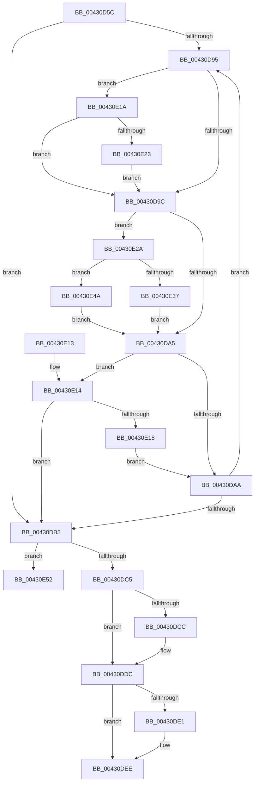

# MiRemoveSecureEntry

- RVA: `0x00430D5C`–`0x00430E6E` (길이 `274` bytes)
- VA: `0x0000000140430D5C`
- 실행 섹션: `.text`
- PDB 이름 있음: `예`; PDB Function 태그: `아니요`
- unwind 정보 RVA: `0x00081C0C`
- 디코드: `81`개 명령, `274/274` bytes 표시
- 미해석 바이트: `0` (있으면 어셈블리에 `.byte`로 보존)

> 이 문서는 커널 이미지의 기계어와 PDB 기호를 분석해 생성했습니다. 4번과 5번은 함수 원형과 자료형을 바이너리 사용 방식에서 추정한 C 해석이며 원본 소스 복구 결과는 아닙니다.

## 1. Dependencies

- 직접 호출 지점: **6**; 고유 호출 대상: **6**
- 직접 호출자로 확인된 함수: **2**
- RIP 상대 이미지 참조: **0**

### Outgoing calls
- `0x00430D84` → [MiLockVadCore](../29/MiLockVadCore_function_00297170.md) (function, `0x00297170`)
- `0x00430DB8` → [MiUnlockVadCore](MiUnlockVadCore_function_004311C0.md) (function, `0x004311C0`)
- `0x00430DD7` → [MiUnsecureVirtualMemoryAgainstWrites](../../page/A2/MiUnsecureVirtualMemoryAgainstWrites_function_00A2601C.md) (function, `0x00A2601C`)
- `0x00430DE9` → [MiSetVadFlags](MiSetVadFlags_function_004311FC.md) (function, `0x004311FC`)
- `0x00430DF3` → [ExFreePoolWithTag](../../poolcode/B8/ExFreePoolWithTag_function_00B82870.md) (function, `0x00B82870`)
- `0x00430E68` → [KeBugCheckEx](../4F/KeBugCheckEx_function_004FD660.md) (function, `0x004FD660`)

### Direct callers
- [MmUnsecureVirtualMemory](../../page/88/MmUnsecureVirtualMemory_function_0088A2A0.md) at `0x0088A2E4`
- [MiUnmapLockedPagesInUserSpace](../../page/A7/MiUnmapLockedPagesInUserSpace_function_00A78E54.md) at `0x00A78F2F`

### Static image references
- 디코드된 RIP-relative 메모리 참조가 없습니다.

## 2. Other-region calls and transfers

- 다른 실행 섹션으로 향하는 call: **2**
  - `0x00430DD7` → [MiUnsecureVirtualMemoryAgainstWrites](../../page/A2/MiUnsecureVirtualMemoryAgainstWrites_function_00A2601C.md) (`.text` → `PAGE`)
  - `0x00430DF3` → [ExFreePoolWithTag](../../poolcode/B8/ExFreePoolWithTag_function_00B82870.md) (`.text` → `POOLCODE`)
- 별도 외부 분기/꼬리 이동을 확인하지 못했습니다.

## 3. Assembly (complete function range)

```asm
00430D5C  48 8B C4                        mov rax, rsp
00430D5F  48 89 58 08                     mov qword ptr [rax + 8], rbx
00430D63  48 89 68 10                     mov qword ptr [rax + 0x10], rbp
00430D67  48 89 70 18                     mov qword ptr [rax + 0x18], rsi
00430D6B  48 89 78 20                     mov qword ptr [rax + 0x20], rdi
00430D6F  41 56                           push r14
00430D71  48 83 EC 30                     sub rsp, 0x30
00430D75  48 8B DA                        mov rbx, rdx
00430D78  48 8B F9                        mov rdi, rcx
00430D7B  33 D2                           xor edx, edx
00430D7D  33 F6                           xor esi, esi
00430D7F  33 ED                           xor ebp, ebp
00430D81  45 33 F6                        xor r14d, r14d
00430D84  E8 E7 63 E6 FF                  call 0x140297170
00430D89  4C 8B 47 38                     mov r8, qword ptr [rdi + 0x38]
00430D8D  8A D0                           mov dl, al
00430D8F  49 83 E0 F0                     and r8, 0xfffffffffffffff0
00430D93  74 20                           je 0x140430db5
00430D95  41 83 78 50 02                  cmp dword ptr [r8 + 0x50], 2
00430D9A  74 7E                           je 0x140430e1a
00430D9C  4C 3B C3                        cmp r8, rbx
00430D9F  0F 84 85 00 00 00               je 0x140430e2a
00430DA5  83 FE 01                        cmp esi, 1
00430DA8  77 6A                           ja 0x140430e14
00430DAA  4D 8B F0                        mov r14, r8
00430DAD  4D 8B 00                        mov r8, qword ptr [r8]
00430DB0  4D 85 C0                        test r8, r8
00430DB3  75 E0                           jne 0x140430d95
00430DB5  48 8B CF                        mov rcx, rdi
00430DB8  E8 03 04 00 00                  call 0x1404311c0
00430DBD  85 ED                           test ebp, ebp
00430DBF  0F 84 8D 00 00 00               je 0x140430e52
00430DC5  8B 43 08                        mov eax, dword ptr [rbx + 8]
00430DC8  A8 10                           test al, 0x10
00430DCA  74 10                           je 0x140430ddc
00430DCC  4C 8B 43 10                     mov r8, qword ptr [rbx + 0x10]
00430DD0  48 8B CF                        mov rcx, rdi
00430DD3  48 8B 53 08                     mov rdx, qword ptr [rbx + 8]
00430DD7  E8 40 52 5F 00                  call 0x140a2601c
00430DDC  83 FE 01                        cmp esi, 1
00430DDF  75 0D                           jne 0x140430dee
00430DE1  45 33 C0                        xor r8d, r8d
00430DE4  8B D6                           mov edx, esi
00430DE6  48 8B CF                        mov rcx, rdi
00430DE9  E8 0E 04 00 00                  call 0x1404311fc
00430DEE  33 D2                           xor edx, edx
00430DF0  48 8B CB                        mov rcx, rbx
00430DF3  E8 78 1A 75 00                  call 0x140b82870
00430DF8  48 8B 5C 24 40                  mov rbx, qword ptr [rsp + 0x40]
00430DFD  48 8B 6C 24 48                  mov rbp, qword ptr [rsp + 0x48]
00430E02  48 8B 74 24 50                  mov rsi, qword ptr [rsp + 0x50]
00430E07  48 8B 7C 24 58                  mov rdi, qword ptr [rsp + 0x58]
00430E0C  48 83 C4 30                     add rsp, 0x30
00430E10  41 5E                           pop r14
00430E12  C3                              ret
00430E13  CC                              int3
00430E14  85 ED                           test ebp, ebp
00430E16  75 9D                           jne 0x140430db5
00430E18  EB 90                           jmp 0x140430daa
00430E1A  83 FE 01                        cmp esi, 1
00430E1D  0F 87 79 FF FF FF               ja 0x140430d9c
00430E23  FF C6                           inc esi
00430E25  E9 72 FF FF FF                  jmp 0x140430d9c
00430E2A  49 8B 08                        mov rcx, qword ptr [r8]
00430E2D  BD 01 00 00 00                  mov ebp, 1
00430E32  4D 85 F6                        test r14, r14
00430E35  75 13                           jne 0x140430e4a
00430E37  48 8B 47 38                     mov rax, qword ptr [rdi + 0x38]
00430E3B  83 E0 0F                        and eax, 0xf
00430E3E  48 0B C1                        or rax, rcx
00430E41  48 89 47 38                     mov qword ptr [rdi + 0x38], rax
00430E45  E9 5B FF FF FF                  jmp 0x140430da5
00430E4A  49 89 0E                        mov qword ptr [r14], rcx
00430E4D  E9 53 FF FF FF                  jmp 0x140430da5
00430E52  48 83 64 24 20 00               and qword ptr [rsp + 0x20], 0
00430E58  4C 8B CB                        mov r9, rbx
00430E5B  4C 8B C7                        mov r8, rdi
00430E5E  BA 01 50 01 00                  mov edx, 0x15001
00430E63  B9 1A 00 00 00                  mov ecx, 0x1a
00430E68  E8 F3 C7 0C 00                  call 0x1404fd660
00430E6D  CC                              int3
```

## 4. C-style interpretation (structured pseudocode)

```c
__int64 __fastcall MiRemoveSecureEntry(__int64 a1, __int64 a2)
{
    __int64 result;
    __int64 v_r14;
    __int64 v_rbp;
    __int64 v_rsi;
    __int64 v_rsp;
    unsigned __int64 v_stack_p10;
    unsigned __int64 v_stack_p18;
    unsigned __int64 v_stack_p20;
    unsigned __int64 v_stack_p8;

    *(unsigned __int64 *)(v_rsp + 8) = v_rbx;
    *(unsigned __int64 *)(v_rsp + 16) = v_rbp;
    *(unsigned __int64 *)(v_rsp + 24) = v_rsi;
    *(unsigned __int64 *)(v_rsp + 32) = v_rdi;
    v_rsp = (v_rsp) - (48);
    a2 = 0;
    v_rsi = 0;
    v_rbp = 0;
    v_r14 = 0;
    result = MiLockVadCore(a1, a2, a3, a4);
    a3 = (*(unsigned __int64 *)(a1 + 56)) & (-16);
    if (condition_is_equal) goto loc_00430DB5;
loc_00430D95:
    if ((*(unsigned int *)(a3 + 80)) == 2) goto loc_00430E1A;
loc_00430D9C:
    if (a3 == 0) goto loc_00430E2A;
loc_00430DA5:
    if (0 > 1) goto loc_00430E14;
loc_00430DAA:
    if (*(unsigned __int64 *)(a3) != 0) goto loc_00430D95;
loc_00430DB5:
    result = MiUnlockVadCore(a1, (unsigned __int8)(result), *(unsigned __int64 *)(a3), a4);
    if (0 == 0) goto loc_00430E52;
    result = (unsigned int)(*(unsigned int *)(a2 + 8));
    if ((((unsigned __int8)((unsigned int)(*(unsigned int *)(a2 + 8)))) & (16)) != 0) {
        a3 = *(unsigned __int64 *)(a2 + 16);
        a1 = a1;
        a2 = *(unsigned __int64 *)(a2 + 8);
        result = MiUnsecureVirtualMemoryAgainstWrites(a1, a2, a3, a4);
    }
    if (0 == 1) {
        a3 = 0;
        a2 = 0;
        a1 = a1;
        result = MiSetVadFlags(a1, a2, a3, a4);
    }
    a2 = 0;
    result = ExFreePoolWithTag(0, a2, a3, a4);
    v_rsp = (v_rsp) + (48);
    return result;
loc_00430E14:
    if ((unsigned int)(v_stack_p10) != 0) goto loc_00430DB5;
    goto loc_00430DAA;
loc_00430E1A:
    if (((unsigned int)(v_stack_p18)) > 1) goto loc_00430D9C;
    v_rsi = (unsigned int)((v_stack_p18) + 1);
    goto loc_00430D9C;
loc_00430E2A:
    if (0 != 0) goto loc_00430E4A;
    result = (unsigned int)((*(unsigned __int64 *)(v_stack_p20 + 56)) & (15));
    result = (result) | (*(unsigned __int64 *)(a3));
    *(unsigned __int64 *)(v_stack_p20 + 56) = result;
    goto loc_00430DA5;
loc_00430E4A:
    *(unsigned __int64 *)(a3) = *(unsigned __int64 *)(a3);
    goto loc_00430DA5;
loc_00430E52:
    result = KeBugCheckEx(26, (unsigned int)(0x15001ULL), v_stack_p20, v_stack_p8);
    return result;
}
```

## 5. (Beta) C Style

```c
int64_t MiRemoveSecureEntry(void *Arg1, void *Arg2)
{
    uint8_t *arg1 = (uint8_t *)Arg1;
    uint8_t *arg2 = (uint8_t *)Arg2;

    int64_t result;
    int64_t local_r14;
    int64_t local_rbp;
    int64_t local_rsi;
    int64_t local_rsp;
    uint64_t v_stack_p10;
    uint64_t v_stack_p18;
    uint64_t v_stack_p20;
    uint64_t v_stack_p8;

    *(uint64_t *)(local_rsp + 0x8) = local_rbx;
    *(uint64_t *)(local_rsp + 0x10) = local_rbp;
    *(uint64_t *)(local_rsp + 0x18) = local_rsi;
    *(uint64_t *)(local_rsp + 0x20) = local_rdi;
    local_rsp = (local_rsp) - (48);
    Arg2 = 0;
    local_rsi = 0;
    local_rbp = 0;
    local_r14 = 0;
    result = MiLockVadCore(Arg1, Arg2, a3, a4);
    a3 = (*(uint64_t *)(arg1 + 0x38)) & (-16);
    if (condition_is_equal) goto loc_00430DB5;
loc_00430D95:
    if ((*(uint32_t *)(a3 + 0x50)) == 2) goto loc_00430E1A;
loc_00430D9C:
    if (a3 == 0) goto loc_00430E2A;
loc_00430DA5:
    if (0 > 1) goto loc_00430E14;
loc_00430DAA:
    if (*(uint64_t *)(a3) != 0) goto loc_00430D95;
loc_00430DB5:
    result = MiUnlockVadCore(Arg1, (uint8_t)(result), *(uint64_t *)(a3), a4);
    if (0 == 0) goto loc_00430E52;
    result = (uint32_t)(*(uint32_t *)(arg2 + 0x8));
    if ((((uint8_t)((uint32_t)(*(uint32_t *)(arg2 + 0x8)))) & (16)) != 0) {
        a3 = *(uint64_t *)(arg2 + 0x10);
        Arg1 = Arg1;
        Arg2 = *(uint64_t *)(arg2 + 0x8);
        result = MiUnsecureVirtualMemoryAgainstWrites(Arg1, Arg2, a3, a4);
    }
    if (0 == 1) {
        a3 = 0;
        Arg2 = 0;
        Arg1 = Arg1;
        result = MiSetVadFlags(Arg1, Arg2, a3, a4);
    }
    Arg2 = 0;
    result = ExFreePoolWithTag(0, Arg2, a3, a4);
    local_rsp = (local_rsp) + (48);
    return result;
loc_00430E14:
    if ((uint32_t)(v_stack_p10) != 0) goto loc_00430DB5;
    goto loc_00430DAA;
loc_00430E1A:
    if (((uint32_t)(v_stack_p18)) > 1) goto loc_00430D9C;
    local_rsi = (uint32_t)((v_stack_p18) + 1);
    goto loc_00430D9C;
loc_00430E2A:
    if (0 != 0) goto loc_00430E4A;
    result = (uint32_t)((*(uint64_t *)(v_stack_p20 + 0x38)) & (15));
    result = (result) | (*(uint64_t *)(a3));
    *(uint64_t *)(v_stack_p20 + 0x38) = result;
    goto loc_00430DA5;
loc_00430E4A:
    *(uint64_t *)(a3) = *(uint64_t *)(a3);
    goto loc_00430DA5;
loc_00430E52:
    result = KeBugCheckEx(26, (uint32_t)(0x15001ULL), v_stack_p20, v_stack_p8);
    return result;
}
```

### 관측된 메모리 오프셋

구조체 형식이 확인되지 않은 접근은 인자 기준의 오프셋으로만 기록했습니다.

| 기준 인자 | 오프셋 표현 | 폭 (bit) | 접근 |
|---|---:|---:|---|
| `Arg1` | `+ 0x38` | `64` | `R` |
| `Arg1` | `+ 0x38` | `64` | `W` |
| `Arg2` | `+ 0x8` | `32` | `R` |
| `Arg2` | `+ 0x8` | `64` | `R` |
| `Arg2` | `+ 0x10` | `64` | `R` |

## 6. Execution-region graph

[열기: 2D/3D 그래프와 함수 탐색 컨트롤 패널](../../../control-panel.html?section=text&rva=0x00430D5C&view=graph)

- 2D 그래프는 위에서 아래로 흐르고, 3D 그래프는 빈 공간을 드래그해 회전합니다. Shift+드래그는 이동, 휠은 확대·축소, 함수 노드 선택은 대상 보고서 이동입니다.

### Static fallback


