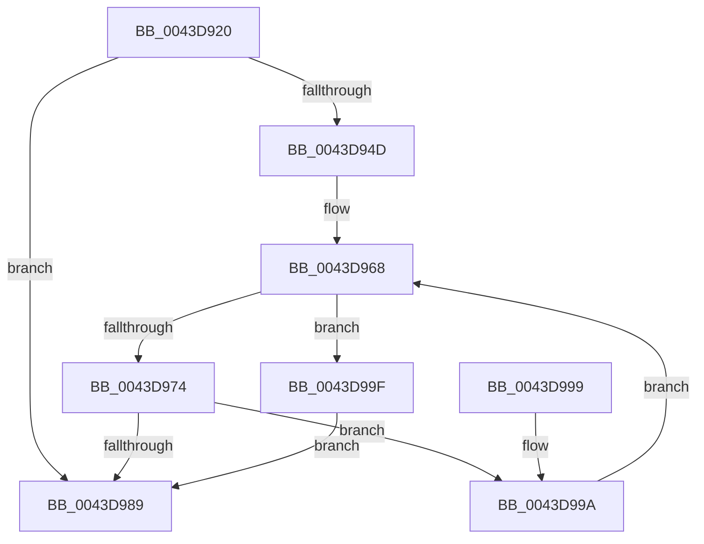

# MiReplenishLocalCommit

- RVA: `0x0043D920`–`0x0043D9C6` (길이 `166` bytes)
- VA: `0x000000014043D920`
- 실행 섹션: `.text`
- PDB 이름 있음: `예`; PDB Function 태그: `아니요`
- unwind 정보 RVA: `0x000A48CC`
- 디코드: `44`개 명령, `166/166` bytes 표시
- 미해석 바이트: `0` (있으면 어셈블리에 `.byte`로 보존)

> 이 문서는 커널 이미지의 기계어와 PDB 기호를 분석해 생성했습니다. 4번과 5번은 함수 원형과 자료형을 바이너리 사용 방식에서 추정한 C 해석이며 원본 소스 복구 결과는 아닙니다.

## 1. Dependencies

- 직접 호출 지점: **2**; 고유 호출 대상: **2**
- 직접 호출자로 확인된 함수: **1**
- RIP 상대 이미지 참조: **0**

### Outgoing calls
- `0x0043D956` → [MiUpdateCommitCounts](MiUpdateCommitCounts_function_0043D9CC.md) (function, `0x0043D9CC`)
- `0x0043D9BF` → [MiSignalCommitSignals](../24/MiSignalCommitSignals_function_00249090.md) (function, `0x00249090`)

### Direct callers
- [MiChargeCommit](../28/MiChargeCommit_function_00286EB0.md) at `0x0028710A`

### Static image references
- 디코드된 RIP-relative 메모리 참조가 없습니다.

## 2. Other-region calls and transfers

- 다른 실행 섹션으로 향하는 call: **0**
- 별도 외부 분기/꼬리 이동을 확인하지 못했습니다.

## 3. Assembly (complete function range)

```asm
0043D920  48 89 5C 24 10                  mov qword ptr [rsp + 0x10], rbx
0043D925  48 89 74 24 18                  mov qword ptr [rsp + 0x18], rsi
0043D92A  57                              push rdi
0043D92B  48 83 EC 20                     sub rsp, 0x20
0043D92F  49 8B F9                        mov rdi, r9
0043D932  4F 8D 14 08                     lea r10, [r8 + r9]
0043D936  4D 8B D8                        mov r11, r8
0043D939  48 8B F2                        mov rsi, rdx
0043D93C  48 8B D9                        mov rbx, rcx
0043D93F  49 8B C0                        mov rax, r8
0043D942  F0 4C 0F B1 91 40 4B 00 00      lock cmpxchg qword ptr [rcx + 0x4b40], r10
0043D94B  75 3C                           jne 0x14043d989
0043D94D  45 33 C9                        xor r9d, r9d
0043D950  4C 8B C7                        mov r8, rdi
0043D953  49 8B D3                        mov rdx, r11
0043D956  E8 71 00 00 00                  call 0x14043d9cc
0043D95B  0F 0D 8E 98 8B 00 00            prefetchw byte ptr [rsi + 0x8b98]
0043D962  8B 96 98 8B 00 00               mov edx, dword ptr [rsi + 0x8b98]
0043D968  48 8D 04 3A                     lea rax, [rdx + rdi]
0043D96C  48 3D 00 02 00 00               cmp rax, 0x200
0043D972  77 2B                           ja 0x14043d99f
0043D974  8D 0C 3A                        lea ecx, [rdx + rdi]
0043D977  8B C2                           mov eax, edx
0043D979  F0 0F B1 8E 98 8B 00 00         lock cmpxchg dword ptr [rsi + 0x8b98], ecx
0043D981  48 63 C8                        movsxd rcx, eax
0043D984  48 3B CA                        cmp rcx, rdx
0043D987  75 11                           jne 0x14043d99a
0043D989  48 8B 5C 24 38                  mov rbx, qword ptr [rsp + 0x38]
0043D98E  48 8B 74 24 40                  mov rsi, qword ptr [rsp + 0x40]
0043D993  48 83 C4 20                     add rsp, 0x20
0043D997  5F                              pop rdi
0043D998  C3                              ret
0043D999  CC                              int3
0043D99A  48 8B D1                        mov rdx, rcx
0043D99D  EB C9                           jmp 0x14043d968
0043D99F  4C 8B C7                        mov r8, rdi
0043D9A2  49 F7 D8                        neg r8
0043D9A5  F0 4C 01 83 80 4B 00 00         lock add qword ptr [rbx + 0x4b80], r8
0043D9AD  F0 4C 0F C1 83 40 4B 00 00      lock xadd qword ptr [rbx + 0x4b40], r8
0043D9B6  49 8B D0                        mov rdx, r8
0043D9B9  48 8B CB                        mov rcx, rbx
0043D9BC  48 2B D7                        sub rdx, rdi
0043D9BF  E8 CC B6 E0 FF                  call 0x140249090
0043D9C4  EB C3                           jmp 0x14043d989
```

## 4. C-style interpretation (structured pseudocode)

```c
__int64 __fastcall MiReplenishLocalCommit(__int64 a1, __int64 a2, __int64 a3, __int64 a4)
{
    __int64 result;
    __int64 v_rsp;
    unsigned __int64 v_stack_p10;
    unsigned __int64 v_stack_p18;

    v_stack_p10 = v_rbx;
    v_stack_p18 = v_rsi;
    v_rsp = (v_rsp) - (32);
    if (condition_is_not_equal) goto loc_0043D989;
    a4 = 0;
    result = MiUpdateCommitCounts(a1, a3, 0, a4);
loc_0043D968:
    if (((unsigned int)(*(unsigned int *)(a2 + 35736)) + a4 * 1) > 512) goto loc_0043D99F;
    if (((int)((unsigned int)((unsigned int)((unsigned int)((unsigned int)(*(unsigned int *)(a2 + 35736))))))) != ((unsigned int)(*(unsigned int *)(a2 + 35736)))) goto loc_0043D99A;
loc_0043D989:
    v_rsp = (v_rsp) + (32);
    return (unsigned int)((unsigned int)((unsigned int)(*(unsigned int *)(a2 + 35736))));
loc_0043D99A:
    goto loc_0043D968;
loc_0043D99F:
    a3 = -(0);
    a2 = (a3) - (0);
    result = MiSignalCommitSignals(v_stack_p10, a2, a3, a4);
    goto loc_0043D989;
}
```

## 5. (Beta) C Style

```c
int64_t MiReplenishLocalCommit(void *Arg1, void *Arg2, void *Arg3, int64_t Arg4)
{
    uint8_t *arg1 = (uint8_t *)Arg1;
    uint8_t *arg2 = (uint8_t *)Arg2;
    uint8_t *arg3 = (uint8_t *)Arg3;

    int64_t result;
    int64_t local_rsp;
    uint64_t v_stack_p10;
    uint64_t v_stack_p18;

    v_stack_p10 = local_rbx;
    v_stack_p18 = local_rsi;
    local_rsp = (local_rsp) - (32);
    if (condition_is_not_equal) goto loc_0043D989;
    Arg4 = 0;
    result = MiUpdateCommitCounts(Arg1, Arg3, 0, Arg4);
loc_0043D968:
    if (((uint32_t)(*(uint32_t *)(arg2 + 0x8B98)) + Arg4 * 1) > 512) goto loc_0043D99F;
    if (((int32_t)((uint32_t)((uint32_t)((uint32_t)((uint32_t)(*(uint32_t *)(arg2 + 0x8B98))))))) != ((uint32_t)(*(uint32_t *)(arg2 + 0x8B98)))) goto loc_0043D99A;
loc_0043D989:
    local_rsp = (local_rsp) + (32);
    return (uint32_t)((uint32_t)((uint32_t)(*(uint32_t *)(arg2 + 0x8B98))));
loc_0043D99A:
    goto loc_0043D968;
loc_0043D99F:
    Arg3 = -(0);
    Arg2 = (Arg3) - (0);
    result = MiSignalCommitSignals(v_stack_p10, Arg2, Arg3, Arg4);
    goto loc_0043D989;
}
```

### 관측된 메모리 오프셋

구조체 형식이 확인되지 않은 접근은 인자 기준의 오프셋으로만 기록했습니다.

| 기준 인자 | 오프셋 표현 | 폭 (bit) | 접근 |
|---|---:|---:|---|
| `Arg1` | `+ 0x4B40` | `64` | `R` |
| `Arg1` | `+ 0x4B40` | `64` | `R/W` |
| `Arg1` | `+ 0x4B80` | `64` | `R/W` |
| `Arg2` | `+ 0x8B98` | `8` | `R` |
| `Arg2` | `+ 0x8B98` | `32` | `R` |
| `Arg3` | `+ 0x0 + r9*1` | `64` | `R` |

## 6. Execution-region graph

[열기: 2D/3D 그래프와 함수 탐색 컨트롤 패널](../../../control-panel.html?section=text&rva=0x0043D920&view=graph)

- 2D 그래프는 위에서 아래로 흐르고, 3D 그래프는 빈 공간을 드래그해 회전합니다. Shift+드래그는 이동, 휠은 확대·축소, 함수 노드 선택은 대상 보고서 이동입니다.

### Static fallback


