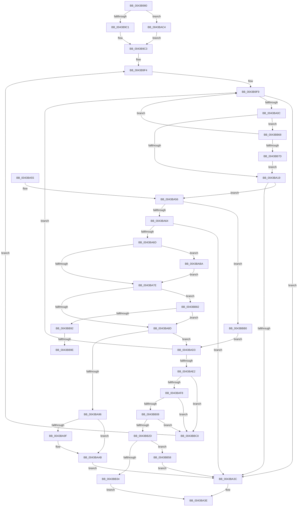

# MiSetPageZeroInProgress

- RVA: `0x0043B980`–`0x0043BBD0` (길이 `592` bytes)
- VA: `0x000000014043B980`
- 실행 섹션: `.text`
- PDB 이름 있음: `예`; PDB Function 태그: `예`
- unwind 정보 RVA: `0x000A446C`
- 디코드: `149`개 명령, `592/592` bytes 표시
- 미해석 바이트: `0` (있으면 어셈블리에 `.byte`로 보존)

> 이 문서는 커널 이미지의 기계어와 PDB 기호를 분석해 생성했습니다. 4번과 5번은 함수 원형과 자료형을 바이너리 사용 방식에서 추정한 C 해석이며 원본 소스 복구 결과는 아닙니다.

## 1. Dependencies

- 직접 호출 지점: **11**; 고유 호출 대상: **7**
- 직접 호출자로 확인된 함수: **2**
- RIP 상대 이미지 참조: **4**

### Outgoing calls
- `0x0043BAA6` → [KiLowerIrqlProcessIrqlFlags](../4F/KiLowerIrqlProcessIrqlFlags_function_004F5698.md) (function, `0x004F5698`)
- `0x0043BABD` → [KiRaiseIrqlProcessIrqlFlags](../4F/KiRaiseIrqlProcessIrqlFlags_function_004F56FC.md) (function, `0x004F56FC`)
- `0x0043BAFB` → [MiGetPfnPageSizeIndex](../31/MiGetPfnPageSizeIndex_function_0031C710.md) (function, `0x0031C710`)
- `0x0043BB40` → [MiBeginPageAccessor](MiBeginPageAccessor_function_0043BBE0.md) (function, `0x0043BBE0`)
- `0x0043BB4B` → [MiUnlockPage](../31/MiUnlockPage_function_0031A3E0.md) (function, `0x0031A3E0`)
- `0x0043BB5E` → [MiUnlockPage](../31/MiUnlockPage_function_0031A3E0.md) (function, `0x0031A3E0`)
- `0x0043BB6B` → [MiIsDecayPfn](../2B/MiIsDecayPfn_function_002B9240.md) (function, `0x002B9240`)
- `0x0043BB85` → [MiIsDecayPfn](../2B/MiIsDecayPfn_function_002B9240.md) (function, `0x002B9240`)
- `0x0043BBA5` → [KiLowerIrqlProcessIrqlFlags](../4F/KiLowerIrqlProcessIrqlFlags_function_004F5698.md) (function, `0x004F5698`)
- `0x0043BBB3` → [MiSafeLockPage](../32/MiSafeLockPage_function_00321620.md) (function, `0x00321620`)
- `0x0043BBC6` → [MiUnlockPage](../31/MiUnlockPage_function_0031A3E0.md) (function, `0x0031A3E0`)

### Direct callers
- [MiGetBestPageToZero](../32/MiGetBestPageToZero_function_003200A0.md) at `0x00320101`
- [sub_00320232](../32/Unknown_function_00320232.md) at `0x0032037D`

### Static image references
- `0x0043B9B4` → RVA `0x00FC5002` (`ALMOSTRO`; read)
- `0x0043BA0C` → RVA `0x00E2DCE0` (`.data`; read)
- `0x0043BA75` → RVA `0x00FC6D20` (`ALMOSTRO`; read)
- `0x0043BB0C` → RVA `0x00E30088` (`.data`; read)

## 2. Other-region calls and transfers

- 다른 실행 섹션으로 향하는 call: **0**
- call이 아닌 외부 분기/꼬리 이동: **2**
  - `0x0043BB98` → [sub_006EF642](../6E/Unknown_function_006EF642.md) (`tail-transfer`)
  - `0x0043BBAB` → [sub_006EF642](../6E/Unknown_function_006EF642.md) (`tail-transfer`)

## 3. Assembly (complete function range)

```asm
0043B980  48 89 5C 24 10                  mov qword ptr [rsp + 0x10], rbx
0043B985  48 89 6C 24 18                  mov qword ptr [rsp + 0x18], rbp
0043B98A  56                              push rsi
0043B98B  57                              push rdi
0043B98C  41 55                           push r13
0043B98E  41 56                           push r14
0043B990  41 57                           push r15
0043B992  48 83 EC 20                     sub rsp, 0x20
0043B996  44 8B 49 1C                     mov r9d, dword ptr [rcx + 0x1c]
0043B99A  4C 8B F1                        mov r14, rcx
0043B99D  4C 8B 29                        mov r13, qword ptr [rcx]
0043B9A0  41 8B E9                        mov ebp, r9d
0043B9A3  C1 ED 10                        shr ebp, 0x10
0043B9A6  45 8B C1                        mov r8d, r9d
0043B9A9  41 C1 E8 0F                     shr r8d, 0xf
0043B9AD  83 E5 03                        and ebp, 3
0043B9B0  41 83 E0 01                     and r8d, 1
0043B9B4  80 3D 47 96 B8 00 01            cmp byte ptr [rip + 0xb89647], 1
0043B9BB  0F 87 03 01 00 00               ja 0x14043bac4
0043B9C1  33 D2                           xor edx, edx
0043B9C3  48 8D 0C AD 00 00 00 00         lea rcx, [rbp*4]
0043B9CB  49 8B C1                        mov rax, r9
0043B9CE  48 C1 E8 12                     shr rax, 0x12
0043B9D2  48 03 CD                        add rcx, rbp
0043B9D5  83 E0 03                        and eax, 3
0043B9D8  49 8D 0C 48                     lea rcx, [r8 + rcx*2]
0043B9DC  48 8D 14 8A                     lea rdx, [rdx + rcx*4]
0043B9E0  48 8D 0C 90                     lea rcx, [rax + rdx*4]
0043B9E4  41 0F B6 C1                     movzx eax, r9b
0043B9E8  4C 6B F8 58                     imul r15, rax, 0x58
0043B9EC  4D 03 BC CD 20 04 00 00         add r15, qword ptr [r13 + rcx*8 + 0x420]
0043B9F4  BA 02 00 00 00                  mov edx, 2
0043B9F9  49 8B 77 10                     mov rsi, qword ptr [r15 + 0x10]
0043B9FD  48 B8 FF FF FF FF 3F 00 00 00   movabs rax, 0x3fffffffff
0043BA07  48 3B F0                        cmp rsi, rax
0043BA0A  74 30                           je 0x14043ba3c
0043BA0C  48 3B 35 CD 22 9F 00            cmp rsi, qword ptr [rip + 0x9f22cd]
0043BA13  0F 87 4F 01 00 00               ja 0x14043bb68
0043BA19  48 8D 1C 76                     lea rbx, [rsi + rsi*2]
0043BA1D  48 C1 E3 04                     shl rbx, 4
0043BA21  48 B9 00 00 00 00 00 DE FF FF   movabs rcx, 0xffffde0000000000
0043BA2B  48 03 D9                        add rbx, rcx
0043BA2E  8B 43 20                        mov eax, dword ptr [rbx + 0x20]
0043BA31  89 44 24 50                     mov dword ptr [rsp + 0x50], eax
0043BA35  C1 E8 10                        shr eax, 0x10
0043BA38  A8 08                           test al, 8
0043BA3A  74 1A                           je 0x14043ba56
0043BA3C  33 C0                           xor eax, eax
0043BA3E  48 8B 5C 24 58                  mov rbx, qword ptr [rsp + 0x58]
0043BA43  48 8B 6C 24 60                  mov rbp, qword ptr [rsp + 0x60]
0043BA48  48 83 C4 20                     add rsp, 0x20
0043BA4C  41 5F                           pop r15
0043BA4E  41 5E                           pop r14
0043BA50  41 5D                           pop r13
0043BA52  5F                              pop rdi
0043BA53  5E                              pop rsi
0043BA54  C3                              ret
0043BA55  CC                              int3
0043BA56  41 F7 46 20 00 04 00 00         test dword ptr [r14 + 0x20], 0x400
0043BA5E  0F 85 4C 01 00 00               jne 0x14043bbb0
0043BA64  48 8B 43 18                     mov rax, qword ptr [rbx + 0x18]
0043BA68  48 85 C0                        test rax, rax
0043BA6B  78 CF                           js 0x14043ba3c
0043BA6D  44 0F 20 C7                     mov rdi, cr8
0043BA71  44 0F 22 C2                     mov cr8, rdx
0043BA75  83 3D A4 B2 B8 00 00            cmp dword ptr [rip + 0xb8b2a4], 0
0043BA7C  75 3C                           jne 0x14043baba
0043BA7E  48 8B 43 28                     mov rax, qword ptr [rbx + 0x28]
0043BA82  48 0F BA E0 36                  bt rax, 0x36
0043BA87  0F 83 F5 00 00 00               jae 0x14043bb82
0043BA8D  F0 48 0F BA 6B 18 3F            lock bts qword ptr [rbx + 0x18], 0x3f
0043BA94  73 3D                           jae 0x14043bad3
0043BA96  83 3D 83 B2 B8 00 00            cmp dword ptr [rip + 0xb8b283], 0
0043BA9D  74 0C                           je 0x14043baab
0043BA9F  44 0F 20 C1                     mov rcx, cr8
0043BAA3  40 8A D7                        mov dl, dil
0043BAA6  E8 ED 9B 0B 00                  call 0x1404f5698
0043BAAB  40 0F B6 C7                     movzx eax, dil
0043BAAF  44 0F 22 C0                     mov cr8, rax
0043BAB3  41 83 4E 20 02                  or dword ptr [r14 + 0x20], 2
0043BAB8  EB 82                           jmp 0x14043ba3c
0043BABA  40 8A CF                        mov cl, dil
0043BABD  E8 3A 9C 0B 00                  call 0x1404f56fc
0043BAC2  EB BA                           jmp 0x14043ba7e
0043BAC4  41 8B D1                        mov edx, r9d
0043BAC7  48 C1 EA 08                     shr rdx, 8
0043BACB  83 E2 01                        and edx, 1
0043BACE  E9 F0 FE FF FF                  jmp 0x14043b9c3
0043BAD3  BA 02 00 00 00                  mov edx, 2
0043BAD8  40 80 FF 11                     cmp dil, 0x11
0043BADC  0F 84 17 FF FF FF               je 0x14043b9f9
0043BAE2  8B 4B 20                        mov ecx, dword ptr [rbx + 0x20]
0043BAE5  89 4C 24 50                     mov dword ptr [rsp + 0x50], ecx
0043BAE9  C1 E9 10                        shr ecx, 0x10
0043BAEC  80 E1 07                        and cl, 7
0043BAEF  80 F9 01                        cmp cl, 1
0043BAF2  0F 85 C8 00 00 00               jne 0x14043bbc0
0043BAF8  48 8B CB                        mov rcx, rbx
0043BAFB  E8 10 0C EE FF                  call 0x14031c710
0043BB00  3B C5                           cmp eax, ebp
0043BB02  0F 85 B8 00 00 00               jne 0x14043bbc0
0043BB08  48 8B 43 28                     mov rax, qword ptr [rbx + 0x28]
0043BB0C  48 8B 15 75 45 9F 00            mov rdx, qword ptr [rip + 0x9f4575]
0043BB13  4D 8B 85 88 3A 00 00            mov r8, qword ptr [r13 + 0x3a88]
0043BB1A  48 C1 E8 2B                     shr rax, 0x2b
0043BB1E  25 FF 03 00 00                  and eax, 0x3ff
0043BB23  4C 39 04 C2                     cmp qword ptr [rdx + rax*8], r8
0043BB27  0F 85 93 00 00 00               jne 0x14043bbc0
0043BB2D  F6 44 24 52 08                  test byte ptr [rsp + 0x52], 8
0043BB32  75 24                           jne 0x14043bb58
0043BB34  49 8B 4E 28                     mov rcx, qword ptr [r14 + 0x28]
0043BB38  45 33 C9                        xor r9d, r9d
0043BB3B  4C 8B C3                        mov r8, rbx
0043BB3E  8B D5                           mov edx, ebp
0043BB40  E8 9B 00 00 00                  call 0x14043bbe0
0043BB45  40 8A D7                        mov dl, dil
0043BB48  48 8B CB                        mov rcx, rbx
0043BB4B  E8 90 E8 ED FF                  call 0x14031a3e0
0043BB50  48 8B C3                        mov rax, rbx
0043BB53  E9 E6 FE FF FF                  jmp 0x14043ba3e
0043BB58  40 8A D7                        mov dl, dil
0043BB5B  48 8B CB                        mov rcx, rbx
0043BB5E  E8 7D E8 ED FF                  call 0x14031a3e0
0043BB63  E9 D4 FE FF FF                  jmp 0x14043ba3c
0043BB68  48 8B CE                        mov rcx, rsi
0043BB6B  E8 D0 D6 E7 FF                  call 0x1402b9240
0043BB70  BA 02 00 00 00                  mov edx, 2
0043BB75  85 C0                           test eax, eax
0043BB77  0F 84 7C FE FF FF               je 0x14043b9f9
0043BB7D  E9 97 FE FF FF                  jmp 0x14043ba19
0043BB82  48 8B CE                        mov rcx, rsi
0043BB85  E8 B6 D6 E7 FF                  call 0x1402b9240
0043BB8A  85 C0                           test eax, eax
0043BB8C  0F 85 FB FE FF FF               jne 0x14043ba8d
0043BB92  39 05 88 B1 B8 00               cmp dword ptr [rip + 0xb8b188], eax
0043BB98  0F 84 A4 3A 2B 00               je 0x1406ef642
0043BB9E  44 0F 20 C1                     mov rcx, cr8
0043BBA2  40 8A D7                        mov dl, dil
0043BBA5  E8 EE 9A 0B 00                  call 0x1404f5698
0043BBAA  90                              nop
0043BBAB  E9 92 3A 2B 00                  jmp 0x1406ef642
0043BBB0  48 8B CE                        mov rcx, rsi
0043BBB3  E8 68 5A EE FF                  call 0x140321620
0043BBB8  40 8A F8                        mov dil, al
0043BBBB  E9 13 FF FF FF                  jmp 0x14043bad3
0043BBC0  40 8A D7                        mov dl, dil
0043BBC3  48 8B CB                        mov rcx, rbx
0043BBC6  E8 15 E8 ED FF                  call 0x14031a3e0
0043BBCB  E9 24 FE FF FF                  jmp 0x14043b9f4
```

## 4. C-style interpretation (structured pseudocode)

```c
__int64 __fastcall MiSetPageZeroInProgress(__int64 a1, int a2)
{
    __int64 result;
    __int64 v_r15;
    __int64 v_rbp;
    __int64 v_rbx;
    __int64 v_rsp;
    unsigned __int64 v_stack_p10;
    unsigned __int64 v_stack_p18;
    unsigned int v_stack_p50;
    unsigned __int8 v_stack_p52;
    unsigned int v_stack_p8;

    v_stack_p10 = v_rbx;
    v_stack_p18 = v_rbp;
    v_rsp = (v_rsp) - (32);
    v_rbp = (unsigned int)(((unsigned int)((unsigned int)((unsigned int)(*(unsigned int *)(a1 + 28))))) >> (16));
    a3 = (unsigned int)(((unsigned int)((unsigned int)((unsigned int)(*(unsigned int *)(a1 + 28))))) >> (15));
    v_rbp = (unsigned int)((v_rbp) & (3));
    a3 = (unsigned int)((a3) & (1));
    if ((*(unsigned __int8 *)(v_rip + 12097095)) > 1) goto loc_0043BAC4;
    a2 = 0;
loc_0043B9C3:
    result = ((unsigned int)(*(unsigned int *)(a1 + 28))) >> (18);
    a1 = (v_rbp * 4) + (v_rbp);
    result = (unsigned int)((result) & (3));
    v_r15 = (v_r15) * ((unsigned __int8)((unsigned int)(*(unsigned int *)(a1 + 28))));
    v_r15 = (v_r15) + (*(unsigned __int64 *)(*(unsigned __int64 *)(a1) + result + a2 + a3 + a1 * 2 * 4 * 4 * 8 + 1056));
loc_0043B9F4:
loc_0043B9F9:
    if ((*(unsigned __int64 *)(v_r15 + 16)) == ((unsigned __int8)((unsigned int)(*(unsigned int *)(a1 + 28))))) goto loc_0043BA3C;
    if ((*(unsigned __int64 *)(v_r15 + 16)) > (*(unsigned __int64 *)(v_rip + 10429133))) goto loc_0043BB68;
loc_0043BA19:
    v_rbx = (*(unsigned __int64 *)(v_r15 + 16) + *(unsigned __int64 *)(v_r15 + 16) * 2) << (4);
    v_rbx = (v_rbx) + (result + a2 + a3 + a1 * 2 * 4 * 4);
    v_stack_p8 = (unsigned int)((unsigned int)(*(unsigned int *)(v_rbx + 32)));
    result = (unsigned int)(((unsigned int)(*(unsigned int *)(v_rbx + 32))) >> (16));
    if ((((unsigned __int8)(result)) & (8)) == 0) goto loc_0043BA56;
loc_0043BA3C:
    result = 0;
loc_0043BA3E:
    v_rsp = (v_rsp) + (32);
    return result;
loc_0043BA56:
    if (((*(unsigned int *)(a1 + 32)) & (0x400ULL)) != 0) goto loc_0043BBB0;
    if (sign_flag) goto loc_0043BA3C;
    if ((*(unsigned int *)(v_rip + 12104356)) != 0) goto loc_0043BABA;
loc_0043BA7E:
    if ((*(unsigned int *)(v_rip + 12104356)) >= 0) goto loc_0043BB82;
loc_0043BA8D:
    if ((*(unsigned int *)(v_rip + 12104356)) >= 0) goto loc_0043BAD3;
    result = *(unsigned __int64 *)(v_stack_p10 + 40);
    if ((*(unsigned int *)(v_rip + 12104323)) != 0) {
        a1 = 2;
        a2 = (unsigned __int8)(v_cr8);
        result = KiLowerIrqlProcessIrqlFlags(a1, a2, a3, (unsigned int)(*(unsigned int *)(a1 + 28)));
    }
    goto loc_0043BA3C;
loc_0043BABA:
    result = KiRaiseIrqlProcessIrqlFlags((unsigned __int8)(v_cr8), a2, a3, (unsigned int)(*(unsigned int *)(a1 + 28)));
    goto loc_0043BA7E;
loc_0043BAC4:
    a2 = ((unsigned int)((unsigned int)((unsigned int)(*(unsigned int *)(a1 + 28))))) >> (8);
    a2 = (unsigned int)((a2) & (1));
    goto loc_0043B9C3;
loc_0043BAD3:
    if (((unsigned __int8)(v_cr8)) == 17) goto loc_0043B9F9;
    v_stack_p50 = (unsigned int)((unsigned int)(*(unsigned int *)(v_stack_p10 + 32)));
    a1 = (unsigned int)(((unsigned int)(*(unsigned int *)(v_stack_p10 + 32))) >> (16));
    a1 = (unsigned __int8)((a1) & (7));
    if (((unsigned __int8)(a1)) != 1) goto loc_0043BBC0;
    result = MiGetPfnPageSizeIndex(v_stack_p10, 2, a3, (unsigned int)(*(unsigned int *)(a1 + 28)));
    if (((unsigned int)(result)) != ((unsigned int)(v_stack_p18))) goto loc_0043BBC0;
    result = (*(unsigned __int64 *)(v_stack_p10 + 40)) >> (43);
    result = (unsigned int)((result) & (0x3FFULL));
    if ((*(unsigned __int64 *)(*(unsigned __int64 *)(v_rip + 10438005) + result * 8)) != (*(unsigned __int64 *)(*(unsigned __int64 *)(a1) + 14984))) goto loc_0043BBC0;
    if (((v_stack_p52) & (8)) != 0) goto loc_0043BB58;
    a4 = 0;
    result = MiBeginPageAccessor(*(unsigned __int64 *)(a1 + 40), (unsigned int)((unsigned int)(v_stack_p18)), v_stack_p10, a4);
    result = MiUnlockPage(v_stack_p10, (unsigned __int8)(v_cr8), v_stack_p10, a4);
    goto loc_0043BA3E;
loc_0043BB58:
    result = MiUnlockPage(v_stack_p10, (unsigned __int8)(v_cr8), v_stack_p10, a4);
    goto loc_0043BA3C;
loc_0043BB68:
    result = MiIsDecayPfn(*(unsigned __int64 *)(v_r15 + 16), (unsigned __int8)(v_cr8), v_stack_p10, a4);
    if ((unsigned int)(result) == 0) goto loc_0043B9F9;
    goto loc_0043BA19;
loc_0043BB82:
    result = MiIsDecayPfn(*(unsigned __int64 *)(v_r15 + 16), 2, v_stack_p10, a4);
    if ((unsigned int)(result) != 0) goto loc_0043BA8D;
    result = KiLowerIrqlProcessIrqlFlags((unsigned __int8)(v_cr8), (unsigned __int8)(v_cr8), v_stack_p10, a4);
loc_0043BBB0:
    result = MiSafeLockPage(*(unsigned __int64 *)(v_r15 + 16), (unsigned __int8)(v_cr8), v_stack_p10, a4);
    goto loc_0043BAD3;
loc_0043BBC0:
    result = MiUnlockPage(v_stack_p10, (unsigned __int8)((unsigned __int8)(result)), v_stack_p10, a4);
    goto loc_0043B9F4;
}
```

## 5. (Beta) C Style

```c
int64_t MiSetPageZeroInProgress(void *Arg1, int32_t Arg2)
{
    uint8_t *arg1 = (uint8_t *)Arg1;

    int64_t result;
    int64_t local_r15;
    int64_t local_rbp;
    int64_t local_rbx;
    int64_t local_rsp;
    uint64_t v_stack_p10;
    uint64_t v_stack_p18;
    uint32_t v_stack_p50;
    uint8_t v_stack_p52;
    uint32_t v_stack_p8;

    v_stack_p10 = local_rbx;
    v_stack_p18 = local_rbp;
    local_rsp = (local_rsp) - (32);
    local_rbp = (uint32_t)(((uint32_t)((uint32_t)((uint32_t)(*(uint32_t *)(arg1 + 0x1C))))) >> (16));
    a3 = (uint32_t)(((uint32_t)((uint32_t)((uint32_t)(*(uint32_t *)(arg1 + 0x1C))))) >> (15));
    local_rbp = (uint32_t)((local_rbp) & (3));
    a3 = (uint32_t)((a3) & (1));
    if ((*(uint8_t *)(v_rip + 0xB89647)) > 1) goto loc_0043BAC4;
    Arg2 = 0;
loc_0043B9C3:
    result = ((uint32_t)(*(uint32_t *)(arg1 + 0x1C))) >> (18);
    Arg1 = (local_rbp * 4) + (local_rbp);
    result = (uint32_t)((result) & (3));
    local_r15 = (local_r15) * ((uint8_t)((uint32_t)(*(uint32_t *)(arg1 + 0x1C))));
    local_r15 = (local_r15) + (*(uint64_t *)(*(uint64_t *)(arg1) + result + Arg2 + a3 + arg1 * 2 * 4 * 4 * 8 + 0x420));
loc_0043B9F4:
loc_0043B9F9:
    if ((*(uint64_t *)(local_r15 + 0x10)) == ((uint8_t)((uint32_t)(*(uint32_t *)(arg1 + 0x1C))))) goto loc_0043BA3C;
    if ((*(uint64_t *)(local_r15 + 0x10)) > (*(uint64_t *)(v_rip + 0x9F22CD))) goto loc_0043BB68;
loc_0043BA19:
    local_rbx = (*(uint64_t *)(local_r15 + 0x10) + *(uint64_t *)(local_r15 + 0x10) * 2) << (4);
    local_rbx = (local_rbx) + (result + Arg2 + a3 + Arg1 * 2 * 4 * 4);
    v_stack_p8 = (uint32_t)((uint32_t)(*(uint32_t *)(local_rbx + 0x20)));
    result = (uint32_t)(((uint32_t)(*(uint32_t *)(local_rbx + 0x20))) >> (16));
    if ((((uint8_t)(result)) & (8)) == 0) goto loc_0043BA56;
loc_0043BA3C:
    result = 0;
loc_0043BA3E:
    local_rsp = (local_rsp) + (32);
    return result;
loc_0043BA56:
    if (((*(uint32_t *)(arg1 + 0x20)) & (0x400ULL)) != 0) goto loc_0043BBB0;
    if (sign_flag) goto loc_0043BA3C;
    if ((*(uint32_t *)(v_rip + 0xB8B2A4)) != 0) goto loc_0043BABA;
loc_0043BA7E:
    if ((*(uint32_t *)(v_rip + 0xB8B2A4)) >= 0) goto loc_0043BB82;
loc_0043BA8D:
    if ((*(uint32_t *)(v_rip + 0xB8B2A4)) >= 0) goto loc_0043BAD3;
    result = *(uint64_t *)(v_stack_p10 + 0x28);
    if ((*(uint32_t *)(v_rip + 0xB8B283)) != 0) {
        Arg1 = 2;
        Arg2 = (uint8_t)(v_cr8);
        result = KiLowerIrqlProcessIrqlFlags(Arg1, Arg2, a3, (uint32_t)(*(uint32_t *)(arg1 + 0x1C)));
    }
    goto loc_0043BA3C;
loc_0043BABA:
    result = KiRaiseIrqlProcessIrqlFlags((uint8_t)(v_cr8), Arg2, a3, (uint32_t)(*(uint32_t *)(arg1 + 0x1C)));
    goto loc_0043BA7E;
loc_0043BAC4:
    Arg2 = ((uint32_t)((uint32_t)((uint32_t)(*(uint32_t *)(arg1 + 0x1C))))) >> (8);
    Arg2 = (uint32_t)((Arg2) & (1));
    goto loc_0043B9C3;
loc_0043BAD3:
    if (((uint8_t)(v_cr8)) == 17) goto loc_0043B9F9;
    v_stack_p50 = (uint32_t)((uint32_t)(*(uint32_t *)(v_stack_p10 + 0x20)));
    Arg1 = (uint32_t)(((uint32_t)(*(uint32_t *)(v_stack_p10 + 0x20))) >> (16));
    Arg1 = (uint8_t)((Arg1) & (7));
    if (((uint8_t)(Arg1)) != 1) goto loc_0043BBC0;
    result = MiGetPfnPageSizeIndex(v_stack_p10, 2, a3, (uint32_t)(*(uint32_t *)(arg1 + 0x1C)));
    if (((uint32_t)(result)) != ((uint32_t)(v_stack_p18))) goto loc_0043BBC0;
    result = (*(uint64_t *)(v_stack_p10 + 0x28)) >> (43);
    result = (uint32_t)((result) & (0x3FFULL));
    if ((*(uint64_t *)(*(uint64_t *)(v_rip + 0x9F4575) + result * 8)) != (*(uint64_t *)(*(uint64_t *)(arg1) + 0x3A88))) goto loc_0043BBC0;
    if (((v_stack_p52) & (8)) != 0) goto loc_0043BB58;
    a4 = 0;
    result = MiBeginPageAccessor(*(uint64_t *)(arg1 + 0x28), (uint32_t)((uint32_t)(v_stack_p18)), v_stack_p10, a4);
    result = MiUnlockPage(v_stack_p10, (uint8_t)(v_cr8), v_stack_p10, a4);
    goto loc_0043BA3E;
loc_0043BB58:
    result = MiUnlockPage(v_stack_p10, (uint8_t)(v_cr8), v_stack_p10, a4);
    goto loc_0043BA3C;
loc_0043BB68:
    result = MiIsDecayPfn(*(uint64_t *)(local_r15 + 0x10), (uint8_t)(v_cr8), v_stack_p10, a4);
    if ((uint32_t)(result) == 0) goto loc_0043B9F9;
    goto loc_0043BA19;
loc_0043BB82:
    result = MiIsDecayPfn(*(uint64_t *)(local_r15 + 0x10), 2, v_stack_p10, a4);
    if ((uint32_t)(result) != 0) goto loc_0043BA8D;
    result = KiLowerIrqlProcessIrqlFlags((uint8_t)(v_cr8), (uint8_t)(v_cr8), v_stack_p10, a4);
loc_0043BBB0:
    result = MiSafeLockPage(*(uint64_t *)(local_r15 + 0x10), (uint8_t)(v_cr8), v_stack_p10, a4);
    goto loc_0043BAD3;
loc_0043BBC0:
    result = MiUnlockPage(v_stack_p10, (uint8_t)((uint8_t)(result)), v_stack_p10, a4);
    goto loc_0043B9F4;
}
```

### 관측된 메모리 오프셋

구조체 형식이 확인되지 않은 접근은 인자 기준의 오프셋으로만 기록했습니다.

| 기준 인자 | 오프셋 표현 | 폭 (bit) | 접근 |
|---|---:|---:|---|
| `Arg1` | `+ 0x0` | `64` | `R` |
| `Arg1` | `+ 0x1C` | `32` | `R` |
| `Arg1` | `+ 0x20` | `32` | `R` |
| `Arg1` | `+ 0x20` | `32` | `R/W` |
| `Arg1` | `+ 0x28` | `64` | `R` |

## 6. Execution-region graph

[열기: 2D/3D 그래프와 함수 탐색 컨트롤 패널](../../../control-panel.html?section=text&rva=0x0043B980&view=graph)

- 2D 그래프는 위에서 아래로 흐르고, 3D 그래프는 빈 공간을 드래그해 회전합니다. Shift+드래그는 이동, 휠은 확대·축소, 함수 노드 선택은 대상 보고서 이동입니다.

### Static fallback


