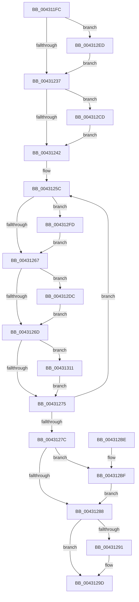

# MiSetVadFlags

- RVA: `0x004311FC`–`0x00431326` (길이 `298` bytes)
- VA: `0x00000001404311FC`
- 실행 섹션: `.text`
- PDB 이름 있음: `예`; PDB Function 태그: `아니요`
- unwind 정보 RVA: `0x000A2154`
- 디코드: `81`개 명령, `298/298` bytes 표시
- 미해석 바이트: `0` (있으면 어셈블리에 `.byte`로 보존)

> 이 문서는 커널 이미지의 기계어와 PDB 기호를 분석해 생성했습니다. 4번과 5번은 함수 원형과 자료형을 바이너리 사용 방식에서 추정한 C 해석이며 원본 소스 복구 결과는 아닙니다.

## 1. Dependencies

- 직접 호출 지점: **5**; 고유 호출 대상: **5**
- 직접 호출자로 확인된 함수: **7**
- RIP 상대 이미지 참조: **1**

### Outgoing calls
- `0x0043124A` → [MiLockVadCore](../29/MiLockVadCore_function_00297170.md) (function, `0x00297170`)
- `0x00431298` → [KiLowerIrqlProcessIrqlFlags](../4F/KiLowerIrqlProcessIrqlFlags_function_004F5698.md) (function, `0x004F5698`)
- `0x004312C6` → [MiUnlockVadTree](../29/MiUnlockVadTree_function_00297020.md) (function, `0x00297020`)
- `0x004312D2` → [MiLockVadTree](../27/MiLockVadTree_function_0027C0F0.md) (function, `0x0027C0F0`)
- `0x004312F3` → [KiRaiseIrqlProcessIrqlFlags](../4F/KiRaiseIrqlProcessIrqlFlags_function_004F56FC.md) (function, `0x004F56FC`)

### Direct callers
- [MiRemoveSecureEntry](MiRemoveSecureEntry_function_00430D5C.md) at `0x00430DE9`
- [MiApplyImageHotPatchRequest](../../page/80/MiApplyImageHotPatchRequest_function_008025AC.md) at `0x00802A29`
- [MiApplyImageHotPatchRequest](../../page/80/MiApplyImageHotPatchRequest_function_008025AC.md) at `0x00802A6C`
- [MiCreatePatchSectionRequest](../../page/80/MiCreatePatchSectionRequest_function_008031E0.md) at `0x008032F4`
- [MiGetVadForHotPatchInProgress](../../page/80/MiGetVadForHotPatchInProgress_function_008039C4.md) at `0x00803A90`
- [sub_0088535F](../../page/88/Unknown_function_0088535F.md) at `0x0088558D`
- [MiAddSecureEntry](../../page/98/MiAddSecureEntry_function_00980250.md) at `0x0098034D`
- [MiSecureVad](../../page/9F/MiSecureVad_function_009F5788.md) at `0x009F58B9`

### Static image references
- `0x0043122A` → RVA `0x00FC6D20` (`ALMOSTRO`; read)

## 2. Other-region calls and transfers

- 다른 실행 섹션으로 향하는 call: **0**
- 별도 외부 분기/꼬리 이동을 확인하지 못했습니다.

## 3. Assembly (complete function range)

```asm
004311FC  48 89 5C 24 08                  mov qword ptr [rsp + 8], rbx
00431201  48 89 6C 24 10                  mov qword ptr [rsp + 0x10], rbp
00431206  48 89 74 24 18                  mov qword ptr [rsp + 0x18], rsi
0043120B  57                              push rdi
0043120C  41 56                           push r14
0043120E  41 57                           push r15
00431210  48 83 EC 20                     sub rsp, 0x20
00431214  45 8B F0                        mov r14d, r8d
00431217  8B EA                           mov ebp, edx
00431219  48 8B D9                        mov rbx, rcx
0043121C  44 0F 20 C6                     mov rsi, cr8
00431220  41 BF 02 00 00 00               mov r15d, 2
00431226  45 0F 22 C7                     mov cr8, r15
0043122A  83 3D EF 5A B9 00 00            cmp dword ptr [rip + 0xb95aef], 0
00431231  0F 85 B6 00 00 00               jne 0x1404312ed
00431237  8B FD                           mov edi, ebp
00431239  41 23 FF                        and edi, r15d
0043123C  0F 85 8B 00 00 00               jne 0x1404312cd
00431242  BA 01 00 00 00                  mov edx, 1
00431247  48 8B CB                        mov rcx, rbx
0043124A  E8 21 5F E6 FF                  call 0x140297170
0043124F  8B 43 30                        mov eax, dword ptr [rbx + 0x30]
00431252  44 8B C5                        mov r8d, ebp
00431255  41 83 E0 01                     and r8d, 1
00431259  83 E5 04                        and ebp, 4
0043125C  8B C8                           mov ecx, eax
0043125E  45 85 C0                        test r8d, r8d
00431261  0F 85 96 00 00 00               jne 0x1404312fd
00431267  8B D1                           mov edx, ecx
00431269  85 FF                           test edi, edi
0043126B  75 6F                           jne 0x1404312dc
0043126D  85 ED                           test ebp, ebp
0043126F  0F 85 9C 00 00 00               jne 0x140431311
00431275  F0 0F B1 4B 30                  lock cmpxchg dword ptr [rbx + 0x30], ecx
0043127A  75 E0                           jne 0x14043125c
0043127C  F0 81 63 30 FC FF FF 7F         lock and dword ptr [rbx + 0x30], 0x7ffffffc
00431284  85 FF                           test edi, edi
00431286  75 37                           jne 0x1404312bf
00431288  83 3D 91 5A B9 00 00            cmp dword ptr [rip + 0xb95a91], 0
0043128F  74 0C                           je 0x14043129d
00431291  44 0F 20 C1                     mov rcx, cr8
00431295  40 8A D6                        mov dl, sil
00431298  E8 FB 43 0C 00                  call 0x1404f5698
0043129D  40 0F B6 C6                     movzx eax, sil
004312A1  44 0F 22 C0                     mov cr8, rax
004312A5  48 8B 5C 24 40                  mov rbx, qword ptr [rsp + 0x40]
004312AA  48 8B 6C 24 48                  mov rbp, qword ptr [rsp + 0x48]
004312AF  48 8B 74 24 50                  mov rsi, qword ptr [rsp + 0x50]
004312B4  48 83 C4 20                     add rsp, 0x20
004312B8  41 5F                           pop r15
004312BA  41 5E                           pop r14
004312BC  5F                              pop rdi
004312BD  C3                              ret
004312BE  CC                              int3
004312BF  B2 11                           mov dl, 0x11
004312C1  B9 03 00 00 00                  mov ecx, 3
004312C6  E8 55 5D E6 FF                  call 0x140297020
004312CB  EB BB                           jmp 0x140431288
004312CD  B9 03 00 00 00                  mov ecx, 3
004312D2  E8 19 AE E4 FF                  call 0x14027c0f0
004312D7  E9 66 FF FF FF                  jmp 0x140431242
004312DC  42 8D 0C B5 00 00 00 00         lea ecx, [r14*4]
004312E4  33 CA                           xor ecx, edx
004312E6  83 E1 04                        and ecx, 4
004312E9  33 CA                           xor ecx, edx
004312EB  EB 80                           jmp 0x14043126d
004312ED  41 8A D7                        mov dl, r15b
004312F0  40 8A CE                        mov cl, sil
004312F3  E8 04 44 0C 00                  call 0x1404f56fc
004312F8  E9 3A FF FF FF                  jmp 0x140431237
004312FD  42 8D 0C F5 00 00 00 00         lea ecx, [r14*8]
00431305  33 C8                           xor ecx, eax
00431307  83 E1 08                        and ecx, 8
0043130A  33 C8                           xor ecx, eax
0043130C  E9 56 FF FF FF                  jmp 0x140431267
00431311  41 8B D6                        mov edx, r14d
00431314  C1 E2 17                        shl edx, 0x17
00431317  33 D1                           xor edx, ecx
00431319  81 E2 00 00 80 01               and edx, 0x1800000
0043131F  33 CA                           xor ecx, edx
00431321  E9 4F FF FF FF                  jmp 0x140431275
```

## 4. C-style interpretation (structured pseudocode)

```c
__int64 __fastcall MiSetVadFlags(__int64 a1, int a2, int a3)
{
    __int64 result;
    __int64 v_rbp;
    __int64 v_rdi;
    __int64 v_rsp;
    unsigned __int64 v_stack_p10;
    unsigned __int64 v_stack_p18;
    unsigned __int64 v_stack_p8;

    v_stack_p8 = v_rbx;
    v_stack_p10 = v_rbp;
    v_stack_p18 = v_rsi;
    v_rsp = (v_rsp) - (32);
    if ((*(unsigned int *)(v_rip + 12147439)) != 0) goto loc_004312ED;
loc_00431237:
    v_rdi = (unsigned int)(((unsigned int)((unsigned int)((unsigned int)(a2)))) & (2));
    if (condition_is_not_equal) goto loc_004312CD;
loc_00431242:
    result = MiLockVadCore(a1, 1, a3, a4);
    a3 = (unsigned int)(((unsigned int)((unsigned int)((unsigned int)(a2)))) & (1));
    v_rbp = (unsigned int)(((unsigned int)(a2)) & (4));
loc_0043125C:
    if (a3 != 0) goto loc_004312FD;
loc_00431267:
    if ((unsigned int)(v_rdi) != 0) goto loc_004312DC;
loc_0043126D:
    if ((unsigned int)(v_rbp) != 0) goto loc_00431311;
loc_00431275:
    if ((unsigned int)(v_rbp) != 0) goto loc_0043125C;
    if ((unsigned int)(v_rdi) != 0) goto loc_004312BF;
loc_00431288:
    result = (unsigned int)(*(unsigned int *)(a1 + 48));
    if ((*(unsigned int *)(v_rip + 12147345)) != 0) {
        a1 = 2;
        a2 = (unsigned __int8)(v_cr8);
        result = KiLowerIrqlProcessIrqlFlags(a1, a2, a3, a4);
    }
    v_rsp = (v_rsp) + (32);
    return (unsigned __int8)(v_cr8);
loc_004312BF:
    result = MiUnlockVadTree(3, 17, a3, a4);
    goto loc_00431288;
loc_004312CD:
    result = MiLockVadTree(3, 17, a3, a4);
    goto loc_00431242;
loc_004312DC:
    a1 = (unsigned int)(((unsigned int)(a3) * 4) ^ (17));
    a1 = (unsigned int)((a1) & (4));
    a1 = (unsigned int)((a1) ^ (17));
    goto loc_0043126D;
loc_004312ED:
    result = KiRaiseIrqlProcessIrqlFlags((unsigned __int8)(v_stack_p18), 2, a3, a4);
    goto loc_00431237;
loc_004312FD:
    a1 = (unsigned int)(((unsigned int)(a3) * 8) ^ ((unsigned int)(result)));
    a1 = (unsigned int)((a1) & (8));
    a1 = (unsigned int)((a1) ^ ((unsigned int)(result)));
    goto loc_00431267;
loc_00431311:
    a2 = (unsigned int)(((unsigned int)((unsigned int)((unsigned int)(a3)))) << (23));
    a2 = (unsigned int)((a2) ^ ((unsigned int)(a1)));
    a2 = (unsigned int)((a2) & (0x1800000ULL));
    a1 = (unsigned int)((a1) ^ (a2));
    goto loc_00431275;
}
```

## 5. (Beta) C Style

```c
int64_t MiSetVadFlags(void *Arg1, int32_t Arg2, int32_t Arg3)
{
    uint8_t *arg1 = (uint8_t *)Arg1;

    int64_t result;
    int64_t local_rbp;
    int64_t local_rdi;
    int64_t local_rsp;
    uint64_t v_stack_p10;
    uint64_t v_stack_p18;
    uint64_t v_stack_p8;

    v_stack_p8 = local_rbx;
    v_stack_p10 = local_rbp;
    v_stack_p18 = local_rsi;
    local_rsp = (local_rsp) - (32);
    if ((*(uint32_t *)(v_rip + 0xB95AEF)) != 0) goto loc_004312ED;
loc_00431237:
    local_rdi = (uint32_t)(((uint32_t)((uint32_t)((uint32_t)(Arg2)))) & (2));
    if (condition_is_not_equal) goto loc_004312CD;
loc_00431242:
    result = MiLockVadCore(Arg1, 1, Arg3, a4);
    Arg3 = (uint32_t)(((uint32_t)((uint32_t)((uint32_t)(Arg2)))) & (1));
    local_rbp = (uint32_t)(((uint32_t)(Arg2)) & (4));
loc_0043125C:
    if (Arg3 != 0) goto loc_004312FD;
loc_00431267:
    if ((uint32_t)(local_rdi) != 0) goto loc_004312DC;
loc_0043126D:
    if ((uint32_t)(local_rbp) != 0) goto loc_00431311;
loc_00431275:
    if ((uint32_t)(local_rbp) != 0) goto loc_0043125C;
    if ((uint32_t)(local_rdi) != 0) goto loc_004312BF;
loc_00431288:
    result = (uint32_t)(*(uint32_t *)(arg1 + 0x30));
    if ((*(uint32_t *)(v_rip + 0xB95A91)) != 0) {
        Arg1 = 2;
        Arg2 = (uint8_t)(v_cr8);
        result = KiLowerIrqlProcessIrqlFlags(Arg1, Arg2, Arg3, a4);
    }
    local_rsp = (local_rsp) + (32);
    return (uint8_t)(v_cr8);
loc_004312BF:
    result = MiUnlockVadTree(3, 17, Arg3, a4);
    goto loc_00431288;
loc_004312CD:
    result = MiLockVadTree(3, 17, Arg3, a4);
    goto loc_00431242;
loc_004312DC:
    Arg1 = (uint32_t)(((uint32_t)(Arg3) * 4) ^ (17));
    Arg1 = (uint32_t)((Arg1) & (4));
    Arg1 = (uint32_t)((Arg1) ^ (17));
    goto loc_0043126D;
loc_004312ED:
    result = KiRaiseIrqlProcessIrqlFlags((uint8_t)(v_stack_p18), 2, Arg3, a4);
    goto loc_00431237;
loc_004312FD:
    Arg1 = (uint32_t)(((uint32_t)(Arg3) * 8) ^ ((uint32_t)(result)));
    Arg1 = (uint32_t)((Arg1) & (8));
    Arg1 = (uint32_t)((Arg1) ^ ((uint32_t)(result)));
    goto loc_00431267;
loc_00431311:
    Arg2 = (uint32_t)(((uint32_t)((uint32_t)((uint32_t)(Arg3)))) << (23));
    Arg2 = (uint32_t)((Arg2) ^ ((uint32_t)(Arg1)));
    Arg2 = (uint32_t)((Arg2) & (0x1800000ULL));
    Arg1 = (uint32_t)((Arg1) ^ (Arg2));
    goto loc_00431275;
}
```

### 관측된 메모리 오프셋

구조체 형식이 확인되지 않은 접근은 인자 기준의 오프셋으로만 기록했습니다.

| 기준 인자 | 오프셋 표현 | 폭 (bit) | 접근 |
|---|---:|---:|---|
| `Arg1` | `+ 0x30` | `32` | `R` |
| `Arg1` | `+ 0x30` | `32` | `R/W` |

## 6. Execution-region graph

[열기: 2D/3D 그래프와 함수 탐색 컨트롤 패널](../../../control-panel.html?section=text&rva=0x004311FC&view=graph)

- 2D 그래프는 위에서 아래로 흐르고, 3D 그래프는 빈 공간을 드래그해 회전합니다. Shift+드래그는 이동, 휠은 확대·축소, 함수 노드 선택은 대상 보고서 이동입니다.

### Static fallback


