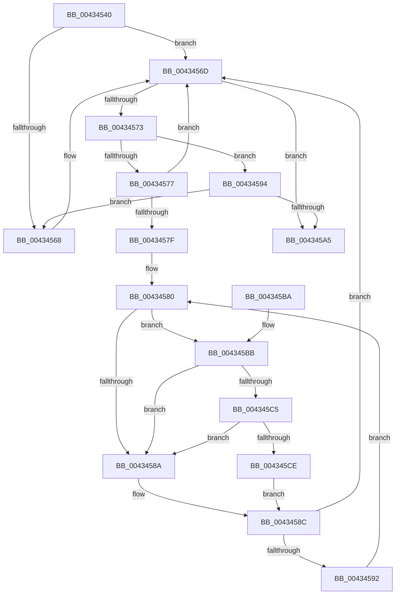

# MiSpinForProtoPoolLock

- RVA: `0x00434540`–`0x004345D7` (길이 `151` bytes)
- VA: `0x0000000140434540`
- 실행 섹션: `.text`
- PDB 이름 있음: `예`; PDB Function 태그: `아니요`
- unwind 정보 RVA: `0x000A2790`
- 디코드: `51`개 명령, `151/151` bytes 표시
- 미해석 바이트: `0` (있으면 어셈블리에 `.byte`로 보존)

> 이 문서는 커널 이미지의 기계어와 PDB 기호를 분석해 생성했습니다. 4번과 5번은 함수 원형과 자료형을 바이너리 사용 방식에서 추정한 C 해석이며 원본 소스 복구 결과는 아닙니다.

## 1. Dependencies

- 직접 호출 지점: **2**; 고유 호출 대상: **2**
- 직접 호출자로 확인된 함수: **2**
- RIP 상대 이미지 참조: **3**

### Outgoing calls
- `0x004345C5` → [KiCheckVpBackingLongSpinWaitHypercall](../30/KiCheckVpBackingLongSpinWaitHypercall_function_0030F490.md) (function, `0x0030F490`)
- `0x004345D0` → [HvlNotifyLongSpinWait](../30/HvlNotifyLongSpinWait_function_0030F460.md) (function, `0x0030F460`)

### Direct callers
- [MiLockProtoPoolPage](../2B/MiLockProtoPoolPage_function_002B8B80.md) at `0x002B9134`
- [MiLockOwnedProtoPage](../32/MiLockOwnedProtoPage_function_00322560.md) at `0x00322657`

### Static image references
- `0x00434554` → RVA `0x00FC6B60` (`ALMOSTRO`; read)
- `0x00434582` → RVA `0x00FC52AC` (`ALMOSTRO`; reference)
- `0x004345BB` → RVA `0x00FC6AB8` (`ALMOSTRO`; read)

## 2. Other-region calls and transfers

- 다른 실행 섹션으로 향하는 call: **0**
- 별도 외부 분기/꼬리 이동을 확인하지 못했습니다.

## 3. Assembly (complete function range)

```asm
00434540  48 89 5C 24 08                  mov qword ptr [rsp + 8], rbx
00434545  48 89 6C 24 10                  mov qword ptr [rsp + 0x10], rbp
0043454A  48 89 74 24 18                  mov qword ptr [rsp + 0x18], rsi
0043454F  57                              push rdi
00434550  48 83 EC 20                     sub rsp, 0x20
00434554  8B 35 06 26 B9 00               mov esi, dword ptr [rip + 0xb92606]
0043455A  48 8D 79 10                     lea rdi, [rcx + 0x10]
0043455E  33 ED                           xor ebp, ebp
00434560  81 E6 00 00 80 00               and esi, 0x800000
00434566  74 05                           je 0x14043456d
00434568  F3 48 0F AE F7                  umonitor rdi
0043456D  8B 07                           mov eax, dword ptr [rdi]
0043456F  85 C0                           test eax, eax
00434571  75 32                           jne 0x1404345a5
00434573  85 F6                           test esi, esi
00434575  75 1D                           jne 0x140434594
00434577  8B 07                           mov eax, dword ptr [rdi]
00434579  8B DD                           mov ebx, ebp
0043457B  85 C0                           test eax, eax
0043457D  75 EE                           jne 0x14043456d
0043457F  90                              nop
00434580  FF C3                           inc ebx
00434582  85 1D 24 0D B9 00               test dword ptr [rip + 0xb90d24], ebx
00434588  74 31                           je 0x1404345bb
0043458A  F3 90                           pause
0043458C  8B 07                           mov eax, dword ptr [rdi]
0043458E  85 C0                           test eax, eax
00434590  75 DB                           jne 0x14043456d
00434592  EB EC                           jmp 0x140434580
00434594  B8 FF FF FF FF                  mov eax, 0xffffffff
00434599  8B D0                           mov edx, eax
0043459B  F2 0F AE F5                     umwait ebp
0043459F  8B 07                           mov eax, dword ptr [rdi]
004345A1  85 C0                           test eax, eax
004345A3  74 C3                           je 0x140434568
004345A5  48 8B 5C 24 30                  mov rbx, qword ptr [rsp + 0x30]
004345AA  48 8B 6C 24 38                  mov rbp, qword ptr [rsp + 0x38]
004345AF  48 8B 74 24 40                  mov rsi, qword ptr [rsp + 0x40]
004345B4  48 83 C4 20                     add rsp, 0x20
004345B8  5F                              pop rdi
004345B9  C3                              ret
004345BA  CC                              int3
004345BB  8B 05 F7 24 B9 00               mov eax, dword ptr [rip + 0xb924f7]
004345C1  A8 40                           test al, 0x40
004345C3  74 C5                           je 0x14043458a
004345C5  E8 C6 AE ED FF                  call 0x14030f490
004345CA  84 C0                           test al, al
004345CC  74 BC                           je 0x14043458a
004345CE  8B CB                           mov ecx, ebx
004345D0  E8 8B AE ED FF                  call 0x14030f460
004345D5  EB B5                           jmp 0x14043458c
```

## 4. C-style interpretation (structured pseudocode)

```c
__int64 __fastcall MiSpinForProtoPoolLock(__int64 a1)
{
    __int64 result;
    __int64 v_rbp;
    __int64 v_rbx;
    __int64 v_rsi;
    __int64 v_rsp;
    unsigned __int64 v_stack_p10;
    unsigned __int64 v_stack_p18;
    unsigned __int64 v_stack_p8;

    v_stack_p8 = v_rbx;
    v_stack_p10 = v_rbp;
    v_stack_p18 = v_rsi;
    v_rsp = (v_rsp) - (32);
    v_rbp = 0;
    v_rsi = (unsigned int)(((unsigned int)(*(unsigned int *)(v_rip + 12133894))) & (0x800000ULL));
    if (!(condition_is_equal)) {
    }
    if ((unsigned int)((unsigned int)(*(unsigned int *)(a1 + 16))) != 0) goto loc_004345A5;
    if ((unsigned int)(v_rsi) != 0) goto loc_00434594;
    if ((unsigned int)((unsigned int)(*(unsigned int *)(a1 + 16))) != 0) goto loc_0043456D;
loc_00434580:
    v_rbx = (unsigned int)((0) + 1);
    if (((*(unsigned int *)(v_rip + 12127524)) & ((unsigned int)(v_rbx))) == 0) goto loc_004345BB;
loc_0043458A:
loc_0043458C:
    if ((unsigned int)((unsigned int)(*(unsigned int *)(a1 + 16))) != 0) goto loc_0043456D;
    goto loc_00434580;
loc_00434594:
    if ((unsigned int)((unsigned int)(*(unsigned int *)(a1 + 16))) == 0) goto loc_00434568;
loc_004345A5:
    v_rsp = (v_rsp) + (32);
    return (unsigned int)(*(unsigned int *)(a1 + 16));
loc_004345BB:
    if ((((unsigned __int8)((unsigned int)(*(unsigned int *)(v_rip + 12133623)))) & (64)) == 0) goto loc_0043458A;
    result = KiCheckVpBackingLongSpinWaitHypercall(a1, (unsigned int)((unsigned int)((unsigned int)(0xFFFFFFFFULL))), a3, a4);
    if ((unsigned __int8)(result) == 0) goto loc_0043458A;
    result = HvlNotifyLongSpinWait((unsigned int)((unsigned int)(v_stack_p8)), (unsigned int)((unsigned int)((unsigned int)(0xFFFFFFFFULL))), a3, a4);
    goto loc_0043458C;
}
```

## 5. (Beta) C Style

```c
int64_t MiSpinForProtoPoolLock(void *Arg1)
{
    uint8_t *arg1 = (uint8_t *)Arg1;

    int64_t result;
    int64_t local_rbp;
    int64_t local_rbx;
    int64_t local_rsi;
    int64_t local_rsp;
    uint64_t v_stack_p10;
    uint64_t v_stack_p18;
    uint64_t v_stack_p8;

    v_stack_p8 = local_rbx;
    v_stack_p10 = local_rbp;
    v_stack_p18 = local_rsi;
    local_rsp = (local_rsp) - (32);
    local_rbp = 0;
    local_rsi = (uint32_t)(((uint32_t)(*(uint32_t *)(v_rip + 0xB92606))) & (0x800000ULL));
    if (!(condition_is_equal)) {
    }
    if ((uint32_t)((uint32_t)(*(uint32_t *)(arg1 + 0x10))) != 0) goto loc_004345A5;
    if ((uint32_t)(local_rsi) != 0) goto loc_00434594;
    if ((uint32_t)((uint32_t)(*(uint32_t *)(arg1 + 0x10))) != 0) goto loc_0043456D;
loc_00434580:
    local_rbx = (uint32_t)((0) + 1);
    if (((*(uint32_t *)(v_rip + 0xB90D24)) & ((uint32_t)(local_rbx))) == 0) goto loc_004345BB;
loc_0043458A:
loc_0043458C:
    if ((uint32_t)((uint32_t)(*(uint32_t *)(arg1 + 0x10))) != 0) goto loc_0043456D;
    goto loc_00434580;
loc_00434594:
    if ((uint32_t)((uint32_t)(*(uint32_t *)(arg1 + 0x10))) == 0) goto loc_00434568;
loc_004345A5:
    local_rsp = (local_rsp) + (32);
    return (uint32_t)(*(uint32_t *)(arg1 + 0x10));
loc_004345BB:
    if ((((uint8_t)((uint32_t)(*(uint32_t *)(v_rip + 0xB924F7)))) & (64)) == 0) goto loc_0043458A;
    result = KiCheckVpBackingLongSpinWaitHypercall(Arg1, (uint32_t)((uint32_t)((uint32_t)(0xFFFFFFFFULL))), a3, a4);
    if ((uint8_t)(result) == 0) goto loc_0043458A;
    result = HvlNotifyLongSpinWait((uint32_t)((uint32_t)(v_stack_p8)), (uint32_t)((uint32_t)((uint32_t)(0xFFFFFFFFULL))), a3, a4);
    goto loc_0043458C;
}
```

### 관측된 메모리 오프셋

구조체 형식이 확인되지 않은 접근은 인자 기준의 오프셋으로만 기록했습니다.

| 기준 인자 | 오프셋 표현 | 폭 (bit) | 접근 |
|---|---:|---:|---|
| `Arg1` | `+ 0x10` | `64` | `R` |

## 6. Execution-region graph

[열기: 2D/3D 그래프와 함수 탐색 컨트롤 패널](../../../control-panel.html?section=text&rva=0x00434540&view=graph)

- 2D 그래프는 위에서 아래로 흐르고, 3D 그래프는 빈 공간을 드래그해 회전합니다. Shift+드래그는 이동, 휠은 확대·축소, 함수 노드 선택은 대상 보고서 이동입니다.

### Static fallback


