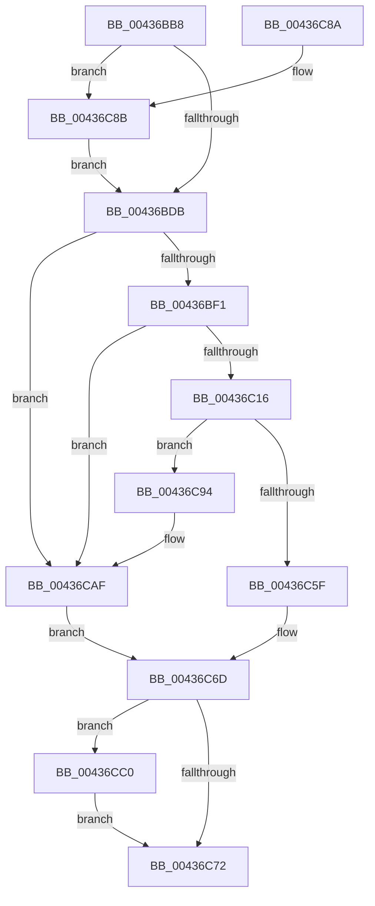

# MiStopPageAccessor

- RVA: `0x00436BB8`–`0x00436CCF` (길이 `279` bytes)
- VA: `0x0000000140436BB8`
- 실행 섹션: `.text`
- PDB 이름 있음: `예`; PDB Function 태그: `아니요`
- unwind 정보 RVA: `0x000A30B8`
- 디코드: `72`개 명령, `279/279` bytes 표시
- 미해석 바이트: `0` (있으면 어셈블리에 `.byte`로 보존)

> 이 문서는 커널 이미지의 기계어와 PDB 기호를 분석해 생성했습니다. 4번과 5번은 함수 원형과 자료형을 바이너리 사용 방식에서 추정한 C 해석이며 원본 소스 복구 결과는 아닙니다.

## 1. Dependencies

- 직접 호출 지점: **4**; 고유 호출 대상: **4**
- 직접 호출자로 확인된 함수: **5**
- RIP 상대 이미지 참조: **1**

### Outgoing calls
- `0x00436C52` → [MiLocatePageCollisionByPfn](../33/MiLocatePageCollisionByPfn_function_00337CC0.md) (function, `0x00337CC0`)
- `0x00436C64` → [MiMakeDemandZeroPte](../33/MiMakeDemandZeroPte_function_00337A00.md) (function, `0x00337A00`)
- `0x00436CA9` → [KeBugCheckEx](../4F/KeBugCheckEx_function_004FD660.md) (function, `0x004FD660`)
- `0x00436CB2` → [MiStopHugePageAccessor](../4F/MiStopHugePageAccessor_function_004F6A68.md) (function, `0x004F6A68`)

### Direct callers
- [MiInitializeNewUltraHugeContext](../3F/MiInitializeNewUltraHugeContext_function_003FB974.md) at `0x003FBB00`
- [MiInitializeNewUltraHugeContext](../3F/MiInitializeNewUltraHugeContext_function_003FB974.md) at `0x003FBB19`
- [MiHugeRangeFreeToZero](MiHugeRangeFreeToZero_function_00436A38.md) at `0x00436AA5`
- [MiPageListCollision](MiPageListCollision_function_00436B48.md) at `0x00436B5B`
- [MiDereferenceHugeContext](../4D/MiDereferenceHugeContext_function_004D9664.md) at `0x004D975A`
- [MiScrubLargePage](../69/MiScrubLargePage_function_006942E8.md) at `0x00694785`
- [MiScrubLargePage](../69/MiScrubLargePage_function_006942E8.md) at `0x006947F8`

### Static image references
- `0x00436BF1` → RVA `0x00E2DCE0` (`.data`; read)

## 2. Other-region calls and transfers

- 다른 실행 섹션으로 향하는 call: **0**
- 별도 외부 분기/꼬리 이동을 확인하지 못했습니다.

## 3. Assembly (complete function range)

```asm
00436BB8  48 89 5C 24 10                  mov qword ptr [rsp + 0x10], rbx
00436BBD  48 89 6C 24 18                  mov qword ptr [rsp + 0x18], rbp
00436BC2  48 89 74 24 20                  mov qword ptr [rsp + 0x20], rsi
00436BC7  57                              push rdi
00436BC8  48 83 EC 30                     sub rsp, 0x30
00436BCC  49 8B F0                        mov rsi, r8
00436BCF  48 8B D9                        mov rbx, rcx
00436BD2  4D 85 C0                        test r8, r8
00436BD5  0F 85 B0 00 00 00               jne 0x140436c8b
00436BDB  49 B8 00 00 00 00 00 DE FF FF   movabs r8, 0xffffde0000000000
00436BE5  49 8B C0                        mov rax, r8
00436BE8  48 3B D8                        cmp rbx, rax
00436BEB  0F 82 BE 00 00 00               jb 0x140436caf
00436BF1  48 8B 05 E8 70 9F 00            mov rax, qword ptr [rip + 0x9f70e8]
00436BF8  48 8D 0C 40                     lea rcx, [rax + rax*2]
00436BFC  48 C1 E1 04                     shl rcx, 4
00436C00  48 B8 30 00 00 00 00 DE FF FF   movabs rax, 0xffffde0000000030
00436C0A  48 03 C8                        add rcx, rax
00436C0D  48 3B D9                        cmp rbx, rcx
00436C10  0F 83 99 00 00 00               jae 0x140436caf
00436C16  8B 43 20                        mov eax, dword ptr [rbx + 0x20]
00436C19  89 44 24 40                     mov dword ptr [rsp + 0x40], eax
00436C1D  C1 E8 10                        shr eax, 0x10
00436C20  24 F7                           and al, 0xf7
00436C22  88 44 24 42                     mov byte ptr [rsp + 0x42], al
00436C26  8B 44 24 40                     mov eax, dword ptr [rsp + 0x40]
00436C2A  89 43 20                        mov dword ptr [rbx + 0x20], eax
00436C2D  49 8B C0                        mov rax, r8
00436C30  48 8B 7B 10                     mov rdi, qword ptr [rbx + 0x10]
00436C34  48 8B EB                        mov rbp, rbx
00436C37  48 2B E8                        sub rbp, rax
00436C3A  48 8B CF                        mov rcx, rdi
00436C3D  48 B8 AB AA AA AA AA AA AA AA   movabs rax, 0xaaaaaaaaaaaaaaab
00436C47  48 C1 FD 04                     sar rbp, 4
00436C4B  48 0F AF E8                     imul rbp, rax
00436C4F  48 8B D5                        mov rdx, rbp
00436C52  E8 69 10 F0 FF                  call 0x140337cc0
00436C57  48 8B D0                        mov rdx, rax
00436C5A  48 85 C0                        test rax, rax
00436C5D  74 35                           je 0x140436c94
00436C5F  B9 04 00 00 00                  mov ecx, 4
00436C64  E8 97 0D F0 FF                  call 0x140337a00
00436C69  48 89 43 10                     mov qword ptr [rbx + 0x10], rax
00436C6D  48 85 F6                        test rsi, rsi
00436C70  75 4E                           jne 0x140436cc0
00436C72  48 8B 5C 24 48                  mov rbx, qword ptr [rsp + 0x48]
00436C77  48 8B C7                        mov rax, rdi
00436C7A  48 8B 6C 24 50                  mov rbp, qword ptr [rsp + 0x50]
00436C7F  48 8B 74 24 58                  mov rsi, qword ptr [rsp + 0x58]
00436C84  48 83 C4 30                     add rsp, 0x30
00436C88  5F                              pop rdi
00436C89  C3                              ret
00436C8A  CC                              int3
00436C8B  41 83 20 00                     and dword ptr [r8], 0
00436C8F  E9 47 FF FF FF                  jmp 0x140436bdb
00436C94  4C 8B CF                        mov r9, rdi
00436C97  48 89 6C 24 20                  mov qword ptr [rsp + 0x20], rbp
00436C9C  4C 8B C3                        mov r8, rbx
00436C9F  BA 02 15 00 00                  mov edx, 0x1502
00436CA4  B9 1A 00 00 00                  mov ecx, 0x1a
00436CA9  E8 B2 69 0C 00                  call 0x1404fd660
00436CAE  CC                              int3
00436CAF  48 8B CB                        mov rcx, rbx
00436CB2  E8 B1 FD 0B 00                  call 0x1404f6a68
00436CB7  48 8B F8                        mov rdi, rax
00436CBA  48 8D 50 18                     lea rdx, [rax + 0x18]
00436CBE  EB AD                           jmp 0x140436c6d
00436CC0  48 2B D7                        sub rdx, rdi
00436CC3  48 83 EA 18                     sub rdx, 0x18
00436CC7  48 C1 FA 03                     sar rdx, 3
00436CCB  89 16                           mov dword ptr [rsi], edx
00436CCD  EB A3                           jmp 0x140436c72
```

## 4. C-style interpretation (structured pseudocode)

```c
__int64 __fastcall MiStopPageAccessor(__int64 a1, __int64 a2, __int64 a3)
{
    __int64 result;
    __int64 v_rbp;
    __int64 v_rsp;
    unsigned __int64 v_stack_p10;
    unsigned __int64 v_stack_p18;
    unsigned __int64 v_stack_p20;
    unsigned int v_stack_p8;
    unsigned __int8 v_stack_pA;

    v_stack_p10 = v_rbx;
    v_stack_p18 = v_rbp;
    v_stack_p20 = v_rsi;
    v_rsp = (v_rsp) - (48);
    if (a3 != 0) goto loc_00436C8B;
loc_00436BDB:
    if (a1 < a3) goto loc_00436CAF;
    a1 = (*(unsigned __int64 *)(v_rip + 10449128) + *(unsigned __int64 *)(v_rip + 10449128) * 2) << (4);
    a1 = (a1) + (*(unsigned __int64 *)(v_rip + 10449128));
    if (a1 >= a1) goto loc_00436CAF;
    v_stack_p8 = (unsigned int)((unsigned int)(*(unsigned int *)(a1 + 32)));
    result = (unsigned int)(((unsigned int)(*(unsigned int *)(a1 + 32))) >> (16));
    result = (unsigned __int8)((result) & (247));
    v_stack_pA = (unsigned __int8)(result);
    *(unsigned int *)(a1 + 32) = (unsigned int)((unsigned int)(v_stack_p8));
    v_rbp = (a1) - (a3);
    v_rbp = (v_rbp) >> (4);
    v_rbp = (v_rbp) * (a3);
    result = MiLocatePageCollisionByPfn(*(unsigned __int64 *)(a1 + 16), v_rbp, a3, a4);
    if (result == 0) goto loc_00436C94;
    result = MiMakeDemandZeroPte(4, result, a3, a4);
    *(unsigned __int64 *)(a1 + 16) = result;
loc_00436C6D:
    if (a3 != 0) goto loc_00436CC0;
loc_00436C72:
    v_rsp = (v_rsp) + (48);
    return *(unsigned __int64 *)(a1 + 16);
loc_00436C8B:
    goto loc_00436BDB;
loc_00436C94:
    v_stack_p20 = v_stack_p18;
    result = KeBugCheckEx(26, (unsigned int)(0x1502ULL), v_stack_p10, *(unsigned __int64 *)(a1 + 16));
loc_00436CAF:
    result = MiStopHugePageAccessor(v_stack_p10, (unsigned int)(0x1502ULL), v_stack_p10, *(unsigned __int64 *)(a1 + 16));
    goto loc_00436C6D;
loc_00436CC0:
    a2 = (result + 24) - (result);
    a2 = (a2) - (24);
    a2 = (a2) >> (3);
    *(unsigned int *)(v_stack_p20) = (unsigned int)(a2);
    goto loc_00436C72;
}
```

## 5. (Beta) C Style

```c
int64_t MiStopPageAccessor(int64_t Arg1, int64_t Arg2, int64_t Arg3)
{
    int64_t result;
    int64_t local_rbp;
    int64_t local_rsp;
    uint64_t v_stack_p10;
    uint64_t v_stack_p18;
    uint64_t v_stack_p20;
    uint32_t v_stack_p8;
    uint8_t v_stack_pA;

    v_stack_p10 = local_rbx;
    v_stack_p18 = local_rbp;
    v_stack_p20 = local_rsi;
    local_rsp = (local_rsp) - (48);
    if (Arg3 != 0) goto loc_00436C8B;
loc_00436BDB:
    if (Arg1 < Arg3) goto loc_00436CAF;
    Arg1 = (*(uint64_t *)(v_rip + 0x9F70E8) + *(uint64_t *)(v_rip + 0x9F70E8) * 2) << (4);
    Arg1 = (Arg1) + (*(uint64_t *)(v_rip + 0x9F70E8));
    if (Arg1 >= Arg1) goto loc_00436CAF;
    v_stack_p8 = (uint32_t)((uint32_t)(*(uint32_t *)(Arg1 + 0x20)));
    result = (uint32_t)(((uint32_t)(*(uint32_t *)(Arg1 + 0x20))) >> (16));
    result = (uint8_t)((result) & (247));
    v_stack_pA = (uint8_t)(result);
    *(uint32_t *)(Arg1 + 0x20) = (uint32_t)((uint32_t)(v_stack_p8));
    local_rbp = (Arg1) - (Arg3);
    local_rbp = (local_rbp) >> (4);
    local_rbp = (local_rbp) * (Arg3);
    result = MiLocatePageCollisionByPfn(*(uint64_t *)(Arg1 + 0x10), local_rbp, Arg3, a4);
    if (result == 0) goto loc_00436C94;
    result = MiMakeDemandZeroPte(4, result, Arg3, a4);
    *(uint64_t *)(Arg1 + 0x10) = result;
loc_00436C6D:
    if (Arg3 != 0) goto loc_00436CC0;
loc_00436C72:
    local_rsp = (local_rsp) + (48);
    return *(uint64_t *)(Arg1 + 0x10);
loc_00436C8B:
    goto loc_00436BDB;
loc_00436C94:
    v_stack_p20 = v_stack_p18;
    result = KeBugCheckEx(26, (uint32_t)(0x1502ULL), v_stack_p10, *(uint64_t *)(Arg1 + 0x10));
loc_00436CAF:
    result = MiStopHugePageAccessor(v_stack_p10, (uint32_t)(0x1502ULL), v_stack_p10, *(uint64_t *)(Arg1 + 0x10));
    goto loc_00436C6D;
loc_00436CC0:
    Arg2 = (result + 24) - (result);
    Arg2 = (Arg2) - (24);
    Arg2 = (Arg2) >> (3);
    *(uint32_t *)(v_stack_p20) = (uint32_t)(Arg2);
    goto loc_00436C72;
}
```

## 6. Execution-region graph

[열기: 2D/3D 그래프와 함수 탐색 컨트롤 패널](../../../control-panel.html?section=text&rva=0x00436BB8&view=graph)

- 2D 그래프는 위에서 아래로 흐르고, 3D 그래프는 빈 공간을 드래그해 회전합니다. Shift+드래그는 이동, 휠은 확대·축소, 함수 노드 선택은 대상 보고서 이동입니다.

### Static fallback


