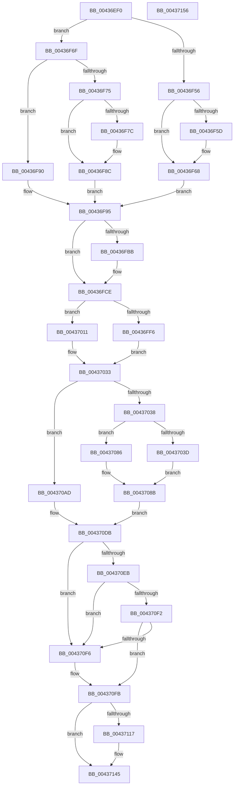

# MiUnlinkHugeRange

- RVA: `0x00436EF0`–`0x00437157` (길이 `615` bytes)
- VA: `0x0000000140436EF0`
- 실행 섹션: `.text`
- PDB 이름 있음: `예`; PDB Function 태그: `아니요`
- unwind 정보 RVA: `0x000A315C`
- 디코드: `166`개 명령, `615/615` bytes 표시
- 미해석 바이트: `0` (있으면 어셈블리에 `.byte`로 보존)

> 이 문서는 커널 이미지의 기계어와 PDB 기호를 분석해 생성했습니다. 4번과 5번은 함수 원형과 자료형을 바이너리 사용 방식에서 추정한 C 해석이며 원본 소스 복구 결과는 아닙니다.

## 1. Dependencies

- 직접 호출 지점: **6**; 고유 호출 대상: **5**
- 직접 호출자로 확인된 함수: **8**
- RIP 상대 이미지 참조: **2**

### Outgoing calls
- `0x00436F24` → [MiPageToChannel](../2B/MiPageToChannel_function_002B9B48.md) (function, `0x002B9B48`)
- `0x00436F30` → [MiPageToNode](../33/MiPageToNode_function_00338CD0.md) (function, `0x00338CD0`)
- `0x00436F60` → [MiPageListCollision](MiPageListCollision_function_00436B48.md) (function, `0x00436B48`)
- `0x00436F7F` → [MiPageListCollision](MiPageListCollision_function_00436B48.md) (function, `0x00436B48`)
- `0x00436FAE` → [MiGetColorHeadHugeRangeBase](MiGetColorHeadHugeRangeBase_function_00437160.md) (function, `0x00437160`)
- `0x0043707F` → [MiUpdateHugeRangeZeroFreeBitmap](../67/MiUpdateHugeRangeZeroFreeBitmap_function_0067759C.md) (function, `0x0067759C`)

### Direct callers
- [MiHugeRangeFreeToZero](MiHugeRangeFreeToZero_function_00436A38.md) at `0x00436AD9`
- [MiGetHugeBadRangeFromNode](../67/MiGetHugeBadRangeFromNode_function_00675818.md) at `0x0067590F`
- [MiGetPerfectColorHeadHugeRange](../67/MiGetPerfectColorHeadHugeRange_function_00675C08.md) at `0x00675D3A`
- [MiHugePurgeZeroList](../67/MiHugePurgeZeroList_function_00676124.md) at `0x0067625F`
- [MiMakeEntireHugePfnGood](../67/MiMakeEntireHugePfnGood_function_00676644.md) at `0x006766D4`
- [MiMarkHugePfnBad](../67/MiMarkHugePfnBad_function_00676744.md) at `0x00676A75`
- [MiMarkHugePfnGood](../67/MiMarkHugePfnGood_function_00676BB0.md) at `0x00676D03`
- [MiMoveBadHugeRangeCrossPartition](../67/MiMoveBadHugeRangeCrossPartition_function_00676DD0.md) at `0x00676E5E`

### Static image references
- `0x00436F01` → RVA `0x00E2DCC0` (`.data`; read)
- `0x00436F35` → RVA `0x00E300C0` (`.data`; read)

## 2. Other-region calls and transfers

- 다른 실행 섹션으로 향하는 call: **0**
- 별도 외부 분기/꼬리 이동을 확인하지 못했습니다.

## 3. Assembly (complete function range)

```asm
00436EF0  40 53                           push rbx
00436EF2  55                              push rbp
00436EF3  56                              push rsi
00436EF4  57                              push rdi
00436EF5  41 54                           push r12
00436EF7  41 55                           push r13
00436EF9  41 56                           push r14
00436EFB  41 57                           push r15
00436EFD  48 83 EC 28                     sub rsp, 0x28
00436F01  8B 05 B9 6D 9F 00               mov eax, dword ptr [rip + 0x9f6db9]
00436F07  48 8B DA                        mov rbx, rdx
00436F0A  48 8B E9                        mov rbp, rcx
00436F0D  89 84 24 80 00 00 00            mov dword ptr [rsp + 0x80], eax
00436F14  81 E3 FF FF 3F 00               and ebx, 0x3fffff
00436F1A  44 8B E3                        mov r12d, ebx
00436F1D  49 C1 E4 12                     shl r12, 0x12
00436F21  49 8B CC                        mov rcx, r12
00436F24  E8 1F 2C E8 FF                  call 0x1402b9b48
00436F29  49 8B CC                        mov rcx, r12
00436F2C  88 44 24 70                     mov byte ptr [rsp + 0x70], al
00436F30  E8 9B 1D F0 FF                  call 0x140338cd0
00436F35  48 8B 0D 84 91 9F 00            mov rcx, qword ptr [rip + 0x9f9184]
00436F3C  8B F8                           mov edi, eax
00436F3E  C6 44 24 78 00                  mov byte ptr [rsp + 0x78], 0
00436F43  4C 8D 3C D9                     lea r15, [rcx + rbx*8]
00436F47  4D 8B 1F                        mov r11, qword ptr [r15]
00436F4A  49 8B CB                        mov rcx, r11
00436F4D  83 E1 07                        and ecx, 7
00436F50  48 83 F9 02                     cmp rcx, 2
00436F54  75 19                           jne 0x140436f6f
00436F56  49 0F BA E3 3B                  bt r11, 0x3b
00436F5B  73 0B                           jae 0x140436f68
00436F5D  49 8B CF                        mov rcx, r15
00436F60  E8 E3 FB FF FF                  call 0x140436b48
00436F65  4D 8B 1F                        mov r11, qword ptr [r15]
00436F68  BE 01 00 00 00                  mov esi, 1
00436F6D  EB 26                           jmp 0x140436f95
00436F6F  48 83 F9 01                     cmp rcx, 1
00436F73  75 1B                           jne 0x140436f90
00436F75  49 0F BA E3 3B                  bt r11, 0x3b
00436F7A  73 10                           jae 0x140436f8c
00436F7C  49 8B CF                        mov rcx, r15
00436F7F  E8 C4 FB FF FF                  call 0x140436b48
00436F84  4D 8B 1F                        mov r11, qword ptr [r15]
00436F87  C6 44 24 78 01                  mov byte ptr [rsp + 0x78], 1
00436F8C  33 F6                           xor esi, esi
00436F8E  EB 05                           jmp 0x140436f95
00436F90  BE 05 00 00 00                  mov esi, 5
00436F95  4C 69 EF 80 DF 00 00            imul r13, rdi, 0xdf80
00436F9C  44 8B C6                        mov r8d, esi
00436F9F  48 89 BC 24 88 00 00 00         mov qword ptr [rsp + 0x88], rdi
00436FA7  4C 03 6D 10                     add r13, qword ptr [rbp + 0x10]
00436FAB  49 8B CD                        mov rcx, r13
00436FAE  E8 AD 01 00 00                  call 0x140437160
00436FB3  4C 8B F0                        mov r14, rax
00436FB6  83 FE 05                        cmp esi, 5
00436FB9  74 13                           je 0x140436fce
00436FBB  8B 8C 24 80 00 00 00            mov ecx, dword ptr [rsp + 0x80]
00436FC2  33 D2                           xor edx, edx
00436FC4  48 8B C3                        mov rax, rbx
00436FC7  48 F7 F1                        div rcx
00436FCA  4D 8D 34 D6                     lea r14, [r14 + rdx*8]
00436FCE  B8 FF FF 3F 00                  mov eax, 0x3fffff
00436FD3  4D 8B C3                        mov r8, r11
00436FD6  49 C1 E8 0F                     shr r8, 0xf
00436FDA  49 8B DB                        mov rbx, r11
00436FDD  4D 8B C8                        mov r9, r8
00436FE0  48 C1 EB 25                     shr rbx, 0x25
00436FE4  49 C1 E0 0F                     shl r8, 0xf
00436FE8  4C 23 C8                        and r9, rax
00436FEB  4C 8B D3                        mov r10, rbx
00436FEE  49 8B C8                        mov rcx, r8
00436FF1  4C 23 D0                        and r10, rax
00436FF4  75 1B                           jne 0x140437011
00436FF6  49 8B 06                        mov rax, qword ptr [r14]
00436FF9  48 33 C8                        xor rcx, rax
00436FFC  48 B8 FF 7F 00 00 E0 FF FF FF   movabs rax, 0xffffffe000007fff
00437006  48 23 C8                        and rcx, rax
00437009  49 33 C8                        xor rcx, r8
0043700C  49 89 0E                        mov qword ptr [r14], rcx
0043700F  EB 22                           jmp 0x140437033
00437011  48 8B 15 A8 90 9F 00            mov rdx, qword ptr [rip + 0x9f90a8]
00437018  4A 8B 04 D2                     mov rax, qword ptr [rdx + r10*8]
0043701C  48 33 C8                        xor rcx, rax
0043701F  48 B8 FF 7F 00 00 E0 FF FF FF   movabs rax, 0xffffffe000007fff
00437029  48 23 C8                        and rcx, rax
0043702C  49 33 C8                        xor rcx, r8
0043702F  4A 89 0C D2                     mov qword ptr [rdx + r10*8], rcx
00437033  4D 85 C9                        test r9, r9
00437036  75 75                           jne 0x1404370ad
00437038  83 FE 05                        cmp esi, 5
0043703B  74 49                           je 0x140437086
0043703D  83 E7 3F                        and edi, 0x3f
00437040  49 C1 EC 12                     shr r12, 0x12
00437044  44 8B C6                        mov r8d, esi
00437047  33 D2                           xor edx, edx
00437049  41 83 E0 01                     and r8d, 1
0043704D  49 8B CD                        mov rcx, r13
00437050  41 C1 E0 0B                     shl r8d, 0xb
00437054  44 0B C7                        or r8d, edi
00437057  0F B6 7C 24 70                  movzx edi, byte ptr [rsp + 0x70]
0043705C  41 0F BA E8 09                  bts r8d, 9
00437061  8B C7                           mov eax, edi
00437063  83 E0 01                        and eax, 1
00437066  45 03 C0                        add r8d, r8d
00437069  44 0B C0                        or r8d, eax
0043706C  41 8B C4                        mov eax, r12d
0043706F  F7 35 4B 6C 9F 00               div dword ptr [rip + 0x9f6c4b]
00437075  41 C1 E0 08                     shl r8d, 8
00437079  0F B6 C2                        movzx eax, dl
0043707C  44 0B C0                        or r8d, eax
0043707F  E8 18 05 24 00                  call 0x14067759c
00437084  EB 05                           jmp 0x14043708b
00437086  40 8A 7C 24 70                  mov dil, byte ptr [rsp + 0x70]
0043708B  49 8B 06                        mov rax, qword ptr [r14]
0043708E  48 C1 E3 25                     shl rbx, 0x25
00437092  48 8B CB                        mov rcx, rbx
00437095  48 33 C8                        xor rcx, rax
00437098  48 B8 FF FF FF FF 1F 00 00 F8   movabs rax, 0xf800001fffffffff
004370A2  48 23 C8                        and rcx, rax
004370A5  48 33 CB                        xor rcx, rbx
004370A8  49 89 0E                        mov qword ptr [r14], rcx
004370AB  EB 2E                           jmp 0x1404370db
004370AD  48 8B 15 0C 90 9F 00            mov rdx, qword ptr [rip + 0x9f900c]
004370B4  40 8A 7C 24 70                  mov dil, byte ptr [rsp + 0x70]
004370B9  48 C1 E3 25                     shl rbx, 0x25
004370BD  48 8B CB                        mov rcx, rbx
004370C0  4A 8B 04 CA                     mov rax, qword ptr [rdx + r9*8]
004370C4  48 33 C8                        xor rcx, rax
004370C7  48 B8 FF FF FF FF 1F 00 00 F8   movabs rax, 0xf800001fffffffff
004370D1  48 23 C8                        and rcx, rax
004370D4  48 33 CB                        xor rcx, rbx
004370D7  4A 89 0C CA                     mov qword ptr [rdx + r9*8], rcx
004370DB  41 81 E3 FF 7F 00 00            and r11d, 0x7fff
004370E2  80 BD E5 3E 00 00 00            cmp byte ptr [rbp + 0x3ee5], 0
004370E9  75 0B                           jne 0x1404370f6
004370EB  80 7C 24 78 00                  cmp byte ptr [rsp + 0x78], 0
004370F0  75 04                           jne 0x1404370f6
004370F2  85 F6                           test esi, esi
004370F4  74 05                           je 0x1404370fb
004370F6  49 0F BA EB 10                  bts r11, 0x10
004370FB  48 B8 FB FF 03 00 80 FF FF FF   movabs rax, 0xffffff800003fffb
00437105  4C 23 D8                        and r11, rax
00437108  49 81 CB 03 00 02 00            or r11, 0x20003
0043710F  4D 89 1F                        mov qword ptr [r15], r11
00437112  83 FE 05                        cmp esi, 5
00437115  74 2E                           je 0x140437145
00437117  48 69 8C 24 88 00 00 00 F8 0D 00 00  imul rcx, qword ptr [rsp + 0x88], 0xdf8
00437123  8B C6                           mov eax, esi
00437125  48 03 C8                        add rcx, rax
00437128  40 0F B6 C7                     movzx eax, dil
0043712C  48 8D 14 48                     lea rdx, [rax + rcx*2]
00437130  48 8B 45 10                     mov rax, qword ptr [rbp + 0x10]
00437134  F0 48 FF 8C D0 98 3A 00 00      lock dec qword ptr [rax + rdx*8 + 0x3a98]
0043713D  F0 48 FF 8D 18 41 00 00         lock dec qword ptr [rbp + 0x4118]
00437145  48 83 C4 28                     add rsp, 0x28
00437149  41 5F                           pop r15
0043714B  41 5E                           pop r14
0043714D  41 5D                           pop r13
0043714F  41 5C                           pop r12
00437151  5F                              pop rdi
00437152  5E                              pop rsi
00437153  5D                              pop rbp
00437154  5B                              pop rbx
00437155  C3                              ret
00437156  CC                              int3
```

## 4. C-style interpretation (structured pseudocode)

```c
__int64 __fastcall MiUnlinkHugeRange(__int64 a1, __int64 a2)
{
    __int64 result;
    __int64 v_r10;
    __int64 v_r11;
    __int64 v_r12;
    __int64 v_r13;
    __int64 v_r14;
    __int64 v_rbx;
    __int64 v_rdi;
    __int64 v_rsi;
    __int64 v_rsp;
    unsigned __int8 v_stack_p10;
    unsigned int v_stack_p18;
    unsigned __int64 v_stack_p20;
    unsigned __int8 v_stack_p8;

    v_rsp = (v_rsp) - (40);
    v_stack_p18 = (unsigned int)((unsigned int)(*(unsigned int *)(v_rip + 10448313)));
    v_rbx = (unsigned int)((a2) & (0x3FFFFFULL));
    v_r12 = ((unsigned int)((unsigned int)(v_rbx))) << (18);
    result = MiPageToChannel(v_r12, a2, a3, a4);
    v_stack_p8 = (unsigned __int8)(result);
    result = MiPageToNode(v_r12, a2, a3, a4);
    v_stack_p10 = 0;
    a1 = (unsigned int)((*(unsigned __int64 *)(*(unsigned __int64 *)(v_rip + 10457476) + v_rbx * 8)) & (7));
    if (a1 != 2) goto loc_00436F6F;
    v_r11 = *(unsigned __int64 *)(*(unsigned __int64 *)(v_rip + 10457476) + v_rbx * 8);
    if (a1 < 2) {
        a1 = *(unsigned __int64 *)(v_rip + 10457476) + v_rbx * 8;
        result = MiPageListCollision(a1, a2, a3, a4);
        v_r11 = *(unsigned __int64 *)(*(unsigned __int64 *)(v_rip + 10457476) + v_rbx * 8);
    }
    goto loc_00436F95;
loc_00436F6F:
    if (a1 != 1) goto loc_00436F90;
    if (a1 < 1) {
        a1 = *(unsigned __int64 *)(v_rip + 10457476) + v_rbx * 8;
        result = MiPageListCollision(a1, a2, a3, a4);
        v_r11 = *(unsigned __int64 *)(*(unsigned __int64 *)(v_rip + 10457476) + v_rbx * 8);
        v_stack_p10 = 1;
    }
    v_rsi = 0;
    goto loc_00436F95;
loc_00436F90:
loc_00436F95:
    v_r13 = (v_r13) * ((unsigned int)((unsigned int)(result)));
    v_stack_p20 = (unsigned int)((unsigned int)(result));
    v_r13 = (v_r13) + (*(unsigned __int64 *)(a1 + 16));
    result = MiGetColorHeadHugeRangeBase(v_r13, a2, 5, a4);
    v_r14 = result;
    if (5 != 5) {
        a1 = v_stack_p18;
        a2 = 0;
        result = v_rbx;
        v_r14 = result + a2 * 8;
    }
    a3 = (v_r11) >> (15);
    v_rbx = (v_r11) >> (37);
    a3 = (a3) << (15);
    a4 = (a3) & ((unsigned int)(0x3FFFFFULL));
    v_r10 = (v_rbx) & ((unsigned int)(0x3FFFFFULL));
    if (condition_is_not_equal) goto loc_00437011;
    a1 = (a3) ^ (*(unsigned __int64 *)(v_r14));
    a1 = (a1) & (*(unsigned __int64 *)(v_r14));
    a1 = (a1) ^ (a3);
    *(unsigned __int64 *)(v_r14) = a1;
    goto loc_00437033;
loc_00437011:
    a1 = (a1) ^ (*(unsigned __int64 *)(*(unsigned __int64 *)(v_rip + 10457256) + v_r10 * 8));
    a1 = (a1) & (*(unsigned __int64 *)(*(unsigned __int64 *)(v_rip + 10457256) + v_r10 * 8));
    a1 = (a1) ^ (a3);
    *(unsigned __int64 *)(*(unsigned __int64 *)(v_rip + 10457256) + v_r10 * 8) = a1;
loc_00437033:
    if (a4 != 0) goto loc_004370AD;
    if (5 == 5) goto loc_00437086;
    v_rdi = (unsigned int)(((unsigned int)((unsigned int)(result))) & (63));
    v_r12 = (v_r12) >> (18);
    a2 = 0;
    a3 = (unsigned int)((5) & (1));
    a3 = (unsigned int)((a3) << (11));
    a3 = (unsigned int)((a3) | ((unsigned int)(v_rdi)));
    result = (unsigned int)(((unsigned int)((unsigned int)(v_stack_p8))) & (1));
    a3 = (unsigned int)((a3) + ((unsigned int)(a3)));
    a3 = (unsigned int)((a3) | ((unsigned int)(result)));
    a3 = (unsigned int)((a3) << (8));
    a3 = (unsigned int)((a3) | (0));
    result = MiUpdateHugeRangeZeroFreeBitmap(v_r13, a2, a3, a4);
    goto loc_0043708B;
loc_00437086:
loc_0043708B:
    v_rbx = (v_rbx) << (37);
    a1 = (v_rbx) ^ (*(unsigned __int64 *)(v_r14));
    a1 = (a1) & (*(unsigned __int64 *)(v_r14));
    a1 = (a1) ^ (v_rbx);
    *(unsigned __int64 *)(v_r14) = a1;
    goto loc_004370DB;
loc_004370AD:
    v_rbx = (v_rbx) << (37);
    a1 = (v_rbx) ^ (*(unsigned __int64 *)(*(unsigned __int64 *)(v_rip + 10457100) + a4 * 8));
    a1 = (a1) & (*(unsigned __int64 *)(*(unsigned __int64 *)(v_rip + 10457100) + a4 * 8));
    a1 = (a1) ^ (v_rbx);
    *(unsigned __int64 *)(*(unsigned __int64 *)(v_rip + 10457100) + a4 * 8) = a1;
loc_004370DB:
    v_r11 = (unsigned int)((v_r11) & (0x7FFFULL));
    if ((*(unsigned __int8 *)(a1 + 16101)) != 0) goto loc_004370F6;
    if (v_stack_p10 != 0) goto loc_004370F6;
    if (5 != 0) {
    }
    v_r11 = (v_r11) & (*(unsigned __int64 *)(*(unsigned __int64 *)(v_rip + 10457100) + a4 * 8));
    v_r11 = (v_r11) | (0x20003ULL);
    *(unsigned __int64 *)(*(unsigned __int64 *)(v_rip + 10457476) + v_rbx * 8) = v_r11;
    result = *(unsigned __int64 *)(*(unsigned __int64 *)(v_rip + 10457100) + a4 * 8);
    if (5 != 5) {
        a1 = (a1) * (v_stack_p20);
        result = 5;
        a1 = (a1) + (result);
        result = (unsigned __int8)(v_stack_p8);
        a2 = result + a1 * 2;
        result = *(unsigned __int64 *)(a1 + 16);
    }
    v_rsp = (v_rsp) + (40);
    return result;
}
```

## 5. (Beta) C Style

```c
int64_t MiUnlinkHugeRange(void *Arg1, int64_t Arg2)
{
    uint8_t *arg1 = (uint8_t *)Arg1;

    int64_t result;
    int64_t local_r10;
    int64_t local_r11;
    int64_t local_r12;
    int64_t local_r13;
    int64_t local_r14;
    int64_t local_rbx;
    int64_t local_rdi;
    int64_t local_rsi;
    int64_t local_rsp;
    uint8_t v_stack_p10;
    uint32_t v_stack_p18;
    uint64_t v_stack_p20;
    uint8_t v_stack_p8;

    local_rsp = (local_rsp) - (40);
    v_stack_p18 = (uint32_t)((uint32_t)(*(uint32_t *)(v_rip + 0x9F6DB9)));
    local_rbx = (uint32_t)((Arg2) & (0x3FFFFFULL));
    local_r12 = ((uint32_t)((uint32_t)(local_rbx))) << (18);
    result = MiPageToChannel(local_r12, Arg2, a3, a4);
    v_stack_p8 = (uint8_t)(result);
    result = MiPageToNode(local_r12, Arg2, a3, a4);
    v_stack_p10 = 0;
    Arg1 = (uint32_t)((*(uint64_t *)(*(uint64_t *)(v_rip + 0x9F9184) + local_rbx * 8)) & (7));
    if (Arg1 != 2) goto loc_00436F6F;
    local_r11 = *(uint64_t *)(*(uint64_t *)(v_rip + 0x9F9184) + local_rbx * 8);
    if (Arg1 < 2) {
        Arg1 = *(uint64_t *)(v_rip + 0x9F9184) + local_rbx * 8;
        result = MiPageListCollision(Arg1, Arg2, a3, a4);
        local_r11 = *(uint64_t *)(*(uint64_t *)(v_rip + 0x9F9184) + local_rbx * 8);
    }
    goto loc_00436F95;
loc_00436F6F:
    if (Arg1 != 1) goto loc_00436F90;
    if (Arg1 < 1) {
        Arg1 = *(uint64_t *)(v_rip + 0x9F9184) + local_rbx * 8;
        result = MiPageListCollision(Arg1, Arg2, a3, a4);
        local_r11 = *(uint64_t *)(*(uint64_t *)(v_rip + 0x9F9184) + local_rbx * 8);
        v_stack_p10 = 1;
    }
    local_rsi = 0;
    goto loc_00436F95;
loc_00436F90:
loc_00436F95:
    local_r13 = (local_r13) * ((uint32_t)((uint32_t)(result)));
    v_stack_p20 = (uint32_t)((uint32_t)(result));
    local_r13 = (local_r13) + (*(uint64_t *)(arg1 + 0x10));
    result = MiGetColorHeadHugeRangeBase(local_r13, Arg2, 5, a4);
    local_r14 = result;
    if (5 != 5) {
        Arg1 = v_stack_p18;
        Arg2 = 0;
        result = local_rbx;
        local_r14 = result + Arg2 * 8;
    }
    a3 = (local_r11) >> (15);
    local_rbx = (local_r11) >> (37);
    a3 = (a3) << (15);
    a4 = (a3) & ((uint32_t)(0x3FFFFFULL));
    local_r10 = (local_rbx) & ((uint32_t)(0x3FFFFFULL));
    if (condition_is_not_equal) goto loc_00437011;
    Arg1 = (a3) ^ (*(uint64_t *)(local_r14));
    Arg1 = (Arg1) & (*(uint64_t *)(local_r14));
    Arg1 = (Arg1) ^ (a3);
    *(void **)(local_r14) = Arg1;
    goto loc_00437033;
loc_00437011:
    Arg1 = (Arg1) ^ (*(uint64_t *)(*(uint64_t *)(v_rip + 0x9F90A8) + local_r10 * 8));
    Arg1 = (Arg1) & (*(uint64_t *)(*(uint64_t *)(v_rip + 0x9F90A8) + local_r10 * 8));
    Arg1 = (Arg1) ^ (a3);
    *(void **)(*(uint64_t *)(v_rip + 0x9F90A8) + local_r10 * 8) = Arg1;
loc_00437033:
    if (a4 != 0) goto loc_004370AD;
    if (5 == 5) goto loc_00437086;
    local_rdi = (uint32_t)(((uint32_t)((uint32_t)(result))) & (63));
    local_r12 = (local_r12) >> (18);
    Arg2 = 0;
    a3 = (uint32_t)((5) & (1));
    a3 = (uint32_t)((a3) << (11));
    a3 = (uint32_t)((a3) | ((uint32_t)(local_rdi)));
    result = (uint32_t)(((uint32_t)((uint32_t)(v_stack_p8))) & (1));
    a3 = (uint32_t)((a3) + ((uint32_t)(a3)));
    a3 = (uint32_t)((a3) | ((uint32_t)(result)));
    a3 = (uint32_t)((a3) << (8));
    a3 = (uint32_t)((a3) | (0));
    result = MiUpdateHugeRangeZeroFreeBitmap(local_r13, Arg2, a3, a4);
    goto loc_0043708B;
loc_00437086:
loc_0043708B:
    local_rbx = (local_rbx) << (37);
    Arg1 = (local_rbx) ^ (*(uint64_t *)(local_r14));
    Arg1 = (Arg1) & (*(uint64_t *)(local_r14));
    Arg1 = (Arg1) ^ (local_rbx);
    *(void **)(local_r14) = Arg1;
    goto loc_004370DB;
loc_004370AD:
    local_rbx = (local_rbx) << (37);
    Arg1 = (local_rbx) ^ (*(uint64_t *)(*(uint64_t *)(v_rip + 0x9F900C) + a4 * 8));
    Arg1 = (Arg1) & (*(uint64_t *)(*(uint64_t *)(v_rip + 0x9F900C) + a4 * 8));
    Arg1 = (Arg1) ^ (local_rbx);
    *(void **)(*(uint64_t *)(v_rip + 0x9F900C) + a4 * 8) = Arg1;
loc_004370DB:
    local_r11 = (uint32_t)((local_r11) & (0x7FFFULL));
    if ((*(uint8_t *)(arg1 + 0x3EE5)) != 0) goto loc_004370F6;
    if (v_stack_p10 != 0) goto loc_004370F6;
    if (5 != 0) {
    }
    local_r11 = (local_r11) & (*(uint64_t *)(*(uint64_t *)(v_rip + 0x9F900C) + a4 * 8));
    local_r11 = (local_r11) | (0x20003ULL);
    *(uint64_t *)(*(uint64_t *)(v_rip + 0x9F9184) + local_rbx * 8) = local_r11;
    result = *(uint64_t *)(*(uint64_t *)(v_rip + 0x9F900C) + a4 * 8);
    if (5 != 5) {
        Arg1 = (Arg1) * (v_stack_p20);
        result = 5;
        Arg1 = (Arg1) + (result);
        result = (uint8_t)(v_stack_p8);
        Arg2 = result + Arg1 * 2;
        result = *(uint64_t *)(arg1 + 0x10);
    }
    local_rsp = (local_rsp) + (40);
    return result;
}
```

### 관측된 메모리 오프셋

구조체 형식이 확인되지 않은 접근은 인자 기준의 오프셋으로만 기록했습니다.

| 기준 인자 | 오프셋 표현 | 폭 (bit) | 접근 |
|---|---:|---:|---|
| `Arg1` | `+ 0x10` | `64` | `R` |
| `Arg1` | `+ 0x3EE5` | `8` | `R` |
| `Arg1` | `+ 0x4118` | `64` | `R/W` |

## 6. Execution-region graph

[열기: 2D/3D 그래프와 함수 탐색 컨트롤 패널](../../../control-panel.html?section=text&rva=0x00436EF0&view=graph)

- 2D 그래프는 위에서 아래로 흐르고, 3D 그래프는 빈 공간을 드래그해 회전합니다. Shift+드래그는 이동, 휠은 확대·축소, 함수 노드 선택은 대상 보고서 이동입니다.

### Static fallback


