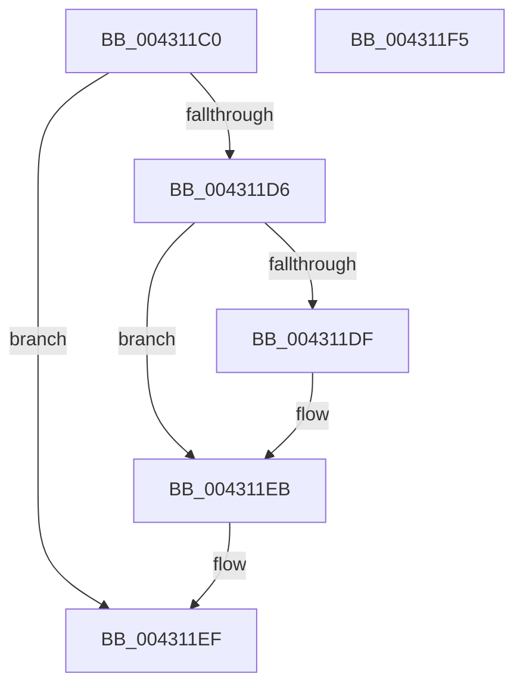

# MiUnlockVadCore

- RVA: `0x004311C0`–`0x004311F6` (길이 `54` bytes)
- VA: `0x00000001404311C0`
- 실행 섹션: `.text`
- PDB 이름 있음: `예`; PDB Function 태그: `아니요`
- unwind 정보 RVA: `0x0005CF00`
- 디코드: `16`개 명령, `54/54` bytes 표시
- 미해석 바이트: `0` (있으면 어셈블리에 `.byte`로 보존)

> 이 문서는 커널 이미지의 기계어와 PDB 기호를 분석해 생성했습니다. 4번과 5번은 함수 원형과 자료형을 바이너리 사용 방식에서 추정한 C 해석이며 원본 소스 복구 결과는 아닙니다.

## 1. Dependencies

- 직접 호출 지점: **1**; 고유 호출 대상: **1**
- 직접 호출자로 확인된 함수: **13**
- RIP 상대 이미지 참조: **1**

### Outgoing calls
- `0x004311E6` → [KiLowerIrqlProcessIrqlFlags](../4F/KiLowerIrqlProcessIrqlFlags_function_004F5698.md) (function, `0x004F5698`)

### Direct callers
- [sub_0032D782](../32/Unknown_function_0032D782.md) at `0x0032DC17`
- [sub_0032E327](../32/Unknown_function_0032E327.md) at `0x0032E3C4`
- [MiCheckVirtualAddress](../32/MiCheckVirtualAddress_function_0032E4F0.md) at `0x0032E7D7`
- [MiMakeSecureExclusive](MiMakeSecureExclusive_function_00430CA4.md) at `0x00430CEF`
- [MiLocateOldestSecure](MiLocateOldestSecure_function_00430D10.md) at `0x00430D40`
- [MiRemoveSecureEntry](MiRemoveSecureEntry_function_00430D5C.md) at `0x00430DB8`
- [MiInsertVadEvent](MiInsertVadEvent_function_00430E74.md) at `0x00430EB3`
- [MiGetVadWakeList](MiGetVadWakeList_function_00431134.md) at `0x0043117B`
- [MiRemoveVadEvent](../67/MiRemoveVadEvent_function_0067E41C.md) at `0x0067E474`
- [sub_006E1EDA](../6E/Unknown_function_006E1EDA.md) at `0x006E1EDC`
- [sub_006E1EEA](../6E/Unknown_function_006E1EEA.md) at `0x006E1EEF`
- [sub_006E1EFA](../6E/Unknown_function_006E1EFA.md) at `0x006E1EFC`
- [sub_006F5C7C](../6F/Unknown_function_006F5C7C.md) at `0x006F5C89`

### Static image references
- `0x004311D6` → RVA `0x00FC6D20` (`ALMOSTRO`; read)

## 2. Other-region calls and transfers

- 다른 실행 섹션으로 향하는 call: **0**
- 별도 외부 분기/꼬리 이동을 확인하지 못했습니다.

## 3. Assembly (complete function range)

```asm
004311C0  40 53                           push rbx
004311C2  48 83 EC 20                     sub rsp, 0x20
004311C6  0F B6 DA                        movzx ebx, dl
004311C9  F0 81 61 30 FC FF FF 7F         lock and dword ptr [rcx + 0x30], 0x7ffffffc
004311D1  80 FB 11                        cmp bl, 0x11
004311D4  74 19                           je 0x1404311ef
004311D6  83 3D 43 5B B9 00 00            cmp dword ptr [rip + 0xb95b43], 0
004311DD  74 0C                           je 0x1404311eb
004311DF  44 0F 20 C1                     mov rcx, cr8
004311E3  0F B6 D3                        movzx edx, bl
004311E6  E8 AD 44 0C 00                  call 0x1404f5698
004311EB  44 0F 22 C3                     mov cr8, rbx
004311EF  48 83 C4 20                     add rsp, 0x20
004311F3  5B                              pop rbx
004311F4  C3                              ret
004311F5  CC                              int3
```

## 4. C-style interpretation (structured pseudocode)

```c
__int64 __fastcall MiUnlockVadCore(__int64 a1, unsigned __int8 a2)
{
    __int64 result;
    __int64 v_rsp;

    v_rsp = (v_rsp) - (32);
    if (a2 == 17) goto loc_004311EF;
    if ((*(unsigned int *)(v_rip + 12147523)) != 0) {
        a1 = v_cr8;
        a2 = a2;
        result = KiLowerIrqlProcessIrqlFlags(a1, a2, a3, a4);
    }
loc_004311EF:
    v_rsp = (v_rsp) + (32);
    return result;
}
```

## 5. (Beta) C Style

```c
int64_t MiUnlockVadCore(void *Arg1, uint8_t Arg2)
{
    uint8_t *arg1 = (uint8_t *)Arg1;

    int64_t result;
    int64_t local_rsp;

    local_rsp = (local_rsp) - (32);
    if (Arg2 == 17) goto loc_004311EF;
    if ((*(uint32_t *)(v_rip + 0xB95B43)) != 0) {
        Arg1 = v_cr8;
        Arg2 = Arg2;
        result = KiLowerIrqlProcessIrqlFlags(Arg1, Arg2, a3, a4);
    }
loc_004311EF:
    local_rsp = (local_rsp) + (32);
    return result;
}
```

### 관측된 메모리 오프셋

구조체 형식이 확인되지 않은 접근은 인자 기준의 오프셋으로만 기록했습니다.

| 기준 인자 | 오프셋 표현 | 폭 (bit) | 접근 |
|---|---:|---:|---|
| `Arg1` | `+ 0x30` | `32` | `R/W` |

## 6. Execution-region graph

[열기: 2D/3D 그래프와 함수 탐색 컨트롤 패널](../../../control-panel.html?section=text&rva=0x004311C0&view=graph)

- 2D 그래프는 위에서 아래로 흐르고, 3D 그래프는 빈 공간을 드래그해 회전합니다. Shift+드래그는 이동, 휠은 확대·축소, 함수 노드 선택은 대상 보고서 이동입니다.

### Static fallback


