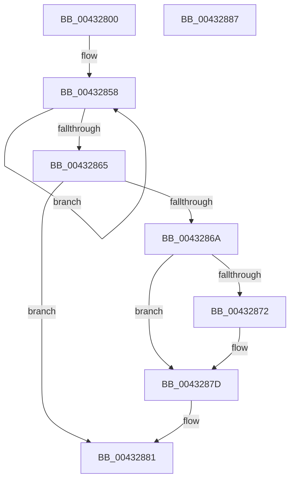

# MiUnmapPageInHyperSpaceWorker

- RVA: `0x00432800`–`0x00432888` (길이 `136` bytes)
- VA: `0x0000000140432800`
- 실행 섹션: `.text`
- PDB 이름 있음: `예`; PDB Function 태그: `아니요`
- unwind 정보 RVA: `0x0005CF00`
- 디코드: `35`개 명령, `136/136` bytes 표시
- 미해석 바이트: `0` (있으면 어셈블리에 `.byte`로 보존)

> 이 문서는 커널 이미지의 기계어와 PDB 기호를 분석해 생성했습니다. 4번과 5번은 함수 원형과 자료형을 바이너리 사용 방식에서 추정한 C 해석이며 원본 소스 복구 결과는 아닙니다.

## 1. Dependencies

- 직접 호출 지점: **1**; 고유 호출 대상: **1**
- 직접 호출자로 확인된 함수: **21**
- RIP 상대 이미지 참조: **2**

### Outgoing calls
- `0x00432878` → [KiLowerIrqlProcessIrqlFlags](../4F/KiLowerIrqlProcessIrqlFlags_function_004F5698.md) (function, `0x004F5698`)

### Direct callers
- [MiWaitForInPageComplete](../38/MiWaitForInPageComplete_function_00380AB8.md) at `0x00380E56`
- [MiPersistMdl](../40/MiPersistMdl_function_00402B2C.md) at `0x00402BEA`
- [MiBuildMappedCluster](../40/MiBuildMappedCluster_function_00405F1C.md) at `0x00406220`
- [MiBuildMappedCluster](../40/MiBuildMappedCluster_function_00405F1C.md) at `0x004062FC`
- [MiBuildMappedCluster](../40/MiBuildMappedCluster_function_00405F1C.md) at `0x00406563`
- [MiBuildMappedCluster](../40/MiBuildMappedCluster_function_00405F1C.md) at `0x0040660D`
- [MiBuildMappedCluster](../40/MiBuildMappedCluster_function_00405F1C.md) at `0x004068EA`
- [MiBuildMappedCluster](../40/MiBuildMappedCluster_function_00405F1C.md) at `0x00406960`
- [MiMakeOutswappedPageResident](MiMakeOutswappedPageResident_function_00431AD0.md) at `0x00431CAA`
- [MiMakeOutswappedPageResident](MiMakeOutswappedPageResident_function_00431AD0.md) at `0x00431F70`
- [MiInitializeSelfmap](MiInitializeSelfmap_function_0043202C.md) at `0x004320BD`
- [MiInitializeImageHeaderPage](MiInitializeImageHeaderPage_function_0043231C.md) at `0x00432370`
- [MiReadWriteAnyLevelShadowPte](MiReadWriteAnyLevelShadowPte_function_00432654.md) at `0x0043270B`
- [MiReadWriteAnyLevelShadowPte](MiReadWriteAnyLevelShadowPte_function_00432654.md) at `0x0043279E`
- [MiArePageContentsZero](../4D/MiArePageContentsZero_function_004D4278.md) at `0x004D435D`
- [MiSplitDirectMapPage](../4D/MiSplitDirectMapPage_function_004DAAA0.md) at `0x004DACF6`
- [MiApplyDebuggerPatches](../4F/MiApplyDebuggerPatches_function_004F7BE4.md) at `0x004F7D4B`
- [MiReplaceImportEntry](../67/MiReplaceImportEntry_function_00671440.md) at `0x00671664`
- [MiStackTheftFreezeProcessors](../67/MiStackTheftFreezeProcessors_function_0067B274.md) at `0x0067B433`
- [MiPersistPage](../68/MiPersistPage_function_00681A68.md) at `0x00681AA4`
- [MiDemoteValidLargePageOneLevel](../68/MiDemoteValidLargePageOneLevel_function_0068A3F4.md) at `0x0068A6E0`
- [MiReplicatePteChangeToProcess](../69/MiReplicatePteChangeToProcess_function_00693D24.md) at `0x00693DF3`
- [MiComputeCacheAttributeSpeeds](../69/MiComputeCacheAttributeSpeeds_function_006999E8.md) at `0x00699C9A`
- [sub_006DAAE6](../6D/Unknown_function_006DAAE6.md) at `0x006DAB66`
- [sub_006DBB22](../6D/Unknown_function_006DBB22.md) at `0x006DBB91`
- [sub_006E4818](../6E/Unknown_function_006E4818.md) at `0x006E489B`
- [sub_006E82CE](../6E/Unknown_function_006E82CE.md) at `0x006E847C`
- [sub_006F15CE](../6F/Unknown_function_006F15CE.md) at `0x006F1675`

### Static image references
- `0x00432848` → RVA `0x00010880` (`.rdata`; read)
- `0x0043286A` → RVA `0x00FC6D20` (`ALMOSTRO`; read)

## 2. Other-region calls and transfers

- 다른 실행 섹션으로 향하는 call: **0**
- 별도 외부 분기/꼬리 이동을 확인하지 못했습니다.

## 3. Assembly (complete function range)

```asm
00432800  40 53                           push rbx
00432802  48 83 EC 20                     sub rsp, 0x20
00432806  48 C1 E9 09                     shr rcx, 9
0043280A  48 B8 F8 FF FF FF 7F 00 00 00   movabs rax, 0x7ffffffff8
00432814  48 23 C8                        and rcx, rax
00432817  0F B6 DA                        movzx ebx, dl
0043281A  45 8B C8                        mov r9d, r8d
0043281D  48 B8 00 00 00 00 80 F6 FF FF   movabs rax, 0xfffff68000000000
00432827  48 03 C8                        add rcx, rax
0043282A  65 48 8B 04 25 20 00 00 00      mov rax, qword ptr gs:[0x20]
00432833  4C 8B 80 38 88 00 00            mov r8, qword ptr [rax + 0x8838]
0043283A  41 8B C1                        mov eax, r9d
0043283D  25 00 00 00 10                  and eax, 0x10000000
00432842  49 83 20 00                     and qword ptr [r8], 0
00432846  F7 D8                           neg eax
00432848  48 8B 05 31 E0 BD FF            mov rax, qword ptr [rip - 0x421fcf]
0043284F  48 1B D2                        sbb rdx, rdx
00432852  83 E2 0F                        and edx, 0xf
00432855  48 FF C2                        inc rdx
00432858  48 89 01                        mov qword ptr [rcx], rax
0043285B  48 83 C1 08                     add rcx, 8
0043285F  48 83 EA 01                     sub rdx, 1
00432863  75 F3                           jne 0x140432858
00432865  80 FB 11                        cmp bl, 0x11
00432868  74 17                           je 0x140432881
0043286A  39 15 B0 44 B9 00               cmp dword ptr [rip + 0xb944b0], edx
00432870  74 0B                           je 0x14043287d
00432872  44 0F 20 C1                     mov rcx, cr8
00432876  8A D3                           mov dl, bl
00432878  E8 1B 2E 0C 00                  call 0x1404f5698
0043287D  44 0F 22 C3                     mov cr8, rbx
00432881  48 83 C4 20                     add rsp, 0x20
00432885  5B                              pop rbx
00432886  C3                              ret
00432887  CC                              int3
```

## 4. C-style interpretation (structured pseudocode)

```c
__int64 __fastcall MiUnmapPageInHyperSpaceWorker(__int64 a1, __int64 a2, int a3)
{
    __int64 result;
    __int64 v_rsp;

    v_rsp = (v_rsp) - (32);
    a1 = (a1) >> (9);
    a1 = (a1) & (result);
    a1 = (a1) + (result);
    result = (unsigned int)(((unsigned int)((unsigned int)((unsigned int)(a3)))) & (0x10000000ULL));
    result = (unsigned int)(-(result));
    a2 = (unsigned int)((a2) & (15));
    a2 = (a2) + 1;
loc_00432858:
    *(unsigned __int64 *)(a1) = *(unsigned __int64 *)(v_rip - 4333519);
    a1 = (a1) + (8);
    a2 = (a2) - (1);
    if (condition_is_not_equal) goto loc_00432858;
    if (((unsigned __int8)((unsigned __int8)(a2))) == 17) goto loc_00432881;
    result = *(unsigned __int64 *)(v_rip - 4333519);
    if ((*(unsigned int *)(v_rip + 12141744)) != ((unsigned int)(a2))) {
        a1 = v_cr8;
        a2 = (unsigned __int8)((unsigned __int8)(a2));
        result = KiLowerIrqlProcessIrqlFlags(a1, a2, *(unsigned __int64 *)(*(unsigned __int64 *)(gs_base + (0 + 32)) + 34872), (unsigned int)(a3));
    }
loc_00432881:
    v_rsp = (v_rsp) + (32);
    return result;
}
```

## 5. (Beta) C Style

```c
int64_t MiUnmapPageInHyperSpaceWorker(int64_t Arg1, int64_t Arg2, int32_t Arg3)
{
    int64_t result;
    int64_t local_rsp;

    local_rsp = (local_rsp) - (32);
    Arg1 = (Arg1) >> (9);
    Arg1 = (Arg1) & (result);
    Arg1 = (Arg1) + (result);
    result = (uint32_t)(((uint32_t)((uint32_t)((uint32_t)(Arg3)))) & (0x10000000ULL));
    result = (uint32_t)(-(result));
    Arg2 = (uint32_t)((Arg2) & (15));
    Arg2 = (Arg2) + 1;
loc_00432858:
    *(uint64_t *)(Arg1) = *(uint64_t *)(v_rip - 0x421FCF);
    Arg1 = (Arg1) + (8);
    Arg2 = (Arg2) - (1);
    if (condition_is_not_equal) goto loc_00432858;
    if (((uint8_t)((uint8_t)(Arg2))) == 17) goto loc_00432881;
    result = *(uint64_t *)(v_rip - 0x421FCF);
    if ((*(uint32_t *)(v_rip + 0xB944B0)) != ((uint32_t)(Arg2))) {
        Arg1 = v_cr8;
        Arg2 = (uint8_t)((uint8_t)(Arg2));
        result = KiLowerIrqlProcessIrqlFlags(Arg1, Arg2, *(uint64_t *)(*(uint64_t *)(gs_base + (0 + 0x20)) + 0x8838), (uint32_t)(Arg3));
    }
loc_00432881:
    local_rsp = (local_rsp) + (32);
    return result;
}
```

## 6. Execution-region graph

[열기: 2D/3D 그래프와 함수 탐색 컨트롤 패널](../../../control-panel.html?section=text&rva=0x00432800&view=graph)

- 2D 그래프는 위에서 아래로 흐르고, 3D 그래프는 빈 공간을 드래그해 회전합니다. Shift+드래그는 이동, 휠은 확대·축소, 함수 노드 선택은 대상 보고서 이동입니다.

### Static fallback


