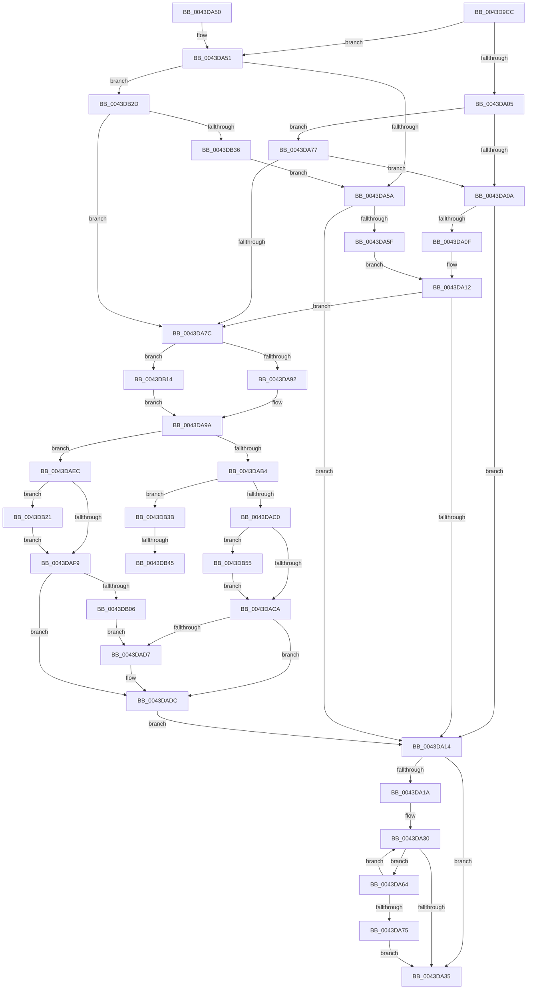

# MiUpdateCommitCounts

- RVA: `0x0043D9CC`–`0x0043DB6B` (길이 `415` bytes)
- VA: `0x000000014043D9CC`
- 실행 섹션: `.text`
- PDB 이름 있음: `예`; PDB Function 태그: `예`
- unwind 정보 RVA: `0x000A48E0`
- 디코드: `105`개 명령, `415/415` bytes 표시
- 미해석 바이트: `0` (있으면 어셈블리에 `.byte`로 보존)

> 이 문서는 커널 이미지의 기계어와 PDB 기호를 분석해 생성했습니다. 4번과 5번은 함수 원형과 자료형을 바이너리 사용 방식에서 추정한 C 해석이며 원본 소스 복구 결과는 아닙니다.

## 1. Dependencies

- 직접 호출 지점: **9**; 고유 호출 대상: **5**
- 직접 호출자로 확인된 함수: **1**
- RIP 상대 이미지 참조: **0**

### Outgoing calls
- `0x0043DA95` → [ExAcquireSpinLockExclusiveAtDpcLevel](../24/ExAcquireSpinLockExclusiveAtDpcLevel_function_00248E80.md) (function, `0x00248E80`)
- `0x0043DAD7` → [KeResetEvent](../24/KeResetEvent_function_00248350.md) (function, `0x00248350`)
- `0x0043DAE2` → [MiReleaseSpinLockExclusive](../24/MiReleaseSpinLockExclusive_function_002482C0.md) (function, `0x002482C0`)
- `0x0043DB06` → [KeResetEvent](../24/KeResetEvent_function_00248350.md) (function, `0x00248350`)
- `0x0043DB14` → [ExAcquireSpinLockExclusive](../24/ExAcquireSpinLockExclusive_function_00248690.md) (function, `0x00248690`)
- `0x0043DB26` → [KeSetEvent](../33/KeSetEvent_function_0033F310.md) (function, `0x0033F310`)
- `0x0043DB4A` → [KeSetEvent](../33/KeSetEvent_function_0033F310.md) (function, `0x0033F310`)
- `0x0043DB55` → [KeResetEvent](../24/KeResetEvent_function_00248350.md) (function, `0x00248350`)
- `0x0043DB61` → [KeResetEvent](../24/KeResetEvent_function_00248350.md) (function, `0x00248350`)

### Direct callers
- [MiReplenishLocalCommit](MiReplenishLocalCommit_function_0043D920.md) at `0x0043D956`

### Static image references
- 디코드된 RIP-relative 메모리 참조가 없습니다.

## 2. Other-region calls and transfers

- 다른 실행 섹션으로 향하는 call: **0**
- call이 아닌 외부 분기/꼬리 이동: **2**
  - `0x0043DB3F` → [sub_006EF788](../6E/Unknown_function_006EF788.md) (`tail-transfer`)
  - `0x0043DB50` → [sub_006EF788](../6E/Unknown_function_006EF788.md) (`tail-transfer`)

## 3. Assembly (complete function range)

```asm
0043D9CC  48 8B C4                        mov rax, rsp
0043D9CF  48 89 58 08                     mov qword ptr [rax + 8], rbx
0043D9D3  48 89 68 10                     mov qword ptr [rax + 0x10], rbp
0043D9D7  48 89 70 18                     mov qword ptr [rax + 0x18], rsi
0043D9DB  48 89 78 20                     mov qword ptr [rax + 0x20], rdi
0043D9DF  41 56                           push r14
0043D9E1  48 83 EC 20                     sub rsp, 0x20
0043D9E5  4C 8B 91 E0 41 00 00            mov r10, qword ptr [rcx + 0x41e0]
0043D9EC  4A 8D 04 02                     lea rax, [rdx + r8]
0043D9F0  48 8B D9                        mov rbx, rcx
0043D9F3  48 8B 89 D8 41 00 00            mov rcx, qword ptr [rcx + 0x41d8]
0043D9FA  45 8B F1                        mov r14d, r9d
0043D9FD  49 8B E8                        mov rbp, r8
0043DA00  48 3B C2                        cmp rax, rdx
0043DA03  77 4C                           ja 0x14043da51
0043DA05  49 3B D2                        cmp rdx, r10
0043DA08  73 6D                           jae 0x14043da77
0043DA0A  48 3B C1                        cmp rax, rcx
0043DA0D  73 05                           jae 0x14043da14
0043DA0F  48 3B D1                        cmp rdx, rcx
0043DA12  73 68                           jae 0x14043da7c
0043DA14  41 F6 C6 10                     test r14b, 0x10
0043DA18  75 1B                           jne 0x14043da35
0043DA1A  48 8B D5                        mov rdx, rbp
0043DA1D  F0 48 0F C1 93 80 4B 00 00      lock xadd qword ptr [rbx + 0x4b80], rdx
0043DA26  48 8B 83 C0 41 00 00            mov rax, qword ptr [rbx + 0x41c0]
0043DA2D  48 03 D5                        add rdx, rbp
0043DA30  48 3B D0                        cmp rdx, rax
0043DA33  77 2F                           ja 0x14043da64
0043DA35  48 8B 5C 24 30                  mov rbx, qword ptr [rsp + 0x30]
0043DA3A  48 8B 6C 24 38                  mov rbp, qword ptr [rsp + 0x38]
0043DA3F  48 8B 74 24 40                  mov rsi, qword ptr [rsp + 0x40]
0043DA44  48 8B 7C 24 48                  mov rdi, qword ptr [rsp + 0x48]
0043DA49  48 83 C4 20                     add rsp, 0x20
0043DA4D  41 5E                           pop r14
0043DA4F  C3                              ret
0043DA50  CC                              int3
0043DA51  49 3B C2                        cmp rax, r10
0043DA54  0F 83 D3 00 00 00               jae 0x14043db2d
0043DA5A  48 3B D1                        cmp rdx, rcx
0043DA5D  73 B5                           jae 0x14043da14
0043DA5F  48 3B C1                        cmp rax, rcx
0043DA62  EB AE                           jmp 0x14043da12
0043DA64  48 8B C8                        mov rcx, rax
0043DA67  F0 48 0F B1 93 C0 41 00 00      lock cmpxchg qword ptr [rbx + 0x41c0], rdx
0043DA70  48 3B C8                        cmp rcx, rax
0043DA73  75 BB                           jne 0x14043da30
0043DA75  EB BE                           jmp 0x14043da35
0043DA77  49 3B C2                        cmp rax, r10
0043DA7A  73 8E                           jae 0x14043da0a
0043DA7C  44 0F 20 C0                     mov rax, cr8
0043DA80  48 8D BB F8 41 00 00            lea rdi, [rbx + 0x41f8]
0043DA87  48 8B CF                        mov rcx, rdi
0043DA8A  3C 02                           cmp al, 2
0043DA8C  0F 85 82 00 00 00               jne 0x14043db14
0043DA92  40 B6 11                        mov sil, 0x11
0043DA95  E8 E6 B3 E0 FF                  call 0x140248e80
0043DA9A  48 8B 93 40 4B 00 00            mov rdx, qword ptr [rbx + 0x4b40]
0043DAA1  48 8B 8B D8 41 00 00            mov rcx, qword ptr [rbx + 0x41d8]
0043DAA8  48 8B 83 E0 41 00 00            mov rax, qword ptr [rbx + 0x41e0]
0043DAAF  48 3B D1                        cmp rdx, rcx
0043DAB2  72 38                           jb 0x14043daec
0043DAB4  48 8B 8B 30 01 00 00            mov rcx, qword ptr [rbx + 0x130]
0043DABB  48 3B D0                        cmp rdx, rax
0043DABE  73 7B                           jae 0x14043db3b
0043DAC0  83 79 04 01                     cmp dword ptr [rcx + 4], 1
0043DAC4  0F 84 8B 00 00 00               je 0x14043db55
0043DACA  48 8B 8B 28 01 00 00            mov rcx, qword ptr [rbx + 0x128]
0043DAD1  83 79 04 01                     cmp dword ptr [rcx + 4], 1
0043DAD5  75 05                           jne 0x14043dadc
0043DAD7  E8 74 A8 E0 FF                  call 0x140248350
0043DADC  40 8A D6                        mov dl, sil
0043DADF  48 8B CF                        mov rcx, rdi
0043DAE2  E8 D9 A7 E0 FF                  call 0x1402482c0
0043DAE7  E9 28 FF FF FF                  jmp 0x14043da14
0043DAEC  48 8B 8B 28 01 00 00            mov rcx, qword ptr [rbx + 0x128]
0043DAF3  83 79 04 00                     cmp dword ptr [rcx + 4], 0
0043DAF7  74 28                           je 0x14043db21
0043DAF9  48 8B 8B 30 01 00 00            mov rcx, qword ptr [rbx + 0x130]
0043DB00  83 79 04 01                     cmp dword ptr [rcx + 4], 1
0043DB04  75 D6                           jne 0x14043dadc
0043DB06  E8 45 A8 E0 FF                  call 0x140248350
0043DB0B  48 8B 8B 38 01 00 00            mov rcx, qword ptr [rbx + 0x138]
0043DB12  EB C3                           jmp 0x14043dad7
0043DB14  E8 77 AB E0 FF                  call 0x140248690
0043DB19  40 8A F0                        mov sil, al
0043DB1C  E9 79 FF FF FF                  jmp 0x14043da9a
0043DB21  45 33 C0                        xor r8d, r8d
0043DB24  33 D2                           xor edx, edx
0043DB26  E8 E5 17 F0 FF                  call 0x14033f310
0043DB2B  EB CC                           jmp 0x14043daf9
0043DB2D  49 3B D2                        cmp rdx, r10
0043DB30  0F 82 46 FF FF FF               jb 0x14043da7c
0043DB36  E9 1F FF FF FF                  jmp 0x14043da5a
0043DB3B  83 79 04 00                     cmp dword ptr [rcx + 4], 0
0043DB3F  0F 85 43 1C 2B 00               jne 0x1406ef788
0043DB45  45 33 C0                        xor r8d, r8d
0043DB48  33 D2                           xor edx, edx
0043DB4A  E8 C1 17 F0 FF                  call 0x14033f310
0043DB4F  90                              nop
0043DB50  E9 33 1C 2B 00                  jmp 0x1406ef788
0043DB55  E8 F6 A7 E0 FF                  call 0x140248350
0043DB5A  48 8B 8B 38 01 00 00            mov rcx, qword ptr [rbx + 0x138]
0043DB61  E8 EA A7 E0 FF                  call 0x140248350
0043DB66  E9 5F FF FF FF                  jmp 0x14043daca
```

## 4. C-style interpretation (structured pseudocode)

```c
__int64 __fastcall MiUpdateCommitCounts(__int64 a1, __int64 a2, __int64 a3, int a4)
{
    __int64 result;
    __int64 v_rsp;
    unsigned __int64 v_stack_p10;
    unsigned __int64 v_stack_p18;
    unsigned __int64 v_stack_p20;
    unsigned __int64 v_stack_p8;

    *(unsigned __int64 *)(v_rsp + 8) = v_rbx;
    *(unsigned __int64 *)(v_rsp + 16) = v_rbp;
    *(unsigned __int64 *)(v_rsp + 24) = v_rsi;
    *(unsigned __int64 *)(v_rsp + 32) = v_rdi;
    v_rsp = (v_rsp) - (32);
    if ((a2 + a3 * 1) > a2) goto loc_0043DA51;
    if (a2 >= (*(unsigned __int64 *)(a1 + 16864))) goto loc_0043DA77;
loc_0043DA0A:
    if ((a2 + a3 * 1) >= (*(unsigned __int64 *)(a1 + 16856))) goto loc_0043DA14;
loc_0043DA12:
    if (a2 >= (*(unsigned __int64 *)(a1 + 16856))) goto loc_0043DA7C;
loc_0043DA14:
    if ((((unsigned __int8)((unsigned int)(a4))) & (16)) != 0) goto loc_0043DA35;
    a2 = (a3) + (a3);
loc_0043DA30:
    if (a2 > (*(unsigned __int64 *)(a1 + 16832))) goto loc_0043DA64;
loc_0043DA35:
    v_rsp = (v_rsp) + (32);
    return *(unsigned __int64 *)(a1 + 16832);
loc_0043DA51:
    if ((*(unsigned __int64 *)(a1 + 16832)) >= (*(unsigned __int64 *)(a1 + 16864))) goto loc_0043DB2D;
loc_0043DA5A:
    if (a2 >= (*(unsigned __int64 *)(a1 + 16856))) goto loc_0043DA14;
    goto loc_0043DA12;
loc_0043DA64:
    if ((*(unsigned __int64 *)(a1 + 16832)) != (*(unsigned __int64 *)(a1 + 16832))) goto loc_0043DA30;
    goto loc_0043DA35;
loc_0043DA77:
    if ((*(unsigned __int64 *)(a1 + 16832)) >= (*(unsigned __int64 *)(a1 + 16864))) goto loc_0043DA0A;
loc_0043DA7C:
    if (((unsigned __int8)(v_cr8)) != 2) goto loc_0043DB14;
    result = ExAcquireSpinLockExclusiveAtDpcLevel(v_stack_p8 + 16888, a2, a3, a4);
loc_0043DA9A:
    if ((*(unsigned __int64 *)(v_stack_p8 + 19264)) < (*(unsigned __int64 *)(v_stack_p8 + 16856))) goto loc_0043DAEC;
    if ((*(unsigned __int64 *)(v_stack_p8 + 19264)) >= (*(unsigned __int64 *)(v_stack_p8 + 16864))) goto loc_0043DB3B;
    if ((*(unsigned int *)(*(unsigned __int64 *)(v_stack_p8 + 304) + 4)) == 1) goto loc_0043DB55;
loc_0043DACA:
    result = *(unsigned __int64 *)(v_stack_p8 + 16864);
    if ((*(unsigned int *)(*(unsigned __int64 *)(v_stack_p8 + 296) + 4)) == 1) {
        result = KeResetEvent(*(unsigned __int64 *)(v_stack_p8 + 296), *(unsigned __int64 *)(v_stack_p8 + 19264), a3, a4);
    }
    result = MiReleaseSpinLockExclusive(v_stack_p8 + 16888, 17, a3, a4);
    goto loc_0043DA14;
loc_0043DAEC:
    if ((*(unsigned int *)(*(unsigned __int64 *)(v_stack_p8 + 296) + 4)) == 0) goto loc_0043DB21;
loc_0043DAF9:
    if ((*(unsigned int *)(*(unsigned __int64 *)(v_stack_p8 + 304) + 4)) != 1) goto loc_0043DADC;
    result = KeResetEvent(*(unsigned __int64 *)(v_stack_p8 + 304), 17, a3, a4);
    goto loc_0043DAD7;
loc_0043DB14:
    result = ExAcquireSpinLockExclusive(*(unsigned __int64 *)(v_stack_p8 + 312), 17, a3, a4);
    goto loc_0043DA9A;
loc_0043DB21:
    a3 = 0;
    a2 = 0;
    result = KeSetEvent(*(unsigned __int64 *)(v_stack_p8 + 312), a2, a3, a4);
    goto loc_0043DAF9;
loc_0043DB2D:
    if (0 < (*(unsigned __int64 *)(a1 + 16864))) goto loc_0043DA7C;
    goto loc_0043DA5A;
loc_0043DB3B:
    a3 = 0;
    a2 = 0;
    result = KeSetEvent(*(unsigned __int64 *)(v_stack_p8 + 312), a2, a3, a4);
loc_0043DB55:
    result = KeResetEvent(*(unsigned __int64 *)(v_stack_p8 + 312), a2, a3, a4);
    result = KeResetEvent(*(unsigned __int64 *)(v_stack_p8 + 312), a2, a3, a4);
    goto loc_0043DACA;
}
```

## 5. (Beta) C Style

```c
int64_t MiUpdateCommitCounts(void *Arg1, void *Arg2, int64_t Arg3, int32_t Arg4)
{
    uint8_t *arg1 = (uint8_t *)Arg1;
    uint8_t *arg2 = (uint8_t *)Arg2;

    int64_t result;
    int64_t local_rsp;
    uint64_t v_stack_p10;
    uint64_t v_stack_p18;
    uint64_t v_stack_p20;
    uint64_t v_stack_p8;

    *(uint64_t *)(local_rsp + 0x8) = local_rbx;
    *(uint64_t *)(local_rsp + 0x10) = local_rbp;
    *(uint64_t *)(local_rsp + 0x18) = local_rsi;
    *(uint64_t *)(local_rsp + 0x20) = local_rdi;
    local_rsp = (local_rsp) - (32);
    if ((Arg2 + Arg3 * 1) > Arg2) goto loc_0043DA51;
    if (Arg2 >= (*(uint64_t *)(arg1 + 0x41E0))) goto loc_0043DA77;
loc_0043DA0A:
    if ((Arg2 + Arg3 * 1) >= (*(uint64_t *)(arg1 + 0x41D8))) goto loc_0043DA14;
loc_0043DA12:
    if (Arg2 >= (*(uint64_t *)(arg1 + 0x41D8))) goto loc_0043DA7C;
loc_0043DA14:
    if ((((uint8_t)((uint32_t)(Arg4))) & (16)) != 0) goto loc_0043DA35;
    Arg2 = (Arg3) + (Arg3);
loc_0043DA30:
    if (Arg2 > (*(uint64_t *)(arg1 + 0x41C0))) goto loc_0043DA64;
loc_0043DA35:
    local_rsp = (local_rsp) + (32);
    return *(uint64_t *)(arg1 + 0x41C0);
loc_0043DA51:
    if ((*(uint64_t *)(arg1 + 0x41C0)) >= (*(uint64_t *)(arg1 + 0x41E0))) goto loc_0043DB2D;
loc_0043DA5A:
    if (Arg2 >= (*(uint64_t *)(arg1 + 0x41D8))) goto loc_0043DA14;
    goto loc_0043DA12;
loc_0043DA64:
    if ((*(uint64_t *)(arg1 + 0x41C0)) != (*(uint64_t *)(arg1 + 0x41C0))) goto loc_0043DA30;
    goto loc_0043DA35;
loc_0043DA77:
    if ((*(uint64_t *)(arg1 + 0x41C0)) >= (*(uint64_t *)(arg1 + 0x41E0))) goto loc_0043DA0A;
loc_0043DA7C:
    if (((uint8_t)(v_cr8)) != 2) goto loc_0043DB14;
    result = ExAcquireSpinLockExclusiveAtDpcLevel(v_stack_p8 + 16888, Arg2, Arg3, Arg4);
loc_0043DA9A:
    if ((*(uint64_t *)(v_stack_p8 + 0x4B40)) < (*(uint64_t *)(v_stack_p8 + 0x41D8))) goto loc_0043DAEC;
    if ((*(uint64_t *)(v_stack_p8 + 0x4B40)) >= (*(uint64_t *)(v_stack_p8 + 0x41E0))) goto loc_0043DB3B;
    if ((*(uint32_t *)(*(uint64_t *)(v_stack_p8 + 0x130) + 0x4)) == 1) goto loc_0043DB55;
loc_0043DACA:
    result = *(uint64_t *)(v_stack_p8 + 0x41E0);
    if ((*(uint32_t *)(*(uint64_t *)(v_stack_p8 + 0x128) + 0x4)) == 1) {
        result = KeResetEvent(*(uint64_t *)(v_stack_p8 + 0x128), *(uint64_t *)(v_stack_p8 + 0x4B40), Arg3, Arg4);
    }
    result = MiReleaseSpinLockExclusive(v_stack_p8 + 16888, 17, Arg3, Arg4);
    goto loc_0043DA14;
loc_0043DAEC:
    if ((*(uint32_t *)(*(uint64_t *)(v_stack_p8 + 0x128) + 0x4)) == 0) goto loc_0043DB21;
loc_0043DAF9:
    if ((*(uint32_t *)(*(uint64_t *)(v_stack_p8 + 0x130) + 0x4)) != 1) goto loc_0043DADC;
    result = KeResetEvent(*(uint64_t *)(v_stack_p8 + 0x130), 17, Arg3, Arg4);
    goto loc_0043DAD7;
loc_0043DB14:
    result = ExAcquireSpinLockExclusive(*(uint64_t *)(v_stack_p8 + 0x138), 17, Arg3, Arg4);
    goto loc_0043DA9A;
loc_0043DB21:
    Arg3 = 0;
    Arg2 = 0;
    result = KeSetEvent(*(uint64_t *)(v_stack_p8 + 0x138), Arg2, Arg3, Arg4);
    goto loc_0043DAF9;
loc_0043DB2D:
    if (0 < (*(uint64_t *)(arg1 + 0x41E0))) goto loc_0043DA7C;
    goto loc_0043DA5A;
loc_0043DB3B:
    Arg3 = 0;
    Arg2 = 0;
    result = KeSetEvent(*(uint64_t *)(v_stack_p8 + 0x138), Arg2, Arg3, Arg4);
loc_0043DB55:
    result = KeResetEvent(*(uint64_t *)(v_stack_p8 + 0x138), Arg2, Arg3, Arg4);
    result = KeResetEvent(*(uint64_t *)(v_stack_p8 + 0x138), Arg2, Arg3, Arg4);
    goto loc_0043DACA;
}
```

### 관측된 메모리 오프셋

구조체 형식이 확인되지 않은 접근은 인자 기준의 오프셋으로만 기록했습니다.

| 기준 인자 | 오프셋 표현 | 폭 (bit) | 접근 |
|---|---:|---:|---|
| `Arg1` | `+ 0x128` | `64` | `R` |
| `Arg1` | `+ 0x130` | `64` | `R` |
| `Arg1` | `+ 0x138` | `64` | `R` |
| `Arg1` | `+ 0x41C0` | `64` | `R` |
| `Arg1` | `+ 0x41D8` | `64` | `R` |
| `Arg1` | `+ 0x41E0` | `64` | `R` |
| `Arg1` | `+ 0x41F8` | `64` | `R` |
| `Arg1` | `+ 0x4B40` | `64` | `R` |
| `Arg1` | `+ 0x4B80` | `64` | `R/W` |
| `Arg2` | `+ 0x0 + r8*1` | `64` | `R` |

## 6. Execution-region graph

[열기: 2D/3D 그래프와 함수 탐색 컨트롤 패널](../../../control-panel.html?section=text&rva=0x0043D9CC&view=graph)

- 2D 그래프는 위에서 아래로 흐르고, 3D 그래프는 빈 공간을 드래그해 회전합니다. Shift+드래그는 이동, 휠은 확대·축소, 함수 노드 선택은 대상 보고서 이동입니다.

### Static fallback


