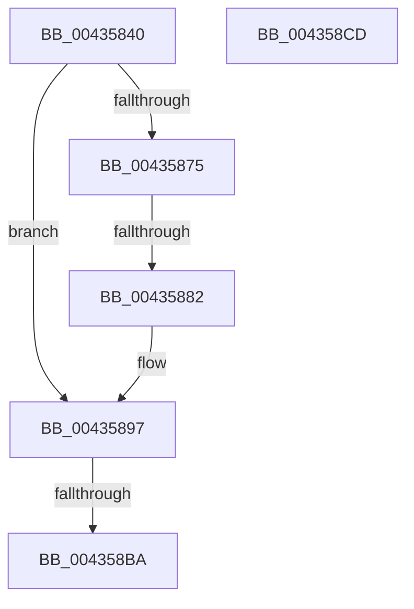

# MiUpdateDemotedSubPage

- RVA: `0x00435840`–`0x004358CE` (길이 `142` bytes)
- VA: `0x0000000140435840`
- 실행 섹션: `.text`
- PDB 이름 있음: `예`; PDB Function 태그: `예`
- unwind 정보 RVA: `0x000A2C58`
- 디코드: `44`개 명령, `142/142` bytes 표시
- 미해석 바이트: `0` (있으면 어셈블리에 `.byte`로 보존)

> 이 문서는 커널 이미지의 기계어와 PDB 기호를 분석해 생성했습니다. 4번과 5번은 함수 원형과 자료형을 바이너리 사용 방식에서 추정한 C 해석이며 원본 소스 복구 결과는 아닙니다.

## 1. Dependencies

- 직접 호출 지점: **0**; 고유 호출 대상: **0**
- 직접 호출자로 확인된 함수: **3**
- RIP 상대 이미지 참조: **0**

### Outgoing calls
- 직접 디코드된 call 명령이 없습니다.

### Direct callers
- [MiInsertDemotedPages](MiInsertDemotedPages_function_004354B8.md) at `0x00435653`
- [MiDemoteValidLargePageOneLevel](../68/MiDemoteValidLargePageOneLevel_function_0068A3F4.md) at `0x0068A8C9`
- [MiDemotePfnListChain](../69/MiDemotePfnListChain_function_00698B5C.md) at `0x00698CE6`

### Static image references
- 디코드된 RIP-relative 메모리 참조가 없습니다.

## 2. Other-region calls and transfers

- 다른 실행 섹션으로 향하는 call: **0**
- call이 아닌 외부 분기/꼬리 이동: **2**
  - `0x0043587C` → [sub_00435948](Unknown_function_00435948.md) (`tail-transfer`)
  - `0x004358B8` → [sub_004358CE](Unknown_function_004358CE.md) (`tail-transfer`)

## 3. Assembly (complete function range)

```asm
00435840  48 89 5C 24 18                  mov qword ptr [rsp + 0x18], rbx
00435845  55                              push rbp
00435846  56                              push rsi
00435847  57                              push rdi
00435848  41 54                           push r12
0043584A  41 55                           push r13
0043584C  48 83 EC 20                     sub rsp, 0x20
00435850  33 FF                           xor edi, edi
00435852  41 8B F0                        mov esi, r8d
00435855  48 8B DA                        mov rbx, rdx
00435858  48 8B E9                        mov rbp, rcx
0043585B  49 BC 00 00 00 00 00 02 00 00   movabs r12, 0x20000000000
00435865  49 BD FF FF FF FF FF FD FF FF   movabs r13, 0xfffffdffffffffff
0043586F  41 83 F8 03                     cmp r8d, 3
00435873  75 22                           jne 0x140435897
00435875  48 8B 42 28                     mov rax, qword ptr [rdx + 0x28]
00435879  49 85 C4                        test r12, rax
0043587C  0F 85 C6 00 00 00               jne 0x140435948
00435882  48 8B 42 28                     mov rax, qword ptr [rdx + 0x28]
00435886  48 B9 FF FF FF FF FF FE FF FF   movabs rcx, 0xfffffeffffffffff
00435890  48 23 C1                        and rax, rcx
00435893  48 89 42 28                     mov qword ptr [rdx + 0x28], rax
00435897  8B 42 24                        mov eax, dword ptr [rdx + 0x24]
0043589A  40 0F B6 CE                     movzx ecx, sil
0043589E  F6 D1                           not cl
004358A0  0F B6 D1                        movzx edx, cl
004358A3  C1 E2 1B                        shl edx, 0x1b
004358A6  8B CA                           mov ecx, edx
004358A8  33 C8                           xor ecx, eax
004358AA  81 E1 FF FF FF E7               and ecx, 0xe7ffffff
004358B0  33 CA                           xor ecx, edx
004358B2  89 4B 24                        mov dword ptr [rbx + 0x24], ecx
004358B5  83 FE 03                        cmp esi, 3
004358B8  75 14                           jne 0x1404358ce
004358BA  48 8B 5C 24 60                  mov rbx, qword ptr [rsp + 0x60]
004358BF  8B C7                           mov eax, edi
004358C1  48 83 C4 20                     add rsp, 0x20
004358C5  41 5D                           pop r13
004358C7  41 5C                           pop r12
004358C9  5F                              pop rdi
004358CA  5E                              pop rsi
004358CB  5D                              pop rbp
004358CC  C3                              ret
004358CD  CC                              int3
```

## 4. C-style interpretation (structured pseudocode)

```c
__int64 __fastcall MiUpdateDemotedSubPage(__int64 a1, __int64 a2, int a3)
{
    __int64 result;
    __int64 v_rdi;
    __int64 v_rsp;
    unsigned __int64 v_stack_p18;

    v_stack_p18 = v_rbx;
    v_rsp = (v_rsp) - (32);
    v_rdi = 0;
    if (a3 != 3) goto loc_00435897;
    result = (*(unsigned __int64 *)(a2 + 40)) & (a1);
    *(unsigned __int64 *)(a2 + 40) = result;
loc_00435897:
    a1 = (unsigned __int8)(~((unsigned __int8)((unsigned int)(a3))));
    a2 = (unsigned int)(((unsigned __int8)(a1)) << (27));
    a1 = (unsigned int)(((unsigned int)((unsigned int)(a2))) ^ ((unsigned int)((unsigned int)(*(unsigned int *)(a2 + 36)))));
    a1 = (unsigned int)((a1) & (0xE7FFFFFFULL));
    a1 = (unsigned int)((a1) ^ ((unsigned int)(a2)));
    *(unsigned int *)(a2 + 36) = (unsigned int)(a1);
    v_rsp = (v_rsp) + (32);
    return 0;
}
```

## 5. (Beta) C Style

```c
int64_t MiUpdateDemotedSubPage(int64_t Arg1, void *Arg2, int32_t Arg3)
{
    uint8_t *arg2 = (uint8_t *)Arg2;

    int64_t result;
    int64_t local_rdi;
    int64_t local_rsp;
    uint64_t v_stack_p18;

    v_stack_p18 = local_rbx;
    local_rsp = (local_rsp) - (32);
    local_rdi = 0;
    if (Arg3 != 3) goto loc_00435897;
    result = (*(uint64_t *)(arg2 + 0x28)) & (Arg1);
    *(uint64_t *)(arg2 + 0x28) = result;
loc_00435897:
    Arg1 = (uint8_t)(~((uint8_t)((uint32_t)(Arg3))));
    Arg2 = (uint32_t)(((uint8_t)(Arg1)) << (27));
    Arg1 = (uint32_t)(((uint32_t)((uint32_t)(Arg2))) ^ ((uint32_t)((uint32_t)(*(uint32_t *)(arg2 + 0x24)))));
    Arg1 = (uint32_t)((Arg1) & (0xE7FFFFFFULL));
    Arg1 = (uint32_t)((Arg1) ^ ((uint32_t)(Arg2)));
    *(uint32_t *)(arg2 + 0x24) = (uint32_t)(Arg1);
    local_rsp = (local_rsp) + (32);
    return 0;
}
```

### 관측된 메모리 오프셋

구조체 형식이 확인되지 않은 접근은 인자 기준의 오프셋으로만 기록했습니다.

| 기준 인자 | 오프셋 표현 | 폭 (bit) | 접근 |
|---|---:|---:|---|
| `Arg2` | `+ 0x24` | `32` | `R` |
| `Arg2` | `+ 0x24` | `32` | `W` |
| `Arg2` | `+ 0x28` | `64` | `R` |
| `Arg2` | `+ 0x28` | `64` | `W` |

## 6. Execution-region graph

[열기: 2D/3D 그래프와 함수 탐색 컨트롤 패널](../../../control-panel.html?section=text&rva=0x00435840&view=graph)

- 2D 그래프는 위에서 아래로 흐르고, 3D 그래프는 빈 공간을 드래그해 회전합니다. Shift+드래그는 이동, 휠은 확대·축소, 함수 노드 선택은 대상 보고서 이동입니다.

### Static fallback


