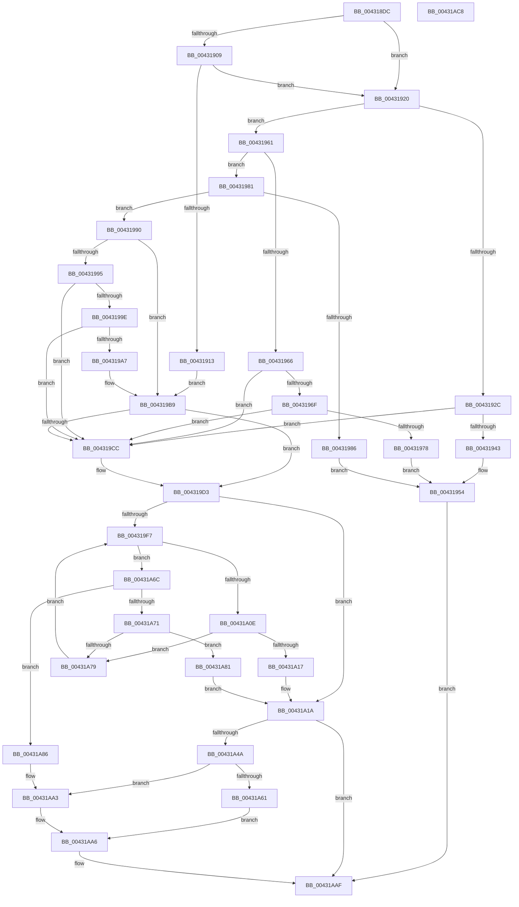

# MiUpdateDriverLoadInProgress

- RVA: `0x004318DC`–`0x00431AC9` (길이 `493` bytes)
- VA: `0x00000001404318DC`
- 실행 섹션: `.text`
- PDB 이름 있음: `예`; PDB Function 태그: `아니요`
- unwind 정보 RVA: `0x00084C9C`
- 디코드: `136`개 명령, `493/493` bytes 표시
- 미해석 바이트: `0` (있으면 어셈블리에 `.byte`로 보존)

> 이 문서는 커널 이미지의 기계어와 PDB 기호를 분석해 생성했습니다. 4번과 5번은 함수 원형과 자료형을 바이너리 사용 방식에서 추정한 C 해석이며 원본 소스 복구 결과는 아닙니다.

## 1. Dependencies

- 직접 호출 지점: **8**; 고유 호출 대상: **6**
- 직접 호출자로 확인된 함수: **4**
- RIP 상대 이미지 참조: **8**

### Outgoing calls
- `0x00431913` → [MmLockLoadedModuleListExclusive](MmLockLoadedModuleListExclusive_function_0043229C.md) (function, `0x0043229C`)
- `0x00431920` → [MmLockLoadedModuleListExclusive](MmLockLoadedModuleListExclusive_function_0043229C.md) (function, `0x0043229C`)
- `0x00431957` → [MmUnlockLoadedModuleListExclusive](MmUnlockLoadedModuleListExclusive_function_004322E0.md) (function, `0x004322E0`)
- `0x00431A28` → [RtlAvlInsertNodeEx](../26/RtlAvlInsertNodeEx_function_00265790.md) (function, `0x00265790`)
- `0x00431A38` → [MmUnlockLoadedModuleListExclusive](MmUnlockLoadedModuleListExclusive_function_004322E0.md) (function, `0x004322E0`)
- `0x00431A57` → [MmGetLoadedModuleImageAdditionalTablesAddress](../3D/MmGetLoadedModuleImageAdditionalTablesAddress_function_003D4CF0.md) (function, `0x003D4CF0`)
- `0x00431A9D` → [KeBugCheckEx](../4F/KeBugCheckEx_function_004FD660.md) (function, `0x004FD660`)
- `0x00431AAA` → [RtlInsertInvertedFunctionTable](RtlInsertInvertedFunctionTable_function_00432138.md) (function, `0x00432138`)

### Direct callers
- [MmLoadSystemImageEx](../../page/99/MmLoadSystemImageEx_function_00999B8C.md) at `0x00999DCD`
- [MmLoadSystemImageEx](../../page/99/MmLoadSystemImageEx_function_00999B8C.md) at `0x00999F0D`
- [MiObtainSectionForDriver](../../page/A2/MiObtainSectionForDriver_function_00A24494.md) at `0x00A24511`
- [MiUnloadSystemImage](../../page/AA/MiUnloadSystemImage_function_00AA2FD4.md) at `0x00AA3391`
- [MiInitializeLoadedModuleList](../../init/C6/MiInitializeLoadedModuleList_function_00C6BCDC.md) at `0x00C6BDFF`

### Static image references
- `0x0043192C` → RVA `0x00E2D990` (`.data`; read)
- `0x00431933` → RVA `0x00E2D988` (`.data`; read)
- `0x0043194D` → RVA `0x00E2D990` (`.data`; write)
- `0x004319B9` → RVA `0x00EF54C8` (`.data`; read)
- `0x004319C0` → RVA `0x00EF54C0` (`.data`; read)
- `0x004319E0` → RVA `0x00E2D980` (`.data`; read)
- `0x004319E7` → RVA `0x00EF54C8` (`.data`; write)
- `0x00431A3D` → RVA `0x00FC6A88` (`ALMOSTRO`; read)

## 2. Other-region calls and transfers

- 다른 실행 섹션으로 향하는 call: **0**
- 별도 외부 분기/꼬리 이동을 확인하지 못했습니다.

## 3. Assembly (complete function range)

```asm
004318DC  48 89 5C 24 08                  mov qword ptr [rsp + 8], rbx
004318E1  48 89 6C 24 10                  mov qword ptr [rsp + 0x10], rbp
004318E6  48 89 74 24 18                  mov qword ptr [rsp + 0x18], rsi
004318EB  57                              push rdi
004318EC  41 56                           push r14
004318EE  41 57                           push r15
004318F0  48 83 EC 30                     sub rsp, 0x30
004318F4  41 8B E9                        mov ebp, r9d
004318F7  4D 8B F0                        mov r14, r8
004318FA  4C 8B FA                        mov r15, rdx
004318FD  48 8B D9                        mov rbx, rcx
00431900  48 8B F9                        mov rdi, rcx
00431903  41 83 F9 02                     cmp r9d, 2
00431907  75 17                           jne 0x140431920
00431909  48 8B FA                        mov rdi, rdx
0043190C  41 0F BA E6 1C                  bt r14d, 0x1c
00431911  73 0D                           jae 0x140431920
00431913  E8 84 09 00 00                  call 0x14043229c
00431918  40 8A F0                        mov sil, al
0043191B  E9 99 00 00 00                  jmp 0x1404319b9
00431920  E8 77 09 00 00                  call 0x14043229c
00431925  0F B6 F0                        movzx esi, al
00431928  85 ED                           test ebp, ebp
0043192A  75 35                           jne 0x140431961
0043192C  48 8B 05 5D C0 9F 00            mov rax, qword ptr [rip + 0x9fc05d]
00431933  48 8D 0D 4E C0 9F 00            lea rcx, [rip + 0x9fc04e]
0043193A  48 39 08                        cmp qword ptr [rax], rcx
0043193D  0F 85 89 00 00 00               jne 0x1404319cc
00431943  48 89 0B                        mov qword ptr [rbx], rcx
00431946  48 89 43 08                     mov qword ptr [rbx + 8], rax
0043194A  48 89 18                        mov qword ptr [rax], rbx
0043194D  48 89 1D 3C C0 9F 00            mov qword ptr [rip + 0x9fc03c], rbx
00431954  40 8A CE                        mov cl, sil
00431957  E8 84 09 00 00                  call 0x1404322e0
0043195C  E9 4E 01 00 00                  jmp 0x140431aaf
00431961  83 FD 03                        cmp ebp, 3
00431964  75 1B                           jne 0x140431981
00431966  48 8B 0F                        mov rcx, qword ptr [rdi]
00431969  48 39 79 08                     cmp qword ptr [rcx + 8], rdi
0043196D  75 5D                           jne 0x1404319cc
0043196F  48 8B 47 08                     mov rax, qword ptr [rdi + 8]
00431973  48 39 38                        cmp qword ptr [rax], rdi
00431976  75 54                           jne 0x1404319cc
00431978  48 89 08                        mov qword ptr [rax], rcx
0043197B  48 89 41 08                     mov qword ptr [rcx + 8], rax
0043197F  EB D3                           jmp 0x140431954
00431981  83 FD 01                        cmp ebp, 1
00431984  75 0A                           jne 0x140431990
00431986  4C 89 7B 30                     mov qword ptr [rbx + 0x30], r15
0043198A  44 89 73 40                     mov dword ptr [rbx + 0x40], r14d
0043198E  EB C4                           jmp 0x140431954
00431990  83 FD 02                        cmp ebp, 2
00431993  75 24                           jne 0x1404319b9
00431995  4C 8B 0F                        mov r9, qword ptr [rdi]
00431998  49 39 79 08                     cmp qword ptr [r9 + 8], rdi
0043199C  75 2E                           jne 0x1404319cc
0043199E  4C 8B 47 08                     mov r8, qword ptr [rdi + 8]
004319A2  49 39 38                        cmp qword ptr [r8], rdi
004319A5  75 25                           jne 0x1404319cc
004319A7  8B D6                           mov edx, esi
004319A9  4D 89 08                        mov qword ptr [r8], r9
004319AC  4D 3B C1                        cmp r8, r9
004319AF  4D 89 41 08                     mov qword ptr [r9 + 8], r8
004319B3  0F 45 D6                        cmovne edx, esi
004319B6  40 8A F2                        mov sil, dl
004319B9  48 8B 05 08 3B AC 00            mov rax, qword ptr [rip + 0xac3b08]
004319C0  48 8D 15 F9 3A AC 00            lea rdx, [rip + 0xac3af9]
004319C7  48 39 10                        cmp qword ptr [rax], rdx
004319CA  74 07                           je 0x1404319d3
004319CC  B9 03 00 00 00                  mov ecx, 3
004319D1  CD 29                           int 0x29
004319D3  48 89 13                        mov qword ptr [rbx], rdx
004319D6  45 32 C0                        xor r8b, r8b
004319D9  48 89 43 08                     mov qword ptr [rbx + 8], rax
004319DD  48 89 18                        mov qword ptr [rax], rbx
004319E0  48 8B 15 99 BF 9F 00            mov rdx, qword ptr [rip + 0x9fbf99]
004319E7  48 89 1D DA 3A AC 00            mov qword ptr [rip + 0xac3ada], rbx
004319EE  4C 8B 4B 30                     mov r9, qword ptr [rbx + 0x30]
004319F2  48 85 D2                        test rdx, rdx
004319F5  74 23                           je 0x140431a1a
004319F7  8B 8A 70 FF FF FF               mov ecx, dword ptr [rdx - 0x90]
004319FD  4C 8B 82 60 FF FF FF            mov r8, qword ptr [rdx - 0xa0]
00431A04  FF C9                           dec ecx
00431A06  49 03 C8                        add rcx, r8
00431A09  4C 3B C9                        cmp r9, rcx
00431A0C  76 5E                           jbe 0x140431a6c
00431A0E  48 8B 42 08                     mov rax, qword ptr [rdx + 8]
00431A12  48 85 C0                        test rax, rax
00431A15  75 62                           jne 0x140431a79
00431A17  41 B0 01                        mov r8b, 1
00431A1A  4C 8D 8B D0 00 00 00            lea r9, [rbx + 0xd0]
00431A21  48 8D 0D 58 BF 9F 00            lea rcx, [rip + 0x9fbf58]
00431A28  E8 63 3D E3 FF                  call 0x140265790
00431A2D  0F BA AB B8 00 00 00 0A         bts dword ptr [rbx + 0xb8], 0xa
00431A35  40 8A CE                        mov cl, sil
00431A38  E8 A3 08 00 00                  call 0x1404322e0
00431A3D  48 F7 05 40 50 B9 00 00 00 04 00  test qword ptr [rip + 0xb95040], 0x40000
00431A48  75 65                           jne 0x140431aaf
00431A4A  83 64 24 68 00                  and dword ptr [rsp + 0x68], 0
00431A4F  48 8D 54 24 68                  lea rdx, [rsp + 0x68]
00431A54  48 8B CB                        mov rcx, rbx
00431A57  E8 94 32 FA FF                  call 0x1403d4cf0
00431A5C  48 85 C0                        test rax, rax
00431A5F  74 42                           je 0x140431aa3
00431A61  8B 54 24 68                     mov edx, dword ptr [rsp + 0x68]
00431A65  2B 53 30                        sub edx, dword ptr [rbx + 0x30]
00431A68  03 D0                           add edx, eax
00431A6A  EB 3A                           jmp 0x140431aa6
00431A6C  4D 3B C8                        cmp r9, r8
00431A6F  73 15                           jae 0x140431a86
00431A71  48 8B 02                        mov rax, qword ptr [rdx]
00431A74  48 85 C0                        test rax, rax
00431A77  74 08                           je 0x140431a81
00431A79  48 8B D0                        mov rdx, rax
00431A7C  E9 76 FF FF FF                  jmp 0x1404319f7
00431A81  45 32 C0                        xor r8b, r8b
00431A84  EB 94                           jmp 0x140431a1a
00431A86  48 83 64 24 20 00               and qword ptr [rsp + 0x20], 0
00431A8C  4C 8B CA                        mov r9, rdx
00431A8F  4C 8B 43 30                     mov r8, qword ptr [rbx + 0x30]
00431A93  BA 16 10 00 00                  mov edx, 0x1016
00431A98  B9 1A 00 00 00                  mov ecx, 0x1a
00431A9D  E8 BE BB 0C 00                  call 0x1404fd660
00431AA2  CC                              int3
00431AA3  8B 53 40                        mov edx, dword ptr [rbx + 0x40]
00431AA6  48 8B 4B 30                     mov rcx, qword ptr [rbx + 0x30]
00431AAA  E8 89 06 00 00                  call 0x140432138
00431AAF  48 8B 5C 24 50                  mov rbx, qword ptr [rsp + 0x50]
00431AB4  48 8B 6C 24 58                  mov rbp, qword ptr [rsp + 0x58]
00431AB9  48 8B 74 24 60                  mov rsi, qword ptr [rsp + 0x60]
00431ABE  48 83 C4 30                     add rsp, 0x30
00431AC2  41 5F                           pop r15
00431AC4  41 5E                           pop r14
00431AC6  5F                              pop rdi
00431AC7  C3                              ret
00431AC8  CC                              int3
```

## 4. C-style interpretation (structured pseudocode)

```c
__int64 __fastcall MiUpdateDriverLoadInProgress(__int64 a1, __int64 a2, __int64 a3, int a4)
{
    __int64 result;
    __int64 v_rsp;
    unsigned __int64 v_stack_m28;
    unsigned __int64 v_stack_p10;
    unsigned __int64 v_stack_p18;
    unsigned int v_stack_p20;
    unsigned __int64 v_stack_p8;

    v_stack_p8 = v_rbx;
    v_stack_p10 = v_rbp;
    v_stack_p18 = v_rsi;
    v_rsp = (v_rsp) - (48);
    if (a4 != 2) goto loc_00431920;
    if (a4 >= 2) goto loc_00431920;
    result = MmLockLoadedModuleListExclusive(a1, a2, a3, a4);
    goto loc_004319B9;
loc_00431920:
    result = MmLockLoadedModuleListExclusive(a1, a2, a3, a4);
    if ((unsigned int)((unsigned int)(a4)) != 0) goto loc_00431961;
    if ((*(unsigned __int64 *)(*(unsigned __int64 *)(v_rip + 10469469))) != (v_rip + 10469454)) goto loc_004319CC;
    *(unsigned __int64 *)(a1) = v_rip + 10469454;
    *(unsigned __int64 *)(a1 + 8) = *(unsigned __int64 *)(v_rip + 10469469);
    *(unsigned __int64 *)(*(unsigned __int64 *)(v_rip + 10469469)) = a1;
    *(unsigned __int64 *)(v_rip + 10469436) = a1;
loc_00431954:
    result = MmUnlockLoadedModuleListExclusive((unsigned __int8)((unsigned __int8)(result)), a2, a3, a4);
    goto loc_00431AAF;
loc_00431961:
    if (((unsigned int)((unsigned int)(a4))) != 3) goto loc_00431981;
    if ((*(unsigned __int64 *)(*(unsigned __int64 *)(a2) + 8)) != a2) goto loc_004319CC;
    if ((*(unsigned __int64 *)(*(unsigned __int64 *)(a2 + 8))) != a2) goto loc_004319CC;
    *(unsigned __int64 *)(*(unsigned __int64 *)(a2 + 8)) = *(unsigned __int64 *)(a2);
    *(unsigned __int64 *)(*(unsigned __int64 *)(a2) + 8) = *(unsigned __int64 *)(a2 + 8);
    goto loc_00431954;
loc_00431981:
    if (((unsigned int)((unsigned int)(a4))) != 1) goto loc_00431990;
    *(unsigned __int64 *)(a1 + 48) = a2;
    *(unsigned int *)(a1 + 64) = (unsigned int)(a3);
    goto loc_00431954;
loc_00431990:
    if (((unsigned int)((unsigned int)(a4))) != 2) goto loc_004319B9;
    if ((*(unsigned __int64 *)(*(unsigned __int64 *)(a2) + 8)) != a2) goto loc_004319CC;
    if ((*(unsigned __int64 *)(*(unsigned __int64 *)(a2 + 8))) != a2) goto loc_004319CC;
    *(unsigned __int64 *)(*(unsigned __int64 *)(a2 + 8)) = *(unsigned __int64 *)(a2);
    *(unsigned __int64 *)(*(unsigned __int64 *)(a2) + 8) = *(unsigned __int64 *)(a2 + 8);
    a2 = (unsigned int)((unsigned int)((unsigned __int8)(result)));
    if ((*(unsigned __int64 *)(a2 + 8)) != (*(unsigned __int64 *)(a2))) { a2 = (unsigned int)((unsigned __int8)(result)); }
loc_004319B9:
    if ((*(unsigned __int64 *)(*(unsigned __int64 *)(v_rip + 11287304))) != (v_rip + 11287289)) {
        a1 = 3;
    }
    *(unsigned __int64 *)(a1) = v_rip + 11287289;
    a3 = 0;
    *(unsigned __int64 *)(a1 + 8) = *(unsigned __int64 *)(v_rip + 11287304);
    *(unsigned __int64 *)(*(unsigned __int64 *)(v_rip + 11287304)) = a1;
    *(unsigned __int64 *)(v_rip + 11287258) = a1;
    if (*(unsigned __int64 *)(v_rip + 10469273) == 0) goto loc_00431A1A;
loc_004319F7:
    a1 = (unsigned int)(((unsigned int)(*(unsigned int *)(*(unsigned __int64 *)(v_rip + 10469273) - 144))) - 1);
    a1 = (a1) + (*(unsigned __int64 *)(*(unsigned __int64 *)(v_rip + 10469273) - 160));
    if ((*(unsigned __int64 *)(a1 + 48)) <= a1) goto loc_00431A6C;
    if (*(unsigned __int64 *)(*(unsigned __int64 *)(v_rip + 10469273) + 8) != 0) goto loc_00431A79;
loc_00431A1A:
    result = RtlAvlInsertNodeEx(v_rip + 10469208, *(unsigned __int64 *)(v_rip + 10469273), 1, a1 + 208);
    result = MmUnlockLoadedModuleListExclusive((unsigned __int8)((unsigned __int8)(a2)), *(unsigned __int64 *)(v_rip + 10469273), 1, a1 + 208);
    if (((*(unsigned __int64 *)(v_rip + 12144704)) & (0x40000ULL)) != 0) goto loc_00431AAF;
    result = MmGetLoadedModuleImageAdditionalTablesAddress(a1, v_stack_p20, 1, a1 + 208);
    if (result == 0) goto loc_00431AA3;
    a2 = (unsigned int)(((unsigned int)(v_stack_p20)) - (*(unsigned int *)(a1 + 48)));
    a2 = (unsigned int)((a2) + ((unsigned int)(result)));
    goto loc_00431AA6;
loc_00431A6C:
    if ((a1 + 208) >= 1) goto loc_00431A86;
    if (*(unsigned __int64 *)(a2) == 0) goto loc_00431A81;
loc_00431A79:
    goto loc_004319F7;
loc_00431A81:
    a3 = 0;
    goto loc_00431A1A;
loc_00431A86:
    result = KeBugCheckEx(26, (unsigned int)(0x1016ULL), *(unsigned __int64 *)(a1 + 48), *(unsigned __int64 *)(a2));
loc_00431AA3:
loc_00431AA6:
    result = RtlInsertInvertedFunctionTable(*(unsigned __int64 *)(a1 + 48), (unsigned int)(*(unsigned int *)(a1 + 64)), *(unsigned __int64 *)(a1 + 48), *(unsigned __int64 *)(a2));
loc_00431AAF:
    v_rsp = (v_rsp) + (48);
    return result;
}
```

## 5. (Beta) C Style

```c
int64_t MiUpdateDriverLoadInProgress(void *Arg1, int64_t Arg2, int64_t Arg3, int32_t Arg4)
{
    uint8_t *arg1 = (uint8_t *)Arg1;

    int64_t result;
    int64_t local_rsp;
    uint64_t v_stack_m28;
    uint64_t v_stack_p10;
    uint64_t v_stack_p18;
    uint32_t v_stack_p20;
    uint64_t v_stack_p8;

    v_stack_p8 = local_rbx;
    v_stack_p10 = local_rbp;
    v_stack_p18 = local_rsi;
    local_rsp = (local_rsp) - (48);
    if (Arg4 != 2) goto loc_00431920;
    if (Arg4 >= 2) goto loc_00431920;
    result = MmLockLoadedModuleListExclusive(Arg1, Arg2, Arg3, Arg4);
    goto loc_004319B9;
loc_00431920:
    result = MmLockLoadedModuleListExclusive(Arg1, Arg2, Arg3, Arg4);
    if ((uint32_t)((uint32_t)(Arg4)) != 0) goto loc_00431961;
    if ((*(uint64_t *)(*(uint64_t *)(v_rip + 0x9FC05D))) != (v_rip + 10469454)) goto loc_004319CC;
    *(uint64_t *)(arg1) = v_rip + 10469454;
    *(uint64_t *)(arg1 + 0x8) = *(uint64_t *)(v_rip + 0x9FC05D);
    *(void **)(*(uint64_t *)(v_rip + 0x9FC05D)) = Arg1;
    *(void **)(v_rip + 0x9FC03C) = Arg1;
loc_00431954:
    result = MmUnlockLoadedModuleListExclusive((uint8_t)((uint8_t)(result)), Arg2, Arg3, Arg4);
    goto loc_00431AAF;
loc_00431961:
    if (((uint32_t)((uint32_t)(Arg4))) != 3) goto loc_00431981;
    if ((*(uint64_t *)(*(uint64_t *)(Arg2) + 0x8)) != Arg2) goto loc_004319CC;
    if ((*(uint64_t *)(*(uint64_t *)(Arg2 + 0x8))) != Arg2) goto loc_004319CC;
    *(uint64_t *)(*(uint64_t *)(Arg2 + 0x8)) = *(uint64_t *)(Arg2);
    *(uint64_t *)(*(uint64_t *)(Arg2) + 0x8) = *(uint64_t *)(Arg2 + 0x8);
    goto loc_00431954;
loc_00431981:
    if (((uint32_t)((uint32_t)(Arg4))) != 1) goto loc_00431990;
    *(uint64_t *)(arg1 + 0x30) = Arg2;
    *(uint32_t *)(arg1 + 0x40) = (uint32_t)(Arg3);
    goto loc_00431954;
loc_00431990:
    if (((uint32_t)((uint32_t)(Arg4))) != 2) goto loc_004319B9;
    if ((*(uint64_t *)(*(uint64_t *)(Arg2) + 0x8)) != Arg2) goto loc_004319CC;
    if ((*(uint64_t *)(*(uint64_t *)(Arg2 + 0x8))) != Arg2) goto loc_004319CC;
    *(uint64_t *)(*(uint64_t *)(Arg2 + 0x8)) = *(uint64_t *)(Arg2);
    *(uint64_t *)(*(uint64_t *)(Arg2) + 0x8) = *(uint64_t *)(Arg2 + 0x8);
    Arg2 = (uint32_t)((uint32_t)((uint8_t)(result)));
    if ((*(uint64_t *)(Arg2 + 0x8)) != (*(uint64_t *)(Arg2))) { Arg2 = (uint32_t)((uint8_t)(result)); }
loc_004319B9:
    if ((*(uint64_t *)(*(uint64_t *)(v_rip + 0xAC3B08))) != (v_rip + 11287289)) {
        Arg1 = 3;
    }
    *(uint64_t *)(arg1) = v_rip + 11287289;
    Arg3 = 0;
    *(uint64_t *)(arg1 + 0x8) = *(uint64_t *)(v_rip + 0xAC3B08);
    *(void **)(*(uint64_t *)(v_rip + 0xAC3B08)) = Arg1;
    *(void **)(v_rip + 0xAC3ADA) = Arg1;
    if (*(uint64_t *)(v_rip + 0x9FBF99) == 0) goto loc_00431A1A;
loc_004319F7:
    Arg1 = (uint32_t)(((uint32_t)(*(uint32_t *)(*(uint64_t *)(v_rip + 0x9FBF99) - 0x90))) - 1);
    Arg1 = (Arg1) + (*(uint64_t *)(*(uint64_t *)(v_rip + 0x9FBF99) - 0xA0));
    if ((*(uint64_t *)(arg1 + 0x30)) <= Arg1) goto loc_00431A6C;
    if (*(uint64_t *)(*(uint64_t *)(v_rip + 0x9FBF99) + 0x8) != 0) goto loc_00431A79;
loc_00431A1A:
    result = RtlAvlInsertNodeEx(v_rip + 10469208, *(uint64_t *)(v_rip + 0x9FBF99), 1, Arg1 + 208);
    result = MmUnlockLoadedModuleListExclusive((uint8_t)((uint8_t)(Arg2)), *(uint64_t *)(v_rip + 0x9FBF99), 1, Arg1 + 208);
    if (((*(uint64_t *)(v_rip + 0xB95040)) & (0x40000ULL)) != 0) goto loc_00431AAF;
    result = MmGetLoadedModuleImageAdditionalTablesAddress(Arg1, v_stack_p20, 1, Arg1 + 208);
    if (result == 0) goto loc_00431AA3;
    Arg2 = (uint32_t)(((uint32_t)(v_stack_p20)) - (*(uint32_t *)(arg1 + 0x30)));
    Arg2 = (uint32_t)((Arg2) + ((uint32_t)(result)));
    goto loc_00431AA6;
loc_00431A6C:
    if ((Arg1 + 208) >= 1) goto loc_00431A86;
    if (*(uint64_t *)(Arg2) == 0) goto loc_00431A81;
loc_00431A79:
    goto loc_004319F7;
loc_00431A81:
    Arg3 = 0;
    goto loc_00431A1A;
loc_00431A86:
    result = KeBugCheckEx(26, (uint32_t)(0x1016ULL), *(uint64_t *)(arg1 + 0x30), *(uint64_t *)(Arg2));
loc_00431AA3:
loc_00431AA6:
    result = RtlInsertInvertedFunctionTable(*(uint64_t *)(arg1 + 0x30), (uint32_t)(*(uint32_t *)(arg1 + 0x40)), *(uint64_t *)(arg1 + 0x30), *(uint64_t *)(Arg2));
loc_00431AAF:
    local_rsp = (local_rsp) + (48);
    return result;
}
```

### 관측된 메모리 오프셋

구조체 형식이 확인되지 않은 접근은 인자 기준의 오프셋으로만 기록했습니다.

| 기준 인자 | 오프셋 표현 | 폭 (bit) | 접근 |
|---|---:|---:|---|
| `Arg1` | `+ 0x0` | `64` | `W` |
| `Arg1` | `+ 0x8` | `64` | `W` |
| `Arg1` | `+ 0x30` | `32` | `R` |
| `Arg1` | `+ 0x30` | `64` | `R` |
| `Arg1` | `+ 0x30` | `64` | `W` |
| `Arg1` | `+ 0x40` | `32` | `R` |
| `Arg1` | `+ 0x40` | `32` | `W` |
| `Arg1` | `+ 0xB8` | `32` | `R/W` |
| `Arg1` | `+ 0xD0` | `64` | `R` |

## 6. Execution-region graph

[열기: 2D/3D 그래프와 함수 탐색 컨트롤 패널](../../../control-panel.html?section=text&rva=0x004318DC&view=graph)

- 2D 그래프는 위에서 아래로 흐르고, 3D 그래프는 빈 공간을 드래그해 회전합니다. Shift+드래그는 이동, 휠은 확대·축소, 함수 노드 선택은 대상 보고서 이동입니다.

### Static fallback


