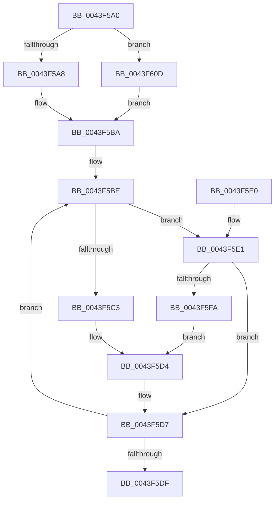

# MiUpdatePageMoveInProgressInternal

- RVA: `0x0043F5A0`–`0x0043F615` (길이 `117` bytes)
- VA: `0x000000014043F5A0`
- 실행 섹션: `.text`
- PDB 이름 있음: `예`; PDB Function 태그: `아니요`
- unwind 정보 RVA: `0x000DB714`
- 디코드: `32`개 명령, `117/117` bytes 표시
- 미해석 바이트: `0` (있으면 어셈블리에 `.byte`로 보존)

> 이 문서는 커널 이미지의 기계어와 PDB 기호를 분석해 생성했습니다. 4번과 5번은 함수 원형과 자료형을 바이너리 사용 방식에서 추정한 C 해석이며 원본 소스 복구 결과는 아닙니다.

## 1. Dependencies

- 직접 호출 지점: **0**; 고유 호출 대상: **0**
- 직접 호출자로 확인된 함수: **4**
- RIP 상대 이미지 참조: **0**

### Outgoing calls
- 직접 디코드된 call 명령이 없습니다.

### Direct callers
- [MiPurgeZeroListHead](../4C/MiPurgeZeroListHead_function_004CE464.md) at `0x004CE4DD`
- [MiPurgeZeroListHead](../4C/MiPurgeZeroListHead_function_004CE464.md) at `0x004CE591`
- [MiPurgeZeroListHead](../4C/MiPurgeZeroListHead_function_004CE464.md) at `0x004CE5E3`
- [MiHugePurgeZeroList](../67/MiHugePurgeZeroList_function_00676124.md) at `0x0067621C`
- [MiHugePurgeZeroList](../67/MiHugePurgeZeroList_function_00676124.md) at `0x006762F2`
- [MiHugePurgeZeroList](../67/MiHugePurgeZeroList_function_00676124.md) at `0x0067638F`
- [MiScrubLargePage](../69/MiScrubLargePage_function_006942E8.md) at `0x0069448F`
- [MiScrubLargePage](../69/MiScrubLargePage_function_006942E8.md) at `0x006944BA`
- [sub_006FA666](../6F/Unknown_function_006FA666.md) at `0x006FA68A`
- [sub_006FA666](../6F/Unknown_function_006FA666.md) at `0x006FA724`

### Static image references
- 디코드된 RIP-relative 메모리 참조가 없습니다.

## 2. Other-region calls and transfers

- 다른 실행 섹션으로 향하는 call: **0**
- 별도 외부 분기/꼬리 이동을 확인하지 못했습니다.

## 3. Assembly (complete function range)

```asm
0043F5A0  4C 8B D1                        mov r10, rcx
0043F5A3  45 85 C9                        test r9d, r9d
0043F5A6  75 65                           jne 0x14043f60d
0043F5A8  83 FA 02                        cmp edx, 2
0043F5AB  B8 60 3B 00 00                  mov eax, 0x3b60
0043F5B0  41 B9 58 3B 00 00               mov r9d, 0x3b58
0043F5B6  44 0F 42 C8                     cmovb r9d, eax
0043F5BA  49 8B 04 09                     mov rax, qword ptr [r9 + rcx]
0043F5BE  45 85 C0                        test r8d, r8d
0043F5C1  74 1E                           je 0x14043f5e1
0043F5C3  48 8D 50 01                     lea rdx, [rax + 1]
0043F5C7  48 8B CA                        mov rcx, rdx
0043F5CA  48 33 C8                        xor rcx, rax
0043F5CD  48 81 E1 00 00 FF FF            and rcx, 0xffffffffffff0000
0043F5D4  48 33 CA                        xor rcx, rdx
0043F5D7  F0 4B 0F B1 0C 11               lock cmpxchg qword ptr [r9 + r10], rcx
0043F5DD  75 DF                           jne 0x14043f5be
0043F5DF  C3                              ret
0043F5E0  CC                              int3
0043F5E1  48 8D 50 FF                     lea rdx, [rax - 1]
0043F5E5  48 8B CA                        mov rcx, rdx
0043F5E8  48 33 C8                        xor rcx, rax
0043F5EB  48 81 E1 00 00 FF FF            and rcx, 0xffffffffffff0000
0043F5F2  48 33 CA                        xor rcx, rdx
0043F5F5  66 85 C9                        test cx, cx
0043F5F8  75 DD                           jne 0x14043f5d7
0043F5FA  48 8D 91 00 00 01 00            lea rdx, [rcx + 0x10000]
0043F601  48 33 D1                        xor rdx, rcx
0043F604  48 81 E2 00 00 FF FF            and rdx, 0xffffffffffff0000
0043F60B  EB C7                           jmp 0x14043f5d4
0043F60D  41 B9 68 3B 00 00               mov r9d, 0x3b68
0043F613  EB A5                           jmp 0x14043f5ba
```

## 4. C-style interpretation (structured pseudocode)

```c
__int64 __fastcall MiUpdatePageMoveInProgressInternal(__int64 a1, int a2, int a3, int a4)
{
    if (a4 != 0) goto loc_0043F60D;
    a4 = (unsigned int)(0x3B58ULL);
    if (a2 < 2) { a4 = (unsigned int)((unsigned int)(0x3B60ULL)); }
loc_0043F5BA:
loc_0043F5BE:
    if (a3 == 0) goto loc_0043F5E1;
    a1 = (*(unsigned __int64 *)(a4 + a1 * 1) + 1) ^ (*(unsigned __int64 *)(a4 + a1 * 1));
    a1 = (a1) & (0xFFFFFFFFFFFF0000ULL);
loc_0043F5D4:
    a1 = (a1) ^ (*(unsigned __int64 *)(a4 + a1 * 1) + 1);
loc_0043F5D7:
    if (condition_is_not_equal) goto loc_0043F5BE;
    return *(unsigned __int64 *)(a4 + a1 * 1);
loc_0043F5E1:
    a1 = (*(unsigned __int64 *)(a4 + a1 * 1) - 1) ^ (*(unsigned __int64 *)(a4 + a1 * 1));
    a1 = (a1) & (0xFFFFFFFFFFFF0000ULL);
    a1 = (a1) ^ (*(unsigned __int64 *)(a4 + a1 * 1) - 1);
    if ((unsigned __int16)(a1) != 0) goto loc_0043F5D7;
    a2 = (a1 + 65536) ^ (a1);
    a2 = (a2) & (0xFFFFFFFFFFFF0000ULL);
    goto loc_0043F5D4;
loc_0043F60D:
    goto loc_0043F5BA;
}
```

## 5. (Beta) C Style

```c
int64_t MiUpdatePageMoveInProgressInternal(int64_t Arg1, int32_t Arg2, int32_t Arg3, int32_t Arg4)
{
    if (Arg4 != 0) goto loc_0043F60D;
    Arg4 = (uint32_t)(0x3B58ULL);
    if (Arg2 < 2) { Arg4 = (uint32_t)((uint32_t)(0x3B60ULL)); }
loc_0043F5BA:
loc_0043F5BE:
    if (Arg3 == 0) goto loc_0043F5E1;
    Arg1 = (*(uint64_t *)(Arg4 + Arg1 * 1) + 1) ^ (*(uint64_t *)(Arg4 + Arg1 * 1));
    Arg1 = (Arg1) & (0xFFFFFFFFFFFF0000ULL);
loc_0043F5D4:
    Arg1 = (Arg1) ^ (*(uint64_t *)(Arg4 + Arg1 * 1) + 1);
loc_0043F5D7:
    if (condition_is_not_equal) goto loc_0043F5BE;
    return *(uint64_t *)(Arg4 + Arg1 * 1);
loc_0043F5E1:
    Arg1 = (*(uint64_t *)(Arg4 + Arg1 * 1) - 1) ^ (*(uint64_t *)(Arg4 + Arg1 * 1));
    Arg1 = (Arg1) & (0xFFFFFFFFFFFF0000ULL);
    Arg1 = (Arg1) ^ (*(uint64_t *)(Arg4 + Arg1 * 1) - 1);
    if ((uint16_t)(Arg1) != 0) goto loc_0043F5D7;
    Arg2 = (Arg1 + 65536) ^ (Arg1);
    Arg2 = (Arg2) & (0xFFFFFFFFFFFF0000ULL);
    goto loc_0043F5D4;
loc_0043F60D:
    goto loc_0043F5BA;
}
```

## 6. Execution-region graph

[열기: 2D/3D 그래프와 함수 탐색 컨트롤 패널](../../../control-panel.html?section=text&rva=0x0043F5A0&view=graph)

- 2D 그래프는 위에서 아래로 흐르고, 3D 그래프는 빈 공간을 드래그해 회전합니다. Shift+드래그는 이동, 휠은 확대·축소, 함수 노드 선택은 대상 보고서 이동입니다.

### Static fallback


