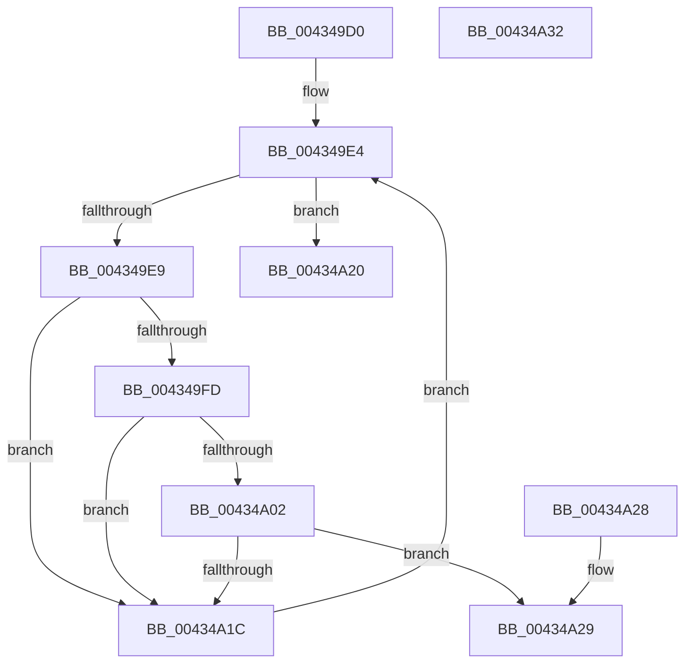

# MiVaIsPageFileHash

- RVA: `0x004349D0`–`0x00434A33` (길이 `99` bytes)
- VA: `0x00000001404349D0`
- 실행 섹션: `.text`
- PDB 이름 있음: `예`; PDB Function 태그: `아니요`
- unwind 정보 RVA: `0x000A2ACC`
- 디코드: `29`개 명령, `99/99` bytes 표시
- 미해석 바이트: `0` (있으면 어셈블리에 `.byte`로 보존)

> 이 문서는 커널 이미지의 기계어와 PDB 기호를 분석해 생성했습니다. 4번과 5번은 함수 원형과 자료형을 바이너리 사용 방식에서 추정한 C 해석이며 원본 소스 복구 결과는 아닙니다.

## 1. Dependencies

- 직접 호출 지점: **0**; 고유 호출 대상: **0**
- 직접 호출자로 확인된 함수: **1**
- RIP 상대 이미지 참조: **1**

### Outgoing calls
- 직접 디코드된 call 명령이 없습니다.

### Direct callers
- [MiStealPage](../2B/MiStealPage_function_002B28D0.md) at `0x002B3B78`
- [MiStealPage](../2B/MiStealPage_function_002B28D0.md) at `0x002B3BA4`

### Static image references
- `0x00434A06` → RVA `0x00E3738C` (`.data`; read)

## 2. Other-region calls and transfers

- 다른 실행 섹션으로 향하는 call: **0**
- 별도 외부 분기/꼬리 이동을 확인하지 못했습니다.

## 3. Assembly (complete function range)

```asm
004349D0  48 89 5C 24 08                  mov qword ptr [rsp + 8], rbx
004349D5  44 8B 89 58 48 00 00            mov r9d, dword ptr [rcx + 0x4858]
004349DC  48 8B DA                        mov rbx, rdx
004349DF  4C 8B D9                        mov r11, rcx
004349E2  33 C0                           xor eax, eax
004349E4  41 3B C1                        cmp eax, r9d
004349E7  73 37                           jae 0x140434a20
004349E9  4D 8B 94 C3 60 48 00 00         mov r10, qword ptr [r11 + rax*8 + 0x4860]
004349F1  49 8B 8A B8 00 00 00            mov rcx, qword ptr [r10 + 0xb8]
004349F8  48 85 C9                        test rcx, rcx
004349FB  74 1F                           je 0x140434a1c
004349FD  48 3B D9                        cmp rbx, rcx
00434A00  72 1A                           jb 0x140434a1c
00434A02  41 8B 4A 04                     mov ecx, dword ptr [r10 + 4]
00434A06  8B 15 80 29 A0 00               mov edx, dword ptr [rip + 0xa02980]
00434A0C  48 0F AF D1                     imul rdx, rcx
00434A10  49 03 92 B8 00 00 00            add rdx, qword ptr [r10 + 0xb8]
00434A17  48 3B DA                        cmp rbx, rdx
00434A1A  72 0D                           jb 0x140434a29
00434A1C  FF C0                           inc eax
00434A1E  EB C4                           jmp 0x1404349e4
00434A20  33 C0                           xor eax, eax
00434A22  48 8B 5C 24 08                  mov rbx, qword ptr [rsp + 8]
00434A27  C3                              ret
00434A28  CC                              int3
00434A29  48 8B 5C 24 08                  mov rbx, qword ptr [rsp + 8]
00434A2E  49 8B C2                        mov rax, r10
00434A31  C3                              ret
00434A32  CC                              int3
```

## 4. C-style interpretation (structured pseudocode)

```c
__int64 __fastcall MiVaIsPageFileHash(__int64 a1, __int64 a2)
{
    __int64 result;
    unsigned __int64 v_stack_p8;

    v_stack_p8 = v_rbx;
    result = 0;
loc_004349E4:
    if (0 >= ((unsigned int)((unsigned int)(*(unsigned int *)(a1 + 18520))))) goto loc_00434A20;
    if (*(unsigned __int64 *)(*(unsigned __int64 *)(a1 + result * 8 + 18528) + 184) == 0) goto loc_00434A1C;
    if (a2 < (*(unsigned __int64 *)(*(unsigned __int64 *)(a1 + result * 8 + 18528) + 184))) goto loc_00434A1C;
    a2 = ((unsigned int)(*(unsigned int *)(v_rip + 10496384))) * ((unsigned int)(*(unsigned int *)(*(unsigned __int64 *)(a1 + result * 8 + 18528) + 4)));
    a2 = (a2) + (*(unsigned __int64 *)(*(unsigned __int64 *)(a1 + result * 8 + 18528) + 184));
    if (a2 < a2) goto loc_00434A29;
loc_00434A1C:
    result = (unsigned int)((result) + 1);
    goto loc_004349E4;
loc_00434A20:
    result = 0;
    return result;
loc_00434A29:
    return *(unsigned __int64 *)(a1 + result * 8 + 18528);
}
```

## 5. (Beta) C Style

```c
int64_t MiVaIsPageFileHash(void *Arg1, int64_t Arg2)
{
    uint8_t *arg1 = (uint8_t *)Arg1;

    int64_t result;
    uint64_t v_stack_p8;

    v_stack_p8 = local_rbx;
    result = 0;
loc_004349E4:
    if (0 >= ((uint32_t)((uint32_t)(*(uint32_t *)(arg1 + 0x4858))))) goto loc_00434A20;
    if (*(uint64_t *)(*(uint64_t *)(arg1 + result * 8 + 0x4860) + 0xB8) == 0) goto loc_00434A1C;
    if (Arg2 < (*(uint64_t *)(*(uint64_t *)(arg1 + result * 8 + 0x4860) + 0xB8))) goto loc_00434A1C;
    Arg2 = ((uint32_t)(*(uint32_t *)(v_rip + 0xA02980))) * ((uint32_t)(*(uint32_t *)(*(uint64_t *)(arg1 + result * 8 + 0x4860) + 0x4)));
    Arg2 = (Arg2) + (*(uint64_t *)(*(uint64_t *)(arg1 + result * 8 + 0x4860) + 0xB8));
    if (Arg2 < Arg2) goto loc_00434A29;
loc_00434A1C:
    result = (uint32_t)((result) + 1);
    goto loc_004349E4;
loc_00434A20:
    result = 0;
    return result;
loc_00434A29:
    return *(uint64_t *)(arg1 + result * 8 + 0x4860);
}
```

### 관측된 메모리 오프셋

구조체 형식이 확인되지 않은 접근은 인자 기준의 오프셋으로만 기록했습니다.

| 기준 인자 | 오프셋 표현 | 폭 (bit) | 접근 |
|---|---:|---:|---|
| `Arg1` | `+ 0x4858` | `32` | `R` |
| `Arg1` | `+ 0x4860 + rax*8` | `64` | `R` |

## 6. Execution-region graph

[열기: 2D/3D 그래프와 함수 탐색 컨트롤 패널](../../../control-panel.html?section=text&rva=0x004349D0&view=graph)

- 2D 그래프는 위에서 아래로 흐르고, 3D 그래프는 빈 공간을 드래그해 회전합니다. Shift+드래그는 이동, 휠은 확대·축소, 함수 노드 선택은 대상 보고서 이동입니다.

### Static fallback


