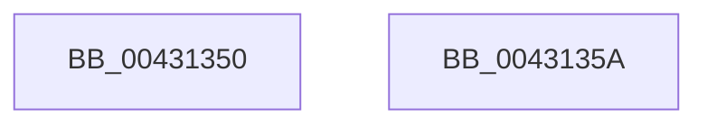

# MiVadDeleted

- RVA: `0x00431350`–`0x0043135B` (길이 `11` bytes)
- VA: `0x0000000140431350`
- 실행 섹션: `.text`
- PDB 이름 있음: `예`; PDB Function 태그: `아니요`
- unwind 정보 RVA: `0x000DB714`
- 디코드: `5`개 명령, `11/11` bytes 표시
- 미해석 바이트: `0` (있으면 어셈블리에 `.byte`로 보존)

> 이 문서는 커널 이미지의 기계어와 PDB 기호를 분석해 생성했습니다. 4번과 5번은 함수 원형과 자료형을 바이너리 사용 방식에서 추정한 C 해석이며 원본 소스 복구 결과는 아닙니다.

## 1. Dependencies

- 직접 호출 지점: **0**; 고유 호출 대상: **0**
- 직접 호출자로 확인된 함수: **19**
- RIP 상대 이미지 참조: **0**

### Outgoing calls
- 직접 디코드된 call 명령이 없습니다.

### Direct callers
- [MiGetVadForHotPatchInProgress](../../page/80/MiGetVadForHotPatchInProgress_function_008039C4.md) at `0x00803A1C`
- [MiHotPatchProcess](../../page/80/MiHotPatchProcess_function_00803B78.md) at `0x00803C17`
- [MiHotPatchProcess](../../page/80/MiHotPatchProcess_function_00803B78.md) at `0x00803D2F`
- [MiPrepareToHotPatchVad](../../page/80/MiPrepareToHotPatchVad_function_00806E70.md) at `0x00806EA1`
- [MiProcessPatchImageCfg](../../page/80/MiProcessPatchImageCfg_function_00806F9C.md) at `0x00807083`
- [NtAreMappedFilesTheSame](../../page/87/NtAreMappedFilesTheSame_function_0087EC70.md) at `0x0087ED49`
- [NtAreMappedFilesTheSame](../../page/87/NtAreMappedFilesTheSame_function_0087EC70.md) at `0x0087ED59`
- [MiLockVadRange](../../page/87/MiLockVadRange_function_0087F670.md) at `0x0087F76D`
- [MiLockVadRange](../../page/87/MiLockVadRange_function_0087F670.md) at `0x0087F8E0`
- [MiCommitFileBackedSection](../../page/88/MiCommitFileBackedSection_function_00882238.md) at `0x00882376`
- [MiCleanVad](../../page/88/MiCleanVad_function_00889224.md) at `0x00889233`
- [MiMarkSharedImageCfgBits](../../page/8D/MiMarkSharedImageCfgBits_function_008D0CC4.md) at `0x008D0DB7`
- [MiPopulateCfgBitMap](../../page/8D/MiPopulateCfgBitMap_function_008D0FA4.md) at `0x008D1067`
- [MmIsFileMapped](../../page/91/MmIsFileMapped_function_0091D8D4.md) at `0x0091D9BF`
- [MmEnumerateAddressSpaceAndReferenceImages](../../page/97/MmEnumerateAddressSpaceAndReferenceImages_function_0097DD50.md) at `0x0097DE74`
- [MiAllocateFromSubAllocatedRegion](../../page/98/MiAllocateFromSubAllocatedRegion_function_00981C24.md) at `0x00981D6F`
- [sub_009E5A2C](../../page/9E/Unknown_function_009E5A2C.md) at `0x009E5B42`
- [sub_009E5A2C](../../page/9E/Unknown_function_009E5A2C.md) at `0x009E5BB3`
- [MmCleanProcessAddressSpace](../../page/A1/MmCleanProcessAddressSpace_function_00A17EC0.md) at `0x00A17FE6`
- [MiPrepareVadDelete](../../page/A2/MiPrepareVadDelete_function_00A25E98.md) at `0x00A25F4C`
- [MiQuerySingleLoadedPatch](../../page/A4/MiQuerySingleLoadedPatch_function_00A41EB0.md) at `0x00A41F2F`
- [MiLoadSectionIntoVsmEnclave](../../page/AB/MiLoadSectionIntoVsmEnclave_function_00AB1D4C.md) at `0x00AB1E77`
- [sub_00B44B9C](../../page/B4/Unknown_function_00B44B9C.md) at `0x00B44BA7`

### Static image references
- 디코드된 RIP-relative 메모리 참조가 없습니다.

## 2. Other-region calls and transfers

- 다른 실행 섹션으로 향하는 call: **0**
- 별도 외부 분기/꼬리 이동을 확인하지 못했습니다.

## 3. Assembly (complete function range)

```asm
00431350  8B 41 30                        mov eax, dword ptr [rcx + 0x30]
00431353  C1 E8 02                        shr eax, 2
00431356  83 E0 01                        and eax, 1
00431359  C3                              ret
0043135A  CC                              int3
```

## 4. C-style interpretation (structured pseudocode)

```c
__int64 __fastcall MiVadDeleted(__int64 a1)
{
    __int64 result;

    result = (unsigned int)(((unsigned int)(*(unsigned int *)(a1 + 48))) >> (2));
    result = (unsigned int)((result) & (1));
    return result;
}
```

## 5. (Beta) C Style

```c
int64_t MiVadDeleted(void *Arg1)
{
    uint8_t *arg1 = (uint8_t *)Arg1;

    int64_t result;

    result = (uint32_t)(((uint32_t)(*(uint32_t *)(arg1 + 0x30))) >> (2));
    result = (uint32_t)((result) & (1));
    return result;
}
```

### 관측된 메모리 오프셋

구조체 형식이 확인되지 않은 접근은 인자 기준의 오프셋으로만 기록했습니다.

| 기준 인자 | 오프셋 표현 | 폭 (bit) | 접근 |
|---|---:|---:|---|
| `Arg1` | `+ 0x30` | `32` | `R` |

## 6. Execution-region graph

[열기: 2D/3D 그래프와 함수 탐색 컨트롤 패널](../../../control-panel.html?section=text&rva=0x00431350&view=graph)

- 2D 그래프는 위에서 아래로 흐르고, 3D 그래프는 빈 공간을 드래그해 회전합니다. Shift+드래그는 이동, 휠은 확대·축소, 함수 노드 선택은 대상 보고서 이동입니다.

### Static fallback


