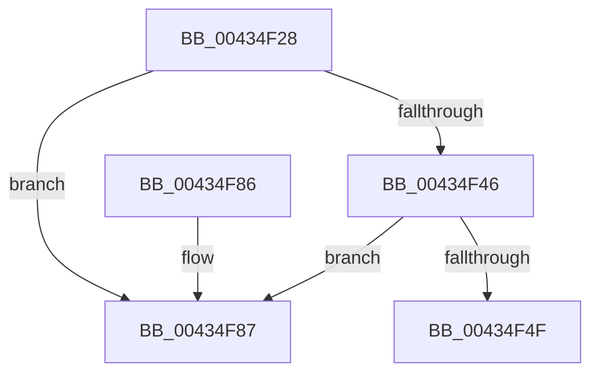

# MiZeroVaToActiveEntry

- RVA: `0x00434F28`–`0x00434F9F` (길이 `119` bytes)
- VA: `0x0000000140434F28`
- 실행 섹션: `.text`
- PDB 이름 있음: `예`; PDB Function 태그: `아니요`
- unwind 정보 RVA: `0x00076F28`
- 디코드: `32`개 명령, `119/119` bytes 표시
- 미해석 바이트: `0` (있으면 어셈블리에 `.byte`로 보존)

> 이 문서는 커널 이미지의 기계어와 PDB 기호를 분석해 생성했습니다. 4번과 5번은 함수 원형과 자료형을 바이너리 사용 방식에서 추정한 C 해석이며 원본 소스 복구 결과는 아닙니다.

## 1. Dependencies

- 직접 호출 지점: **3**; 고유 호출 대상: **2**
- 직접 호출자로 확인된 함수: **2**
- RIP 상대 이미지 참조: **1**

### Outgoing calls
- `0x00434F32` → [MiGetZeroingContext](MiGetZeroingContext_function_00434FB0.md) (function, `0x00434FB0`)
- `0x00434F52` → [MiGetZeroingContext](MiGetZeroingContext_function_00434FB0.md) (function, `0x00434FB0`)
- `0x00434F99` → [KeBugCheckEx](../4F/KeBugCheckEx_function_004FD660.md) (function, `0x004FD660`)

### Direct callers
- [MiTryZeroMemory](../31/MiTryZeroMemory_function_0031E720.md) at `0x0031E8EB`
- [MiGetZeroExceptionInfo](MiGetZeroExceptionInfo_function_00434EA8.md) at `0x00434EDD`

### Static image references
- `0x00434F5A` → RVA `0x00011C60` (`.rdata`; read)

## 2. Other-region calls and transfers

- 다른 실행 섹션으로 향하는 call: **0**
- 별도 외부 분기/꼬리 이동을 확인하지 못했습니다.

## 3. Assembly (complete function range)

```asm
00434F28  48 83 EC 38                     sub rsp, 0x38
00434F2C  4C 8B CA                        mov r9, rdx
00434F2F  4C 8B C1                        mov r8, rcx
00434F32  E8 79 00 00 00                  call 0x140434fb0
00434F37  4C 8B D0                        mov r10, rax
00434F3A  48 8B 90 28 01 00 00            mov rdx, qword ptr [rax + 0x128]
00434F41  4C 3B CA                        cmp r9, rdx
00434F44  72 41                           jb 0x140434f87
00434F46  4C 3B 88 30 01 00 00            cmp r9, qword ptr [rax + 0x130]
00434F4D  77 38                           ja 0x140434f87
00434F4F  49 8B C8                        mov rcx, r8
00434F52  E8 59 00 00 00                  call 0x140434fb0
00434F57  4C 2B CA                        sub r9, rdx
00434F5A  4C 8D 05 FF CC BD FF            lea r8, [rip - 0x423301]
00434F61  33 D2                           xor edx, edx
00434F63  8B 88 40 01 00 00               mov ecx, dword ptr [rax + 0x140]
00434F69  49 8B C1                        mov rax, r9
00434F6C  4D 8B 04 C8                     mov r8, qword ptr [r8 + rcx*8]
00434F70  49 C1 E0 0C                     shl r8, 0xc
00434F74  49 F7 F0                        div r8
00434F77  8B C0                           mov eax, eax
00434F79  48 83 C0 03                     add rax, 3
00434F7D  49 8D 04 C2                     lea rax, [r10 + rax*8]
00434F81  48 83 C4 38                     add rsp, 0x38
00434F85  C3                              ret
00434F86  CC                              int3
00434F87  4C 89 4C 24 20                  mov qword ptr [rsp + 0x20], r9
00434F8C  BA 02 61 00 00                  mov edx, 0x6102
00434F91  4D 8B CA                        mov r9, r10
00434F94  B9 1A 00 00 00                  mov ecx, 0x1a
00434F99  E8 C2 86 0C 00                  call 0x1404fd660
00434F9E  CC                              int3
```

## 4. C-style interpretation (structured pseudocode)

```c
__int64 __fastcall MiZeroVaToActiveEntry(__int64 a1, __int64 a2)
{
    __int64 result;
    __int64 v_rsp;
    unsigned __int64 v_stack_p20;

    v_rsp = (v_rsp) - (56);
    result = MiGetZeroingContext(a1, a2, a1, a2);
    if (a2 < (*(unsigned __int64 *)(result + 296))) goto loc_00434F87;
    if (a2 > (*(unsigned __int64 *)(result + 304))) goto loc_00434F87;
    result = MiGetZeroingContext(a1, *(unsigned __int64 *)(result + 296), a1, a2);
    a4 = (a2) - (*(unsigned __int64 *)(result + 296));
    a2 = 0;
    a3 = (*(unsigned __int64 *)(v_rip - 4338433 + (unsigned int)(*(unsigned int *)(result + 320)) * 8)) << (12);
    result = ((unsigned int)((unsigned int)(a4))) + (3);
    v_rsp = (v_rsp) + (56);
    return result + result * 8;
loc_00434F87:
    v_stack_p20 = a4;
    result = KeBugCheckEx(26, (unsigned int)(0x6102ULL), a3, result);
    return result;
}
```

## 5. (Beta) C Style

```c
int64_t MiZeroVaToActiveEntry(int64_t Arg1, int64_t Arg2)
{
    int64_t result;
    int64_t local_rsp;
    uint64_t v_stack_p20;

    local_rsp = (local_rsp) - (56);
    result = MiGetZeroingContext(Arg1, Arg2, Arg1, Arg2);
    if (Arg2 < (*(uint64_t *)(result + 0x128))) goto loc_00434F87;
    if (Arg2 > (*(uint64_t *)(result + 0x130))) goto loc_00434F87;
    result = MiGetZeroingContext(Arg1, *(uint64_t *)(result + 0x128), Arg1, Arg2);
    a4 = (Arg2) - (*(uint64_t *)(result + 0x128));
    Arg2 = 0;
    a3 = (*(uint64_t *)(v_rip - 0x423301 + (uint32_t)(*(uint32_t *)(result + 0x140)) * 8)) << (12);
    result = ((uint32_t)((uint32_t)(a4))) + (3);
    local_rsp = (local_rsp) + (56);
    return result + result * 8;
loc_00434F87:
    v_stack_p20 = a4;
    result = KeBugCheckEx(26, (uint32_t)(0x6102ULL), a3, result);
    return result;
}
```

## 6. Execution-region graph

[열기: 2D/3D 그래프와 함수 탐색 컨트롤 패널](../../../control-panel.html?section=text&rva=0x00434F28&view=graph)

- 2D 그래프는 위에서 아래로 흐르고, 3D 그래프는 빈 공간을 드래그해 회전합니다. Shift+드래그는 이동, 휠은 확대·축소, 함수 노드 선택은 대상 보고서 이동입니다.

### Static fallback


