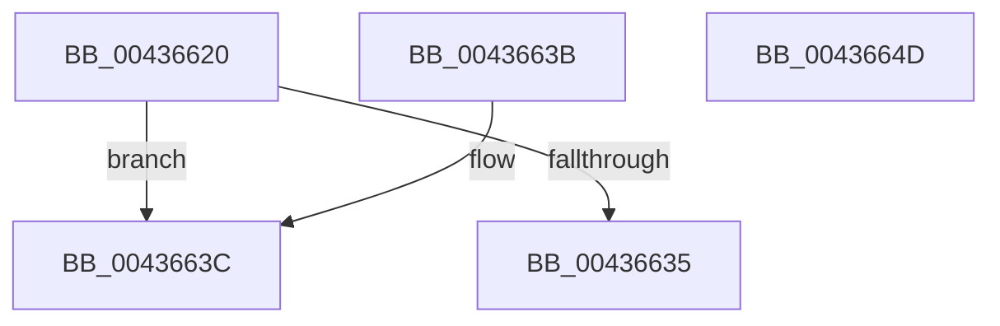

# MmGetNextNode

- RVA: `0x00436620`–`0x0043664E` (길이 `46` bytes)
- VA: `0x0000000140436620`
- 실행 섹션: `.text`
- PDB 이름 있음: `예`; PDB Function 태그: `아니요`
- unwind 정보 RVA: `0x000DB714`
- 디코드: `15`개 명령, `46/46` bytes 표시
- 미해석 바이트: `0` (있으면 어셈블리에 `.byte`로 보존)

> 이 문서는 커널 이미지의 기계어와 PDB 기호를 분석해 생성했습니다. 4번과 5번은 함수 원형과 자료형을 바이너리 사용 방식에서 추정한 C 해석이며 원본 소스 복구 결과는 아닙니다.

## 1. Dependencies

- 직접 호출 지점: **0**; 고유 호출 대상: **0**
- 직접 호출자로 확인된 함수: **6**
- RIP 상대 이미지 참조: **2**

### Outgoing calls
- 직접 디코드된 call 명령이 없습니다.

### Direct callers
- [PoAllProcessorsDeepIdle](../5C/PoAllProcessorsDeepIdle_function_005CF1C4.md) at `0x005CF289`
- [SMKM_STORE_MGR&lt;SM_TRAITS&gt;::SmCompressManagerUpdateTopology](../60/SMKM_STORE_MGR_SM_TRAITS_SmCompressManagerUpdateTopology_function_0060C634.md) at `0x0060C6EA`
- [ExpEnumerateNextActiveWorkSubQueue](../65/ExpEnumerateNextActiveWorkSubQueue_function_0065A3B4.md) at `0x0065A3EE`
- [sub_006D969C](../6D/Unknown_function_006D969C.md) at `0x006D974D`
- [MmAllocateMemoryRanges](../../page/7F/MmAllocateMemoryRanges_function_007FC0C0.md) at `0x007FC1F9`
- [KeInitializeProcess](../../page/A6/KeInitializeProcess_function_00A63CF4.md) at `0x00A640F1`

### Static image references
- `0x00436623` → RVA `0x00FC5000` (`ALMOSTRO`; read)
- `0x0043663F` → RVA `0x00E2DBD0` (`.data`; read)

## 2. Other-region calls and transfers

- 다른 실행 섹션으로 향하는 call: **0**
- 별도 외부 분기/꼬리 이동을 확인하지 못했습니다.

## 3. Assembly (complete function range)

```asm
00436620  44 8B 02                        mov r8d, dword ptr [rdx]
00436623  0F B7 05 D6 E9 B8 00            movzx eax, word ptr [rip + 0xb8e9d6]
0043662A  41 FF C0                        inc r8d
0043662D  44 89 02                        mov dword ptr [rdx], r8d
00436630  44 3B C0                        cmp r8d, eax
00436633  75 07                           jne 0x14043663c
00436635  B8 FF FF FF FF                  mov eax, 0xffffffff
0043663A  C3                              ret
0043663B  CC                              int3
0043663C  0F AF C8                        imul ecx, eax
0043663F  48 8B 05 8A 75 9F 00            mov rax, qword ptr [rip + 0x9f758a]
00436646  41 03 C8                        add ecx, r8d
00436649  8B 04 88                        mov eax, dword ptr [rax + rcx*4]
0043664C  C3                              ret
0043664D  CC                              int3
```

## 4. C-style interpretation (structured pseudocode)

```c
__int64 __fastcall MmGetNextNode(int a1, __int64 a2)
{
    a3 = (unsigned int)(((unsigned int)(*(unsigned int *)(a2))) + 1);
    *(unsigned int *)(a2) = (unsigned int)(a3);
    if (((unsigned int)(a3)) != ((unsigned int)(*(unsigned __int16 *)(v_rip + 12118486)))) goto loc_0043663C;
    return (unsigned int)(0xFFFFFFFFULL);
loc_0043663C:
    a1 = (unsigned int)((a1) * ((unsigned int)((unsigned int)(0xFFFFFFFFULL))));
    a1 = (unsigned int)((a1) + ((unsigned int)(a3)));
    return (unsigned int)(*(unsigned int *)(*(unsigned __int64 *)(v_rip + 10450314) + a1 * 4));
}
```

## 5. (Beta) C Style

```c
int64_t MmGetNextNode(int32_t Arg1, void *Arg2)
{
    uint8_t *arg2 = (uint8_t *)Arg2;

    a3 = (uint32_t)(((uint32_t)(*(uint32_t *)(arg2))) + 1);
    *(uint32_t *)(arg2) = (uint32_t)(a3);
    if (((uint32_t)(a3)) != ((uint32_t)(*(uint16_t *)(v_rip + 0xB8E9D6)))) goto loc_0043663C;
    return (uint32_t)(0xFFFFFFFFULL);
loc_0043663C:
    Arg1 = (uint32_t)((Arg1) * ((uint32_t)((uint32_t)(0xFFFFFFFFULL))));
    Arg1 = (uint32_t)((Arg1) + ((uint32_t)(a3)));
    return (uint32_t)(*(uint32_t *)(*(uint64_t *)(v_rip + 0x9F758A) + Arg1 * 4));
}
```

### 관측된 메모리 오프셋

구조체 형식이 확인되지 않은 접근은 인자 기준의 오프셋으로만 기록했습니다.

| 기준 인자 | 오프셋 표현 | 폭 (bit) | 접근 |
|---|---:|---:|---|
| `Arg2` | `+ 0x0` | `32` | `R` |
| `Arg2` | `+ 0x0` | `32` | `W` |

## 6. Execution-region graph

[열기: 2D/3D 그래프와 함수 탐색 컨트롤 패널](../../../control-panel.html?section=text&rva=0x00436620&view=graph)

- 2D 그래프는 위에서 아래로 흐르고, 3D 그래프는 빈 공간을 드래그해 회전합니다. Shift+드래그는 이동, 휠은 확대·축소, 함수 노드 선택은 대상 보고서 이동입니다.

### Static fallback


