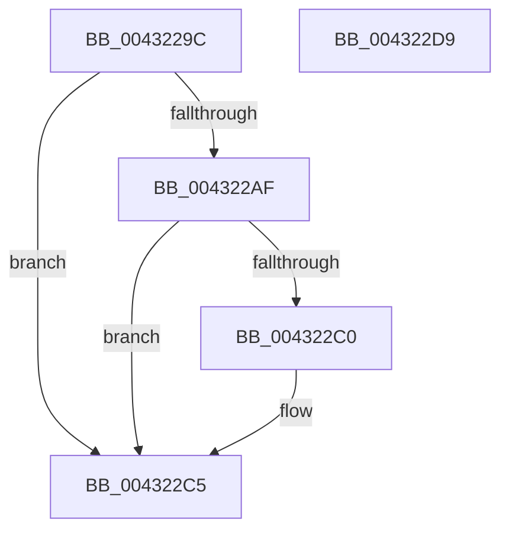

# MmLockLoadedModuleListExclusive

- RVA: `0x0043229C`–`0x004322DA` (길이 `62` bytes)
- VA: `0x000000014043229C`
- 실행 섹션: `.text`
- PDB 이름 있음: `예`; PDB Function 태그: `아니요`
- unwind 정보 RVA: `0x0005CF00`
- 디코드: `18`개 명령, `62/62` bytes 표시
- 미해석 바이트: `0` (있으면 어셈블리에 `.byte`로 보존)

> 이 문서는 커널 이미지의 기계어와 PDB 기호를 분석해 생성했습니다. 4번과 5번은 함수 원형과 자료형을 바이너리 사용 방식에서 추정한 C 해석이며 원본 소스 복구 결과는 아닙니다.

## 1. Dependencies

- 직접 호출 지점: **2**; 고유 호출 대상: **2**
- 직접 호출자로 확인된 함수: **5**
- RIP 상대 이미지 참조: **2**

### Outgoing calls
- `0x004322C0` → [KiRaiseIrqlProcessIrqlFlags](../4F/KiRaiseIrqlProcessIrqlFlags_function_004F56FC.md) (function, `0x004F56FC`)
- `0x004322CC` → [ExAcquireSpinLockExclusiveAtDpcLevel](../24/ExAcquireSpinLockExclusiveAtDpcLevel_function_00248E80.md) (function, `0x00248E80`)

### Direct callers
- [MiUpdateDriverLoadInProgress](MiUpdateDriverLoadInProgress_function_004318DC.md) at `0x00431913`
- [MiUpdateDriverLoadInProgress](MiUpdateDriverLoadInProgress_function_004318DC.md) at `0x00431920`
- [RtlRemoveInvertedFunctionTable](RtlRemoveInvertedFunctionTable_function_004320E8.md) at `0x004320F5`
- [RtlInsertInvertedFunctionTable](RtlInsertInvertedFunctionTable_function_00432138.md) at `0x00432174`
- [MiRemoveLoaderEntry](../67/MiRemoveLoaderEntry_function_006713C8.md) at `0x006713EB`
- [sub_006F88AE](../6F/Unknown_function_006F88AE.md) at `0x006F8D12`

### Static image references
- `0x004322B7` → RVA `0x00FC6D20` (`ALMOSTRO`; read)
- `0x004322C5` → RVA `0x00FCF200` (`CACHEALI`; read)

## 2. Other-region calls and transfers

- 다른 실행 섹션으로 향하는 call: **0**
- 별도 외부 분기/꼬리 이동을 확인하지 못했습니다.

## 3. Assembly (complete function range)

```asm
0043229C  40 53                           push rbx
0043229E  48 83 EC 20                     sub rsp, 0x20
004322A2  44 0F 20 C3                     mov rbx, cr8
004322A6  BA 0F 00 00 00                  mov edx, 0xf
004322AB  3A DA                           cmp bl, dl
004322AD  73 16                           jae 0x1404322c5
004322AF  44 0F 20 C1                     mov rcx, cr8
004322B3  44 0F 22 C2                     mov cr8, rdx
004322B7  83 3D 62 4A B9 00 00            cmp dword ptr [rip + 0xb94a62], 0
004322BE  74 05                           je 0x1404322c5
004322C0  E8 37 34 0C 00                  call 0x1404f56fc
004322C5  48 8D 0D 34 CF B9 00            lea rcx, [rip + 0xb9cf34]
004322CC  E8 AF 6B E1 FF                  call 0x140248e80
004322D1  8A C3                           mov al, bl
004322D3  48 83 C4 20                     add rsp, 0x20
004322D7  5B                              pop rbx
004322D8  C3                              ret
004322D9  CC                              int3
```

## 4. C-style interpretation (structured pseudocode)

```c
__int64 __fastcall MmLockLoadedModuleListExclusive(void)
{
    __int64 result;
    __int64 v_rsp;

    v_rsp = (v_rsp) - (32);
    if (((unsigned __int8)(v_cr8)) >= 15) goto loc_004322C5;
    if ((*(unsigned int *)(v_rip + 12143202)) != 0) {
        result = KiRaiseIrqlProcessIrqlFlags(v_cr8, 15, a3, a4);
    }
    result = ExAcquireSpinLockExclusiveAtDpcLevel(v_rip + 12177204, 15, a3, a4);
    v_rsp = (v_rsp) + (32);
    return (unsigned __int8)(v_cr8);
}
```

## 5. (Beta) C Style

```c
void MmLockLoadedModuleListExclusive(void)
{
    int64_t result;
    int64_t local_rsp;

    local_rsp = (local_rsp) - (32);
    if (((uint8_t)(v_cr8)) >= 15) goto loc_004322C5;
    if ((*(uint32_t *)(v_rip + 0xB94A62)) != 0) {
        result = KiRaiseIrqlProcessIrqlFlags(v_cr8, 15, a3, a4);
    }
    result = ExAcquireSpinLockExclusiveAtDpcLevel(v_rip + 12177204, 15, a3, a4);
    local_rsp = (local_rsp) + (32);
    return (uint8_t)(v_cr8);
}
```

## 6. Execution-region graph

[열기: 2D/3D 그래프와 함수 탐색 컨트롤 패널](../../../control-panel.html?section=text&rva=0x0043229C&view=graph)

- 2D 그래프는 위에서 아래로 흐르고, 3D 그래프는 빈 공간을 드래그해 회전합니다. Shift+드래그는 이동, 휠은 확대·축소, 함수 노드 선택은 대상 보고서 이동입니다.

### Static fallback


