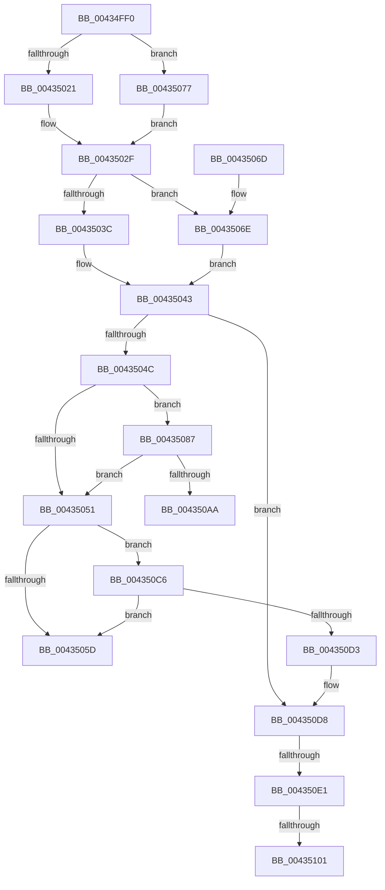

# MmResourcesAvailable

- RVA: `0x00434FF0`–`0x00435111` (길이 `289` bytes)
- VA: `0x0000000140434FF0`
- 실행 섹션: `.text`
- PDB 이름 있음: `예`; PDB Function 태그: `예`
- unwind 정보 RVA: `0x000A2B8C`
- 디코드: `70`개 명령, `289/289` bytes 표시
- 미해석 바이트: `0` (있으면 어셈블리에 `.byte`로 보존)

> 이 문서는 커널 이미지의 기계어와 PDB 기호를 분석해 생성했습니다. 4번과 5번은 함수 원형과 자료형을 바이너리 사용 방식에서 추정한 C 해석이며 원본 소스 복구 결과는 아닙니다.

## 1. Dependencies

- 직접 호출 지점: **3**; 고유 호출 대상: **3**
- 직접 호출자로 확인된 함수: **1**
- RIP 상대 이미지 참조: **10**

### Outgoing calls
- `0x004350BB` → [MiIssuePageExtendRequest](../47/MiIssuePageExtendRequest_function_004752F4.md) (function, `0x004752F4`)
- `0x004350E8` → [ExAcquireSpinLockExclusive](../24/ExAcquireSpinLockExclusive_function_00248690.md) (function, `0x00248690`)
- `0x00435106` → [KePulseEvent](../35/KePulseEvent_function_00351EF0.md) (function, `0x00351EF0`)

### Direct callers
- [ExAllocatePool3](../../poolcode/B8/ExAllocatePool3_function_00B84270.md) at `0x00B84325`

### Static image references
- `0x00435021` → RVA `0x00E2CB48` (`.data`; read)
- `0x00435028` → RVA `0x00E2CB40` (`.data`; read)
- `0x00435077` → RVA `0x00E37650` (`.data`; read)
- `0x0043507E` → RVA `0x00E37660` (`.data`; read)
- `0x00435087` → RVA `0x00E3CEC8` (`.data`; read)
- `0x00435091` → RVA `0x00E3D840` (`.data`; read)
- `0x004350AD` → RVA `0x00E38D00` (`.data`; read)
- `0x004350C6` → RVA `0x00E3D550` (`.data`; read)
- `0x004350E1` → RVA `0x00E3CC40` (`.data`; read)
- `0x004350ED` → RVA `0x00E38E08` (`.data`; read)

## 2. Other-region calls and transfers

- 다른 실행 섹션으로 향하는 call: **0**
- call이 아닌 외부 분기/꼬리 이동: **4**
  - `0x004350C1` → [sub_006EECC0 + 0x14](../6E/Unknown_function_006EECC0.md) (`tail-transfer`)
  - `0x004350DB` → [sub_006EECC0 + 0x14](../6E/Unknown_function_006EECC0.md) (`tail-transfer`)
  - `0x004350FB` → [sub_006EECC0](../6E/Unknown_function_006EECC0.md) (`tail-transfer`)
  - `0x0043510C` → [sub_006EECC0](../6E/Unknown_function_006EECC0.md) (`tail-transfer`)

## 3. Assembly (complete function range)

```asm
00434FF0  48 89 5C 24 10                  mov qword ptr [rsp + 0x10], rbx
00434FF5  57                              push rdi
00434FF6  48 83 EC 20                     sub rsp, 0x20
00434FFA  48 F7 C2 FF 0F 00 00            test rdx, 0xfff
00435001  BF 00 00 00 00                  mov edi, 0
00435006  8B DF                           mov ebx, edi
00435008  48 8B C2                        mov rax, rdx
0043500B  0F 95 C3                        setne bl
0043500E  4C 8B D9                        mov r11, rcx
00435011  48 C1 E8 0C                     shr rax, 0xc
00435015  48 03 D8                        add rbx, rax
00435018  41 81 E3 00 01 00 00            and r11d, 0x100
0043501F  75 56                           jne 0x140435077
00435021  48 8B 0D 20 7B 9F 00            mov rcx, qword ptr [rip + 0x9f7b20]
00435028  48 8B 05 11 7B 9F 00            mov rax, qword ptr [rip + 0x9f7b11]
0043502F  48 2B C1                        sub rax, rcx
00435032  48 C1 E0 0C                     shl rax, 0xc
00435036  41 83 F8 10                     cmp r8d, 0x10
0043503A  74 32                           je 0x14043506e
0043503C  48 8D 8A 00 00 20 00            lea rcx, [rdx + 0x200000]
00435043  48 3B C8                        cmp rcx, rax
00435046  0F 87 8C 00 00 00               ja 0x1404350d8
0043504C  4D 85 DB                        test r11, r11
0043504F  75 36                           jne 0x140435087
00435051  48 8D 8A 00 00 A0 00            lea rcx, [rdx + 0xa00000]
00435058  48 3B C8                        cmp rcx, rax
0043505B  73 69                           jae 0x1404350c6
0043505D  B8 01 00 00 00                  mov eax, 1
00435062  48 8B 5C 24 38                  mov rbx, qword ptr [rsp + 0x38]
00435067  48 83 C4 20                     add rsp, 0x20
0043506B  5F                              pop rdi
0043506C  C3                              ret
0043506D  CC                              int3
0043506E  48 8D 8A 00 00 08 00            lea rcx, [rdx + 0x80000]
00435075  EB CC                           jmp 0x140435043
00435077  48 8B 0D D2 25 A0 00            mov rcx, qword ptr [rip + 0xa025d2]
0043507E  48 8B 05 DB 25 A0 00            mov rax, qword ptr [rip + 0xa025db]
00435085  EB A8                           jmp 0x14043502f
00435087  4C 8B 15 3A 7E A0 00            mov r10, qword ptr [rip + 0xa07e3a]
0043508E  48 8B CF                        mov rcx, rdi
00435091  4C 8B 0D A8 87 A0 00            mov r9, qword ptr [rip + 0xa087a8]
00435098  4D 8B C2                        mov r8, r10
0043509B  4D 2B C1                        sub r8, r9
0043509E  4D 3B CA                        cmp r9, r10
004350A1  49 0F 42 C8                     cmovb rcx, r8
004350A5  48 3B D9                        cmp rbx, rcx
004350A8  76 A7                           jbe 0x140435051
004350AA  45 33 C9                        xor r9d, r9d
004350AD  48 8D 0D 4C 3C A0 00            lea rcx, [rip + 0xa03c4c]
004350B4  48 8B D3                        mov rdx, rbx
004350B7  45 8D 41 02                     lea r8d, [r9 + 2]
004350BB  E8 34 02 04 00                  call 0x1404752f4
004350C0  90                              nop
004350C1  E9 0E 9C 2B 00                  jmp 0x1406eecd4
004350C6  48 81 3D 7F 84 A0 00 00 00 04 00  cmp qword ptr [rip + 0xa0847f], 0x40000
004350D1  72 8A                           jb 0x14043505d
004350D3  BF 01 00 00 00                  mov edi, 1
004350D8  4D 85 DB                        test r11, r11
004350DB  0F 85 F3 9B 2B 00               jne 0x1406eecd4
004350E1  48 8D 0D 58 7B A0 00            lea rcx, [rip + 0xa07b58]
004350E8  E8 A3 35 E1 FF                  call 0x140248690
004350ED  48 8B 0D 14 3D A0 00            mov rcx, qword ptr [rip + 0xa03d14]
004350F4  0F B6 D8                        movzx ebx, al
004350F7  83 79 04 00                     cmp dword ptr [rcx + 4], 0
004350FB  0F 85 BF 9B 2B 00               jne 0x1406eecc0
00435101  45 33 C0                        xor r8d, r8d
00435104  33 D2                           xor edx, edx
00435106  E8 E5 CD F1 FF                  call 0x140351ef0
0043510B  90                              nop
0043510C  E9 AF 9B 2B 00                  jmp 0x1406eecc0
```

## 4. C-style interpretation (structured pseudocode)

```c
__int64 __fastcall MmResourcesAvailable(__int64 a1, __int64 a2, int a3)
{
    __int64 result;
    __int64 v_r11;
    __int64 v_rbx;
    __int64 v_rsp;
    unsigned __int64 v_stack_p10;

    v_stack_p10 = v_rbx;
    v_rsp = (v_rsp) - (32);
    v_rbx = (((a2) & (0xFFFULL)) != 0) ? 1 : 0;
    result = (a2) >> (12);
    v_rbx = (v_rbx) + (result);
    v_r11 = (unsigned int)((a1) & (256));
    if (condition_is_not_equal) goto loc_00435077;
loc_0043502F:
    result = (*(unsigned __int64 *)(v_rip + 10451729)) - (*(unsigned __int64 *)(v_rip + 10451744));
    result = (result) << (12);
    if (a3 == 16) goto loc_0043506E;
loc_00435043:
    if ((a2 + 2097152) > result) goto loc_004350D8;
    if (v_r11 != 0) goto loc_00435087;
loc_00435051:
    if ((a2 + 10485760) >= result) goto loc_004350C6;
loc_0043505D:
    v_rsp = (v_rsp) + (32);
    return 1;
loc_0043506E:
    goto loc_00435043;
loc_00435077:
    goto loc_0043502F;
loc_00435087:
    a3 = (*(unsigned __int64 *)(v_rip + 10518074)) - (*(unsigned __int64 *)(v_rip + 10520488));
    a1 = 0;
    if ((*(unsigned __int64 *)(v_rip + 10520488)) < (*(unsigned __int64 *)(v_rip + 10518074))) { a1 = a3; }
    if (v_stack_p10 <= a1) goto loc_00435051;
    a4 = 0;
    result = MiIssuePageExtendRequest(v_rip + 10501196, v_stack_p10, a4 + 2, a4);
loc_004350C6:
    if ((*(unsigned __int64 *)(v_rip + 10519679)) < 0x40000ULL) goto loc_0043505D;
loc_004350D8:
    result = ExAcquireSpinLockExclusive(v_rip + 10517336, v_stack_p10, a4 + 2, a4);
    a3 = 0;
    a2 = 0;
    result = KePulseEvent(*(unsigned __int64 *)(v_rip + 10501396), a2, a3, a4);
}
```

## 5. (Beta) C Style

```c
int64_t MmResourcesAvailable(int64_t Arg1, int64_t Arg2, int32_t Arg3)
{
    int64_t result;
    int64_t local_r11;
    int64_t local_rbx;
    int64_t local_rsp;
    uint64_t v_stack_p10;

    v_stack_p10 = local_rbx;
    local_rsp = (local_rsp) - (32);
    local_rbx = (((Arg2) & (0xFFFULL)) != 0) ? 1 : 0;
    result = (Arg2) >> (12);
    local_rbx = (local_rbx) + (result);
    local_r11 = (uint32_t)((Arg1) & (256));
    if (condition_is_not_equal) goto loc_00435077;
loc_0043502F:
    result = (*(uint64_t *)(v_rip + 0x9F7B11)) - (*(uint64_t *)(v_rip + 0x9F7B20));
    result = (result) << (12);
    if (Arg3 == 16) goto loc_0043506E;
loc_00435043:
    if ((Arg2 + 2097152) > result) goto loc_004350D8;
    if (local_r11 != 0) goto loc_00435087;
loc_00435051:
    if ((Arg2 + 10485760) >= result) goto loc_004350C6;
loc_0043505D:
    local_rsp = (local_rsp) + (32);
    return 1;
loc_0043506E:
    goto loc_00435043;
loc_00435077:
    goto loc_0043502F;
loc_00435087:
    Arg3 = (*(uint64_t *)(v_rip + 0xA07E3A)) - (*(uint64_t *)(v_rip + 0xA087A8));
    Arg1 = 0;
    if ((*(uint64_t *)(v_rip + 0xA087A8)) < (*(uint64_t *)(v_rip + 0xA07E3A))) { Arg1 = Arg3; }
    if (v_stack_p10 <= Arg1) goto loc_00435051;
    a4 = 0;
    result = MiIssuePageExtendRequest(v_rip + 10501196, v_stack_p10, a4 + 2, a4);
loc_004350C6:
    if ((*(uint64_t *)(v_rip + 0xA0847F)) < 0x40000ULL) goto loc_0043505D;
loc_004350D8:
    result = ExAcquireSpinLockExclusive(v_rip + 10517336, v_stack_p10, a4 + 2, a4);
    Arg3 = 0;
    Arg2 = 0;
    result = KePulseEvent(*(uint64_t *)(v_rip + 0xA03D14), Arg2, Arg3, a4);
}
```

## 6. Execution-region graph

[열기: 2D/3D 그래프와 함수 탐색 컨트롤 패널](../../../control-panel.html?section=text&rva=0x00434FF0&view=graph)

- 2D 그래프는 위에서 아래로 흐르고, 3D 그래프는 빈 공간을 드래그해 회전합니다. Shift+드래그는 이동, 휠은 확대·축소, 함수 노드 선택은 대상 보고서 이동입니다.

### Static fallback


