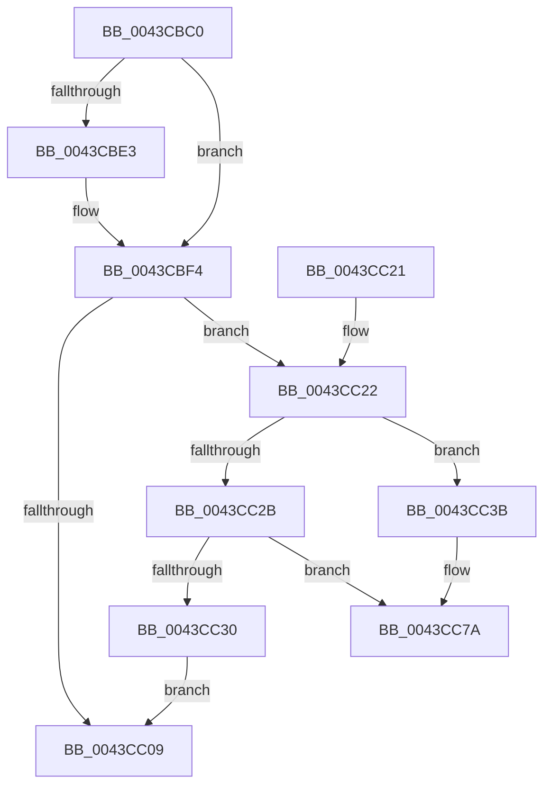

# ObDereferenceObjectExWithTag

- RVA: `0x0043CBC0`–`0x0043CC93` (길이 `211` bytes)
- VA: `0x000000014043CBC0`
- 실행 섹션: `.text`
- PDB 이름 있음: `예`; PDB Function 태그: `아니요`
- unwind 정보 RVA: `0x000A47BC`
- 디코드: `59`개 명령, `211/211` bytes 표시
- 미해석 바이트: `0` (있으면 어셈블리에 `.byte`로 보존)

> 이 문서는 커널 이미지의 기계어와 PDB 기호를 분석해 생성했습니다. 4번과 5번은 함수 원형과 자료형을 바이너리 사용 방식에서 추정한 C 해석이며 원본 소스 복구 결과는 아닙니다.

## 1. Dependencies

- 직접 호출 지점: **4**; 고유 호출 대상: **3**
- 직접 호출자로 확인된 함수: **5**
- RIP 상대 이미지 참조: **3**

### Outgoing calls
- `0x0043CBEF` → [ObpPushStackInfo](../21/ObpPushStackInfo_function_002109E4.md) (function, `0x002109E4`)
- `0x0043CC34` → [ObpDeferObjectDeletion](../3A/ObpDeferObjectDeletion_function_003A2394.md) (function, `0x003A2394`)
- `0x0043CC74` → [KeBugCheckEx](../4F/KeBugCheckEx_function_004FD660.md) (function, `0x004FD660`)
- `0x0043CC8D` → [KeBugCheckEx](../4F/KeBugCheckEx_function_004FD660.md) (function, `0x004FD660`)

### Direct callers
- [sub_00210801](../21/Unknown_function_00210801.md) at `0x00210960`
- [IopCompleteIrpInFileObjectList](../24/IopCompleteIrpInFileObjectList_function_0024F330.md) at `0x0024F942`
- [ExTimerRundown](../39/ExTimerRundown_function_00391394.md) at `0x00391456`
- [ObpCreateHandle](../../page/86/ObpCreateHandle_function_0086B950.md) at `0x0086CE19`
- [ObpCreateHandle](../../page/86/ObpCreateHandle_function_0086B950.md) at `0x0086D5D4`
- [sub_009848DC](../../page/98/Unknown_function_009848DC.md) at `0x00984B0B`

### Static image references
- `0x0043CBD4` → RVA `0x00FC5010` (`ALMOSTRO`; read)
- `0x0043CC5F` → RVA `0x00FC6E4C` (`ALMOSTRO`; read)
- `0x0043CC69` → RVA `0x00FC7800` (`ALMOSTRO`; read)

## 2. Other-region calls and transfers

- 다른 실행 섹션으로 향하는 call: **0**
- 별도 외부 분기/꼬리 이동을 확인하지 못했습니다.

## 3. Assembly (complete function range)

```asm
0043CBC0  48 89 5C 24 08                  mov qword ptr [rsp + 8], rbx
0043CBC5  48 89 6C 24 10                  mov qword ptr [rsp + 0x10], rbp
0043CBCA  48 89 74 24 18                  mov qword ptr [rsp + 0x18], rsi
0043CBCF  57                              push rdi
0043CBD0  48 83 EC 30                     sub rsp, 0x30
0043CBD4  83 3D 35 84 B8 00 00            cmp dword ptr [rip + 0xb88435], 0
0043CBDB  48 8B E9                        mov rbp, rcx
0043CBDE  48 63 F2                        movsxd rsi, edx
0043CBE1  74 11                           je 0x14043cbf4
0043CBE3  45 8B C8                        mov r9d, r8d
0043CBE6  33 D2                           xor edx, edx
0043CBE8  44 8B C6                        mov r8d, esi
0043CBEB  48 83 C1 D0                     add rcx, -0x30
0043CBEF  E8 F0 3D DD FF                  call 0x1402109e4
0043CBF4  8B C6                           mov eax, esi
0043CBF6  F7 D8                           neg eax
0043CBF8  48 63 D8                        movsxd rbx, eax
0043CBFB  F0 48 0F C1 5D D0               lock xadd qword ptr [rbp - 0x30], rbx
0043CC01  48 2B DE                        sub rbx, rsi
0043CC04  48 85 DB                        test rbx, rbx
0043CC07  7E 19                           jle 0x14043cc22
0043CC09  48 8B 6C 24 48                  mov rbp, qword ptr [rsp + 0x48]
0043CC0E  48 8B C3                        mov rax, rbx
0043CC11  48 8B 5C 24 40                  mov rbx, qword ptr [rsp + 0x40]
0043CC16  48 8B 74 24 50                  mov rsi, qword ptr [rsp + 0x50]
0043CC1B  48 83 C4 30                     add rsp, 0x30
0043CC1F  5F                              pop rdi
0043CC20  C3                              ret
0043CC21  CC                              int3
0043CC22  48 8B 4D D8                     mov rcx, qword ptr [rbp - 0x28]
0043CC26  48 85 C9                        test rcx, rcx
0043CC29  75 10                           jne 0x14043cc3b
0043CC2B  48 85 DB                        test rbx, rbx
0043CC2E  78 4A                           js 0x14043cc7a
0043CC30  48 8D 4D D0                     lea rcx, [rbp - 0x30]
0043CC34  E8 5B 57 F6 FF                  call 0x1403a2394
0043CC39  EB CE                           jmp 0x14043cc09
0043CC3B  41 B9 06 00 00 00               mov r9d, 6
0043CC41  48 89 4C 24 20                  mov qword ptr [rsp + 0x20], rcx
0043CC46  48 8D 45 D0                     lea rax, [rbp - 0x30]
0043CC4A  4C 8B C5                        mov r8, rbp
0043CC4D  48 C1 E8 08                     shr rax, 8
0043CC51  0F B6 D0                        movzx edx, al
0043CC54  0F B6 45 E8                     movzx eax, byte ptr [rbp - 0x18]
0043CC58  41 8D 49 12                     lea ecx, [r9 + 0x12]
0043CC5C  48 33 D0                        xor rdx, rax
0043CC5F  0F B6 05 E6 A1 B8 00            movzx eax, byte ptr [rip + 0xb8a1e6]
0043CC66  48 33 D0                        xor rdx, rax
0043CC69  48 8D 05 90 AB B8 00            lea rax, [rip + 0xb8ab90]
0043CC70  48 8B 14 D0                     mov rdx, qword ptr [rax + rdx*8]
0043CC74  E8 E7 09 0C 00                  call 0x1404fd660
0043CC79  CC                              int3
0043CC7A  33 D2                           xor edx, edx
0043CC7C  48 89 5C 24 20                  mov qword ptr [rsp + 0x20], rbx
0043CC81  41 B9 05 00 00 00               mov r9d, 5
0043CC87  4C 8B C5                        mov r8, rbp
0043CC8A  8D 4A 18                        lea ecx, [rdx + 0x18]
0043CC8D  E8 CE 09 0C 00                  call 0x1404fd660
0043CC92  CC                              int3
```

## 4. C-style interpretation (structured pseudocode)

```c
__int64 __fastcall ObDereferenceObjectExWithTag(__int64 a1, int a2, int a3)
{
    __int64 result;
    __int64 v_rbx;
    __int64 v_rsp;
    unsigned __int64 v_stack_p10;
    unsigned __int64 v_stack_p18;
    unsigned __int64 v_stack_p20;
    unsigned __int64 v_stack_p8;

    v_stack_p8 = v_rbx;
    v_stack_p10 = v_rbp;
    v_stack_p18 = v_rsi;
    v_rsp = (v_rsp) - (48);
    if ((*(unsigned int *)(v_rip + 12092469)) != 0) {
        a4 = a3;
        a2 = 0;
        a3 = (unsigned int)((int)(a2));
        a1 = (a1) + (-48);
        result = ObpPushStackInfo(a1, a2, a3, a4);
    }
    result = (unsigned int)(-((unsigned int)((unsigned int)((int)(a2)))));
    v_rbx = ((int)((unsigned int)(result))) - ((int)(a2));
    if (condition_is_less_or_equal) goto loc_0043CC22;
loc_0043CC09:
    v_rsp = (v_rsp) + (48);
    return v_rbx;
loc_0043CC22:
    if (*(unsigned __int64 *)(v_stack_p10 - 40) != 0) goto loc_0043CC3B;
    if (sign_flag) goto loc_0043CC7A;
    result = ObpDeferObjectDeletion(v_stack_p10 - 48, a2, a3, a4);
    goto loc_0043CC09;
loc_0043CC3B:
    v_stack_p20 = v_stack_p10 - 48;
    result = (v_stack_p10 - 48) >> (8);
    a2 = ((unsigned __int8)(result)) ^ (*(unsigned __int8 *)(v_stack_p10 - 24));
    a2 = (a2) ^ (*(unsigned __int8 *)(v_rip + 12100070));
    result = KeBugCheckEx(6 + 18, *(unsigned __int64 *)(v_rip + 12102544 + a2 * 8), v_stack_p10, 6);
loc_0043CC7A:
    a2 = 0;
    v_stack_p20 = v_stack_p8;
    result = KeBugCheckEx(a2 + 24, a2, v_stack_p10, 5);
    return result;
}
```

## 5. (Beta) C Style

```c
int64_t ObDereferenceObjectExWithTag(void *Arg1, int32_t Arg2, int32_t Arg3)
{
    uint8_t *arg1 = (uint8_t *)Arg1;

    int64_t result;
    int64_t local_rbx;
    int64_t local_rsp;
    uint64_t v_stack_p10;
    uint64_t v_stack_p18;
    uint64_t v_stack_p20;
    uint64_t v_stack_p8;

    v_stack_p8 = local_rbx;
    v_stack_p10 = local_rbp;
    v_stack_p18 = local_rsi;
    local_rsp = (local_rsp) - (48);
    if ((*(uint32_t *)(v_rip + 0xB88435)) != 0) {
        a4 = Arg3;
        Arg2 = 0;
        Arg3 = (uint32_t)((int32_t)(Arg2));
        Arg1 = (Arg1) + (-48);
        result = ObpPushStackInfo(Arg1, Arg2, Arg3, a4);
    }
    result = (uint32_t)(-((uint32_t)((uint32_t)((int32_t)(Arg2)))));
    local_rbx = ((int32_t)((uint32_t)(result))) - ((int32_t)(Arg2));
    if (condition_is_less_or_equal) goto loc_0043CC22;
loc_0043CC09:
    local_rsp = (local_rsp) + (48);
    return local_rbx;
loc_0043CC22:
    if (*(uint64_t *)(v_stack_p10 - 0x28) != 0) goto loc_0043CC3B;
    if (sign_flag) goto loc_0043CC7A;
    result = ObpDeferObjectDeletion(v_stack_p10 - 48, Arg2, Arg3, a4);
    goto loc_0043CC09;
loc_0043CC3B:
    v_stack_p20 = v_stack_p10 - 48;
    result = (v_stack_p10 - 48) >> (8);
    Arg2 = ((uint8_t)(result)) ^ (*(uint8_t *)(v_stack_p10 - 0x18));
    Arg2 = (Arg2) ^ (*(uint8_t *)(v_rip + 0xB8A1E6));
    result = KeBugCheckEx(6 + 18, *(uint64_t *)(v_rip + 0xB8AB90 + Arg2 * 8), v_stack_p10, 6);
loc_0043CC7A:
    Arg2 = 0;
    v_stack_p20 = v_stack_p8;
    result = KeBugCheckEx(Arg2 + 24, Arg2, v_stack_p10, 5);
    return result;
}
```

### 관측된 메모리 오프셋

구조체 형식이 확인되지 않은 접근은 인자 기준의 오프셋으로만 기록했습니다.

| 기준 인자 | 오프셋 표현 | 폭 (bit) | 접근 |
|---|---:|---:|---|
| `Arg1` | `- 0x30` | `64` | `R` |
| `Arg1` | `- 0x30` | `64` | `R/W` |
| `Arg1` | `- 0x28` | `64` | `R` |
| `Arg1` | `- 0x18` | `8` | `R` |

## 6. Execution-region graph

[열기: 2D/3D 그래프와 함수 탐색 컨트롤 패널](../../../control-panel.html?section=text&rva=0x0043CBC0&view=graph)

- 2D 그래프는 위에서 아래로 흐르고, 3D 그래프는 빈 공간을 드래그해 회전합니다. Shift+드래그는 이동, 휠은 확대·축소, 함수 노드 선택은 대상 보고서 이동입니다.

### Static fallback


