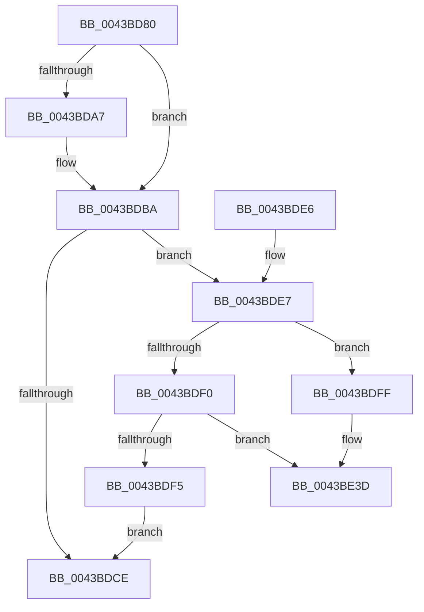

# ObDereferenceObjectEx

- RVA: `0x0043BD80`–`0x0043BE56` (길이 `214` bytes)
- VA: `0x000000014043BD80`
- 실행 섹션: `.text`
- PDB 이름 있음: `예`; PDB Function 태그: `아니요`
- unwind 정보 RVA: `0x000A44C0`
- 디코드: `60`개 명령, `214/214` bytes 표시
- 미해석 바이트: `0` (있으면 어셈블리에 `.byte`로 보존)

> 이 문서는 커널 이미지의 기계어와 PDB 기호를 분석해 생성했습니다. 4번과 5번은 함수 원형과 자료형을 바이너리 사용 방식에서 추정한 C 해석이며 원본 소스 복구 결과는 아닙니다.

## 1. Dependencies

- 직접 호출 지점: **4**; 고유 호출 대상: **3**
- 직접 호출자로 확인된 함수: **1**
- RIP 상대 이미지 참조: **3**

### Outgoing calls
- `0x0043BDB5` → [ObpPushStackInfo](../21/ObpPushStackInfo_function_002109E4.md) (function, `0x002109E4`)
- `0x0043BDF8` → [ObpDeferObjectDeletion](../3A/ObpDeferObjectDeletion_function_003A2394.md) (function, `0x003A2394`)
- `0x0043BE37` → [KeBugCheckEx](../4F/KeBugCheckEx_function_004FD660.md) (function, `0x004FD660`)
- `0x0043BE50` → [KeBugCheckEx](../4F/KeBugCheckEx_function_004FD660.md) (function, `0x004FD660`)

### Direct callers
- [PspClearProcessThreadCidRefs](../../page/90/PspClearProcessThreadCidRefs_function_009071D8.md) at `0x0090726B`

### Static image references
- `0x0043BD94` → RVA `0x00FC5010` (`ALMOSTRO`; read)
- `0x0043BE22` → RVA `0x00FC6E4C` (`ALMOSTRO`; read)
- `0x0043BE2C` → RVA `0x00FC7800` (`ALMOSTRO`; read)

## 2. Other-region calls and transfers

- 다른 실행 섹션으로 향하는 call: **0**
- 별도 외부 분기/꼬리 이동을 확인하지 못했습니다.

## 3. Assembly (complete function range)

```asm
0043BD80  48 89 5C 24 08                  mov qword ptr [rsp + 8], rbx
0043BD85  48 89 6C 24 10                  mov qword ptr [rsp + 0x10], rbp
0043BD8A  48 89 74 24 18                  mov qword ptr [rsp + 0x18], rsi
0043BD8F  57                              push rdi
0043BD90  48 83 EC 30                     sub rsp, 0x30
0043BD94  83 3D 75 92 B8 00 00            cmp dword ptr [rip + 0xb89275], 0
0043BD9B  48 8D 79 D0                     lea rdi, [rcx - 0x30]
0043BD9F  48 63 F2                        movsxd rsi, edx
0043BDA2  48 8B E9                        mov rbp, rcx
0043BDA5  74 13                           je 0x14043bdba
0043BDA7  41 B9 44 66 6C 74               mov r9d, 0x746c6644
0043BDAD  44 8B C6                        mov r8d, esi
0043BDB0  33 D2                           xor edx, edx
0043BDB2  48 8B CF                        mov rcx, rdi
0043BDB5  E8 2A 4C DD FF                  call 0x1402109e4
0043BDBA  8B C6                           mov eax, esi
0043BDBC  F7 D8                           neg eax
0043BDBE  48 63 D8                        movsxd rbx, eax
0043BDC1  F0 48 0F C1 1F                  lock xadd qword ptr [rdi], rbx
0043BDC6  48 2B DE                        sub rbx, rsi
0043BDC9  48 85 DB                        test rbx, rbx
0043BDCC  7E 19                           jle 0x14043bde7
0043BDCE  48 8B 6C 24 48                  mov rbp, qword ptr [rsp + 0x48]
0043BDD3  48 8B C3                        mov rax, rbx
0043BDD6  48 8B 5C 24 40                  mov rbx, qword ptr [rsp + 0x40]
0043BDDB  48 8B 74 24 50                  mov rsi, qword ptr [rsp + 0x50]
0043BDE0  48 83 C4 30                     add rsp, 0x30
0043BDE4  5F                              pop rdi
0043BDE5  C3                              ret
0043BDE6  CC                              int3
0043BDE7  48 8B 4F 08                     mov rcx, qword ptr [rdi + 8]
0043BDEB  48 85 C9                        test rcx, rcx
0043BDEE  75 0F                           jne 0x14043bdff
0043BDF0  48 85 DB                        test rbx, rbx
0043BDF3  78 48                           js 0x14043be3d
0043BDF5  48 8B CF                        mov rcx, rdi
0043BDF8  E8 97 65 F6 FF                  call 0x1403a2394
0043BDFD  EB CF                           jmp 0x14043bdce
0043BDFF  41 B9 06 00 00 00               mov r9d, 6
0043BE05  48 89 4C 24 20                  mov qword ptr [rsp + 0x20], rcx
0043BE0A  48 8B C7                        mov rax, rdi
0043BE0D  4C 8B C5                        mov r8, rbp
0043BE10  48 C1 E8 08                     shr rax, 8
0043BE14  0F B6 D0                        movzx edx, al
0043BE17  0F B6 47 18                     movzx eax, byte ptr [rdi + 0x18]
0043BE1B  41 8D 49 12                     lea ecx, [r9 + 0x12]
0043BE1F  48 33 D0                        xor rdx, rax
0043BE22  0F B6 05 23 B0 B8 00            movzx eax, byte ptr [rip + 0xb8b023]
0043BE29  48 33 D0                        xor rdx, rax
0043BE2C  48 8D 05 CD B9 B8 00            lea rax, [rip + 0xb8b9cd]
0043BE33  48 8B 14 D0                     mov rdx, qword ptr [rax + rdx*8]
0043BE37  E8 24 18 0C 00                  call 0x1404fd660
0043BE3C  CC                              int3
0043BE3D  33 D2                           xor edx, edx
0043BE3F  48 89 5C 24 20                  mov qword ptr [rsp + 0x20], rbx
0043BE44  41 B9 05 00 00 00               mov r9d, 5
0043BE4A  4C 8B C5                        mov r8, rbp
0043BE4D  8D 4A 18                        lea ecx, [rdx + 0x18]
0043BE50  E8 0B 18 0C 00                  call 0x1404fd660
0043BE55  CC                              int3
```

## 4. C-style interpretation (structured pseudocode)

```c
__int64 __fastcall ObDereferenceObjectEx(__int64 a1, int a2)
{
    __int64 result;
    __int64 v_rbx;
    __int64 v_rsp;
    unsigned __int64 v_stack_p10;
    unsigned __int64 v_stack_p18;
    unsigned __int64 v_stack_p20;
    unsigned __int64 v_stack_p8;

    v_stack_p8 = v_rbx;
    v_stack_p10 = v_rbp;
    v_stack_p18 = v_rsi;
    v_rsp = (v_rsp) - (48);
    if ((*(unsigned int *)(v_rip + 12096117)) != 0) {
        a4 = 0x746C6644ULL;
        a3 = (unsigned int)((int)(a2));
        a2 = 0;
        a1 = a1 - 48;
        result = ObpPushStackInfo(a1, a2, a3, a4);
    }
    result = (unsigned int)(-((unsigned int)((unsigned int)((int)(a2)))));
    v_rbx = ((int)((unsigned int)(result))) - ((int)(a2));
    if (condition_is_less_or_equal) goto loc_0043BDE7;
loc_0043BDCE:
    v_rsp = (v_rsp) + (48);
    return v_rbx;
loc_0043BDE7:
    if (*(unsigned __int64 *)(a1 - 48 + 8) != 0) goto loc_0043BDFF;
    if (sign_flag) goto loc_0043BE3D;
    result = ObpDeferObjectDeletion(a1 - 48, a2, a3, a4);
    goto loc_0043BDCE;
loc_0043BDFF:
    v_stack_p20 = a1 - 48;
    result = (a1 - 48) >> (8);
    a2 = ((unsigned __int8)(result)) ^ (*(unsigned __int8 *)(a1 - 48 + 24));
    a2 = (a2) ^ (*(unsigned __int8 *)(v_rip + 12103715));
    result = KeBugCheckEx(6 + 18, *(unsigned __int64 *)(v_rip + 12106189 + a2 * 8), v_stack_p10, 6);
loc_0043BE3D:
    a2 = 0;
    v_stack_p20 = v_stack_p8;
    result = KeBugCheckEx(a2 + 24, a2, v_stack_p10, 5);
    return result;
}
```

## 5. (Beta) C Style

```c
int64_t ObDereferenceObjectEx(void *Arg1, int32_t Arg2)
{
    uint8_t *arg1 = (uint8_t *)Arg1;

    int64_t result;
    int64_t local_rbx;
    int64_t local_rsp;
    uint64_t v_stack_p10;
    uint64_t v_stack_p18;
    uint64_t v_stack_p20;
    uint64_t v_stack_p8;

    v_stack_p8 = local_rbx;
    v_stack_p10 = local_rbp;
    v_stack_p18 = local_rsi;
    local_rsp = (local_rsp) - (48);
    if ((*(uint32_t *)(v_rip + 0xB89275)) != 0) {
        a4 = 0x746C6644ULL;
        a3 = (uint32_t)((int32_t)(Arg2));
        Arg2 = 0;
        Arg1 = Arg1 - 48;
        result = ObpPushStackInfo(Arg1, Arg2, a3, a4);
    }
    result = (uint32_t)(-((uint32_t)((uint32_t)((int32_t)(Arg2)))));
    local_rbx = ((int32_t)((uint32_t)(result))) - ((int32_t)(Arg2));
    if (condition_is_less_or_equal) goto loc_0043BDE7;
loc_0043BDCE:
    local_rsp = (local_rsp) + (48);
    return local_rbx;
loc_0043BDE7:
    if (*(uint64_t *)(arg1 - 0x30 + 0x8) != 0) goto loc_0043BDFF;
    if (sign_flag) goto loc_0043BE3D;
    result = ObpDeferObjectDeletion(Arg1 - 48, Arg2, a3, a4);
    goto loc_0043BDCE;
loc_0043BDFF:
    v_stack_p20 = Arg1 - 48;
    result = (Arg1 - 48) >> (8);
    Arg2 = ((uint8_t)(result)) ^ (*(uint8_t *)(arg1 - 0x30 + 0x18));
    Arg2 = (Arg2) ^ (*(uint8_t *)(v_rip + 0xB8B023));
    result = KeBugCheckEx(6 + 18, *(uint64_t *)(v_rip + 0xB8B9CD + Arg2 * 8), v_stack_p10, 6);
loc_0043BE3D:
    Arg2 = 0;
    v_stack_p20 = v_stack_p8;
    result = KeBugCheckEx(Arg2 + 24, Arg2, v_stack_p10, 5);
    return result;
}
```

### 관측된 메모리 오프셋

구조체 형식이 확인되지 않은 접근은 인자 기준의 오프셋으로만 기록했습니다.

| 기준 인자 | 오프셋 표현 | 폭 (bit) | 접근 |
|---|---:|---:|---|
| `Arg1` | `- 0x30` | `64` | `R` |
| `Arg1` | `+ 0x0` | `64` | `R/W` |
| `Arg1` | `+ 0x8` | `64` | `R` |
| `Arg1` | `+ 0x18` | `8` | `R` |

## 6. Execution-region graph

[열기: 2D/3D 그래프와 함수 탐색 컨트롤 패널](../../../control-panel.html?section=text&rva=0x0043BD80&view=graph)

- 2D 그래프는 위에서 아래로 흐르고, 3D 그래프는 빈 공간을 드래그해 회전합니다. Shift+드래그는 이동, 휠은 확대·축소, 함수 노드 선택은 대상 보고서 이동입니다.

### Static fallback


