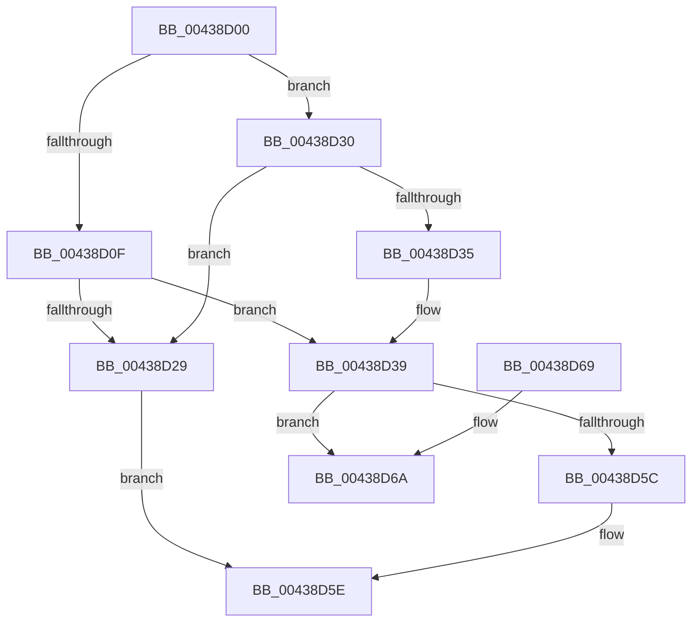

# ObReferenceObjectByPointer

- RVA: `0x00438D00`–`0x00438D82` (길이 `130` bytes)
- VA: `0x0000000140438D00`
- 실행 섹션: `.text`
- PDB 이름 있음: `예`; PDB Function 태그: `아니요`
- unwind 정보 RVA: `0x000A3580`
- 디코드: `39`개 명령, `130/130` bytes 표시
- 미해석 바이트: `0` (있으면 어셈블리에 `.byte`로 보존)

> 이 문서는 커널 이미지의 기계어와 PDB 기호를 분석해 생성했습니다. 4번과 5번은 함수 원형과 자료형을 바이너리 사용 방식에서 추정한 C 해석이며 원본 소스 복구 결과는 아닙니다.

## 1. Dependencies

- 직접 호출 지점: **2**; 고유 호출 대상: **2**
- 직접 호출자로 확인된 함수: **14**
- RIP 상대 이미지 참조: **1**

### Outgoing calls
- `0x00438D49` → [ObpTraceObjectReferenceIfActive](../21/ObpTraceObjectReferenceIfActive_function_00210780.md) (function, `0x00210780`)
- `0x00438D7C` → [KeBugCheckEx](../4F/KeBugCheckEx_function_004FD660.md) (function, `0x004FD660`)

### Direct callers
- [HalpDmaAllocateChildAdapterV3](../../page/70/HalpDmaAllocateChildAdapterV3_function_007066A0.md) at `0x00706872`
- [HalGetAdapterV3](../../page/70/HalGetAdapterV3_function_00709838.md) at `0x00709AE3`
- [HalGetAdapterV3](../../page/70/HalGetAdapterV3_function_00709838.md) at `0x00709B54`
- [HalGetAdapterV3](../../page/70/HalGetAdapterV3_function_00709838.md) at `0x00709D31`
- [HalGetAdapterV2](../../page/70/HalGetAdapterV2_function_00709DD8.md) at `0x00709FD9`
- [HalGetAdapterV2](../../page/70/HalGetAdapterV2_function_00709DD8.md) at `0x0070A034`
- [HalGetAdapterV2](../../page/70/HalGetAdapterV2_function_00709DD8.md) at `0x0070A11D`
- [HalpDmaAllocateChildAdapterV2](../../page/70/HalpDmaAllocateChildAdapterV2_function_0070A200.md) at `0x0070A2C5`
- [EtwpRegisterPrivateSession](../../page/7B/EtwpRegisterPrivateSession_function_007BC92C.md) at `0x007BCBD1`
- [ObpLookupObjectName](../../page/89/ObpLookupObjectName_function_0089BE90.md) at `0x0089D320`
- [ObpLookupObjectName](../../page/89/ObpLookupObjectName_function_0089BE90.md) at `0x0089D393`
- [ObpLookupObjectName](../../page/89/ObpLookupObjectName_function_0089BE90.md) at `0x0089D60A`
- [ObpLookupObjectName](../../page/89/ObpLookupObjectName_function_0089BE90.md) at `0x0089DB72`
- [ObpLookupObjectName](../../page/89/ObpLookupObjectName_function_0089BE90.md) at `0x0089DC3E`
- [ObpParseSymbolicLinkEx](../../page/8B/ObpParseSymbolicLinkEx_function_008B35C0.md) at `0x008B37C6`
- [sub_008C28B0](../../page/8C/Unknown_function_008C28B0.md) at `0x008C29CD`
- [EtwpStopTrace](../../page/9B/EtwpStopTrace_function_009BCE84.md) at `0x009BCF2A`
- [WmipQuerySetExecuteSI](../../page/9E/WmipQuerySetExecuteSI_function_009E0574.md) at `0x009E0777`
- [WmipQueryAllData](../../page/9E/WmipQueryAllData_function_009E086C.md) at `0x009E0C9B`
- [WmipRegisterDevice](../../page/9E/WmipRegisterDevice_function_009E2808.md) at `0x009E28A6`
- [NtImpersonateAnonymousToken](../../page/A3/NtImpersonateAnonymousToken_function_00A3A150.md) at `0x00A3A30F`
- [sub_00B374D0](../../page/B3/Unknown_function_00B374D0.md) at `0x00B37514`

### Static image references
- `0x00438D1D` → RVA `0x00FC6E4C` (`ALMOSTRO`; read)

## 2. Other-region calls and transfers

- 다른 실행 섹션으로 향하는 call: **0**
- 별도 외부 분기/꼬리 이동을 확인하지 못했습니다.

## 3. Assembly (complete function range)

```asm
00438D00  48 89 5C 24 08                  mov qword ptr [rsp + 8], rbx
00438D05  57                              push rdi
00438D06  48 83 EC 30                     sub rsp, 0x30
00438D0A  4D 85 C0                        test r8, r8
00438D0D  74 21                           je 0x140438d30
00438D0F  48 8D 59 D0                     lea rbx, [rcx - 0x30]
00438D13  48 8B C3                        mov rax, rbx
00438D16  48 C1 E8 08                     shr rax, 8
00438D1A  32 43 18                        xor al, byte ptr [rbx + 0x18]
00438D1D  32 05 29 E1 B8 00               xor al, byte ptr [rip + 0xb8e129]
00438D23  41 3A 40 28                     cmp al, byte ptr [r8 + 0x28]
00438D27  74 10                           je 0x140438d39
00438D29  B8 24 00 00 C0                  mov eax, 0xc0000024
00438D2E  EB 2E                           jmp 0x140438d5e
00438D30  45 84 C9                        test r9b, r9b
00438D33  75 F4                           jne 0x140438d29
00438D35  48 8D 59 D0                     lea rbx, [rcx - 0x30]
00438D39  BF 01 00 00 00                  mov edi, 1
00438D3E  41 B8 44 66 6C 74               mov r8d, 0x746c6644
00438D44  8B D7                           mov edx, edi
00438D46  48 8B CB                        mov rcx, rbx
00438D49  E8 32 7A DD FF                  call 0x140210780
00438D4E  F0 48 0F C1 3B                  lock xadd qword ptr [rbx], rdi
00438D53  48 FF C7                        inc rdi
00438D56  48 83 FF 01                     cmp rdi, 1
00438D5A  7E 0E                           jle 0x140438d6a
00438D5C  33 C0                           xor eax, eax
00438D5E  48 8B 5C 24 40                  mov rbx, qword ptr [rsp + 0x40]
00438D63  48 83 C4 30                     add rsp, 0x30
00438D67  5F                              pop rdi
00438D68  C3                              ret
00438D69  CC                              int3
00438D6A  33 D2                           xor edx, edx
00438D6C  48 89 7C 24 20                  mov qword ptr [rsp + 0x20], rdi
00438D71  4C 8D 43 30                     lea r8, [rbx + 0x30]
00438D75  44 8D 4A 10                     lea r9d, [rdx + 0x10]
00438D79  8D 4A 18                        lea ecx, [rdx + 0x18]
00438D7C  E8 DF 48 0C 00                  call 0x1404fd660
00438D81  CC                              int3
```

## 4. C-style interpretation (structured pseudocode)

```c
__int64 __fastcall ObReferenceObjectByPointer(__int64 a1, __int64 a2, __int64 a3, unsigned __int8 a4)
{
    __int64 result;
    __int64 v_rdi;
    __int64 v_rsp;
    unsigned __int64 v_stack_p20;
    unsigned __int64 v_stack_p8;

    v_stack_p8 = v_rbx;
    v_rsp = (v_rsp) - (48);
    if (a3 == 0) goto loc_00438D30;
    result = (a1 - 48) >> (8);
    result = (unsigned __int8)((result) ^ (*(unsigned __int8 *)(a1 - 48 + 24)));
    result = (unsigned __int8)((result) ^ (*(unsigned __int8 *)(v_rip + 12116265)));
    if (((unsigned __int8)(result)) == (*(unsigned __int8 *)(a3 + 40))) goto loc_00438D39;
loc_00438D29:
    goto loc_00438D5E;
loc_00438D30:
    if (a4 != 0) goto loc_00438D29;
loc_00438D39:
    result = ObpTraceObjectReferenceIfActive(a1 - 48, 1, (unsigned int)(0x746C6644ULL), a4);
    v_rdi = (1) + 1;
    if (v_rdi <= 1) goto loc_00438D6A;
    result = 0;
loc_00438D5E:
    v_rsp = (v_rsp) + (48);
    return result;
loc_00438D6A:
    a2 = 0;
    v_stack_p20 = v_rdi;
    result = KeBugCheckEx(a2 + 24, a2, v_stack_p8 + 48, a2 + 16);
    return result;
}
```

## 5. (Beta) C Style

```c
int64_t ObReferenceObjectByPointer(void *Arg1, int64_t Arg2, int64_t Arg3, uint8_t Arg4)
{
    uint8_t *arg1 = (uint8_t *)Arg1;

    int64_t result;
    int64_t local_rdi;
    int64_t local_rsp;
    uint64_t v_stack_p20;
    uint64_t v_stack_p8;

    v_stack_p8 = local_rbx;
    local_rsp = (local_rsp) - (48);
    if (Arg3 == 0) goto loc_00438D30;
    result = (Arg1 - 48) >> (8);
    result = (uint8_t)((result) ^ (*(uint8_t *)(arg1 - 0x30 + 0x18)));
    result = (uint8_t)((result) ^ (*(uint8_t *)(v_rip + 0xB8E129)));
    if (((uint8_t)(result)) == (*(uint8_t *)(Arg3 + 0x28))) goto loc_00438D39;
loc_00438D29:
    goto loc_00438D5E;
loc_00438D30:
    if (Arg4 != 0) goto loc_00438D29;
loc_00438D39:
    result = ObpTraceObjectReferenceIfActive(Arg1 - 48, 1, (uint32_t)(0x746C6644ULL), Arg4);
    local_rdi = (1) + 1;
    if (local_rdi <= 1) goto loc_00438D6A;
    result = 0;
loc_00438D5E:
    local_rsp = (local_rsp) + (48);
    return result;
loc_00438D6A:
    Arg2 = 0;
    v_stack_p20 = local_rdi;
    result = KeBugCheckEx(Arg2 + 24, Arg2, v_stack_p8 + 48, Arg2 + 16);
    return result;
}
```

### 관측된 메모리 오프셋

구조체 형식이 확인되지 않은 접근은 인자 기준의 오프셋으로만 기록했습니다.

| 기준 인자 | 오프셋 표현 | 폭 (bit) | 접근 |
|---|---:|---:|---|
| `Arg1` | `- 0x30` | `64` | `R` |
| `Arg1` | `+ 0x0` | `64` | `R/W` |
| `Arg1` | `+ 0x18` | `8` | `R` |
| `Arg1` | `+ 0x30` | `64` | `R` |

## 6. Execution-region graph

[열기: 2D/3D 그래프와 함수 탐색 컨트롤 패널](../../../control-panel.html?section=text&rva=0x00438D00&view=graph)

- 2D 그래프는 위에서 아래로 흐르고, 3D 그래프는 빈 공간을 드래그해 회전합니다. Shift+드래그는 이동, 휠은 확대·축소, 함수 노드 선택은 대상 보고서 이동입니다.

### Static fallback


