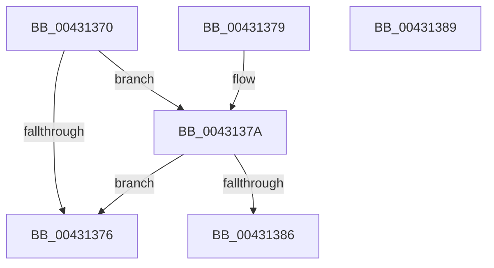

# ObpFilterOperation

- RVA: `0x00431370`–`0x0043138A` (길이 `26` bytes)
- VA: `0x0000000140431370`
- 실행 섹션: `.text`
- PDB 이름 있음: `예`; PDB Function 태그: `아니요`
- unwind 정보 RVA: `0x000DB714`
- 디코드: `11`개 명령, `26/26` bytes 표시
- 미해석 바이트: `0` (있으면 어셈블리에 `.byte`로 보존)

> 이 문서는 커널 이미지의 기계어와 PDB 기호를 분석해 생성했습니다. 4번과 5번은 함수 원형과 자료형을 바이너리 사용 방식에서 추정한 C 해석이며 원본 소스 복구 결과는 아닙니다.

## 1. Dependencies

- 직접 호출 지점: **0**; 고유 호출 대상: **0**
- 직접 호출자로 확인된 함수: **1**
- RIP 상대 이미지 참조: **0**

### Outgoing calls
- 직접 디코드된 call 명령이 없습니다.

### Direct callers
- [ObCompleteObjectDuplication](../../page/89/ObCompleteObjectDuplication_function_0089387C.md) at `0x0089394B`

### Static image references
- 디코드된 RIP-relative 메모리 참조가 없습니다.

## 2. Other-region calls and transfers

- 다른 실행 섹션으로 향하는 call: **0**
- 별도 외부 분기/꼬리 이동을 확인하지 못했습니다.

## 3. Assembly (complete function range)

```asm
00431370  F6 41 42 40                     test byte ptr [rcx + 0x42], 0x40
00431374  75 04                           jne 0x14043137a
00431376  32 C0                           xor al, al
00431378  C3                              ret
00431379  CC                              int3
0043137A  48 81 C1 C8 00 00 00            add rcx, 0xc8
00431381  48 39 09                        cmp qword ptr [rcx], rcx
00431384  74 F0                           je 0x140431376
00431386  B0 01                           mov al, 1
00431388  C3                              ret
00431389  CC                              int3
```

## 4. C-style interpretation (structured pseudocode)

```c
__int64 __fastcall ObpFilterOperation(__int64 a1)
{
    __int64 result;

    if (((*(unsigned __int8 *)(a1 + 66)) & (64)) != 0) goto loc_0043137A;
loc_00431376:
    result = 0;
    return result;
loc_0043137A:
    a1 = (a1) + (200);
    if ((*(unsigned __int64 *)(a1)) == a1) goto loc_00431376;
    return 1;
}
```

## 5. (Beta) C Style

```c
int64_t ObpFilterOperation(void *Arg1)
{
    uint8_t *arg1 = (uint8_t *)Arg1;

    int64_t result;

    if (((*(uint8_t *)(arg1 + 0x42)) & (64)) != 0) goto loc_0043137A;
loc_00431376:
    result = 0;
    return result;
loc_0043137A:
    Arg1 = (Arg1) + (200);
    if ((*(uint64_t *)(arg1)) == Arg1) goto loc_00431376;
    return 1;
}
```

### 관측된 메모리 오프셋

구조체 형식이 확인되지 않은 접근은 인자 기준의 오프셋으로만 기록했습니다.

| 기준 인자 | 오프셋 표현 | 폭 (bit) | 접근 |
|---|---:|---:|---|
| `Arg1` | `+ 0x0` | `64` | `R` |
| `Arg1` | `+ 0x42` | `8` | `R` |

## 6. Execution-region graph

[열기: 2D/3D 그래프와 함수 탐색 컨트롤 패널](../../../control-panel.html?section=text&rva=0x00431370&view=graph)

- 2D 그래프는 위에서 아래로 흐르고, 3D 그래프는 빈 공간을 드래그해 회전합니다. Shift+드래그는 이동, 휠은 확대·축소, 함수 노드 선택은 대상 보고서 이동입니다.

### Static fallback


