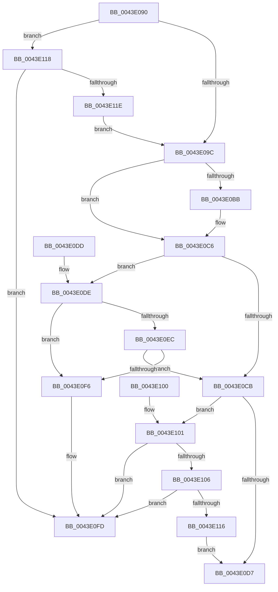

# PfSnCheckLoggingForThread

- RVA: `0x0043E090`–`0x0043E123` (길이 `147` bytes)
- VA: `0x000000014043E090`
- 실행 섹션: `.text`
- PDB 이름 있음: `예`; PDB Function 태그: `아니요`
- unwind 정보 RVA: `0x000DB714`
- 디코드: `39`개 명령, `147/147` bytes 표시
- 미해석 바이트: `0` (있으면 어셈블리에 `.byte`로 보존)

> 이 문서는 커널 이미지의 기계어와 PDB 기호를 분석해 생성했습니다. 4번과 5번은 함수 원형과 자료형을 바이너리 사용 방식에서 추정한 C 해석이며 원본 소스 복구 결과는 아닙니다.

## 1. Dependencies

- 직접 호출 지점: **0**; 고유 호출 대상: **0**
- 직접 호출자로 확인된 함수: **1**
- RIP 상대 이미지 참조: **0**

### Outgoing calls
- 직접 디코드된 call 명령이 없습니다.

### Direct callers
- [MiCompleteProtoPteFault](../34/MiCompleteProtoPteFault_function_00345710.md) at `0x0034679D`

### Static image references
- 디코드된 RIP-relative 메모리 참조가 없습니다.

## 2. Other-region calls and transfers

- 다른 실행 섹션으로 향하는 call: **0**
- 별도 외부 분기/꼬리 이동을 확인하지 못했습니다.

## 3. Assembly (complete function range)

```asm
0043E090  F6 81 A8 05 00 00 40            test byte ptr [rcx + 0x5a8], 0x40
0043E097  4C 8B C9                        mov r9, rcx
0043E09A  75 7C                           jne 0x14043e118
0043E09C  8B 81 A0 05 00 00               mov eax, dword ptr [rcx + 0x5a0]
0043E0A2  48 8B 89 20 02 00 00            mov rcx, qword ptr [rcx + 0x220]
0043E0A9  C1 E8 09                        shr eax, 9
0043E0AC  83 E0 07                        and eax, 7
0043E0AF  48 8B 89 A0 02 00 00            mov rcx, qword ptr [rcx + 0x2a0]
0043E0B6  48 85 C9                        test rcx, rcx
0043E0B9  74 0B                           je 0x14043e0c6
0043E0BB  8B 89 3C 04 00 00               mov ecx, dword ptr [rcx + 0x43c]
0043E0C1  3B C1                           cmp eax, ecx
0043E0C3  0F 4D C1                        cmovge eax, ecx
0043E0C6  83 F8 02                        cmp eax, 2
0043E0C9  7C 13                           jl 0x14043e0de
0043E0CB  48 8B 82 B0 01 00 00            mov rax, qword ptr [rdx + 0x1b0]
0043E0D2  48 85 C0                        test rax, rax
0043E0D5  75 2A                           jne 0x14043e101
0043E0D7  B8 01 00 00 00                  mov eax, 1
0043E0DC  C3                              ret
0043E0DD  CC                              int3
0043E0DE  65 48 8B 04 25 88 01 00 00      mov rax, qword ptr gs:[0x188]
0043E0E7  4C 3B C8                        cmp r9, rax
0043E0EA  75 0A                           jne 0x14043e0f6
0043E0EC  41 83 B9 E0 05 00 00 00         cmp dword ptr [r9 + 0x5e0], 0
0043E0F4  75 D5                           jne 0x14043e0cb
0043E0F6  F0 FF 82 50 01 00 00            lock inc dword ptr [rdx + 0x150]
0043E0FD  33 C0                           xor eax, eax
0043E0FF  C3                              ret
0043E100  CC                              int3
0043E101  49 3B C1                        cmp rax, r9
0043E104  75 F7                           jne 0x14043e0fd
0043E106  49 8B 81 10 05 00 00            mov rax, qword ptr [r9 + 0x510]
0043E10D  48 39 82 B8 01 00 00            cmp qword ptr [rdx + 0x1b8], rax
0043E114  75 E7                           jne 0x14043e0fd
0043E116  EB BF                           jmp 0x14043e0d7
0043E118  41 F6 C0 02                     test r8b, 2
0043E11C  74 DF                           je 0x14043e0fd
0043E11E  E9 79 FF FF FF                  jmp 0x14043e09c
```

## 4. C-style interpretation (structured pseudocode)

```c
__int64 __fastcall PfSnCheckLoggingForThread(__int64 a1, __int64 a2, unsigned __int8 a3)
{
    __int64 result;

    if (((*(unsigned __int8 *)(a1 + 1448)) & (64)) != 0) goto loc_0043E118;
loc_0043E09C:
    result = (unsigned int)(((unsigned int)(*(unsigned int *)(a1 + 1440))) >> (9));
    result = (unsigned int)((result) & (7));
    if (*(unsigned __int64 *)(*(unsigned __int64 *)(a1 + 544) + 672) != 0) {
        a1 = *(unsigned int *)(*(unsigned __int64 *)(*(unsigned __int64 *)(a1 + 544) + 672) + 1084);
        if (((unsigned int)(result)) >= ((unsigned int)(a1))) { result = (unsigned int)(a1); }
    }
    if (((unsigned int)(result)) < 2) goto loc_0043E0DE;
loc_0043E0CB:
    if (*(unsigned __int64 *)(a2 + 432) != 0) goto loc_0043E101;
loc_0043E0D7:
    return 1;
loc_0043E0DE:
    if (a1 != (*(unsigned __int64 *)(gs_base + (0 + 392)))) goto loc_0043E0F6;
    if ((*(unsigned int *)(a1 + 1504)) != 0) goto loc_0043E0CB;
loc_0043E0F6:
loc_0043E0FD:
    result = 0;
    return result;
loc_0043E101:
    if (0 != a1) goto loc_0043E0FD;
    if ((*(unsigned __int64 *)(a2 + 440)) != (*(unsigned __int64 *)(a1 + 1296))) goto loc_0043E0FD;
    goto loc_0043E0D7;
loc_0043E118:
    if (((a3) & (2)) == 0) goto loc_0043E0FD;
    goto loc_0043E09C;
}
```

## 5. (Beta) C Style

```c
int64_t PfSnCheckLoggingForThread(void *Arg1, void *Arg2, uint8_t Arg3)
{
    uint8_t *arg1 = (uint8_t *)Arg1;
    uint8_t *arg2 = (uint8_t *)Arg2;

    int64_t result;

    if (((*(uint8_t *)(arg1 + 0x5A8)) & (64)) != 0) goto loc_0043E118;
loc_0043E09C:
    result = (uint32_t)(((uint32_t)(*(uint32_t *)(arg1 + 0x5A0))) >> (9));
    result = (uint32_t)((result) & (7));
    if (*(uint64_t *)(*(uint64_t *)(arg1 + 0x220) + 0x2A0) != 0) {
        Arg1 = *(uint32_t *)(*(uint64_t *)(*(uint64_t *)(arg1 + 0x220) + 0x2A0) + 0x43C);
        if (((uint32_t)(result)) >= ((uint32_t)(Arg1))) { result = (uint32_t)(Arg1); }
    }
    if (((uint32_t)(result)) < 2) goto loc_0043E0DE;
loc_0043E0CB:
    if (*(uint64_t *)(arg2 + 0x1B0) != 0) goto loc_0043E101;
loc_0043E0D7:
    return 1;
loc_0043E0DE:
    if (Arg1 != (*(uint64_t *)(gs_base + (0 + 0x188)))) goto loc_0043E0F6;
    if ((*(uint32_t *)(arg1 + 0x5E0)) != 0) goto loc_0043E0CB;
loc_0043E0F6:
loc_0043E0FD:
    result = 0;
    return result;
loc_0043E101:
    if (0 != Arg1) goto loc_0043E0FD;
    if ((*(uint64_t *)(arg2 + 0x1B8)) != (*(uint64_t *)(arg1 + 0x510))) goto loc_0043E0FD;
    goto loc_0043E0D7;
loc_0043E118:
    if (((Arg3) & (2)) == 0) goto loc_0043E0FD;
    goto loc_0043E09C;
}
```

### 관측된 메모리 오프셋

구조체 형식이 확인되지 않은 접근은 인자 기준의 오프셋으로만 기록했습니다.

| 기준 인자 | 오프셋 표현 | 폭 (bit) | 접근 |
|---|---:|---:|---|
| `Arg1` | `+ 0x220` | `64` | `R` |
| `Arg1` | `+ 0x5A0` | `32` | `R` |
| `Arg1` | `+ 0x5A8` | `8` | `R` |
| `Arg2` | `+ 0x150` | `32` | `R/W` |
| `Arg2` | `+ 0x1B0` | `64` | `R` |
| `Arg2` | `+ 0x1B8` | `64` | `R` |

## 6. Execution-region graph

[열기: 2D/3D 그래프와 함수 탐색 컨트롤 패널](../../../control-panel.html?section=text&rva=0x0043E090&view=graph)

- 2D 그래프는 위에서 아래로 흐르고, 3D 그래프는 빈 공간을 드래그해 회전합니다. Shift+드래그는 이동, 휠은 확대·축소, 함수 노드 선택은 대상 보고서 이동입니다.

### Static fallback


