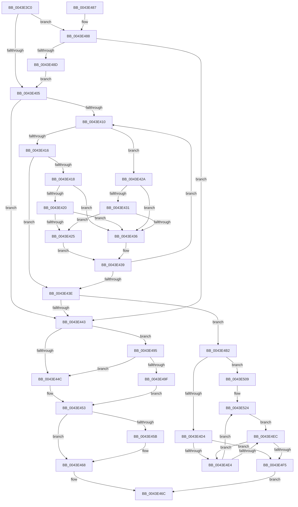

# PfSnNameRemove

- RVA: `0x0043E3C0`–`0x0043E529` (길이 `361` bytes)
- VA: `0x000000014043E3C0`
- 실행 섹션: `.text`
- PDB 이름 있음: `예`; PDB Function 태그: `아니요`
- unwind 정보 RVA: `0x00099830`
- 디코드: `104`개 명령, `361/361` bytes 표시
- 미해석 바이트: `0` (있으면 어셈블리에 `.byte`로 보존)

> 이 문서는 커널 이미지의 기계어와 PDB 기호를 분석해 생성했습니다. 4번과 5번은 함수 원형과 자료형을 바이너리 사용 방식에서 추정한 C 해석이며 원본 소스 복구 결과는 아닙니다.

## 1. Dependencies

- 직접 호출 지점: **7**; 고유 호출 대상: **7**
- 직접 호출자로 확인된 함수: **1**
- RIP 상대 이미지 참조: **3**

### Outgoing calls
- `0x0043E3E7` → [ExAcquireSpinLockExclusive](../24/ExAcquireSpinLockExclusive_function_00248690.md) (function, `0x00248690`)
- `0x0043E463` → [KiLowerIrqlProcessIrqlFlags](../4F/KiLowerIrqlProcessIrqlFlags_function_004F5698.md) (function, `0x004F5698`)
- `0x0043E4AB` → [ExpReleaseSpinLockExclusiveFromDpcLevelInstrumented](../2C/ExpReleaseSpinLockExclusiveFromDpcLevelInstrumented_function_002C0F44.md) (function, `0x002C0F44`)
- `0x0043E4B8` → [RtlRbRemoveNode](../2E/RtlRbRemoveNode_function_002E4C10.md) (function, `0x002E4C10`)
- `0x0043E4C8` → [ExReleaseSpinLockExclusive](../2C/ExReleaseSpinLockExclusive_function_002C0EF0.md) (function, `0x002C0EF0`)
- `0x0043E4FF` → [ExFreePoolWithTag](../../poolcode/B8/ExFreePoolWithTag_function_00B82870.md) (function, `0x00B82870`)
- `0x0043E51E` → [KeBugCheckEx](../4F/KeBugCheckEx_function_004FD660.md) (function, `0x004FD660`)

### Direct callers
- [PfSnNameRemoveAll](../../page/96/PfSnNameRemoveAll_function_00960C90.md) at `0x00960CA8`

### Static image references
- `0x0043E443` → RVA `0x00FC6B06` (`ALMOSTRO`; read)
- `0x0043E453` → RVA `0x00FC6D20` (`ALMOSTRO`; read)
- `0x0043E495` → RVA `0x00F0DE58` (`.data`; read)

## 2. Other-region calls and transfers

- 다른 실행 섹션으로 향하는 call: **1**
  - `0x0043E4FF` → [ExFreePoolWithTag](../../poolcode/B8/ExFreePoolWithTag_function_00B82870.md) (`.text` → `POOLCODE`)
- 별도 외부 분기/꼬리 이동을 확인하지 못했습니다.

## 3. Assembly (complete function range)

```asm
0043E3C0  48 89 5C 24 08                  mov qword ptr [rsp + 8], rbx
0043E3C5  48 89 6C 24 10                  mov qword ptr [rsp + 0x10], rbp
0043E3CA  48 89 74 24 18                  mov qword ptr [rsp + 0x18], rsi
0043E3CF  57                              push rdi
0043E3D0  41 56                           push r14
0043E3D2  41 57                           push r15
0043E3D4  48 83 EC 30                     sub rsp, 0x30
0043E3D8  4C 8B F9                        mov r15, rcx
0043E3DB  48 8B FA                        mov rdi, rdx
0043E3DE  48 81 C1 40 02 00 00            add rcx, 0x240
0043E3E5  33 F6                           xor esi, esi
0043E3E7  E8 A4 A2 E0 FF                  call 0x140248690
0043E3EC  4D 8D 87 08 02 00 00            lea r8, [r15 + 0x208]
0043E3F3  0F B6 E8                        movzx ebp, al
0043E3F6  49 8B 40 08                     mov rax, qword ptr [r8 + 8]
0043E3FA  49 8B 18                        mov rbx, qword ptr [r8]
0043E3FD  A8 01                           test al, 1
0043E3FF  0F 85 83 00 00 00               jne 0x14043e488
0043E405  0F B6 C8                        movzx ecx, al
0043E408  83 E1 01                        and ecx, 1
0043E40B  48 85 DB                        test rbx, rbx
0043E40E  74 33                           je 0x14043e443
0043E410  48 39 7B 18                     cmp qword ptr [rbx + 0x18], rdi
0043E414  77 14                           ja 0x14043e42a
0043E416  73 26                           jae 0x14043e43e
0043E418  48 8B 43 08                     mov rax, qword ptr [rbx + 8]
0043E41C  85 C9                           test ecx, ecx
0043E41E  74 16                           je 0x14043e436
0043E420  48 85 C0                        test rax, rax
0043E423  74 11                           je 0x14043e436
0043E425  48 33 D8                        xor rbx, rax
0043E428  EB 0F                           jmp 0x14043e439
0043E42A  48 8B 03                        mov rax, qword ptr [rbx]
0043E42D  85 C9                           test ecx, ecx
0043E42F  74 05                           je 0x14043e436
0043E431  48 85 C0                        test rax, rax
0043E434  75 EF                           jne 0x14043e425
0043E436  48 8B D8                        mov rbx, rax
0043E439  48 85 DB                        test rbx, rbx
0043E43C  75 D2                           jne 0x14043e410
0043E43E  48 85 DB                        test rbx, rbx
0043E441  75 6F                           jne 0x14043e4b2
0043E443  F6 05 BC 86 B8 00 01            test byte ptr [rip + 0xb886bc], 1
0043E44A  75 49                           jne 0x14043e495
0043E44C  41 89 B7 40 02 00 00            mov dword ptr [r15 + 0x240], esi
0043E453  39 35 C7 88 B8 00               cmp dword ptr [rip + 0xb888c7], esi
0043E459  74 0D                           je 0x14043e468
0043E45B  44 0F 20 C1                     mov rcx, cr8
0043E45F  40 0F B6 D5                     movzx edx, bpl
0043E463  E8 30 72 0B 00                  call 0x1404f5698
0043E468  44 0F 22 C5                     mov cr8, rbp
0043E46C  48 8B 5C 24 50                  mov rbx, qword ptr [rsp + 0x50]
0043E471  8B C6                           mov eax, esi
0043E473  48 8B 74 24 60                  mov rsi, qword ptr [rsp + 0x60]
0043E478  48 8B 6C 24 58                  mov rbp, qword ptr [rsp + 0x58]
0043E47D  48 83 C4 30                     add rsp, 0x30
0043E481  41 5F                           pop r15
0043E483  41 5E                           pop r14
0043E485  5F                              pop rdi
0043E486  C3                              ret
0043E487  CC                              int3
0043E488  48 85 DB                        test rbx, rbx
0043E48B  74 B6                           je 0x14043e443
0043E48D  49 33 D8                        xor rbx, r8
0043E490  E9 70 FF FF FF                  jmp 0x14043e405
0043E495  8B 05 BD F9 AC 00               mov eax, dword ptr [rip + 0xacf9bd]
0043E49B  85 C0                           test eax, eax
0043E49D  75 AD                           jne 0x14043e44c
0043E49F  48 8B 54 24 48                  mov rdx, qword ptr [rsp + 0x48]
0043E4A4  49 8D 8F 40 02 00 00            lea rcx, [r15 + 0x240]
0043E4AB  E8 94 2A E8 FF                  call 0x1402c0f44
0043E4B0  EB A1                           jmp 0x14043e453
0043E4B2  48 8B D3                        mov rdx, rbx
0043E4B5  49 8B C8                        mov rcx, r8
0043E4B8  E8 53 67 EA FF                  call 0x1402e4c10
0043E4BD  40 0F B6 D5                     movzx edx, bpl
0043E4C1  49 8D 8F 40 02 00 00            lea rcx, [r15 + 0x240]
0043E4C8  E8 23 2A E8 FF                  call 0x1402c0ef0
0043E4CD  48 83 7B 20 0A                  cmp qword ptr [rbx + 0x20], 0xa
0043E4D2  75 35                           jne 0x14043e509
0043E4D4  49 8D 8F E8 01 00 00            lea rcx, [r15 + 0x1e8]
0043E4DB  48 8D 51 20                     lea rdx, [rcx + 0x20]
0043E4DF  48 3B CA                        cmp rcx, rdx
0043E4E2  73 11                           jae 0x14043e4f5
0043E4E4  48 8B 01                        mov rax, qword ptr [rcx]
0043E4E7  48 3B C7                        cmp rax, rdi
0043E4EA  74 38                           je 0x14043e524
0043E4EC  48 83 C1 08                     add rcx, 8
0043E4F0  48 3B CA                        cmp rcx, rdx
0043E4F3  72 EF                           jb 0x14043e4e4
0043E4F5  33 D2                           xor edx, edx
0043E4F7  48 8B CB                        mov rcx, rbx
0043E4FA  BE 01 00 00 00                  mov esi, 1
0043E4FF  E8 6C 43 74 00                  call 0x140b82870
0043E504  E9 63 FF FF FF                  jmp 0x14043e46c
0043E509  45 33 C9                        xor r9d, r9d
0043E50C  48 89 74 24 20                  mov qword ptr [rsp + 0x20], rsi
0043E511  45 33 C0                        xor r8d, r8d
0043E514  BA 2D 07 00 00                  mov edx, 0x72d
0043E519  B9 91 01 00 00                  mov ecx, 0x191
0043E51E  E8 3D F1 0B 00                  call 0x1404fd660
0043E523  CC                              int3
0043E524  48 89 31                        mov qword ptr [rcx], rsi
0043E527  EB C3                           jmp 0x14043e4ec
```

## 4. C-style interpretation (structured pseudocode)

```c
__int64 __fastcall PfSnNameRemove(__int64 a1, __int64 a2, __int64 a3, int a4)
{
    __int64 result;
    __int64 v_rbx;
    __int64 v_rsi;
    __int64 v_rsp;
    unsigned __int64 v_stack_p10;
    unsigned __int64 v_stack_p18;
    unsigned __int64 v_stack_p20;
    unsigned __int64 v_stack_p48;
    unsigned __int64 v_stack_p8;

    v_stack_p8 = v_rbx;
    v_stack_p10 = v_rbp;
    v_stack_p18 = v_rsi;
    v_rsp = (v_rsp) - (48);
    a1 = (a1) + (576);
    v_rsi = 0;
    result = ExAcquireSpinLockExclusive(a1, a2, a3, a4);
    if ((((unsigned __int8)(*(unsigned __int64 *)(a1 + 520 + 8))) & (1)) != 0) goto loc_0043E488;
loc_0043E405:
    a1 = (unsigned int)(((unsigned __int8)(*(unsigned __int64 *)(a1 + 520 + 8))) & (1));
    if (*(unsigned __int64 *)(a1 + 520) == 0) goto loc_0043E443;
loc_0043E410:
    if ((*(unsigned __int64 *)(*(unsigned __int64 *)(a1 + 520) + 24)) > a2) goto loc_0043E42A;
    if ((*(unsigned __int64 *)(*(unsigned __int64 *)(a1 + 520) + 24)) >= a2) goto loc_0043E43E;
    if ((unsigned int)(a1) == 0) goto loc_0043E436;
    if (*(unsigned __int64 *)(*(unsigned __int64 *)(a1 + 520) + 8) == 0) goto loc_0043E436;
loc_0043E425:
    v_rbx = (*(unsigned __int64 *)(a1 + 520)) ^ (*(unsigned __int64 *)(*(unsigned __int64 *)(a1 + 520) + 8));
    goto loc_0043E439;
loc_0043E42A:
    if ((unsigned int)(a1) == 0) goto loc_0043E436;
    if (*(unsigned __int64 *)(v_rbx) != 0) goto loc_0043E425;
loc_0043E436:
loc_0043E439:
    if (*(unsigned __int64 *)(v_rbx) != 0) goto loc_0043E410;
loc_0043E43E:
    if (*(unsigned __int64 *)(v_rbx) != 0) goto loc_0043E4B2;
loc_0043E443:
    if (((*(unsigned __int8 *)(v_rip + 12093116)) & (1)) != 0) goto loc_0043E495;
loc_0043E44C:
    *(unsigned int *)(a1 + 576) = 0;
loc_0043E453:
    result = *(unsigned __int64 *)(v_rbx);
    if ((*(unsigned int *)(v_rip + 12093639)) != 0) {
        a1 = v_cr8;
        a2 = (unsigned __int8)((unsigned __int8)(result));
        result = KiLowerIrqlProcessIrqlFlags(a1, a2, a1 + 520, a4);
    }
loc_0043E46C:
    v_rsp = (v_rsp) + (48);
    return 0;
loc_0043E488:
    if (v_stack_p8 == 0) goto loc_0043E443;
    v_rbx = (v_stack_p8) ^ (a1 + 520);
    goto loc_0043E405;
loc_0043E495:
    if ((unsigned int)((unsigned int)(*(unsigned int *)(v_rip + 11336125))) != 0) goto loc_0043E44C;
    result = ExpReleaseSpinLockExclusiveFromDpcLevelInstrumented(a1 + 576, v_stack_p48, a1 + 520, a4);
    goto loc_0043E453;
loc_0043E4B2:
    result = RtlRbRemoveNode(a1 + 520, v_rbx, a1 + 520, a4);
    result = ExReleaseSpinLockExclusive(a1 + 576, (unsigned __int8)(v_stack_p10), a1 + 520, a4);
    if ((*(unsigned __int64 *)(v_rbx + 32)) != 10) goto loc_0043E509;
    if ((a1 + 488) >= (a1 + 488 + 32)) goto loc_0043E4F5;
loc_0043E4E4:
    if ((*(unsigned __int64 *)(a1 + 488)) == a2) goto loc_0043E524;
loc_0043E4EC:
    a1 = (a1 + 488) + (8);
    if (a1 < (a1 + 488 + 32)) goto loc_0043E4E4;
loc_0043E4F5:
    a2 = 0;
    result = ExFreePoolWithTag(v_rbx, a2, a1 + 520, a4);
    goto loc_0043E46C;
loc_0043E509:
    a4 = 0;
    v_stack_p20 = 1;
    a3 = 0;
    result = KeBugCheckEx(401, (unsigned int)(0x72DULL), a3, a4);
loc_0043E524:
    *(unsigned __int64 *)(401) = 1;
    goto loc_0043E4EC;
}
```

## 5. (Beta) C Style

```c
int64_t PfSnNameRemove(void *Arg1, int64_t Arg2, int64_t Arg3, int32_t Arg4)
{
    uint8_t *arg1 = (uint8_t *)Arg1;

    int64_t result;
    int64_t local_rbx;
    int64_t local_rsi;
    int64_t local_rsp;
    uint64_t v_stack_p10;
    uint64_t v_stack_p18;
    uint64_t v_stack_p20;
    uint64_t v_stack_p48;
    uint64_t v_stack_p8;

    v_stack_p8 = local_rbx;
    v_stack_p10 = local_rbp;
    v_stack_p18 = local_rsi;
    local_rsp = (local_rsp) - (48);
    Arg1 = (Arg1) + (576);
    local_rsi = 0;
    result = ExAcquireSpinLockExclusive(Arg1, Arg2, Arg3, Arg4);
    if ((((uint8_t)(*(uint64_t *)(arg1 + 0x208 + 0x8))) & (1)) != 0) goto loc_0043E488;
loc_0043E405:
    Arg1 = (uint32_t)(((uint8_t)(*(uint64_t *)(arg1 + 0x208 + 0x8))) & (1));
    if (*(uint64_t *)(arg1 + 0x208) == 0) goto loc_0043E443;
loc_0043E410:
    if ((*(uint64_t *)(*(uint64_t *)(arg1 + 0x208) + 0x18)) > Arg2) goto loc_0043E42A;
    if ((*(uint64_t *)(*(uint64_t *)(arg1 + 0x208) + 0x18)) >= Arg2) goto loc_0043E43E;
    if ((uint32_t)(Arg1) == 0) goto loc_0043E436;
    if (*(uint64_t *)(*(uint64_t *)(arg1 + 0x208) + 0x8) == 0) goto loc_0043E436;
loc_0043E425:
    local_rbx = (*(uint64_t *)(arg1 + 0x208)) ^ (*(uint64_t *)(*(uint64_t *)(arg1 + 0x208) + 0x8));
    goto loc_0043E439;
loc_0043E42A:
    if ((uint32_t)(Arg1) == 0) goto loc_0043E436;
    if (*(uint64_t *)(local_rbx) != 0) goto loc_0043E425;
loc_0043E436:
loc_0043E439:
    if (*(uint64_t *)(local_rbx) != 0) goto loc_0043E410;
loc_0043E43E:
    if (*(uint64_t *)(local_rbx) != 0) goto loc_0043E4B2;
loc_0043E443:
    if (((*(uint8_t *)(v_rip + 0xB886BC)) & (1)) != 0) goto loc_0043E495;
loc_0043E44C:
    *(uint32_t *)(arg1 + 0x240) = 0;
loc_0043E453:
    result = *(uint64_t *)(local_rbx);
    if ((*(uint32_t *)(v_rip + 0xB888C7)) != 0) {
        Arg1 = v_cr8;
        Arg2 = (uint8_t)((uint8_t)(result));
        result = KiLowerIrqlProcessIrqlFlags(Arg1, Arg2, Arg1 + 520, Arg4);
    }
loc_0043E46C:
    local_rsp = (local_rsp) + (48);
    return 0;
loc_0043E488:
    if (v_stack_p8 == 0) goto loc_0043E443;
    local_rbx = (v_stack_p8) ^ (Arg1 + 520);
    goto loc_0043E405;
loc_0043E495:
    if ((uint32_t)((uint32_t)(*(uint32_t *)(v_rip + 0xACF9BD))) != 0) goto loc_0043E44C;
    result = ExpReleaseSpinLockExclusiveFromDpcLevelInstrumented(Arg1 + 576, v_stack_p48, Arg1 + 520, Arg4);
    goto loc_0043E453;
loc_0043E4B2:
    result = RtlRbRemoveNode(Arg1 + 520, local_rbx, Arg1 + 520, Arg4);
    result = ExReleaseSpinLockExclusive(Arg1 + 576, (uint8_t)(v_stack_p10), Arg1 + 520, Arg4);
    if ((*(uint64_t *)(local_rbx + 0x20)) != 10) goto loc_0043E509;
    if ((Arg1 + 488) >= (Arg1 + 488 + 32)) goto loc_0043E4F5;
loc_0043E4E4:
    if ((*(uint64_t *)(arg1 + 0x1E8)) == Arg2) goto loc_0043E524;
loc_0043E4EC:
    Arg1 = (Arg1 + 488) + (8);
    if (Arg1 < (Arg1 + 488 + 32)) goto loc_0043E4E4;
loc_0043E4F5:
    Arg2 = 0;
    result = ExFreePoolWithTag(local_rbx, Arg2, Arg1 + 520, Arg4);
    goto loc_0043E46C;
loc_0043E509:
    Arg4 = 0;
    v_stack_p20 = 1;
    Arg3 = 0;
    result = KeBugCheckEx(401, (uint32_t)(0x72DULL), Arg3, Arg4);
loc_0043E524:
    *(uint64_t *)(401) = 1;
    goto loc_0043E4EC;
}
```

### 관측된 메모리 오프셋

구조체 형식이 확인되지 않은 접근은 인자 기준의 오프셋으로만 기록했습니다.

| 기준 인자 | 오프셋 표현 | 폭 (bit) | 접근 |
|---|---:|---:|---|
| `Arg1` | `+ 0x0` | `64` | `R` |
| `Arg1` | `+ 0x8` | `64` | `R` |
| `Arg1` | `+ 0x20` | `64` | `R` |
| `Arg1` | `+ 0x1E8` | `64` | `R` |
| `Arg1` | `+ 0x208` | `64` | `R` |
| `Arg1` | `+ 0x240` | `32` | `W` |
| `Arg1` | `+ 0x240` | `64` | `R` |

## 6. Execution-region graph

[열기: 2D/3D 그래프와 함수 탐색 컨트롤 패널](../../../control-panel.html?section=text&rva=0x0043E3C0&view=graph)

- 2D 그래프는 위에서 아래로 흐르고, 3D 그래프는 빈 공간을 드래그해 회전합니다. Shift+드래그는 이동, 휠은 확대·축소, 함수 노드 선택은 대상 보고서 이동입니다.

### Static fallback


