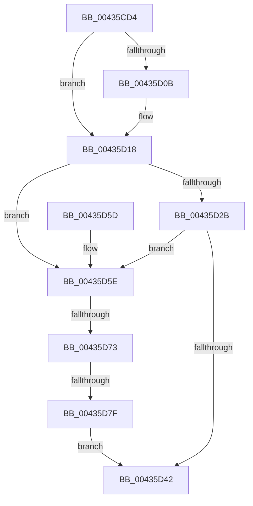

# PoBlockConsoleSwitchEx

- RVA: `0x00435CD4`–`0x00435D86` (길이 `178` bytes)
- VA: `0x0000000140435CD4`
- 실행 섹션: `.text`
- PDB 이름 있음: `예`; PDB Function 태그: `예`
- unwind 정보 RVA: `0x000A2D50`
- 디코드: `53`개 명령, `178/178` bytes 표시
- 미해석 바이트: `0` (있으면 어셈블리에 `.byte`로 보존)

> 이 문서는 커널 이미지의 기계어와 PDB 기호를 분석해 생성했습니다. 4번과 5번은 함수 원형과 자료형을 바이너리 사용 방식에서 추정한 C 해석이며 원본 소스 복구 결과는 아닙니다.

## 1. Dependencies

- 직접 호출 지점: **3**; 고유 호출 대상: **2**
- 직접 호출자로 확인된 함수: **6**
- RIP 상대 이미지 참조: **0**

### Outgoing calls
- `0x00435D1D` → [RtlGetActiveConsoleId](RtlGetActiveConsoleId_function_00436230.md) (function, `0x00436230`)
- `0x00435D37` → [PopDispatchStateCallout](../../page/91/PopDispatchStateCallout_function_0091248C.md) (function, `0x0091248C`)
- `0x00435D42` → [RtlGetActiveConsoleId](RtlGetActiveConsoleId_function_00436230.md) (function, `0x00436230`)

### Direct callers
- [PdcPoBlockSessionSwitchEx](../../page/76/PdcPoBlockSessionSwitchEx_function_00769340.md) at `0x0076936D`
- [PopPowerAggregatorNotifyCsStateExited](../../page/98/PopPowerAggregatorNotifyCsStateExited_function_0098A434.md) at `0x0098A4A4`
- [PopScreenOff](../../page/98/PopScreenOff_function_0098A758.md) at `0x0098A78D`
- [PopAcquireAdaptiveLock](../../page/A3/PopAcquireAdaptiveLock_function_00A3B0E8.md) at `0x00A3B158`
- [PoBlockConsoleSwitch](../../page/AC/PoBlockConsoleSwitch_function_00ACCCA0.md) at `0x00ACCCB1`
- [PopBlockSessionSwitch](../../page/AC/PopBlockSessionSwitch_function_00ACE4C0.md) at `0x00ACE4FA`

### Static image references
- 디코드된 RIP-relative 메모리 참조가 없습니다.

## 2. Other-region calls and transfers

- 다른 실행 섹션으로 향하는 call: **1**
  - `0x00435D37` → [PopDispatchStateCallout](../../page/91/PopDispatchStateCallout_function_0091248C.md) (`.text` → `PAGE`)
- call이 아닌 외부 분기/꼬리 이동: **2**
  - `0x00435D6D` → [sub_006EEE68](../6E/Unknown_function_006EEE68.md) (`tail-transfer`)
  - `0x00435D79` → [sub_006EEE68](../6E/Unknown_function_006EEE68.md) (`tail-transfer`)

## 3. Assembly (complete function range)

```asm
00435CD4  48 89 5C 24 08                  mov qword ptr [rsp + 8], rbx
00435CD9  55                              push rbp
00435CDA  56                              push rsi
00435CDB  57                              push rdi
00435CDC  41 56                           push r14
00435CDE  41 57                           push r15
00435CE0  48 83 EC 20                     sub rsp, 0x20
00435CE4  83 64 24 60 00                  and dword ptr [rsp + 0x60], 0
00435CE9  48 83 CF FF                     or rdi, 0xffffffffffffffff
00435CED  48 C7 44 24 68 60 79 FE FF      mov qword ptr [rsp + 0x68], 0xfffffffffffe7960
00435CF6  4C 8B F2                        mov r14, rdx
00435CF9  48 8B E9                        mov rbp, rcx
00435CFC  49 BF 08 00 00 00 80 F7 FF FF   movabs r15, 0xfffff78000000008
00435D06  4D 85 C0                        test r8, r8
00435D09  74 0D                           je 0x140435d18
00435D0B  49 8B 07                        mov rax, qword ptr [r15]
00435D0E  49 69 38 80 96 98 00            imul rdi, qword ptr [r8], 0x989680
00435D15  48 03 F8                        add rdi, rax
00435D18  BE 01 00 00 00                  mov esi, 1
00435D1D  E8 0E 05 00 00                  call 0x140436230
00435D22  89 44 24 60                     mov dword ptr [rsp + 0x60], eax
00435D26  83 F8 FF                        cmp eax, -1
00435D29  74 33                           je 0x140435d5e
00435D2B  83 65 20 00                     and dword ptr [rbp + 0x20], 0
00435D2F  48 8D 54 24 60                  lea rdx, [rsp + 0x60]
00435D34  48 8B CD                        mov rcx, rbp
00435D37  E8 50 C7 4D 00                  call 0x14091248c
00435D3C  8B D8                           mov ebx, eax
00435D3E  85 C0                           test eax, eax
00435D40  78 1C                           js 0x140435d5e
00435D42  E8 E9 04 00 00                  call 0x140436230
00435D47  41 89 06                        mov dword ptr [r14], eax
00435D4A  8B C3                           mov eax, ebx
00435D4C  48 8B 5C 24 50                  mov rbx, qword ptr [rsp + 0x50]
00435D51  48 83 C4 20                     add rsp, 0x20
00435D55  41 5F                           pop r15
00435D57  41 5E                           pop r14
00435D59  5F                              pop rdi
00435D5A  5E                              pop rsi
00435D5B  5D                              pop rbp
00435D5C  C3                              ret
00435D5D  CC                              int3
00435D5E  B8 1F 85 EB 51                  mov eax, 0x51eb851f
00435D63  F7 E6                           mul esi
00435D65  C1 EA 05                        shr edx, 5
00435D68  6B CA 64                        imul ecx, edx, 0x64
00435D6B  3B F1                           cmp esi, ecx
00435D6D  0F 85 F5 90 2B 00               jne 0x1406eee68
00435D73  49 8B 07                        mov rax, qword ptr [r15]
00435D76  48 3B C7                        cmp rax, rdi
00435D79  0F 82 E9 90 2B 00               jb 0x1406eee68
00435D7F  BB 02 01 00 00                  mov ebx, 0x102
00435D84  EB BC                           jmp 0x140435d42
```

## 4. C-style interpretation (structured pseudocode)

```c
__int64 __fastcall PoBlockConsoleSwitchEx(__int64 a1, __int64 a2, __int64 a3)
{
    __int64 result;
    __int64 v_rdi;
    __int64 v_rsp;
    unsigned int v_stack_p18;
    unsigned __int64 v_stack_p20;
    unsigned __int64 v_stack_p8;

    v_stack_p8 = v_rbx;
    v_rsp = (v_rsp) - (32);
    v_rdi = (v_rdi) | (-1);
    v_stack_p20 = 0xFFFFFFFFFFFE7960ULL;
    if (a3 != 0) {
        result = *(unsigned __int64 *)(v_r15);
        v_rdi = (v_rdi) * (*(unsigned __int64 *)(a3));
        v_rdi = (v_rdi) + (result);
    }
    result = RtlGetActiveConsoleId(a1, a2, a3, a4);
    v_stack_p18 = (unsigned int)(result);
    if (((unsigned int)(result)) == -1) goto loc_00435D5E;
    result = PopDispatchStateCallout(a1, v_stack_p18, a3, a4);
    if (sign_flag) goto loc_00435D5E;
loc_00435D42:
    result = RtlGetActiveConsoleId(a1, v_stack_p18, a3, a4);
    *(unsigned int *)(a2) = (unsigned int)(result);
    v_rsp = (v_rsp) + (32);
    return (unsigned int)((unsigned int)((unsigned int)((unsigned int)(result))));
loc_00435D5E:
    a2 = (unsigned int)((v_stack_p18) >> (5));
    a1 = (unsigned int)((a1) * ((unsigned int)(a2)));
    goto loc_00435D42;
}
```

## 5. (Beta) C Style

```c
int64_t PoBlockConsoleSwitchEx(void *Arg1, void *Arg2, int64_t Arg3)
{
    uint8_t *arg1 = (uint8_t *)Arg1;
    uint8_t *arg2 = (uint8_t *)Arg2;

    int64_t result;
    int64_t local_rdi;
    int64_t local_rsp;
    uint32_t v_stack_p18;
    uint64_t v_stack_p20;
    uint64_t v_stack_p8;

    v_stack_p8 = local_rbx;
    local_rsp = (local_rsp) - (32);
    local_rdi = (local_rdi) | (-1);
    v_stack_p20 = 0xFFFFFFFFFFFE7960ULL;
    if (Arg3 != 0) {
        result = *(uint64_t *)(local_r15);
        local_rdi = (local_rdi) * (*(uint64_t *)(Arg3));
        local_rdi = (local_rdi) + (result);
    }
    result = RtlGetActiveConsoleId(Arg1, Arg2, Arg3, a4);
    v_stack_p18 = (uint32_t)(result);
    if (((uint32_t)(result)) == -1) goto loc_00435D5E;
    result = PopDispatchStateCallout(Arg1, v_stack_p18, Arg3, a4);
    if (sign_flag) goto loc_00435D5E;
loc_00435D42:
    result = RtlGetActiveConsoleId(Arg1, v_stack_p18, Arg3, a4);
    *(uint32_t *)(arg2) = (uint32_t)(result);
    local_rsp = (local_rsp) + (32);
    return (uint32_t)((uint32_t)((uint32_t)((uint32_t)(result))));
loc_00435D5E:
    Arg2 = (uint32_t)((v_stack_p18) >> (5));
    Arg1 = (uint32_t)((Arg1) * ((uint32_t)(Arg2)));
    goto loc_00435D42;
}
```

### 관측된 메모리 오프셋

구조체 형식이 확인되지 않은 접근은 인자 기준의 오프셋으로만 기록했습니다.

| 기준 인자 | 오프셋 표현 | 폭 (bit) | 접근 |
|---|---:|---:|---|
| `Arg1` | `+ 0x20` | `32` | `R/W` |
| `Arg2` | `+ 0x0` | `32` | `W` |

## 6. Execution-region graph

[열기: 2D/3D 그래프와 함수 탐색 컨트롤 패널](../../../control-panel.html?section=text&rva=0x00435CD4&view=graph)

- 2D 그래프는 위에서 아래로 흐르고, 3D 그래프는 빈 공간을 드래그해 회전합니다. Shift+드래그는 이동, 휠은 확대·축소, 함수 노드 선택은 대상 보고서 이동입니다.

### Static fallback


