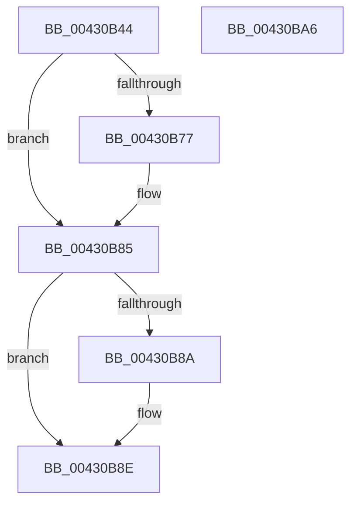

# PopAcquireRwLockExclusive

- RVA: `0x00430B44`–`0x00430BA7` (길이 `99` bytes)
- VA: `0x0000000140430B44`
- 실행 섹션: `.text`
- PDB 이름 있음: `예`; PDB Function 태그: `아니요`
- unwind 정보 RVA: `0x0005CAAC`
- 디코드: `27`개 명령, `99/99` bytes 표시
- 미해석 바이트: `0` (있으면 어셈블리에 `.byte`로 보존)

> 이 문서는 커널 이미지의 기계어와 PDB 기호를 분석해 생성했습니다. 4번과 5번은 함수 원형과 자료형을 바이너리 사용 방식에서 추정한 C 해석이며 원본 소스 복구 결과는 아닙니다.

## 1. Dependencies

- 직접 호출 지점: **2**; 고유 호출 대상: **2**
- 직접 호출자로 확인된 함수: **209**
- RIP 상대 이미지 참조: **0**

### Outgoing calls
- `0x00430B67` → [KeAbPreAcquire](../21/KeAbPreAcquire_function_00210230.md) (function, `0x00210230`)
- `0x00430B80` → [ExfAcquirePushLockExclusiveEx](../20/ExfAcquirePushLockExclusiveEx_function_0020FC90.md) (function, `0x0020FC90`)

### Direct callers
- [PopCoolingTelemetryWorker](../42/PopCoolingTelemetryWorker_function_0042FC3C.md) at `0x0042FC5C`
- [PopCoolingTelemetryWorker](../42/PopCoolingTelemetryWorker_function_0042FC3C.md) at `0x0042FCAB`
- [PopPowerLimitTelemetryWorker](../42/PopPowerLimitTelemetryWorker_function_0042FD20.md) at `0x0042FD3F`
- [PopPowerLimitTelemetryWorker](../42/PopPowerLimitTelemetryWorker_function_0042FD20.md) at `0x0042FD5E`
- [PopGetTransitionsToOnCount](../42/PopGetTransitionsToOnCount_function_0042FDE0.md) at `0x0042FDED`
- [PopThermalCsEntry](../42/PopThermalCsEntry_function_0042FE14.md) at `0x0042FE23`
- [PopCoolingSxTransition](../42/PopCoolingSxTransition_function_0042FEA8.md) at `0x0042FECB`
- [PopCoolingSxTransition](../42/PopCoolingSxTransition_function_0042FEA8.md) at `0x0042FEF2`
- [PopThermalPollingPowerSettingCallback](PopThermalPollingPowerSettingCallback_function_00430720.md) at `0x0043072B`
- [PopWriteBsdPoInfo](PopWriteBsdPoInfo_function_00430768.md) at `0x00430825`
- [PopThermalCoolingPowerSettingCallback](PopThermalCoolingPowerSettingCallback_function_00430950.md) at `0x0043096F`
- [PopPushPowerStateTransitionRecordWithCallback](PopPushPowerStateTransitionRecordWithCallback_function_00430A04.md) at `0x00430A59`
- [PopThermalUpdateTimerPolicy](PopThermalUpdateTimerPolicy_function_00430BEC.md) at `0x00430C38`
- [PopFanSxEntry](../4B/PopFanSxEntry_function_004BEF04.md) at `0x004BEF59`
- [PopIdlePhaseWatchdogCallback](../4C/PopIdlePhaseWatchdogCallback_function_004CB090.md) at `0x004CB11E`
- [PopFanSxExit](../4D/PopFanSxExit_function_004DAA14.md) at `0x004DAA49`
- [PopThermalSxEntry](../4E/PopThermalSxEntry_function_004E3D20.md) at `0x004E3D4F`
- [PopThermalSxEntry](../4E/PopThermalSxEntry_function_004E3D20.md) at `0x004E3D90`
- [PopThermalSxEntry](../4E/PopThermalSxEntry_function_004E3D20.md) at `0x004E3E08`
- [PopPropogateCoolingChange](../4E/PopPropogateCoolingChange_function_004E8FA0.md) at `0x004E9050`
- [PopPropogateCoolingChange](../4E/PopPropogateCoolingChange_function_004E8FA0.md) at `0x004E909C`
- [PpmUpdateIdleDomains](../5D/PpmUpdateIdleDomains_function_005D0B60.md) at `0x005D0B79`
- [PopPowerLimitSxTransition](../5D/PopPowerLimitSxTransition_function_005D0E64.md) at `0x005D0E8B`
- [PopPowerLimitSxTransition](../5D/PopPowerLimitSxTransition_function_005D0E64.md) at `0x005D0EB1`
- [PopPropogateCoolingChangeV2](../5D/PopPropogateCoolingChangeV2_function_005D1058.md) at `0x005D10E5`
- [PopPropogateCoolingChangeV2](../5D/PopPropogateCoolingChangeV2_function_005D1058.md) at `0x005D10EE`
- [PopPropogateCoolingChangeV2](../5D/PopPropogateCoolingChangeV2_function_005D1058.md) at `0x005D119E`
- [PopThermalCsExit](../5D/PopThermalCsExit_function_005D54C8.md) at `0x005D54D3`
- [PopThermalSxExit](../5D/PopThermalSxExit_function_005D55F8.md) at `0x005D5639`
- [PopThermalSxExit](../5D/PopThermalSxExit_function_005D55F8.md) at `0x005D56F3`
- [PopThermalSxExit](../5D/PopThermalSxExit_function_005D55F8.md) at `0x005D5759`
- [PopThermalTelemetryWorker](../5D/PopThermalTelemetryWorker_function_005D57F0.md) at `0x005D5831`
- [PopThermalUpdateTelemetryClientCount](../5D/PopThermalUpdateTelemetryClientCount_function_005D58C4.md) at `0x005D58D3`
- [PopAdaptiveStandbyActivatorCallback](../5D/PopAdaptiveStandbyActivatorCallback_function_005DC590.md) at `0x005DC65B`
- [sub_006F9E40](../6F/Unknown_function_006F9E40.md) at `0x006F9E83`
- [sub_006F9E40](../6F/Unknown_function_006F9E40.md) at `0x006F9ED9`
- [PopPowerAggregatorNotifyAcDcStateChange](../../page/6F/PopPowerAggregatorNotifyAcDcStateChange_function_006FE41C.md) at `0x006FE436`
- [PopPowerAggregatorNotifyDisplayPoweredOn](../../page/70/PopPowerAggregatorNotifyDisplayPoweredOn_function_007003C4.md) at `0x007003CF`
- [PopClearSystemShutdownMarker](../../page/70/PopClearSystemShutdownMarker_function_007030BC.md) at `0x007030C7`
- [PoClearTransitionMarker](../../page/75/PoClearTransitionMarker_function_00753C88.md) at `0x00753D3D`
- [PopClearUserShutdownMarkerWorker](../../page/75/PopClearUserShutdownMarkerWorker_function_00754030.md) at `0x0075403B`
- [PopRecordLongPowerButtonPressDetected](../../page/75/PopRecordLongPowerButtonPressDetected_function_007543BC.md) at `0x007543D6`
- [PopRecordPhysicalPowerButton](../../page/75/PopRecordPhysicalPowerButton_function_00754464.md) at `0x00754485`
- [PopRecordSleepCheckpointSource](../../page/75/PopRecordSleepCheckpointSource_function_007545F4.md) at `0x00754603`
- [PopSetCleanShutdownMarker](../../page/75/PopSetCleanShutdownMarker_function_00754644.md) at `0x0075464F`
- [PopSetUserShutdownMarkerWorker](../../page/75/PopSetUserShutdownMarkerWorker_function_00754680.md) at `0x0075468B`
- [PpmIdleAllocateVetoReasons](../../page/75/PpmIdleAllocateVetoReasons_function_00754D08.md) at `0x00754D26`
- [PpmIdleRegisterDefaultStates](../../page/75/PpmIdleRegisterDefaultStates_function_00755110.md) at `0x0075523F`
- [PpmInstallCoordinatedIdleStates](../../page/75/PpmInstallCoordinatedIdleStates_function_007552A0.md) at `0x007552C2`
- [PpmRegisterVetoList](../../page/75/PpmRegisterVetoList_function_007558B0.md) at `0x007558C9`
- [PoQueryPowerLimitValue](../../page/75/PoQueryPowerLimitValue_function_00755B10.md) at `0x00755B57`
- [PoQueryPowerLimitValue](../../page/75/PoQueryPowerLimitValue_function_00755B10.md) at `0x00755BDF`
- [PoSetPowerLimitValue](../../page/75/PoSetPowerLimitValue_function_00755C30.md) at `0x00755CAA`
- [PopAssociatePowerLimitRequest](../../page/75/PopAssociatePowerLimitRequest_function_00755EC8.md) at `0x00755F0C`
- [PopAssociatePowerLimitRequest](../../page/75/PopAssociatePowerLimitRequest_function_00755EC8.md) at `0x00755F95`
- [PopAssociatePowerLimitRequest](../../page/75/PopAssociatePowerLimitRequest_function_00755EC8.md) at `0x00755FEA`
- [PopDisablePowerLimitExtension](../../page/75/PopDisablePowerLimitExtension_function_00756148.md) at `0x00756170`
- [PopDisablePowerLimitExtension](../../page/75/PopDisablePowerLimitExtension_function_00756148.md) at `0x007561E0`
- [PopEvaluatePowerLimitChange](../../page/75/PopEvaluatePowerLimitChange_function_00756224.md) at `0x0075643B`
- [PopFreePowerLimitRequest](../../page/75/PopFreePowerLimitRequest_function_00756494.md) at `0x007564C7`
- [PopFreePowerLimitRequest](../../page/75/PopFreePowerLimitRequest_function_00756494.md) at `0x007564EB`
- [PopFreePowerLimitRequest](../../page/75/PopFreePowerLimitRequest_function_00756494.md) at `0x00756552`
- [PopFreePowerLimitRequest](../../page/75/PopFreePowerLimitRequest_function_00756494.md) at `0x0075655A`
- [PopFreePowerLimitRequest](../../page/75/PopFreePowerLimitRequest_function_00756494.md) at `0x007565E4`
- [PopFreePowerLimitRequest](../../page/75/PopFreePowerLimitRequest_function_00756494.md) at `0x00756638`
- [PopFreePowerLimitRequest](../../page/75/PopFreePowerLimitRequest_function_00756494.md) at `0x00756657`
- [PopOrphanPowerLimitExtension](../../page/75/PopOrphanPowerLimitExtension_function_007566D8.md) at `0x007566FF`
- [PopOrphanPowerLimitExtension](../../page/75/PopOrphanPowerLimitExtension_function_007566D8.md) at `0x00756708`
- [PopPowerLimitPnpNotification](../../page/75/PopPowerLimitPnpNotification_function_007567C0.md) at `0x00756870`
- [PoSetThermalActiveCooling](../../page/75/PoSetThermalActiveCooling_function_00756D40.md) at `0x00756D85`
- [PopAssociateThermalRequest](../../page/75/PopAssociateThermalRequest_function_00756E78.md) at `0x00756EC7`
- [PopAssociateThermalRequest](../../page/75/PopAssociateThermalRequest_function_00756E78.md) at `0x00756FC1`
- [PopAssociateThermalRequest](../../page/75/PopAssociateThermalRequest_function_00756E78.md) at `0x0075700E`
- [PopCoolingExtensionPnpNotification](../../page/75/PopCoolingExtensionPnpNotification_function_00757110.md) at `0x007571CB`
- [PopDisableCoolingExtension](../../page/75/PopDisableCoolingExtension_function_00757208.md) at `0x00757230`
- [PopDisableCoolingExtension](../../page/75/PopDisableCoolingExtension_function_00757208.md) at `0x007572CC`
- [PopHandleCancelQueryRemove](../../page/75/PopHandleCancelQueryRemove_function_0075730C.md) at `0x00757383`
- [PopHandleCancelQueryRemove](../../page/75/PopHandleCancelQueryRemove_function_0075730C.md) at `0x00757411`
- [PopOrphanCoolingExtension](../../page/75/PopOrphanCoolingExtension_function_00757474.md) at `0x007574A8`
- [PopOrphanCoolingExtension](../../page/75/PopOrphanCoolingExtension_function_00757474.md) at `0x007574B1`
- [PopUnregisterCoolingNotification](../../page/75/PopUnregisterCoolingNotification_function_00757854.md) at `0x0075786A`
- [PopWin32kActivatorCallback](../../page/75/PopWin32kActivatorCallback_function_00758520.md) at `0x00758549`
- [PoRegisterCoalescingCallback](../../page/75/PoRegisterCoalescingCallback_function_0075BF00.md) at `0x0075BF88`
- [PoUnregisterCoalescingCallback](../../page/75/PoUnregisterCoalescingCallback_function_0075C000.md) at `0x0075C06A`
- [PoRegisterForEffectivePowerModeNotifications](../../page/75/PoRegisterForEffectivePowerModeNotifications_function_0075C210.md) at `0x0075C28D`
- [PoUnregisterFromEffectivePowerModeNotifications](../../page/75/PoUnregisterFromEffectivePowerModeNotifications_function_0075C340.md) at `0x0075C36D`
- [PopWnfEffectivePowerModeCallback](../../page/75/PopWnfEffectivePowerModeCallback_function_0075C3B0.md) at `0x0075C3DD`
- [PdcPoLidReliabilityUpdateCallback](../../page/75/PdcPoLidReliabilityUpdateCallback_function_0075F110.md) at `0x0075F14F`
- [PopThermalStateTransitionWorker](../../page/75/PopThermalStateTransitionWorker_function_0075F820.md) at `0x0075F843`
- [PopThermalStateTransitionWorker](../../page/75/PopThermalStateTransitionWorker_function_0075F820.md) at `0x0075F8CE`
- [PopThermalZoneRemove](../../page/75/PopThermalZoneRemove_function_0075FAD0.md) at `0x0075FB5E`
- [NtInitiatePowerAction](../../page/75/NtInitiatePowerAction_function_0075FCB0.md) at `0x0075FE57`
- [PopPowerAggregatorActiveToScreenOffStateHandler](../../page/76/PopPowerAggregatorActiveToScreenOffStateHandler_function_007642F0.md) at `0x0076434C`
- [PopPowerAggregatorDozeTimerWorker](../../page/76/PopPowerAggregatorDozeTimerWorker_function_00764490.md) at `0x007644FF`
- [PopPowerAggregatorEngageModernStandby](../../page/76/PopPowerAggregatorEngageModernStandby_function_00764784.md) at `0x007648B1`
- [PopPowerAggregatorForceSessionSwitch](../../page/76/PopPowerAggregatorForceSessionSwitch_function_007648D0.md) at `0x007648DF`
- [PopPowerAggregatorGetCurrentTargetState](../../page/76/PopPowerAggregatorGetCurrentTargetState_function_00764968.md) at `0x00764978`
- [PopPowerAggregatorNotifyPdcPhaseState](../../page/76/PopPowerAggregatorNotifyPdcPhaseState_function_00764C54.md) at `0x00764C8A`
- [PopPowerAggregatorNotifyResiliencyReached](../../page/76/PopPowerAggregatorNotifyResiliencyReached_function_00764D74.md) at `0x00764D7F`
- [PopPowerAggregatorNotifySystemWake](../../page/76/PopPowerAggregatorNotifySystemWake_function_00764DAC.md) at `0x00764DBB`
- [PopPowerAggregatorPowerSettingCallback](../../page/76/PopPowerAggregatorPowerSettingCallback_function_00764DE0.md) at `0x00764E2E`
- [PopPowerAggregatorScreenOffEnterStateHandler](../../page/76/PopPowerAggregatorScreenOffEnterStateHandler_function_00764E90.md) at `0x00764F92`
- [PopPowerAggregatorSessionSwitchWorker](../../page/76/PopPowerAggregatorSessionSwitchWorker_function_00764FB0.md) at `0x00764FC6`
- [PopPowerAggregatorSnapDiagnosticContext](../../page/76/PopPowerAggregatorSnapDiagnosticContext_function_00765064.md) at `0x0076507C`
- [PopPowerAggregatorSystemTransitionEnterStateHandler](../../page/76/PopPowerAggregatorSystemTransitionEnterStateHandler_function_007650E0.md) at `0x00765164`
- [PopPowerAggregatorSystemTransitionExitStateHandler](../../page/76/PopPowerAggregatorSystemTransitionExitStateHandler_function_00765180.md) at `0x00765229`
- [PopPowerAggregatorTriggerAdaptiveAction](../../page/76/PopPowerAggregatorTriggerAdaptiveAction_function_00765240.md) at `0x0076526A`
- [PopEvaluateInputSuppressionAction](../../page/76/PopEvaluateInputSuppressionAction_function_00765454.md) at `0x0076549C`
- [PopEvaluatePowerButtonSuppressionState](../../page/76/PopEvaluatePowerButtonSuppressionState_function_00765954.md) at `0x007659D2`
- [PopEvaluatePowerButtonSuppressionState](../../page/76/PopEvaluatePowerButtonSuppressionState_function_00765954.md) at `0x00765A1C`
- [PopPowerButtonLidReliabilityUpdated](../../page/76/PopPowerButtonLidReliabilityUpdated_function_00765A68.md) at `0x00765A9A`
- [PopPowerButtonSuppressionUpdateDisableReason](../../page/76/PopPowerButtonSuppressionUpdateDisableReason_function_00765AD8.md) at `0x00765AEE`
- [PopWnfInSupCallback](../../page/76/PopWnfInSupCallback_function_00765B50.md) at `0x00765BAA`
- [PopNotifyPolicyDevice](../../page/76/PopNotifyPolicyDevice_function_00765FF0.md) at `0x00766071`
- [PopPolicyDeviceTargetChange](../../page/76/PopPolicyDeviceTargetChange_function_00766490.md) at `0x007664AF`
- [PopBatteryAdd](../../page/76/PopBatteryAdd_function_00766580.md) at `0x0076662A`
- [PopBatteryRemove](../../page/76/PopBatteryRemove_function_00766D40.md) at `0x00766D70`
- [PopBatteryUpdateTestExempt](../../page/76/PopBatteryUpdateTestExempt_function_00766F54.md) at `0x00766F8A`
- [PopPowerAdapterAdd](../../page/76/PopPowerAdapterAdd_function_00767430.md) at `0x00767528`
- [PopPowerAdapterAdd](../../page/76/PopPowerAdapterAdd_function_00767430.md) at `0x00767737`
- [PopPowerAdapterRemove](../../page/76/PopPowerAdapterRemove_function_00768180.md) at `0x007681E0`
- [PopUsbErrorWNFNotificationCallback](../../page/76/PopUsbErrorWNFNotificationCallback_function_00768470.md) at `0x007684D0`
- [PdcPoNetworkResiliency](../../page/76/PdcPoNetworkResiliency_function_007693A0.md) at `0x007693C0`
- [PdcPoRecordButton](../../page/76/PdcPoRecordButton_function_00769450.md) at `0x0076946A`
- [PopEsInStandbyAcDcCallback](../../page/76/PopEsInStandbyAcDcCallback_function_00769830.md) at `0x0076983B`
- [PopEsPowerSettingPolicyCallback](../../page/76/PopEsPowerSettingPolicyCallback_function_00769870.md) at `0x00769899`
- [PopEsWnfSubscriptionGpAndMdmCallback](../../page/76/PopEsWnfSubscriptionGpAndMdmCallback_function_00769AF0.md) at `0x00769AFB`
- [PopEtEnergyTrackerCleanup](../../page/76/PopEtEnergyTrackerCleanup_function_00769CB4.md) at `0x00769CDA`
- [PopEtEnergyTrackerClose](../../page/76/PopEtEnergyTrackerClose_function_00769EA0.md) at `0x00769EB7`
- [PopEtEnergyTrackerCreate](../../page/76/PopEtEnergyTrackerCreate_function_00769EE0.md) at `0x0076A0C2`
- [PopEtEnergyTrackerCreate](../../page/76/PopEtEnergyTrackerCreate_function_00769EE0.md) at `0x0076A126`
- [PopModernStandbyNotificationCallback](../../page/76/PopModernStandbyNotificationCallback_function_0076AE00.md) at `0x0076AE3A`
- [PopAdaptiveStandbyActionWorker](../../page/76/PopAdaptiveStandbyActionWorker_function_0076C9B0.md) at `0x0076CA31`
- [PopAdaptiveStandbyHandlePowerMessage](../../page/76/PopAdaptiveStandbyHandlePowerMessage_function_0076DB70.md) at `0x0076DC19`
- [PopAdaptiveStandbyInitialize](../../page/76/PopAdaptiveStandbyInitialize_function_0076DDF8.md) at `0x0076DEC6`
- [PopAdaptiveStandbyInitializeActivator](../../page/76/PopAdaptiveStandbyInitializeActivator_function_0076E174.md) at `0x0076E1FA`
- [PopAdaptiveStandbyNotifyShellPhaseState](../../page/76/PopAdaptiveStandbyNotifyShellPhaseState_function_0076E2CC.md) at `0x0076E374`
- [PopAdaptiveStandbyPolicyTimerWorker](../../page/76/PopAdaptiveStandbyPolicyTimerWorker_function_0076E410.md) at `0x0076E48B`
- [PopAdaptiveStandbyPowerSettingCallback](../../page/76/PopAdaptiveStandbyPowerSettingCallback_function_0076E530.md) at `0x0076E5F2`
- [PopAdaptiveStandbyWnfCallback](../../page/76/PopAdaptiveStandbyWnfCallback_function_0076F910.md) at `0x0076F9F0`
- [PpmRegisterProfiles](../../page/77/PpmRegisterProfiles_function_007709F0.md) at `0x00770B5D`
- [PopDirectedDripsUmDirectedFxAddTestDevice](../../page/77/PopDirectedDripsUmDirectedFxAddTestDevice_function_007715D4.md) at `0x00771646`
- [PopDirectedDripsUmDirectedFxRemoveTestDevice](../../page/77/PopDirectedDripsUmDirectedFxRemoveTestDevice_function_007716D4.md) at `0x0077171A`
- [PopDirectedDripsUmDirectedFxSetMode](../../page/77/PopDirectedDripsUmDirectedFxSetMode_function_00771768.md) at `0x00771788`
- [CmCompleteRegistryInitialization](../../page/7D/CmCompleteRegistryInitialization_function_007DF1EC.md) at `0x007DF34D`
- [PoEnergyContextCleanup](../../page/90/PoEnergyContextCleanup_function_00907A38.md) at `0x00907B27`
- [PopUpdateSystemIdleContext](../../page/91/PopUpdateSystemIdleContext_function_00911BB4.md) at `0x00911BE7`
- [PopNotifyCsStateExited](../../page/91/PopNotifyCsStateExited_function_00911F60.md) at `0x00911F6B`
- [PopPowerAggregatorWorker](../../page/91/PopPowerAggregatorWorker_function_00911FB0.md) at `0x00911FBB`
- [PopPowerRequestDelete](../../page/91/PopPowerRequestDelete_function_00913030.md) at `0x00913046`
- [PopTriggerMonitorPowerEvent](../../page/91/PopTriggerMonitorPowerEvent_function_0091446C.md) at `0x009144EA`
- [PopTriggerMonitorPowerEvent](../../page/91/PopTriggerMonitorPowerEvent_function_0091446C.md) at `0x00914590`
- [PopPowerAggregatorHandleIntent](../../page/91/PopPowerAggregatorHandleIntent_function_00914670.md) at `0x00914696`
- [PopResetIdlePhaseWatchdogDiagnosticContext](../../page/91/PopResetIdlePhaseWatchdogDiagnosticContext_function_009149B4.md) at `0x009149BF`
- [PpmSetProfilePolicySetting](../../page/91/PpmSetProfilePolicySetting_function_00915A44.md) at `0x00915E1C`
- [PopWin32kActivatorWorker](../../page/95/PopWin32kActivatorWorker_function_009540C0.md) at `0x009540F2`
- [PopWin32kActivatorWorker](../../page/95/PopWin32kActivatorWorker_function_009540C0.md) at `0x009541AC`
- [PopWin32kActivatorWorker](../../page/95/PopWin32kActivatorWorker_function_009540C0.md) at `0x00954239`
- [NtPowerInformation](../../page/95/NtPowerInformation_function_00955D80.md) at `0x00956E6E`
- [PopPowerAggregatorModernStandbyExitStateHandler](../../page/98/PopPowerAggregatorModernStandbyExitStateHandler_function_00989D90.md) at `0x00989DCB`
- [PopPowerAggregatorDisengageModernStandby](../../page/98/PopPowerAggregatorDisengageModernStandby_function_00989DD8.md) at `0x00989E9F`
- [PopPowerAggregatorScreenOffExitStateHandler](../../page/98/PopPowerAggregatorScreenOffExitStateHandler_function_00989EC0.md) at `0x00989F04`
- [PopPowerAggregatorEnterScreenOff](../../page/98/PopPowerAggregatorEnterScreenOff_function_00989F38.md) at `0x0098A0E4`
- [PopArmIdlePhaseWatchdog](../../page/98/PopArmIdlePhaseWatchdog_function_0098A10C.md) at `0x0098A15D`
- [PopSnapSystemIdleContext](../../page/98/PopSnapSystemIdleContext_function_0098A260.md) at `0x0098A277`
- [PopPowerAggregatorScreenOffActiveToActiveStateHandler](../../page/98/PopPowerAggregatorScreenOffActiveToActiveStateHandler_function_0098A360.md) at `0x0098A39A`
- [PopEtEnergyTrackerQuery](../../page/98/PopEtEnergyTrackerQuery_function_0098B668.md) at `0x0098B781`
- [PoSetProcessEnergyTrackingState](../../page/98/PoSetProcessEnergyTrackingState_function_0098C904.md) at `0x0098C981`
- [PoEnergyContextUpdateComponentPower](../../page/98/PoEnergyContextUpdateComponentPower_function_0098CA08.md) at `0x0098CA69`
- [PopEtProcessSnapshotUpdate](../../page/98/PopEtProcessSnapshotUpdate_function_0098D430.md) at `0x0098D478`
- [PopEtInternerLock](../../page/98/PopEtInternerLock_function_0098DEC0.md) at `0x0098DED3`
- [PopThermalReadCounters](../../page/A0/PopThermalReadCounters_function_00A0E5B8.md) at `0x00A0E5EC`
- [PopThermalReadCounters](../../page/A0/PopThermalReadCounters_function_00A0E5B8.md) at `0x00A0E652`
- [PopPowerRequestSpecialRequestClear](../../page/A2/PopPowerRequestSpecialRequestClear_function_00A21C6C.md) at `0x00A21CD5`
- [PopUpdateConsoleDisplayState](../../page/A3/PopUpdateConsoleDisplayState_function_00A31298.md) at `0x00A313B4`
- [PopRecordDisplayState](../../page/A3/PopRecordDisplayState_function_00A31A08.md) at `0x00A31A17`
- [PopSystemIdleWorker](../../page/A3/PopSystemIdleWorker_function_00A31A60.md) at `0x00A31A87`
- [PopSystemIdleWorker](../../page/A3/PopSystemIdleWorker_function_00A31A60.md) at `0x00A31B25`
- [PopUpdatePdcSystemIdleState](../../page/A3/PopUpdatePdcSystemIdleState_function_00A320B4.md) at `0x00A320C8`
- [PopDiagTraceControlCallback](../../page/A3/PopDiagTraceControlCallback_function_00A38CB0.md) at `0x00A38E2D`
- [PopDiagTraceControlCallback](../../page/A3/PopDiagTraceControlCallback_function_00A38CB0.md) at `0x00A38E4A`
- [PopRundownThermalRequests](../../page/A3/PopRundownThermalRequests_function_00A396B0.md) at `0x00A396D0`
- [PopRundownThermalRequests](../../page/A3/PopRundownThermalRequests_function_00A396B0.md) at `0x00A3971F`
- [PopRundownPowerLimitRequests](../../page/A3/PopRundownPowerLimitRequests_function_00A398C4.md) at `0x00A398E4`
- [PopRundownPowerLimitRequests](../../page/A3/PopRundownPowerLimitRequests_function_00A398C4.md) at `0x00A39903`
- [PpmInstallPlatformIdleStates](../../page/A4/PpmInstallPlatformIdleStates_function_00A46A80.md) at `0x00A46AA6`
- [PopWnfAudioCallback](../../page/A4/PopWnfAudioCallback_function_00A4A0E0.md) at `0x00A4A195`
- [PopEsInStandbyLowPowerEpochCallback](../../page/A4/PopEsInStandbyLowPowerEpochCallback_function_00A4A230.md) at `0x00A4A23B`
- [PopEsWnfSubscriptionOverrideCallback](../../page/A4/PopEsWnfSubscriptionOverrideCallback_function_00A4A3C0.md) at `0x00A4A44B`
- [PopThermalWorker](../../page/A4/PopThermalWorker_function_00A4E200.md) at `0x00A4E26F`
- [PpmEventTraceControlCallback](../../page/A5/PpmEventTraceControlCallback_function_00A51F60.md) at `0x00A52260`
- [PpmProfileAcDcUpdate](../../page/A5/PpmProfileAcDcUpdate_function_00A5280C.md) at `0x00A5283B`
- [PpmApplyProfile](../../page/A5/PpmApplyProfile_function_00A52B08.md) at `0x00A52B4E`
- [PopPowerRequestHandleRequestUpdate](../../page/A6/PopPowerRequestHandleRequestUpdate_function_00A652D8.md) at `0x00A653C2`
- [PopPowerRequestHandleRequestUpdate](../../page/A6/PopPowerRequestHandleRequestUpdate_function_00A652D8.md) at `0x00A6543C`
- [PopAcquirePowerRequestPushLock](../../page/A6/PopAcquirePowerRequestPushLock_function_00A66D94.md) at `0x00A66DA3`
- [PpmUpdateIdleStates](../../page/A7/PpmUpdateIdleStates_function_00A7E370.md) at `0x00A7E3B5`
- [PopNotifyWin32kRequestStatus](../../page/A8/PopNotifyWin32kRequestStatus_function_00A80220.md) at `0x00A8023E`
- [PopBsdFlushWorker](../../page/A8/PopBsdFlushWorker_function_00A82590.md) at `0x00A8259B`
- [PopBsdUpdateWorker](../../page/A8/PopBsdUpdateWorker_function_00A825D0.md) at `0x00A825DB`
- [PopBsdFlush](../../page/A8/PopBsdFlush_function_00A82624.md) at `0x00A82668`
- [PopPowerInformationInternal](../../page/A8/PopPowerInformationInternal_function_00A8B7C0.md) at `0x00A8C2A2`
- [PopPowerInformationInternal](../../page/A8/PopPowerInformationInternal_function_00A8B7C0.md) at `0x00A8CAE9`
- [PopTransitionCheckpoint](../../page/A8/PopTransitionCheckpoint_function_00A8F3E8.md) at `0x00A8F417`
- [PopFanReadFanNoiseInfo](../../page/A9/PopFanReadFanNoiseInfo_function_00A91138.md) at `0x00A91198`
- [PopFanWorker](../../page/A9/PopFanWorker_function_00A9B050.md) at `0x00A9B0A2`
- [PopTransitionTelemetryOsState](../../page/A9/PopTransitionTelemetryOsState_function_00A9DD40.md) at `0x00A9DE43`
- [PoSetThermalPassiveCooling](../../page/AA/PoSetThermalPassiveCooling_function_00AA1540.md) at `0x00AA1577`
- [PopSetConnectedStandbyMarker](../../page/AA/PopSetConnectedStandbyMarker_function_00AA2BA0.md) at `0x00AA2BC3`
- [PopRecordSleepCheckpoint](../../page/AA/PopRecordSleepCheckpoint_function_00AA3EEC.md) at `0x00AA3EFB`
- [PopSetSleepMarker](../../page/AA/PopSetSleepMarker_function_00AA86FC.md) at `0x00AA871D`
- [PopPowerAggregatorNotifyPdcSleepTransition](../../page/AB/PopPowerAggregatorNotifyPdcSleepTransition_function_00AB11E0.md) at `0x00AB1203`
- [PopThermalZoneUpdateCoolingPolicy](../../page/AB/PopThermalZoneUpdateCoolingPolicy_function_00AB1584.md) at `0x00AB15B9`
- [PopClearConnectedStandbyMarker](../../page/AB/PopClearConnectedStandbyMarker_function_00AB38D8.md) at `0x00AB38F7`
- [PopThermalProcessUsermodeEvent](../../page/AB/PopThermalProcessUsermodeEvent_function_00AB7D58.md) at `0x00AB7E3C`
- [PopRecordAcDcState](../../page/AB/PopRecordAcDcState_function_00AB96DC.md) at `0x00AB96EB`
- [PopPowerAggregatorNotifySuspendResume](../../page/AB/PopPowerAggregatorNotifySuspendResume_function_00AB9728.md) at `0x00AB973C`
- [PopClearTransitionCheckpoints](../../page/AB/PopClearTransitionCheckpoints_function_00ABC3FC.md) at `0x00ABC409`
- [PopSleepstudyScenarioStopWorker](../../page/AC/PopSleepstudyScenarioStopWorker_function_00AC0100.md) at `0x00AC010D`
- [PopPowerAggregatorDisplayPoweringOnStateHandler](../../page/AC/PopPowerAggregatorDisplayPoweringOnStateHandler_function_00AC1BA0.md) at `0x00AC1BF1`
- [PopEsPowerSettingBatteryThresholdCallback](../../page/AC/PopEsPowerSettingBatteryThresholdCallback_function_00AC2800.md) at `0x00AC2826`
- [PopSleepstudyStartNextSession](../../page/AC/PopSleepstudyStartNextSession_function_00AC4720.md) at `0x00AC47E5`
- [PopSleepstudyStartNextSession](../../page/AC/PopSleepstudyStartNextSession_function_00AC4720.md) at `0x00AC482B`
- [PopPowerRequestExecutionRequiredSettingCallback](../../page/AC/PopPowerRequestExecutionRequiredSettingCallback_function_00AC4EB0.md) at `0x00AC4ED9`
- [PopClearSleepMarker](../../page/AC/PopClearSleepMarker_function_00AC5498.md) at `0x00AC54A3`
- [PopEsExitSleep](../../page/AC/PopEsExitSleep_function_00AC5AF0.md) at `0x00AC5AFB`
- [PopRecordBatteryPercentage](../../page/AC/PopRecordBatteryPercentage_function_00AC5EB4.md) at `0x00AC5EC3`
- [PopQueryRemainingSystemIdleTime](../../page/AC/PopQueryRemainingSystemIdleTime_function_00AC60B0.md) at `0x00AC60C7`
- [PopPowerRequestRevokeRequestsForSleep](../../page/AC/PopPowerRequestRevokeRequestsForSleep_function_00AC68AC.md) at `0x00AC68B7`
- [PopEsWorker](../../page/AC/PopEsWorker_function_00AC6EE0.md) at `0x00AC6F7D`
- [PopEsWorker](../../page/AC/PopEsWorker_function_00AC6EE0.md) at `0x00AC6F87`
- [PopEsWorker](../../page/AC/PopEsWorker_function_00AC6EE0.md) at `0x00AC6FB0`
- [PopRecordLidStateWorker](../../page/AC/PopRecordLidStateWorker_function_00ACD4D0.md) at `0x00ACD509`
- [PopPowerRequestNotifyTtmSessionInitialized](../../page/AD/PopPowerRequestNotifyTtmSessionInitialized_function_00AD1608.md) at `0x00AD1619`
- [PopEsEnterSleepShutdown](../../page/AD/PopEsEnterSleepShutdown_function_00AD168C.md) at `0x00AD16C7`
- [PopFanUpdateRunningState](../../page/AD/PopFanUpdateRunningState_function_00AD2440.md) at `0x00AD244F`
- [PopPowerRequestNotifyTtmSessionUninitialized](../../page/AD/PopPowerRequestNotifyTtmSessionUninitialized_function_00AD2B30.md) at `0x00AD2B3B`
- [PopSendSuspendResumeNotifications](../../page/AD/PopSendSuspendResumeNotifications_function_00AD425C.md) at `0x00AD428C`
- [PopSendSuspendResumeNotifications](../../page/AD/PopSendSuspendResumeNotifications_function_00AD425C.md) at `0x00AD4305`
- [PopSleepstudySnapModernStandbySessionData](../../page/AD/PopSleepstudySnapModernStandbySessionData_function_00AD529C.md) at `0x00AD52BA`
- [PopFanUpdateCsState](../../page/AD/PopFanUpdateCsState_function_00AD5958.md) at `0x00AD5967`
- [PopSleepstudyCaptureSessionStatistics](../../page/AD/PopSleepstudyCaptureSessionStatistics_function_00AD7554.md) at `0x00AD7755`
- [PopDeactiveThermalRequest](../../page/AD/PopDeactiveThermalRequest_function_00ADF634.md) at `0x00ADF66C`
- [PopDeactiveThermalRequest](../../page/AD/PopDeactiveThermalRequest_function_00ADF634.md) at `0x00ADF6EA`
- [PopDeactiveThermalRequest](../../page/AD/PopDeactiveThermalRequest_function_00ADF634.md) at `0x00ADF6F2`
- [PopDeactiveThermalRequest](../../page/AD/PopDeactiveThermalRequest_function_00ADF634.md) at `0x00ADF79F`
- [PopDeactiveThermalRequest](../../page/AD/PopDeactiveThermalRequest_function_00ADF634.md) at `0x00ADF7E5`
- [PopBatteryApplyCompositeState](../../page/AE/PopBatteryApplyCompositeState_function_00AE0CD0.md) at `0x00AE0F05`
- [PopBatteryApplyCompositeState](../../page/AE/PopBatteryApplyCompositeState_function_00AE0CD0.md) at `0x00AE13D8`
- [PopBatteryWorker](../../page/AE/PopBatteryWorker_function_00AE1650.md) at `0x00AE16E2`
- [PopBatteryWorker](../../page/AE/PopBatteryWorker_function_00AE1650.md) at `0x00AE22CE`
- [PopEvaluateWeakChargerState](../../page/AE/PopEvaluateWeakChargerState_function_00AE2DA0.md) at `0x00AE2DD9`
- [sub_00B39700](../../page/B3/Unknown_function_00B39700.md) at `0x00B3972A`
- [PopUnlockAfterSleepWorker](../../pagelk/B7/PopUnlockAfterSleepWorker_function_00B782A0.md) at `0x00B782AB`
- [PopUnlockAfterSleepWorker](../../pagelk/B7/PopUnlockAfterSleepWorker_function_00B782A0.md) at `0x00B78380`
- [PoDelistPowerStateTransitionBlocker](../../pagelk/B7/PoDelistPowerStateTransitionBlocker_function_00B795D4.md) at `0x00B795F4`
- [PopAcquireTransitionLockAfterSleep](../../pagelk/B7/PopAcquireTransitionLockAfterSleep_function_00B7C61C.md) at `0x00B7C627`
- [PopAcquireTransitionLockAfterSleep](../../pagelk/B7/PopAcquireTransitionLockAfterSleep_function_00B7C61C.md) at `0x00B7C65A`
- [PopDiagInitialize](../../init/C3/PopDiagInitialize_function_00C3F2C0.md) at `0x00C3F3F0`
- [PopInitializeSystemIdleDetection](../../init/C4/PopInitializeSystemIdleDetection_function_00C408EC.md) at `0x00C408F7`
- [PopPowerButtonSuppressionInit](../../init/C4/PopPowerButtonSuppressionInit_function_00C40B00.md) at `0x00C40B11`
- [PopEsInit](../../init/C4/PopEsInit_function_00C42F24.md) at `0x00C42F90`
- [PopModernStandbyNotificationInit](../../init/C4/PopModernStandbyNotificationInit_function_00C43948.md) at `0x00C43963`

### Static image references
- 디코드된 RIP-relative 메모리 참조가 없습니다.

## 2. Other-region calls and transfers

- 다른 실행 섹션으로 향하는 call: **0**
- 별도 외부 분기/꼬리 이동을 확인하지 못했습니다.

## 3. Assembly (complete function range)

```asm
00430B44  48 89 5C 24 08                  mov qword ptr [rsp + 8], rbx
00430B49  57                              push rdi
00430B4A  48 83 EC 20                     sub rsp, 0x20
00430B4E  65 48 8B 04 25 88 01 00 00      mov rax, qword ptr gs:[0x188]
00430B57  45 33 C0                        xor r8d, r8d
00430B5A  33 D2                           xor edx, edx
00430B5C  48 8B D9                        mov rbx, rcx
00430B5F  66 FF 88 E4 01 00 00            dec word ptr [rax + 0x1e4]
00430B66  90                              nop
00430B67  E8 C4 F6 DD FF                  call 0x140210230
00430B6C  F0 48 0F BA 2B 00               lock bts qword ptr [rbx], 0
00430B72  48 8B F8                        mov rdi, rax
00430B75  73 0E                           jae 0x140430b85
00430B77  4C 8B C3                        mov r8, rbx
00430B7A  48 8B D0                        mov rdx, rax
00430B7D  48 8B CB                        mov rcx, rbx
00430B80  E8 0B F1 DD FF                  call 0x14020fc90
00430B85  48 85 FF                        test rdi, rdi
00430B88  74 04                           je 0x140430b8e
00430B8A  C6 47 0A 01                     mov byte ptr [rdi + 0xa], 1
00430B8E  65 48 8B 04 25 88 01 00 00      mov rax, qword ptr gs:[0x188]
00430B97  48 89 43 08                     mov qword ptr [rbx + 8], rax
00430B9B  48 8B 5C 24 30                  mov rbx, qword ptr [rsp + 0x30]
00430BA0  48 83 C4 20                     add rsp, 0x20
00430BA4  5F                              pop rdi
00430BA5  C3                              ret
00430BA6  CC                              int3
```

## 4. C-style interpretation (structured pseudocode)

```c
__int64 __fastcall PopAcquireRwLockExclusive(__int64 a1, int a2, int a3)
{
    __int64 result;
    __int64 v_rsp;
    unsigned __int64 v_stack_p8;

    v_stack_p8 = v_rbx;
    v_rsp = (v_rsp) - (32);
    a3 = 0;
    a2 = 0;
    result = KeAbPreAcquire(a1, a2, a3, a4);
    if (!(condition_is_above_or_equal)) {
        a3 = a1;
        a2 = result;
        a1 = a1;
        result = ExfAcquirePushLockExclusiveEx(a1, a2, a3, a4);
    }
    if (result != 0) {
        *(unsigned __int8 *)(result + 10) = 1;
    }
    *(unsigned __int64 *)(a1 + 8) = *(unsigned __int64 *)(gs_base + (0 + 392));
    v_rsp = (v_rsp) + (32);
    return *(unsigned __int64 *)(gs_base + (0 + 392));
}
```

## 5. (Beta) C Style

```c
int64_t PopAcquireRwLockExclusive(void *Arg1, int32_t Arg2, int32_t Arg3)
{
    uint8_t *arg1 = (uint8_t *)Arg1;

    int64_t result;
    int64_t local_rsp;
    uint64_t v_stack_p8;

    v_stack_p8 = local_rbx;
    local_rsp = (local_rsp) - (32);
    Arg3 = 0;
    Arg2 = 0;
    result = KeAbPreAcquire(Arg1, Arg2, Arg3, a4);
    if (!(condition_is_above_or_equal)) {
        Arg3 = Arg1;
        Arg2 = result;
        Arg1 = Arg1;
        result = ExfAcquirePushLockExclusiveEx(Arg1, Arg2, Arg3, a4);
    }
    if (result != 0) {
        *(uint8_t *)(result + 0xA) = 1;
    }
    *(uint64_t *)(arg1 + 0x8) = *(uint64_t *)(gs_base + (0 + 0x188));
    local_rsp = (local_rsp) + (32);
    return *(uint64_t *)(gs_base + (0 + 0x188));
}
```

### 관측된 메모리 오프셋

구조체 형식이 확인되지 않은 접근은 인자 기준의 오프셋으로만 기록했습니다.

| 기준 인자 | 오프셋 표현 | 폭 (bit) | 접근 |
|---|---:|---:|---|
| `Arg1` | `+ 0x0` | `64` | `R/W` |
| `Arg1` | `+ 0x8` | `64` | `W` |

## 6. Execution-region graph

[열기: 2D/3D 그래프와 함수 탐색 컨트롤 패널](../../../control-panel.html?section=text&rva=0x00430B44&view=graph)

- 2D 그래프는 위에서 아래로 흐르고, 3D 그래프는 빈 공간을 드래그해 회전합니다. Shift+드래그는 이동, 휠은 확대·축소, 함수 노드 선택은 대상 보고서 이동입니다.

### Static fallback


